# Consultas SQL de PedalLibre en cuatro motores

## Introducción

En este informe documento las consultas que voy a ejecutar en DBeaver sobre las bases de datos de PedalLibre. Tomo como referencia los ejemplos de consulta de las guías docentes de [MySQL](https://tecnogua.com/academic/site/bd/gestion/mysql/mysql/), [PostgreSQL](https://tecnogua.com/academic/site/bd/gestion/postgresql/postgresql/), [Microsoft SQL Server](https://tecnogua.com/academic/site/bd/gestion/mssql/mssql/) y [Oracle](https://tecnogua.com/academic/site/bd/gestion/oracle/oracle/), y adapto esos ejemplos a las tablas reales del proyecto.

Me concentro en consultas de lectura para revisar registros, filtrar resultados, relacionar tablas y resumir información. No creo ni modifico tablas ni defino triggers en este informe. Para los triggers de auditoría ya instalados, incluyo únicamente referencias a su proceso de creación, scripts separados de datos de prueba y consultas para revisar cada acción. Presento las consultas principales con sintaxis común a los cuatro motores y separo los límites de resultados cuando cambia la sintaxis.

## Base de datos y tablas

En la carpeta [Creacion de Tablas y Reguistros](<./Creacion%20de%20Tablas%20y%20Reguistros/>) consulté la guía del esquema y los scripts de datos de prueba. Identifiqué 21 tablas del dominio PedalLibre: `roles`, `users`, `clients`, `stations`, `station_locations`, `station_schedules`, `docking_points`, `bicycles`, `bicycle_dockings`, `reservations`, `rates`, `rentals`, `rental_events`, `penalties`, `maintenance`, `payments`, `incidents`, `notifications`, `bicycle_history`, `reviews` e `invoices`. Verifiqué en la guía de inserción y en la semilla MySQL la expectativa de 100 registros por tabla; tomo como base que los datos ya están cargados en los cuatro motores. En DBeaver validaré la base seleccionada y los conteos antes de empezar con las consultas.

Por tanto, consultaré las tablas adicionales del proyecto que identifiqué en sus archivos SQL, creadas sobre cada motor y no automáticamente al instalar MySQL, PostgreSQL, SQL Server u Oracle. Todavía no he abierto las conexiones locales para comprobar en vivo el estado actual de cada servidor.

### Conexiones que usaré

| Motor                | Base de datos o esquema indicado    |
| -------------------- | ----------------------------------- |
| MySQL                | `Pedalibre-Terminal-Dbeaver`      |
| Microsoft SQL Server | `Pedalibre-Terminal-Dbeaver`      |
| PostgreSQL           | `Pedalibre-Terminal-Dbeaver`      |
| Oracle               | Esquema`PEDALIBRETERMINALDBEAVER` |

**MySQL:** Tomo de la guía del esquema y del script de datos de prueba el nombre de la base `Pedalibre-Terminal-Dbeaver`. Antes de ejecutar, confirmo con `SELECT DATABASE()` que esa sea la base seleccionada en DBeaver.

## Procedimiento en DBeaver

1. Abro DBeaver y localizo la conexión correspondiente al motor con el que voy a trabajar.
2. Confirmo que la conexión esté activa y selecciono la base de datos o el esquema de la tabla PedalLibre. Para Oracle uso el esquema `PEDALIBRETERMINALDBEAVER`.
3. Abro un editor SQL asociado a esa conexión y verifico el nombre de la conexión/base antes de ejecutar cualquier comando.
4. Compruebo que existen las tablas del proyecto con el comando de inspección indicado para el motor. Si no aparecen `bicycles`, `rentals`, `payments` y las demás tablas del esquema, detengo la ejecución y corrijo la conexión o el esquema seleccionado.
5. Ejecuto una consulta a la vez: selecciono el bloque completo y uso **Ejecutar sentencia** en DBeaver. Mantengo todas las consultas de este informe en modo de solo lectura.
6. Reviso las filas devueltas en la cuadrícula de resultados y tengo presente que pueden variar según los datos cargados en la base.
7. Debajo de cada bloque SQL identifico la ruta de la captura pendiente. Tomo en DBeaver una imagen que muestre conexión, sentencia y resultado, y la guardo con ese nombre en `trazabilidad/`. Después completo lo que observo y aprendo basándome en las filas reales. Para MySQL, ejecuto cada consulta de esta sección individualmente en DBeaver.

## Consultas principales

En los siguientes bloques presento SQL compatible con los cuatro motores. Los ejecuto después de seleccionar la base o esquema correcto en DBeaver.

### 1. Consultar bicicletas disponibles

Reviso las bicicletas que están disponibles y ordeno el resultado por identificador.

```sql
SELECT bicycle_id, serial_number, bicycle_type, status
FROM bicycles
WHERE status = 'available'
ORDER BY bicycle_id;
```

**Evidencia de ejecucion:**
**MySQL: Consultar bicicletas disponibles**


**Retroalimentacion:** Con esta sentencia filtro `bicycles` por `status = 'available'` y ordeno por identificador. En la captura observo 80 filas recuperadas y todas tienen estado `available`.

**PostgreSQL: Consultar bicicletas disponibles**


**Retroalimentacion:** Con esta sentencia filtro `bicycles` por `status = 'available'` y ordeno por identificador. En la captura observo 80 filas recuperadas y todas tienen estado `available`.

**SQL Server: Consultar bicicletas disponibles**


**Retroalimentacion:** Con esta sentencia filtro `bicycles` por `status = 'available'` y ordeno por identificador. En la captura observo 80 filas recuperadas y todas tienen estado `available`.

**Oracle: Consultar bicicletas disponibles**


**Retroalimentacion:** Con esta sentencia filtro `bicycles` por `status = 'available'` y ordeno por identificador. En la captura observo 80 filas recuperadas y todas tienen estado `available`.

**Lo que aprendi:** Aprendi que `WHERE` permite seleccionar solo las bicicletas disponibles y `ORDER BY` organiza su identificador.

### 2. Consultar alquileres completados

Aplico un filtro por estado y ordeno los alquileres desde el más reciente. Con esta consulta obtengo todos los alquileres completados; en la sección de cada motor limito el resultado a 10 filas con la sintaxis correspondiente.

```sql
SELECT rental_id, client_id, bicycle_id, started_at, ended_at, total_amount, status
FROM rentals
WHERE status = 'completed'
ORDER BY started_at DESC;
```

**Evidencia de ejecucion:**
**MySQL: Consultar alquileres completados**


**Retroalimentacion:** Con esta sentencia filtro `rentals` por estado `completed` y ordeno los inicios en forma descendente. En la captura observo 67 alquileres completados, del más reciente al más antiguo.

**PostgreSQL: Consultar alquileres completados**


**Retroalimentacion:** Con esta sentencia filtro `rentals` por estado `completed` y ordeno los inicios en forma descendente. En la captura observo 67 alquileres completados, del más reciente al más antiguo.

**SQL Server: Consultar alquileres completados**


**Retroalimentacion:** Con esta sentencia filtro `rentals` por estado `completed` y ordeno los inicios en forma descendente. En la captura observo 67 alquileres completados, del más reciente al más antiguo.

**Oracle: Consultar alquileres completados**


**Retroalimentacion:** Con esta sentencia filtro `rentals` por estado `completed` y ordeno los inicios en forma descendente. En la captura observo 67 alquileres completados, del más reciente al más antiguo.

**Lo que aprendi:** Aprendi a filtrar los alquileres por estado y ordenar los mas recientes primero; la variante del motor limita las filas mostradas.

### 3. Consultar detalle de alquileres relacionados

Relaciono alquileres, clientes, bicicletas, tarifa y estaciones. Uso `LEFT JOIN` para conservar el alquiler aunque no tenga estación de inicio o fin asociada.

```sql
SELECT
    r.rental_id,
    c.first_name,
    c.last_name,
    b.serial_number,
    rate.name AS rate_name,
    start_station.name AS start_station,
    end_station.name AS end_station,
    r.started_at,
    r.ended_at,
    r.status,
    r.total_amount
FROM rentals r
JOIN clients c ON c.client_id = r.client_id
JOIN bicycles b ON b.bicycle_id = r.bicycle_id
JOIN rates rate ON rate.rate_id = r.rate_id
LEFT JOIN stations start_station ON start_station.station_id = r.start_station_id
LEFT JOIN stations end_station ON end_station.station_id = r.end_station_id
ORDER BY r.started_at DESC;
```

**Evidencia de ejecucion:**
**MySQL: Consultar detalle de alquileres relacionados**


**Retroalimentacion:** En el resultado identifico el alquiler junto con el nombre del cliente, el serial de la bicicleta, la tarifa y las estaciones de inicio y fin. Observo 100 filas recuperadas; uso `JOIN` para combinar las entidades relacionadas y `LEFT JOIN` para conservar cada alquiler aunque alguna estación no esté asociada.

**PostgreSQL: Consultar detalle de alquileres relacionados**


**Retroalimentacion:** En el resultado identifico el alquiler junto con el nombre del cliente, el serial de la bicicleta, la tarifa y las estaciones de inicio y fin. Observo 100 filas recuperadas; uso `JOIN` para combinar las entidades relacionadas y `LEFT JOIN` para conservar cada alquiler aunque alguna estación no esté asociada.

**SQL Server: Consultar detalle de alquileres relacionados**


**Retroalimentacion:** En el resultado identifico el alquiler junto con el nombre del cliente, el serial de la bicicleta, la tarifa y las estaciones de inicio y fin. Observo 100 filas recuperadas; uso `JOIN` para combinar las entidades relacionadas y `LEFT JOIN` para conservar cada alquiler aunque alguna estación no esté asociada.

**Oracle: Consultar detalle de alquileres relacionados**


**Retroalimentacion:** En el resultado identifico el alquiler junto con el nombre del cliente, el serial de la bicicleta, la tarifa y las estaciones de inicio y fin. Observo 100 filas recuperadas; uso `JOIN` para combinar las entidades relacionadas y `LEFT JOIN` para conservar cada alquiler aunque alguna estación no esté asociada.

**Lo que aprendi:** Aprendi que puedo reunir datos relacionados con `JOIN` y conservar estaciones opcionales con `LEFT JOIN`.

### 4. Resumir alquileres por estado

Uso `GROUP BY` y funciones de agregado para comparar la cantidad y el importe promedio por estado. Con `HAVING` conservo los grupos cuyo importe total es mayor que cero.

```sql
SELECT
    status,
    COUNT(*) AS rental_count,
    SUM(total_amount) AS total_amount,
    AVG(total_amount) AS average_amount
FROM rentals
GROUP BY status
HAVING SUM(total_amount) > 0
ORDER BY status;
```

**Evidencia de ejecucion:**
**MySQL: Resumir alquileres por estado**


**Retroalimentacion:** Agrupo los alquileres por estado y calculo la cantidad, el importe total y el promedio. Observo tres grupos: 16 `active`, 17 `cancelled` y 67 `completed`; sus importes totales son 132.808, 140.629 y 528.213, respectivamente.

**PostgreSQL: Resumir alquileres por estado**


**Retroalimentacion:** Agrupo los alquileres por estado y calculo la cantidad, el importe total y el promedio. Observo tres grupos: 16 `active`, 17 `cancelled` y 67 `completed`; sus importes totales son 132.808, 140.629 y 528.213, respectivamente.

**SQL Server: Resumir alquileres por estado**


**Retroalimentacion:** Agrupo los alquileres por estado y calculo la cantidad, el importe total y el promedio. Observo tres grupos: 16 `active`, 17 `cancelled` y 67 `completed`; sus importes totales son 132.808, 140.629 y 528.213, respectivamente.

**Oracle: Resumir alquileres por estado**


**Retroalimentacion:** Agrupo los alquileres por estado y calculo la cantidad, el importe total y el promedio. Observo tres grupos: 16 `active`, 17 `cancelled` y 67 `completed`; sus importes totales son 132.808, 140.629 y 528.213, respectivamente.

**Lo que aprendi:** Aprendi a agrupar alquileres por estado y resumirlos con `COUNT`, `SUM` y `AVG`.

### 5. Resumir pagos por método y estado

Consulto el número de pagos y el importe total agrupados por método y estado.

```sql
SELECT
    payment_method,
    status,
    COUNT(*) AS payment_count,
    SUM(amount) AS total_paid
FROM payments
GROUP BY payment_method, status
ORDER BY payment_method, status;
```

**Evidencia de ejecucion:**
**MySQL: Resumir pagos por metodo y estado**


**Retroalimentacion:** Agrupo los pagos por método y estado y consulto la cantidad y la suma de los importes. Observo 12 combinaciones entre `credit_card`, `debit_card`, `digital_wallet` y `pse`, cada una con los estados `paid`, `pending` o `refunded`.

**PostgreSQL: Resumir pagos por metodo y estado**


**Retroalimentacion:** Agrupo los pagos por método y estado y consulto la cantidad y la suma de los importes. Observo 12 combinaciones entre `credit_card`, `debit_card`, `digital_wallet` y `pse`, cada una con los estados `paid`, `pending` o `refunded`.

**SQL Server: Resumir pagos por metodo y estado**


**Retroalimentacion:** Agrupo los pagos por método y estado y consulto la cantidad y la suma de los importes. Observo 12 combinaciones entre `credit_card`, `debit_card`, `digital_wallet` y `pse`, cada una con los estados `paid`, `pending` o `refunded`.

**Oracle: Resumir pagos por metodo y estado**


**Retroalimentacion:** Agrupo los pagos por método y estado y consulto la cantidad y la suma de los importes. Observo 12 filas. Identifico `digital_wallet` en una fila y `digital_Wallet` en otra; al distinguir la capitalización, Oracle separa esas variantes en grupos distintos.

**Lo que aprendi:** Aprendi a agrupar pagos por metodo y estado para comparar cantidades e importes.

## Comandos específicos de cada motor

### MySQL

Me conecto a la base indicada y verifico el esquema. Si la lista está vacía o no corresponde a PedalLibre, no continúo hasta seleccionar la base correcta.

```sql
SELECT DATABASE() AS base_actual;
```

Compruebo que la respuesta sea `Pedalibre-Terminal-Dbeaver`. Si observo otro nombre, cambio la conexión activa en DBeaver antes de continuar.

**Evidencia de ejecucion:**
**MySQL: Verificar la base de datos activa**


**Retroalimentacion:** Con `SELECT DATABASE()` identifico la base MySQL activa en esta conexión. Observo `Pedalibre-Terminal-Dbeaver` y confirmo que ejecuto la consulta en la base indicada.

**Lo que aprendi:** Aprendi a comprobar la base activa antes de consultar sus tablas.

```sql
SHOW TABLES;
```

**Evidencia de ejecucion:**
**MySQL: Verificar las tablas de la base**


**Retroalimentacion:** Uso `SHOW TABLES` para listar las tablas visibles en la base MySQL seleccionada, sin consultar sus registros. Observo 21 tablas del proyecto, entre ellas `bicycles`, `clients`, `payments` y `rentals`, y confirmo que el esquema esperado está visible en DBeaver.

**Lo que aprendi:** Aprendi a comprobar que tablas estan visibles en la base seleccionada de MySQL.

Para confirmar la carga de los datos de prueba, cuento las filas de las 21 tablas. Tomo como referencia los 100 registros por tabla indicados en la guía de inserción y comparo ese valor con el resultado que me muestra DBeaver.

```sql
SELECT 'roles' AS tabla, COUNT(*) AS registros FROM roles
UNION ALL SELECT 'users', COUNT(*) FROM users
UNION ALL SELECT 'clients', COUNT(*) FROM clients
UNION ALL SELECT 'stations', COUNT(*) FROM stations
UNION ALL SELECT 'station_locations', COUNT(*) FROM station_locations
UNION ALL SELECT 'station_schedules', COUNT(*) FROM station_schedules
UNION ALL SELECT 'docking_points', COUNT(*) FROM docking_points
UNION ALL SELECT 'bicycles', COUNT(*) FROM bicycles
UNION ALL SELECT 'bicycle_dockings', COUNT(*) FROM bicycle_dockings
UNION ALL SELECT 'rates', COUNT(*) FROM rates
UNION ALL SELECT 'reservations', COUNT(*) FROM reservations
UNION ALL SELECT 'rentals', COUNT(*) FROM rentals
UNION ALL SELECT 'rental_events', COUNT(*) FROM rental_events
UNION ALL SELECT 'penalties', COUNT(*) FROM penalties
UNION ALL SELECT 'maintenance', COUNT(*) FROM maintenance
UNION ALL SELECT 'payments', COUNT(*) FROM payments
UNION ALL SELECT 'incidents', COUNT(*) FROM incidents
UNION ALL SELECT 'notifications', COUNT(*) FROM notifications
UNION ALL SELECT 'bicycle_history', COUNT(*) FROM bicycle_history
UNION ALL SELECT 'reviews', COUNT(*) FROM reviews
UNION ALL SELECT 'invoices', COUNT(*) FROM invoices
ORDER BY tabla;
```

**Evidencia de ejecucion:**
**MySQL: Contar registros por tabla**


**Retroalimentacion:** Cuento las filas de cada una de las 21 tablas. Observo que cada tabla muestra 100 registros, coincidiendo con la cantidad esperada en la guía de inserción.

**Lo que aprendi:** Aprendi a validar con `COUNT(*)` la cantidad de registros cargados antes de analizar los datos.

Para limitar los alquileres completados a 10 filas, agrego `LIMIT 10` al final de la consulta:

```sql
SELECT rental_id, client_id, bicycle_id, started_at, ended_at, total_amount, status
FROM rentals
WHERE status = 'completed'
ORDER BY started_at DESC
LIMIT 10;
```

**Evidencia de ejecucion:**
**MySQL: Mostrar los 10 alquileres completados mas recientes**


**Retroalimentacion:** Con `LIMIT 10` restrinjo la salida a los 10 alquileres completados más recientes, ordenados por fecha de inicio descendente. Observo diez filas con estado `completed`; identifico la primera como el registro más reciente mostrado.

**Lo que aprendi:** Aprendi a filtrar los alquileres por estado y ordenar los mas recientes primero; la variante del motor limita las filas mostradas.

### PostgreSQL

Verifico qué tablas están visibles en el esquema `public`:

```sql
SELECT table_name
FROM information_schema.tables
WHERE table_schema = 'public'
  AND table_type = 'BASE TABLE'
ORDER BY table_name;
```

**Evidencia de ejecucion:**
**PostgreSQL: Verificar las tablas de la base**


**Retroalimentacion:** Consulto el catálogo `information_schema.tables` y filtro el esquema `public` para mostrar solo tablas base. Observo las 21 tablas del proyecto PedalLibre.

**Lo que aprendi:** Aprendi a consultar el catalogo de PostgreSQL para verificar las tablas del esquema `public`.

Para limitar la consulta de alquileres completados a 10 filas, uso `LIMIT 10`:

```sql
SELECT rental_id, client_id, bicycle_id, started_at, ended_at, total_amount, status
FROM rentals
WHERE status = 'completed'
ORDER BY started_at DESC
LIMIT 10;
```

**Evidencia de ejecucion:**
**PostgreSQL: Mostrar los 10 alquileres completados mas recientes**


**Retroalimentacion:** Con `LIMIT 10` limito la salida a los 10 alquileres completados con fecha de inicio más reciente. Observo diez filas, todas con estado `completed`, ordenadas por `started_at` descendente.

**Lo que aprendi:** Aprendi a filtrar los alquileres por estado y ordenar los mas recientes primero; la variante del motor limita las filas mostradas.

### Microsoft SQL Server

Verifico qué tablas pertenecen al esquema actual:

```sql
SELECT TABLE_SCHEMA, TABLE_NAME
FROM INFORMATION_SCHEMA.TABLES
WHERE TABLE_TYPE = 'BASE TABLE'
ORDER BY TABLE_SCHEMA, TABLE_NAME;
```

**Evidencia de ejecucion:**
**SQL Server: Verificar las tablas de la base**


**Retroalimentacion:** Consulto `INFORMATION_SCHEMA.TABLES` para ver el esquema y el nombre de cada tabla base. Observo las 21 tablas del proyecto bajo el esquema `dbo`.

**Lo que aprendi:** Aprendi a consultar `INFORMATION_SCHEMA` para identificar las tablas del esquema de SQL Server.

Para limitar la consulta de alquileres completados a 10 filas, uso `TOP (10)`:

```sql
SELECT TOP (10)
    rental_id, client_id, bicycle_id, started_at, ended_at, total_amount, status
FROM rentals
WHERE status = 'completed'
ORDER BY started_at DESC;
```

**Evidencia de ejecucion:**
**SQL Server: Mostrar los 10 alquileres completados mas recientes**


**Retroalimentacion:** Con `TOP (10)` limito la salida a diez alquileres completados, ordenados por fecha de inicio descendente. Observo diez filas y confirmo que todos muestran el estado `completed`.

**Lo que aprendi:** Aprendi a filtrar los alquileres por estado y ordenar los mas recientes primero; la variante del motor limita las filas mostradas.

### Oracle

Verifico las tablas accesibles con mi usuario conectado. Al conectarme al esquema `PEDALIBRETERMINALDBEAVER`, consulto sus tablas en `USER_TABLES`.

```sql
SELECT table_name
FROM user_tables
ORDER BY table_name;
```

**Evidencia de ejecucion:**
**Oracle: Verificar las tablas de la base**


**Retroalimentacion:** Consulto `USER_TABLES` para listar las tablas que pertenecen al usuario conectado. Observo las 21 tablas de PedalLibre en el esquema `PEDALIBRETERMINALDBEAVER`.

**Lo que aprendi:** Aprendi a revisar las tablas que pertenecen al usuario/esquema Oracle conectado.

Para limitar la consulta de alquileres completados a 10 filas, uso `FETCH FIRST 10 ROWS ONLY`:

```sql
SELECT rental_id, client_id, bicycle_id, started_at, ended_at, total_amount, status
FROM rentals
WHERE status = 'completed'
ORDER BY started_at DESC
FETCH FIRST 10 ROWS ONLY;
```

**Evidencia de ejecucion:**
**Oracle: Mostrar los 10 alquileres completados mas recientes**


**Retroalimentacion:** Con `FETCH FIRST 10 ROWS ONLY` limito la salida a diez alquileres completados, ordenados por fecha de inicio descendente. Observo diez filas y confirmo que todas tienen estado `completed`.

**Lo que aprendi:** Aprendi que Oracle puede limitar filas con `FETCH FIRST`, mientras que PostgreSQL usa `LIMIT` y SQL Server usa `TOP`.

**Retroalimentacion:** Con `LIMIT 10` restrinjo la salida a los 10 alquileres completados más recientes. Dejo pendiente la captura de la ejecución y el resultado de esta variante.

**Lo que aprendi:** Aprendi a filtrar los alquileres por estado y ordenar los mas recientes primero; la variante del motor limita las filas mostradas.

## Consultas adicionales por motor

En esta sección presento análisis propios de cada motor. Ya ejecuté las consultas adicionales de MySQL; para PostgreSQL, SQL Server y Oracle seleccioné temas y funciones diferentes, sin repetir los análisis de las otras secciones. Ejecuto cada grupo solo en la conexión indicada.

### MySQL

**Ejecución en DBeaver:** no envío `DELIMITER` al servidor ni ejecuto todo el bloque como una sola sentencia. Ejecuto primero el `DROP PROCEDURE` (si aparece); después selecciono únicamente desde `CREATE PROCEDURE` hasta su `END;` y uso **Ejecutar SQL (Ctrl+Enter)**; por último ejecuto el `CALL`. Si selecciono el bloque entero, los puntos y coma internos del cuerpo pueden separarlo y provocar errores de sintaxis.

#### Clientes con más alquileres

```sql
SELECT
    c.client_id,
    c.first_name,
    c.last_name,
    COUNT(r.rental_id) AS rental_count
FROM clients c
LEFT JOIN rentals r ON r.client_id = c.client_id
GROUP BY c.client_id, c.first_name, c.last_name
ORDER BY rental_count DESC, c.client_id
LIMIT 5;
```

**Evidencia de ejecucion:**
**MySQL: Identificar clientes con mas alquileres**


**Retroalimentacion:** Cuento los alquileres por cliente y consulto los cinco valores más altos; con `LEFT JOIN` también conservo a los clientes sin alquileres. En el resultado observo cinco clientes con un alquiler cada uno; el desempate por `client_id` los ordena de forma ascendente.

**Lo que aprendi:** Aprendi a combinar `LEFT JOIN`, `COUNT` y orden descendente para encontrar los clientes con mas alquileres, incluidos quienes aun no tienen uno.

**Proceso y procedimiento parametrizado:** [Consultar pasos y procedimiento de clientes con más alquileres](#sp-mysql-clientes-mas-alquileres).

#### Puntos de anclaje disponibles por estación

```sql
SELECT
    s.station_id,
    s.name AS station_name,
    COUNT(dp.docking_point_id) AS docking_point_count,
    SUM(CASE WHEN dp.status = 'available' THEN 1 ELSE 0 END) AS available_points
FROM stations s
LEFT JOIN docking_points dp ON dp.station_id = s.station_id
GROUP BY s.station_id, s.name
ORDER BY s.station_id;
```

**Evidencia de ejecucion:**
**MySQL: Contar anclajes disponibles por estacion**


**Retroalimentacion:** Agrupo los puntos de anclaje por estación, cuento los puntos asociados y sumo los disponibles con `CASE`. En la captura observo 100 filas; en las estaciones visibles identifico un punto asociado por estación y `available_points` vale 0 o 1 según su estado.

**Lo que aprendi:** Aprendi a contar los puntos de anclaje de cada estacion y a usar `CASE` para contar los disponibles.

**Proceso y procedimiento parametrizado:** [Consultar pasos y procedimiento de anclajes por estación](#sp-mysql-anclajes-estacion).

#### Incidentes abiertos

```sql
SELECT
    i.incident_id,
    i.severity,
    i.description,
    i.reported_at,
    b.serial_number,
    c.first_name,
    c.last_name
FROM incidents i
LEFT JOIN bicycles b ON b.bicycle_id = i.bicycle_id
LEFT JOIN clients c ON c.client_id = i.client_id
WHERE i.status = 'open'
ORDER BY i.reported_at DESC;
```

**Evidencia de ejecucion:**
**MySQL: Consultar incidentes abiertos**


**Retroalimentacion:** Filtro los incidentes `open` y uso `LEFT JOIN` para añadir los datos de bicicleta y cliente cuando están asociados. En la cuadrícula observo 25 filas con distintos niveles de severidad y las descripciones de los incidentes.

**Lo que aprendi:** Aprendi a filtrar incidentes abiertos y anadir datos opcionales de la bicicleta y del cliente con `LEFT JOIN`.

**Proceso y procedimiento parametrizado:** [Consultar pasos y procedimiento de incidentes abiertos](#sp-mysql-incidentes-abiertos).

#### Ingresos pagados por mes

```sql
SELECT
    DATE_FORMAT(paid_at, '%Y-%m') AS payment_month,
    COUNT(*) AS payment_count,
    SUM(amount) AS monthly_total
FROM payments
WHERE status = 'paid'
  AND paid_at IS NOT NULL
GROUP BY DATE_FORMAT(paid_at, '%Y-%m')
ORDER BY payment_month;
```

**Evidencia de ejecucion:**
**MySQL: Resumir pagos realizados por mes**


**Retroalimentacion:** Selecciono los pagos con estado `paid` y fecha registrada, los agrupo por mes con `DATE_FORMAT` y sumo sus importes. Observo 71 pagos de octubre de 2026 y un total mensual de 568.145.

**Lo que aprendi:** Aprendi a agrupar los pagos completados por mes; la funcion para expresar ano y mes depende del motor.

**Proceso y procedimiento parametrizado:** [Consultar pasos y procedimiento de ingresos mensuales](#sp-mysql-ingresos-mensuales).

### PostgreSQL

#### Volumen semanal de alquileres

```sql
SELECT
    date_trunc('week', started_at)::date AS week_start,
    COUNT(*) AS rental_count,
    COUNT(*) FILTER (WHERE status = 'completed') AS completed_count,
    COALESCE(SUM(total_amount) FILTER (WHERE status = 'completed'), 0) AS completed_amount
FROM rentals
GROUP BY date_trunc('week', started_at)::date
ORDER BY week_start;
```

**Evidencia de ejecucion:**
**PostgreSQL: Resumir alquileres por semana**


**Retroalimentacion:** Uso `date_trunc('week', ...)` para agrupar las fechas por semana y agregados con `FILTER` para separar el total de alquileres de los completados y sumar el importe completado. Observo una semana que inicia el 5 de octubre de 2026, con 100 alquileres, 67 completados y un importe de 528.213.

**Lo que aprendi:** Aprendere a usar `date_trunc` y agregados filtrados para analizar la actividad semanal en PostgreSQL.

**Proceso y procedimiento parametrizado:** [Consultar pasos y procedimiento de volumen semanal](#sp-postgresql-volumen-semanal).

#### Tiempo promedio de uso de anclajes por estación

```sql
SELECT
    s.station_id,
    s.name AS station_name,
    COUNT(bd.bicycle_docking_id) AS completed_dockings,
    ROUND(
        AVG(EXTRACT(EPOCH FROM (bd.undocked_at - bd.docked_at)) / 60)::numeric,
        2
    ) AS average_docking_minutes
FROM stations s
JOIN docking_points dp ON dp.station_id = s.station_id
JOIN bicycle_dockings bd ON bd.docking_point_id = dp.docking_point_id
WHERE bd.undocked_at IS NOT NULL
GROUP BY s.station_id, s.name
ORDER BY average_docking_minutes DESC, s.station_id;
```

**Evidencia de ejecucion:**
**PostgreSQL: Calcular tiempo de uso de anclajes**


**Retroalimentacion:** Selecciono los acoplamientos que ya tienen hora de retiro, calculo su duración en minutos con `EXTRACT(EPOCH ...)` y obtengo el promedio por estación. Observo 33 estaciones con acoplamientos completados; en el resultado visible cada una tiene un acoplamiento de 25 minutos.

**Lo que aprendi:** Aprendere a restar marcas de tiempo en PostgreSQL y convertir el intervalo a minutos para comparar el uso de estaciones.

**Proceso y procedimiento parametrizado:** [Consultar pasos y procedimiento de uso de anclajes](#sp-postgresql-uso-anclajes).

#### Buscar reportes de revisión con `ILIKE`

```sql
SELECT
    i.incident_id,
    i.severity,
    i.description,
    i.reported_at
FROM incidents i
WHERE i.description ILIKE '%revision%'
ORDER BY i.reported_at DESC;
```

**Evidencia de ejecucion:**
**PostgreSQL: Buscar reportes de revisión**


**Retroalimentacion:** Uso `ILIKE` para buscar el texto `revision` sin distinguir entre mayúsculas y minúsculas. Observo 25 incidentes en la cuadrícula, con severidades `low`, `medium` y `high`, y descripciones que mencionan revisiones de bicicletas.

**Lo que aprendi:** Aprendere a usar `ILIKE` de PostgreSQL para realizar una busqueda de texto sin sensibilidad a mayusculas.

**Proceso y procedimiento parametrizado:** [Consultar pasos y procedimiento de búsqueda de incidentes](#sp-postgresql-buscar-incidentes).

#### Evolución mensual de las calificaciones

```sql
SELECT
    date_trunc('month', created_at)::date AS review_month,
    COUNT(*) AS review_count,
    ROUND(AVG(rating)::numeric, 2) AS average_rating,
    MIN(rating) AS lowest_rating,
    MAX(rating) AS highest_rating
FROM reviews
GROUP BY date_trunc('month', created_at)::date
ORDER BY review_month;
```

**Evidencia de ejecucion:**
**PostgreSQL: Resumir calificaciones por mes**


**Retroalimentacion:** Agrupo las reseñas por mes con `date_trunc` y calculo su cantidad, promedio, calificación mínima y máxima. Observo 100 reseñas para octubre de 2026, promedio de 3, calificación mínima de 1 y máxima de 5.

**Lo que aprendi:** Aprendere a resumir la evolucion de las calificaciones usando agrupacion temporal nativa de PostgreSQL.

**Proceso y procedimiento parametrizado:** [Consultar pasos y procedimiento de calificaciones mensuales](#sp-postgresql-calificaciones-mensuales).

### Microsoft SQL Server

#### Distribución de bicicletas con `PIVOT`

```sql
SELECT bicycle_type, [available], [reserved], [maintenance]
FROM (
    SELECT bicycle_type, status, bicycle_id
    FROM dbo.bicycles
) AS bicycle_statuses
PIVOT (
    COUNT(bicycle_id)
    FOR status IN ([available], [reserved], [maintenance])
) AS bicycle_summary
ORDER BY bicycle_type;
```

**Evidencia de ejecucion:**
**SQL Server: Comparar estados de bicicletas con PIVOT**


**Retroalimentacion:** Uso `PIVOT` para convertir los estados seleccionados en columnas y contar las bicicletas de cada tipo en cada estado. Observo 20 bicicletas disponibles por cada tipo; `electric` y `mountain` tienen 5 en mantenimiento, mientras `standard` y `urban` tienen 5 reservadas.

**Lo que aprendi:** Aprendere a usar `PIVOT` en SQL Server para convertir valores de filas en columnas de resumen.

**Proceso y procedimiento parametrizado:** [Consultar pasos y procedimiento de bicicletas con `PIVOT`](#sp-sqlserver-bicicletas-pivot).

#### Inventario de estaciones en JSON

```sql
SELECT
    s.station_id,
    s.name AS station_name,
    JSON_QUERY((
        SELECT dp.docking_point_id, dp.code, dp.status
        FROM dbo.docking_points AS dp
        WHERE dp.station_id = s.station_id
        ORDER BY dp.docking_point_id
        FOR JSON PATH
    )) AS docking_points_json
FROM dbo.stations AS s
ORDER BY s.station_id
FOR JSON PATH;
```

**Evidencia de ejecucion:**
**SQL Server: Exportar inventario de estaciones a JSON**


**Retroalimentacion:** Uso `FOR JSON PATH` para obtener las estaciones con sus anclajes en un arreglo JSON anidado, y `JSON_QUERY` para conservar ese arreglo como JSON en vez de escaparlo como texto. Observo ocho filas JSON en la cuadrícula, cada una con la estación y el detalle de sus puntos de anclaje.

**Lo que aprendi:** Aprendere a usar `FOR JSON PATH` de SQL Server para representar registros relacionados como JSON anidado.

**Proceso y procedimiento parametrizado:** [Consultar pasos y procedimiento de estaciones en JSON](#sp-sqlserver-estaciones-json).

#### Clasificar facturas y validar el impuesto

```sql
SELECT
    invoice_id,
    invoice_number,
    subtotal,
    tax,
    total,
    CAST(100.0 * tax / NULLIF(subtotal, 0) AS DECIMAL(6, 2)) AS tax_percent,
    total - subtotal - tax AS difference
FROM dbo.invoices
ORDER BY invoice_id;
```

**Evidencia de ejecucion:**
**SQL Server: Revisar importes e impuesto de facturas**


**Retroalimentacion:** Calculo el porcentaje de impuesto y compruebo la diferencia entre total, subtotal e impuesto. En las 100 facturas observo un impuesto de 19 % y un valor de 0 en `difference`, por lo que confirmo que los importes coinciden con la suma de subtotal e impuesto.

**Lo que aprendi:** Aprendere a validar importes calculados y a evitar division entre cero con `NULLIF` en SQL Server.

**Proceso y procedimiento parametrizado:** [Consultar pasos y procedimiento de validación de facturas](#sp-sqlserver-validar-facturas).

#### Comparar el importe de alquileres consecutivos

```sql
WITH rental_comparison AS (
    SELECT
        rental_id,
        client_id,
        started_at,
        total_amount,
        LAG(total_amount) OVER (
            PARTITION BY client_id
            ORDER BY started_at, rental_id
        ) AS previous_amount
    FROM dbo.rentals
    WHERE status = 'completed'
)
SELECT TOP (20)
    client_id,
    rental_id,
    started_at,
    previous_amount,
    total_amount,
    total_amount - previous_amount AS amount_difference
FROM rental_comparison
WHERE previous_amount IS NOT NULL
ORDER BY client_id, started_at, rental_id;
```

**Evidencia de ejecucion:**
**SQL Server: Comparar importes consecutivos por cliente**


**Retroalimentacion:** Uso `LAG` para buscar el importe del alquiler completado anterior de cada cliente. En la captura observo una cuadrícula sin filas (`No data`), así que concluyo que estos datos no contienen pares de alquileres completados del mismo cliente para calcular esa diferencia.

**Lo que aprendi:** Aprendere a comparar registros consecutivos por cliente con la funcion de ventana `LAG`.

**Proceso y procedimiento parametrizado:** [Consultar pasos y procedimiento de comparación con `LAG`](#sp-sqlserver-comparar-alquileres).

### Oracle

#### Rendimiento de las tarifas utilizadas

```sql
SELECT
    rt.rate_id,
    rt.name AS rate_name,
    rt.billing_unit,
    COUNT(r.rental_id) AS rental_count,
    COUNT(CASE WHEN r.status = 'completed' THEN 1 END) AS completed_count,
    NVL(SUM(CASE WHEN r.status = 'completed' THEN r.total_amount END), 0) AS completed_revenue
FROM rates rt
LEFT JOIN rentals r ON r.rate_id = rt.rate_id
GROUP BY rt.rate_id, rt.name, rt.billing_unit
ORDER BY completed_revenue DESC, rt.rate_id;
```

**Evidencia de ejecucion:**
**Oracle: Resumir uso e ingresos por tarifa**


**Retroalimentacion:** Relaciono cada tarifa con sus alquileres, cuento los completados y sumo sus importes. Observo 100 tarifas; en las filas visibles cada tarifa tiene un alquiler completado, y los ingresos varían según el plan.

**Lo que aprendi:** Aprendere a usar `NVL` y agregados condicionales de Oracle para comparar el uso y los ingresos de cada tarifa.

**Proceso y procedimiento parametrizado:** [Consultar pasos y procedimiento de rendimiento de tarifas](#sp-oracle-rendimiento-tarifas).

#### Generar calendario diario de alquileres con `CONNECT BY`

```sql
WITH date_bounds AS (
    SELECT TRUNC(MIN(started_at)) AS first_day,
           TRUNC(MAX(started_at)) AS last_day
    FROM rentals
),
calendar AS (
    SELECT first_day + LEVEL - 1 AS rental_day
    FROM date_bounds
    CONNECT BY LEVEL <= last_day - first_day + 1
)
SELECT
    c.rental_day,
    COUNT(r.rental_id) AS rental_count
FROM calendar c
LEFT JOIN rentals r ON TRUNC(r.started_at) = c.rental_day
GROUP BY c.rental_day
ORDER BY c.rental_day;
```

**Evidencia de ejecucion:**
**Oracle: Generar calendario de alquileres por día**


**Retroalimentacion:** Uso `CONNECT BY LEVEL` para generar una fila por fecha entre el primer y el último alquiler. Observo tres días: 9 de octubre de 2026 con 2 alquileres, 10 de octubre con 54 y 11 de octubre con 44.

**Lo que aprendi:** Aprendere a generar una secuencia de fechas en Oracle mediante la jerarquia `CONNECT BY`.

**Proceso y procedimiento parametrizado:** [Consultar pasos y procedimiento de calendario diario](#sp-oracle-calendario-diario).

#### Resumen de incidentes por severidad con `ROLLUP`

```sql
SELECT
    CASE
        WHEN GROUPING(severity) = 1 THEN 'TOTAL'
        ELSE severity
    END AS severity_group,
    COUNT(*) AS incident_count
FROM incidents
GROUP BY ROLLUP(severity)
ORDER BY GROUPING(severity), severity_group;
```

**Evidencia de ejecucion:**
**Oracle: Resumir incidentes por severidad**


**Retroalimentacion:** Uso `ROLLUP` para calcular el conteo por severidad y añadir el total general; con `GROUPING` identifico esa última fila como `TOTAL`. Observo 33 incidentes `high`, 33 `low`, 34 `medium` y 100 en total.

**Lo que aprendi:** Aprendere a usar `ROLLUP` y `GROUPING` en Oracle para obtener subtotales y un total general.

**Proceso y procedimiento parametrizado:** [Consultar pasos y procedimiento de incidentes con `ROLLUP`](#sp-oracle-incidentes-rollup).

#### Participación de ingresos por tipo de bicicleta con `RATIO_TO_REPORT`

```sql
SELECT
    b.bicycle_type,
    COUNT(*) AS completed_rentals,
    SUM(r.total_amount) AS total_revenue,
    ROUND(RATIO_TO_REPORT(SUM(r.total_amount)) OVER () * 100, 2) AS revenue_percentage
FROM rentals r
JOIN bicycles b ON b.bicycle_id = r.bicycle_id
WHERE r.status = 'completed'
GROUP BY b.bicycle_type
ORDER BY total_revenue DESC, b.bicycle_type;
```

**Evidencia de ejecucion:**
**Oracle: Calcular participación de ingresos por bicicleta**


**Retroalimentacion:** Uso `RATIO_TO_REPORT` para calcular la participación de cada tipo en los ingresos de alquileres completados. Observo 17 alquileres `standard` con 145.779 (27,60 %), 17 `mountain` con 138.758 (26,27 %), 17 `electric` con 124.084 (23,49 %) y 16 `urban` con 119.592 (22,64 %).

**Lo que aprendi:** Aprendere a calcular participaciones porcentuales de grupos con la funcion analitica `RATIO_TO_REPORT` de Oracle.

**Proceso y procedimiento parametrizado:** [Consultar pasos y procedimiento de participación de ingresos](#sp-oracle-ingresos-tipo-bicicleta).

## Procedimientos parametrizados de las consultas adicionales

En cada apartado retomo la consulta y la narrativa que documenté arriba en **Consultas adicionales por motor**. Para reproducirla, confirmo la conexión, ejecuto la consulta original, creo el procedimiento del mismo motor, lo llamo con los parámetros indicados y comparo las columnas devueltas. Las capturas de los procedimientos quedan pendientes hasta que ejecute cada bloque; no presento resultados de ejecuciones que aún no he realizado.

### MySQL

#### Clientes con más alquileres

<a id="sp-mysql-clientes-mas-alquileres"></a>

**Narrativa:** cuento los alquileres por cliente, conservo quienes no tienen uno y parametrizo el límite.

**Paso a paso:** 1. Selecciono la conexión MySQL y ejecuto la consulta original; 2. creo el procedimiento como script; 3. lo llamo con límite cinco; 4. comparo el orden y los conteos.

```sql
DROP PROCEDURE IF EXISTS sp_clientes_mas_alquileres;
CREATE PROCEDURE sp_clientes_mas_alquileres(IN p_limite INT)
BEGIN
    IF p_limite IS NULL OR p_limite < 1 THEN
        SIGNAL SQLSTATE '45000' SET MESSAGE_TEXT = 'El limite debe ser mayor que cero.';
    END IF;
    SELECT c.client_id, c.first_name, c.last_name,
           COUNT(r.rental_id) AS rental_count
    FROM clients c
    LEFT JOIN rentals r ON r.client_id = c.client_id
    GROUP BY c.client_id, c.first_name, c.last_name
    ORDER BY rental_count DESC, c.client_id
    LIMIT p_limite;
END;
CALL sp_clientes_mas_alquileres(5);
```

**Evidencia del procedimiento:** *Pendiente: `trazabilidad/mysql_sp_clientes_mas_alquileres.png`.*

#### Puntos de anclaje disponibles por estación

<a id="sp-mysql-anclajes-estacion"></a>

**Narrativa:** cuento anclajes por estación y los disponibles con `CASE`; el parámetro permite limitar el resultado a una estación.

**Paso a paso:** 1. Ejecuto la consulta original; 2. creo el procedimiento; 3. lo llamo con `NULL` y con una estación existente; 4. comparo ambos conteos.

```sql
DROP PROCEDURE IF EXISTS sp_anclajes_por_estacion;
CREATE PROCEDURE sp_anclajes_por_estacion(IN p_station_id INT)
BEGIN
    SELECT s.station_id, s.name AS station_name,
           COUNT(dp.docking_point_id) AS docking_point_count,
           SUM(CASE WHEN dp.status = 'available' THEN 1 ELSE 0 END) AS available_points
    FROM stations s
    LEFT JOIN docking_points dp ON dp.station_id = s.station_id
    WHERE p_station_id IS NULL OR s.station_id = p_station_id
    GROUP BY s.station_id, s.name
    ORDER BY s.station_id;
END;
CALL sp_anclajes_por_estacion(NULL);
CALL sp_anclajes_por_estacion(1);
```

**Evidencia del procedimiento:** *Pendiente: `trazabilidad/mysql_sp_anclajes_por_estacion.png`.*

#### Incidentes abiertos

<a id="sp-mysql-incidentes-abiertos"></a>

**Narrativa:** filtro los incidentes abiertos, agrego los datos asociados y permito filtrar por severidad.

**Paso a paso:** 1. Ejecuto la consulta original; 2. creo el procedimiento; 3. lo llamo con `NULL` y con una severidad existente; 4. comparo las filas.

```sql
DROP PROCEDURE IF EXISTS sp_incidentes_abiertos;
CREATE PROCEDURE sp_incidentes_abiertos(IN p_severity VARCHAR(30))
BEGIN
    SELECT i.incident_id, i.severity, i.description, i.reported_at,
           b.serial_number, c.first_name, c.last_name
    FROM incidents i
    LEFT JOIN bicycles b ON b.bicycle_id = i.bicycle_id
    LEFT JOIN clients c ON c.client_id = i.client_id
    WHERE i.status = 'open'
      AND (p_severity IS NULL OR i.severity = p_severity)
    ORDER BY i.reported_at DESC;
END;
CALL sp_incidentes_abiertos(NULL);
CALL sp_incidentes_abiertos('high');
```

**Evidencia del procedimiento:** *Pendiente: `trazabilidad/mysql_sp_incidentes_abiertos.png`.*

#### Ingresos pagados por mes

<a id="sp-mysql-ingresos-mensuales"></a>

**Narrativa:** agrupo los pagos pagados por mes dentro de un intervalo de fechas.

**Paso a paso:** 1. Ejecuto la consulta original; 2. creo el procedimiento; 3. lo llamo para octubre de 2026; 4. comparo cantidad e importe.

```sql
DROP PROCEDURE IF EXISTS sp_ingresos_pagados_por_mes;
CREATE PROCEDURE sp_ingresos_pagados_por_mes(IN p_inicio DATETIME, IN p_fin DATETIME)
BEGIN
    IF p_inicio IS NULL OR p_fin IS NULL OR p_inicio >= p_fin THEN
        SIGNAL SQLSTATE '45000' SET MESSAGE_TEXT = 'Indique un intervalo de fechas valido.';
    END IF;
    SELECT DATE_FORMAT(paid_at, '%Y-%m') AS payment_month,
           COUNT(*) AS payment_count, SUM(amount) AS monthly_total
    FROM payments
    WHERE status = 'paid' AND paid_at IS NOT NULL
      AND paid_at >= p_inicio AND paid_at < p_fin
    GROUP BY DATE_FORMAT(paid_at, '%Y-%m')
    ORDER BY payment_month;
END;
CALL sp_ingresos_pagados_por_mes('2026-10-01 00:00:00', '2026-11-01 00:00:00');
```

**Evidencia del procedimiento:** *Pendiente: `trazabilidad/mysql_sp_ingresos_por_mes.png`.*

### PostgreSQL

Para recuperar las filas mantengo abierta la transacción hasta terminar cada `FETCH ALL` del cursor.

#### Volumen semanal de alquileres

<a id="sp-postgresql-volumen-semanal"></a>

**Narrativa:** agrupo alquileres por semana, separo los completados con `FILTER` y sumo sus importes dentro de un intervalo.

**Paso a paso:** 1. Ejecuto la consulta original; 2. creo el procedimiento; 3. lo llamo con un rango de octubre; 4. recupero el cursor dentro de la transacción y comparo los agregados.

```sql
CREATE OR REPLACE PROCEDURE sp_volumen_semanal_alquileres(
    IN p_inicio TIMESTAMP, IN p_fin TIMESTAMP, INOUT p_resultado REFCURSOR
)
LANGUAGE plpgsql AS $$
BEGIN
    IF p_inicio IS NULL OR p_fin IS NULL OR p_inicio >= p_fin THEN
        RAISE EXCEPTION 'Indique un intervalo de fechas valido.';
    END IF;
    OPEN p_resultado FOR
        SELECT date_trunc('week', started_at)::date AS week_start,
               COUNT(*) AS rental_count,
               COUNT(*) FILTER (WHERE status = 'completed') AS completed_count,
               COALESCE(SUM(total_amount) FILTER (WHERE status = 'completed'), 0)
                   AS completed_amount
        FROM rentals
        WHERE started_at >= p_inicio AND started_at < p_fin
        GROUP BY date_trunc('week', started_at)::date
        ORDER BY week_start;
END;
$$;
BEGIN;
CALL sp_volumen_semanal_alquileres(
    TIMESTAMP '2026-10-01', TIMESTAMP '2026-11-01', 'r_semanal'
);
FETCH ALL FROM r_semanal;
COMMIT;
```

**Evidencia del procedimiento:** *Pendiente: `trazabilidad/postgresql_sp_volumen_semanal.png`.*

#### Tiempo promedio de uso de anclajes por estación

<a id="sp-postgresql-uso-anclajes"></a>

**Narrativa:** calculo en minutos la duración de los acoplamientos terminados y promedio por estación; el filtro de estación es opcional.

**Paso a paso:** 1. Ejecuto la consulta original; 2. creo el procedimiento; 3. lo llamo sin filtro y con una estación; 4. recupero el cursor y comparo los promedios.

```sql
CREATE OR REPLACE PROCEDURE sp_uso_anclajes_por_estacion(
    IN p_station_id INTEGER, INOUT p_resultado REFCURSOR
)
LANGUAGE plpgsql AS $$
BEGIN
    OPEN p_resultado FOR
        SELECT s.station_id, s.name AS station_name,
               COUNT(bd.bicycle_docking_id) AS completed_dockings,
               ROUND(AVG(EXTRACT(EPOCH FROM (bd.undocked_at - bd.docked_at)) / 60)::numeric, 2)
                   AS average_docking_minutes
        FROM stations s
        JOIN docking_points dp ON dp.station_id = s.station_id
        JOIN bicycle_dockings bd ON bd.docking_point_id = dp.docking_point_id
        WHERE bd.undocked_at IS NOT NULL
          AND (p_station_id IS NULL OR s.station_id = p_station_id)
        GROUP BY s.station_id, s.name
        ORDER BY average_docking_minutes DESC, s.station_id;
END;
$$;
BEGIN;
CALL sp_uso_anclajes_por_estacion(NULL, 'r_anclajes');
FETCH ALL FROM r_anclajes;
COMMIT;
```

**Evidencia del procedimiento:** *Pendiente: `trazabilidad/postgresql_sp_uso_anclajes.png`.*

#### Buscar reportes de revisión con `ILIKE`

<a id="sp-postgresql-buscar-incidentes"></a>

**Narrativa:** busco en las descripciones de incidentes el texto recibido sin distinguir mayúsculas de minúsculas.

**Paso a paso:** 1. Ejecuto la consulta original; 2. creo el procedimiento; 3. lo llamo con `revision`; 4. recupero el cursor y comparo descripción, severidad y fecha.

```sql
CREATE OR REPLACE PROCEDURE sp_buscar_incidentes_texto(
    IN p_texto TEXT, INOUT p_resultado REFCURSOR
)
LANGUAGE plpgsql AS $$
BEGIN
    IF p_texto IS NULL OR btrim(p_texto) = '' THEN
        RAISE EXCEPTION 'El texto de busqueda no puede estar vacio.';
    END IF;
    OPEN p_resultado FOR
        SELECT incident_id, severity, description, reported_at
        FROM incidents
        WHERE description ILIKE '%' || p_texto || '%'
        ORDER BY reported_at DESC;
END;
$$;
BEGIN;
CALL sp_buscar_incidentes_texto('revision', 'r_incidentes');
FETCH ALL FROM r_incidentes;
COMMIT;
```

**Evidencia del procedimiento:** *Pendiente: `trazabilidad/postgresql_sp_buscar_incidentes.png`.*

#### Evolución mensual de las calificaciones

<a id="sp-postgresql-calificaciones-mensuales"></a>

**Narrativa:** agrupo las reseñas por mes y calculo cantidad, promedio, mínimo y máximo dentro de un intervalo.

**Paso a paso:** 1. Ejecuto la consulta original; 2. creo el procedimiento; 3. lo llamo para octubre; 4. recupero el cursor y comparo las medidas.

```sql
CREATE OR REPLACE PROCEDURE sp_calificaciones_por_mes(
    IN p_inicio TIMESTAMP, IN p_fin TIMESTAMP, INOUT p_resultado REFCURSOR
)
LANGUAGE plpgsql AS $$
BEGIN
    IF p_inicio IS NULL OR p_fin IS NULL OR p_inicio >= p_fin THEN
        RAISE EXCEPTION 'Indique un intervalo de fechas valido.';
    END IF;
    OPEN p_resultado FOR
        SELECT date_trunc('month', created_at)::date AS review_month,
               COUNT(*) AS review_count, ROUND(AVG(rating)::numeric, 2) AS average_rating,
               MIN(rating) AS lowest_rating, MAX(rating) AS highest_rating
        FROM reviews
        WHERE created_at >= p_inicio AND created_at < p_fin
        GROUP BY date_trunc('month', created_at)::date
        ORDER BY review_month;
END;
$$;
BEGIN;
CALL sp_calificaciones_por_mes(
    TIMESTAMP '2026-10-01', TIMESTAMP '2026-11-01', 'r_calificaciones'
);
FETCH ALL FROM r_calificaciones;
COMMIT;
```

**Evidencia del procedimiento:** *Pendiente: `trazabilidad/postgresql_sp_calificaciones_por_mes.png`.*

### Microsoft SQL Server

#### Distribución de bicicletas con `PIVOT`

<a id="sp-sqlserver-bicicletas-pivot"></a>

**Narrativa:** convierto estados en columnas de conteo y parametrizo el tipo de bicicleta.

**Paso a paso:** 1. Ejecuto la consulta original; 2. creo el procedimiento; 3. ejecuto con `NULL` y con `electric`; 4. comparo los conteos de cada estado.

```sql
CREATE OR ALTER PROCEDURE dbo.sp_bicicletas_por_estado
    @p_tipo_bicicleta VARCHAR(50) = NULL
AS
BEGIN
    SET NOCOUNT ON;
    SELECT bicycle_type, [available], [reserved], [maintenance]
    FROM (
        SELECT bicycle_type, status, bicycle_id
        FROM dbo.bicycles
        WHERE @p_tipo_bicicleta IS NULL OR bicycle_type = @p_tipo_bicicleta
    ) AS bicycle_statuses
    PIVOT (
        COUNT(bicycle_id) FOR status IN ([available], [reserved], [maintenance])
    ) AS bicycle_summary
    ORDER BY bicycle_type;
END;
GO
EXEC dbo.sp_bicicletas_por_estado @p_tipo_bicicleta = NULL;
EXEC dbo.sp_bicicletas_por_estado @p_tipo_bicicleta = 'electric';
```

**Evidencia del procedimiento:** *Pendiente: `trazabilidad/sqlserver_sp_bicicletas_por_estado.png`.*

#### Inventario de estaciones en JSON

<a id="sp-sqlserver-estaciones-json"></a>

**Narrativa:** represento estaciones y anclajes relacionados como JSON anidado y agrego un filtro opcional por estación.

**Paso a paso:** 1. Ejecuto la consulta original; 2. creo el procedimiento; 3. lo llamo sin filtro y con una estación; 4. reviso que el arreglo conserve el formato JSON anidado.

```sql
CREATE OR ALTER PROCEDURE dbo.sp_estaciones_en_json
    @p_station_id INT = NULL
AS
BEGIN
    SET NOCOUNT ON;
    SELECT s.station_id, s.name AS station_name,
           JSON_QUERY((
               SELECT dp.docking_point_id, dp.code, dp.status
               FROM dbo.docking_points AS dp
               WHERE dp.station_id = s.station_id
               ORDER BY dp.docking_point_id
               FOR JSON PATH
           )) AS docking_points_json
    FROM dbo.stations AS s
    WHERE @p_station_id IS NULL OR s.station_id = @p_station_id
    ORDER BY s.station_id
    FOR JSON PATH;
END;
GO
EXEC dbo.sp_estaciones_en_json @p_station_id = NULL;
EXEC dbo.sp_estaciones_en_json @p_station_id = 1;
```

**Evidencia del procedimiento:** *Pendiente: `trazabilidad/sqlserver_sp_estaciones_json.png`.*

#### Clasificar facturas y validar el impuesto

<a id="sp-sqlserver-validar-facturas"></a>

**Narrativa:** calculo el porcentaje de impuesto y la diferencia entre total, subtotal e impuesto; permito filtrar por factura.

**Paso a paso:** 1. Ejecuto la consulta original; 2. creo el procedimiento; 3. lo llamo sin filtro y con un identificador; 4. comparo los valores obtenidos.

```sql
CREATE OR ALTER PROCEDURE dbo.sp_validar_impuesto_facturas
    @p_invoice_id INT = NULL
AS
BEGIN
    SET NOCOUNT ON;
    SELECT invoice_id, invoice_number, subtotal, tax, total,
           CAST(100.0 * tax / NULLIF(subtotal, 0) AS DECIMAL(6, 2)) AS tax_percent,
           total - subtotal - tax AS difference
    FROM dbo.invoices
    WHERE @p_invoice_id IS NULL OR invoice_id = @p_invoice_id
    ORDER BY invoice_id;
END;
GO
EXEC dbo.sp_validar_impuesto_facturas @p_invoice_id = NULL;
EXEC dbo.sp_validar_impuesto_facturas @p_invoice_id = 1;
```

**Evidencia del procedimiento:** *Pendiente: `trazabilidad/sqlserver_sp_validar_facturas.png`.*

#### Comparar importes de alquileres consecutivos

<a id="sp-sqlserver-comparar-alquileres"></a>

**Narrativa:** uso `LAG` para comparar alquileres completados consecutivos del mismo cliente y parametrizo el máximo de filas.

**Paso a paso:** 1. Ejecuto la consulta original; 2. creo el procedimiento; 3. lo ejecuto con límite 20; 4. comparo importes y diferencia. Si no hay filas, registro el resultado vacío.

```sql
CREATE OR ALTER PROCEDURE dbo.sp_comparar_importes_alquileres
    @p_limite INT
AS
BEGIN
    SET NOCOUNT ON;
    IF @p_limite IS NULL OR @p_limite < 1
        THROW 50010, 'El limite debe ser mayor que cero.', 1;
    WITH rental_comparison AS (
        SELECT rental_id, client_id, started_at, total_amount,
               LAG(total_amount) OVER (
                   PARTITION BY client_id ORDER BY started_at, rental_id
               ) AS previous_amount
        FROM dbo.rentals
        WHERE status = 'completed'
    )
    SELECT TOP (@p_limite)
           client_id, rental_id, started_at, previous_amount, total_amount,
           total_amount - previous_amount AS amount_difference
    FROM rental_comparison
    WHERE previous_amount IS NOT NULL
    ORDER BY client_id, started_at, rental_id;
END;
GO
EXEC dbo.sp_comparar_importes_alquileres @p_limite = 20;
```

**Evidencia del procedimiento:** *Pendiente: `trazabilidad/sqlserver_sp_comparar_importes_lag.png`.*

### Oracle

Ejecuto cada llamada como script en DBeaver para recuperar el cursor `SYS_REFCURSOR`.

#### Rendimiento de las tarifas utilizadas

<a id="sp-oracle-rendimiento-tarifas"></a>

**Narrativa:** resumo cantidad de alquileres e ingresos completados por tarifa, con filtro opcional por unidad de cobro.

**Paso a paso:** 1. Ejecuto la consulta original; 2. creo el procedimiento; 3. lo llamo con `NULL`; 4. recupero y reviso los datos del cursor.

```sql
CREATE OR REPLACE PROCEDURE sp_rendimiento_tarifas(
    p_unidad IN VARCHAR2, p_resultado OUT SYS_REFCURSOR
)
AS
BEGIN
    OPEN p_resultado FOR
        SELECT rt.rate_id, rt.name AS rate_name, rt.billing_unit,
               COUNT(r.rental_id) AS rental_count,
               COUNT(CASE WHEN r.status = 'completed' THEN 1 END) AS completed_count,
               NVL(SUM(CASE WHEN r.status = 'completed' THEN r.total_amount END), 0)
                   AS completed_revenue
        FROM rates rt
        LEFT JOIN rentals r ON r.rate_id = rt.rate_id
        WHERE p_unidad IS NULL OR rt.billing_unit = p_unidad
        GROUP BY rt.rate_id, rt.name, rt.billing_unit
        ORDER BY completed_revenue DESC, rt.rate_id;
END;
/
DECLARE
    v_resultado SYS_REFCURSOR;
BEGIN
    sp_rendimiento_tarifas(NULL, v_resultado);
    DBMS_SQL.RETURN_RESULT(v_resultado);
END;
/
```

**Evidencia del procedimiento:** *Pendiente: `trazabilidad/oracle_sp_rendimiento_tarifas.png`.*

#### Generar calendario diario de alquileres

<a id="sp-oracle-calendario-diario"></a>

**Narrativa:** genero fechas entre dos parámetros y cuento alquileres iniciados en cada día, incluso cuando el conteo es cero.

**Paso a paso:** 1. Ejecuto la consulta original; 2. creo el procedimiento; 3. indico el intervalo; 4. recupero el cursor y reviso que incluya todas las fechas solicitadas.

```sql
CREATE OR REPLACE PROCEDURE sp_calendario_diario_alquileres(
    p_inicio IN DATE, p_fin IN DATE, p_resultado OUT SYS_REFCURSOR
)
AS
BEGIN
    IF p_inicio IS NULL OR p_fin IS NULL OR TRUNC(p_inicio) > TRUNC(p_fin) THEN
        RAISE_APPLICATION_ERROR(-20002, 'Indique un intervalo de fechas valido.');
    END IF;
    OPEN p_resultado FOR
        WITH calendar AS (
            SELECT TRUNC(p_inicio) + LEVEL - 1 AS rental_day
            FROM dual
            CONNECT BY LEVEL <= TRUNC(p_fin) - TRUNC(p_inicio) + 1
        )
        SELECT c.rental_day, COUNT(r.rental_id) AS rental_count
        FROM calendar c
        LEFT JOIN rentals r ON TRUNC(r.started_at) = c.rental_day
        GROUP BY c.rental_day
        ORDER BY c.rental_day;
END;
/
DECLARE
    v_resultado SYS_REFCURSOR;
BEGIN
    sp_calendario_diario_alquileres(
        DATE '2026-10-09', DATE '2026-10-11', v_resultado
    );
    DBMS_SQL.RETURN_RESULT(v_resultado);
END;
/
```

**Evidencia del procedimiento:** *Pendiente: `trazabilidad/oracle_sp_calendario_diario.png`.*

#### Resumen de incidentes por severidad con `ROLLUP`

<a id="sp-oracle-incidentes-rollup"></a>

**Narrativa:** agrupo incidentes por severidad y mantengo el total general; el filtro por severidad es opcional.

**Paso a paso:** 1. Ejecuto la consulta original; 2. creo el procedimiento; 3. lo llamo sin filtro; 4. recupero el cursor y reviso los grupos y el total.

```sql
CREATE OR REPLACE PROCEDURE sp_incidentes_rollup(
    p_severidad IN VARCHAR2, p_resultado OUT SYS_REFCURSOR
)
AS
BEGIN
    OPEN p_resultado FOR
        SELECT CASE WHEN GROUPING(severity) = 1 THEN 'TOTAL'
                    ELSE severity END AS severity_group,
               COUNT(*) AS incident_count
        FROM incidents
        WHERE p_severidad IS NULL OR severity = p_severidad
        GROUP BY ROLLUP(severity)
        ORDER BY GROUPING(severity), severity_group;
END;
/
DECLARE
    v_resultado SYS_REFCURSOR;
BEGIN
    sp_incidentes_rollup(NULL, v_resultado);
    DBMS_SQL.RETURN_RESULT(v_resultado);
END;
/
```

**Evidencia del procedimiento:** *Pendiente: `trazabilidad/oracle_sp_incidentes_rollup.png`.*

#### Participación de ingresos por tipo de bicicleta

<a id="sp-oracle-ingresos-tipo-bicicleta"></a>

**Narrativa:** calculo el porcentaje de ingresos completados por tipo con `RATIO_TO_REPORT`; puedo filtrar la categoría.

**Paso a paso:** 1. Ejecuto la consulta original; 2. creo el procedimiento; 3. lo llamo sin filtro; 4. recupero el cursor y verifico la suma porcentual del conjunto.

```sql
CREATE OR REPLACE PROCEDURE sp_ingresos_por_tipo_bicicleta(
    p_tipo IN VARCHAR2, p_resultado OUT SYS_REFCURSOR
)
AS
BEGIN
    OPEN p_resultado FOR
        SELECT b.bicycle_type, COUNT(*) AS completed_rentals,
               SUM(r.total_amount) AS total_revenue,
               ROUND(RATIO_TO_REPORT(SUM(r.total_amount)) OVER () * 100, 2)
                   AS revenue_percentage
        FROM rentals r
        JOIN bicycles b ON b.bicycle_id = r.bicycle_id
        WHERE r.status = 'completed'
          AND (p_tipo IS NULL OR b.bicycle_type = p_tipo)
        GROUP BY b.bicycle_type
        ORDER BY total_revenue DESC, b.bicycle_type;
END;
/
DECLARE
    v_resultado SYS_REFCURSOR;
BEGIN
    sp_ingresos_por_tipo_bicicleta(NULL, v_resultado);
    DBMS_SQL.RETURN_RESULT(v_resultado);
END;
/
```

**Evidencia del procedimiento:** *Pendiente: `trazabilidad/oracle_sp_ingresos_por_tipo.png`.*

## Consultas avanzadas por motor

Además de las consultas comunes, presento ejemplos avanzados que aprovechan funciones propias de cada motor, como agregados filtrados, funciones analíticas, CTE, `PIVOT`, JSON y generación de series. Ejecuto cada consulta solo en el motor indicado; debajo registro la captura y lo que observo, y dejo pendiente la evidencia de las consultas que todavía no ejecuto.

### MySQL: agrupar alquileres con `GROUP_CONCAT`

Con esta consulta resumo los alquileres de cada cliente y concateno sus identificadores, ordenados del más reciente al más antiguo.

```sql
SELECT
    c.client_id,
    CONCAT(c.first_name, ' ', c.last_name) AS client_name,
    COUNT(r.rental_id) AS rental_count,
    GROUP_CONCAT(r.rental_id ORDER BY r.started_at DESC SEPARATOR ', ') AS rental_ids
FROM clients c
JOIN rentals r ON r.client_id = c.client_id
GROUP BY c.client_id, c.first_name, c.last_name
ORDER BY rental_count DESC, c.client_id
LIMIT 10;
```

**Evidencia de ejecucion:**
**MySQL: Listar alquileres por cliente con GROUP_CONCAT**


**Retroalimentacion:** Uso `GROUP_CONCAT` para combinar los identificadores de alquiler en una cadena por cliente. Observo diez clientes en el resultado; cada uno tiene un alquiler y la columna `rental_ids` contiene su identificador.

**Lo que aprendi:** Aprendere a usar `GROUP_CONCAT` de MySQL para resumir varios registros relacionados en una sola fila.

**Proceso y procedimiento parametrizado:** [Consultar pasos y procedimiento de `GROUP_CONCAT`](#sp-avanzada-mysql-group-concat).

### PostgreSQL: comparar estados de pago con `FILTER`

Con esta consulta comparo, en una fila por método, el número de pagos pagados, pendientes y reembolsados, y sumo el importe pagado.

```sql
SELECT
    payment_method,
    COUNT(*) FILTER (WHERE status = 'paid') AS paid_count,
    COUNT(*) FILTER (WHERE status = 'pending') AS pending_count,
    COUNT(*) FILTER (WHERE status = 'refunded') AS refunded_count,
    COALESCE(SUM(amount) FILTER (WHERE status = 'paid'), 0) AS paid_total
FROM payments
GROUP BY payment_method
ORDER BY payment_method;
```

**Evidencia de ejecucion:**
**PostgreSQL: Comparar estados de pago con FILTER**


**Retroalimentacion:** Uso `FILTER` para calcular conteos e importes por estado en una sola agrupación. Observo cuatro métodos: tarjeta de crédito con 18 pagos, 3 pendientes, 4 reembolsados y total pagado 135.816; débito con 18, 3, 4 y 156.078; billetera digital con 17, 4, 4 y 132.563; PSE con 18, 4, 3 y 143.688.

**Lo que aprendi:** Aprendere a filtrar cada agregado de PostgreSQL sin separar el resultado en varias consultas.

**Proceso y procedimiento parametrizado:** [Consultar pasos y procedimiento de agregados `FILTER`](#sp-avanzada-postgresql-filter-pagos).

### PostgreSQL: obtener el último alquiler de cada cliente

Con esta consulta obtengo la fecha del alquiler más reciente y uso una subconsulta correlacionada para recuperar su importe; al final limito la salida a diez clientes.

```sql
SELECT
    c.client_id,
    c.first_name,
    c.last_name,
    MAX(r.started_at) AS latest_rental_at,
    (
        SELECT r2.total_amount
        FROM rentals r2
        WHERE r2.client_id = c.client_id
        ORDER BY r2.started_at DESC NULLS LAST
        LIMIT 1
    ) AS latest_rental_amount
FROM clients c
LEFT JOIN rentals r ON r.client_id = c.client_id
GROUP BY c.client_id, c.first_name, c.last_name
ORDER BY latest_rental_at DESC NULLS LAST, c.client_id
FETCH FIRST 10 ROWS ONLY;
```

**Evidencia de ejecucion:**
**PostgreSQL: Consultar el último alquiler de cada cliente**


**Retroalimentacion:** Ordeno los clientes por la fecha de su alquiler más reciente y uso la subconsulta para buscar el importe de ese alquiler. Observo diez clientes; identifico en la primera fila al cliente 40, Samuel Lopez, con fecha 11 de octubre de 2026 a las 14:25 y un importe de 1.820.

**Lo que aprendi:** Aprendi a combinar una agregacion por cliente con una subconsulta correlacionada y `LIMIT 1` para recuperar un valor de su registro mas reciente.

**Proceso y procedimiento parametrizado:** [Consultar pasos y procedimiento del último alquiler por cliente](#sp-avanzada-postgresql-ultimo-alquiler).

### SQL Server: duración media de alquiler por tipo de bicicleta

Con esta consulta uso `DATEDIFF` para calcular la duración en minutos de los alquileres completados y promedio el resultado por tipo de bicicleta.

```sql
SELECT
    b.bicycle_type,
    COUNT(*) AS rental_count,
    AVG(CAST(DATEDIFF(MINUTE, r.started_at, r.ended_at) AS decimal(10, 2))) AS average_duration_minutes
FROM rentals r
JOIN bicycles b ON b.bicycle_id = r.bicycle_id
WHERE r.status = 'completed'
  AND r.ended_at IS NOT NULL
GROUP BY b.bicycle_type
ORDER BY average_duration_minutes DESC, b.bicycle_type;
```

**Evidencia de ejecucion:**
**SQL Server: Calcular duracion promedio con DATEDIFF**


**Retroalimentacion:** Uso `DATEDIFF(MINUTE, ...)` para medir los minutos entre el inicio y el fin. Observo 17 alquileres completados para `electric`, `mountain` y `standard`, y 16 para `urban`; calculo un promedio de duración de 60 minutos para cada tipo.

**Lo que aprendi:** Aprendere a calcular intervalos de tiempo con `DATEDIFF` de SQL Server y a resumirlos por categoria.

**Proceso y procedimiento parametrizado:** [Consultar pasos y procedimiento de duración con `DATEDIFF`](#sp-avanzada-sqlserver-datediff).

### Oracle: obtener el importe del alquiler más reciente con `KEEP`

Con esta consulta conservo a todos los clientes y recupero la fecha y el importe de su alquiler más reciente. Si hay empate de fechas, `MAX` me devuelve el importe mayor entre los alquileres empatados.

```sql
SELECT
    c.client_id,
    c.first_name,
    c.last_name,
    MAX(r.started_at) AS latest_rental_at,
    MAX(r.total_amount) KEEP (DENSE_RANK LAST ORDER BY r.started_at) AS latest_rental_amount
FROM clients c
LEFT JOIN rentals r ON r.client_id = c.client_id
GROUP BY c.client_id, c.first_name, c.last_name
ORDER BY latest_rental_at DESC NULLS LAST, c.client_id
FETCH FIRST 10 ROWS ONLY;
```

**Evidencia de ejecucion:**
**Oracle: Recuperar el alquiler mas reciente con KEEP**
*Captura pendiente: `oracle_alquiler_mas_reciente_keep.png`.*

**Retroalimentacion:** Uso la función de agregado `KEEP (DENSE_RANK LAST ...)` para obtener el importe asociado a la fecha máxima de alquiler por cliente. Con `LEFT JOIN` conservo a los clientes sin alquileres, que aparecerán con fecha e importe nulos. Anotaré las filas reales después de ejecutar la consulta.

**Lo que aprendi:** Aprendere a usar `KEEP` y `DENSE_RANK` en Oracle para recuperar una medida de la fila que ocupa la posicion mas reciente dentro de cada grupo.

**Proceso y procedimiento parametrizado:** [Consultar pasos y procedimiento de `KEEP`](#sp-avanzada-oracle-keep).

## Procedimientos parametrizados de las consultas avanzadas

Desarrollo aquí, dentro del mismo informe, los pasos de ejecución y la versión parametrizada de cada consulta avanzada anterior. Primero ejecuto la consulta original, después creo el procedimiento correspondiente en el motor de DBeaver, ejecuto la llamada de ejemplo y comparo sus columnas y resultados. Incorporo las capturas de cada procedimiento conforme verifico cada consulta.

**Ejecución en DBeaver:** en MySQL creo el procedimiento desde el editor de procedimientos de DBeaver y defino `p_cantidad_clientes` en la sección de parámetros; luego ejecuto su `CALL` en el editor SQL. En PostgreSQL creo cada procedimiento por separado y ejecuto seleccionado el bloque completo de transacción desde `BEGIN` hasta `COMMIT` con **Alt+X**, para mantener abierto el cursor `REFCURSOR` durante `CALL` y `FETCH`. En SQL Server selecciono la definición completa desde `CREATE OR ALTER` hasta `END;` y la ejecuto con **Alt+X**; después ejecuto cada `EXEC` por separado. En Oracle ejecuto el bloque de creación completo con **Alt+X** y luego ejecuto por separado el bloque `DECLARE ... BEGIN ... END;` que muestra el cursor; no envío `/` como sentencia independiente.

### MySQL: `GROUP_CONCAT`

<a id="sp-avanzada-mysql-group-concat"></a>

Parametrizo cuántos clientes muestro y mantengo el orden descendente de sus alquileres concatenados. En DBeaver ejecuto la consulta avanzada original, creo el procedimiento desde el editor de procedimientos y comparo la llamada con diez clientes.

**Paso a paso:** 1. Selecciono MySQL y ejecuto la consulta `GROUP_CONCAT`; 2. abro el editor de procedimientos de DBeaver y creo `sp_alquileres_por_cliente`; 3. agrego el parámetro `p_cantidad_clientes` de tipo `INT`; 4. pego el cuerpo de la consulta en el editor y guardo el procedimiento; 5. ejecuto `CALL sp_alquileres_por_cliente(10);` desde el editor SQL y comparo los clientes, conteos e identificadores concatenados.

```sql
CREATE PROCEDURE sp_alquileres_por_cliente(
    IN p_cantidad_clientes INT
)
SELECT
    c.client_id,
    CONCAT(c.first_name, ' ', c.last_name) AS client_name,
    COUNT(r.rental_id) AS rental_count,
    GROUP_CONCAT(
        r.rental_id
        ORDER BY r.started_at DESC
        SEPARATOR ', '
    ) AS rental_ids
    FROM clients c
    INNER JOIN rentals r
        ON r.client_id = c.client_id
GROUP BY
    c.client_id,
    c.first_name,
    c.last_name
ORDER BY
    rental_count DESC,
    c.client_id
LIMIT p_cantidad_clientes;
```

Después de guardar el procedimiento en el editor de procedimientos, ejecuto la llamada en el editor SQL:

```sql
CALL sp_alquileres_por_cliente(10);
```

**Evidencia de creación:**
**MySQL: Crear `sp_alquileres_por_cliente` en el editor de procedimientos de DBeaver**


**Evidencia de ejecución:**
**MySQL: Ejecutar `sp_alquileres_por_cliente` con límite de diez clientes**


**Retroalimentación:** En el editor de procedimientos de DBeaver definí el parámetro `p_cantidad_clientes` y guardé el procedimiento. Luego ejecuté el `CALL` desde el editor SQL y observé diez filas. Cada cliente aparece con un alquiler y la lista `rental_ids` muestra los identificadores del 1 al 10.

**Lo que aprendí:** Aprendí que en DBeaver debo declarar el parámetro en el editor de procedimientos y guardar allí el procedimiento; luego puedo invocarlo desde el editor SQL con `CALL`.

### PostgreSQL: agregados `FILTER` para pagos

<a id="sp-avanzada-postgresql-filter-pagos"></a>

Parametrizo el método de pago, que puede quedar sin filtrar. Ejecuto la consulta original, creo el procedimiento y recupero el cursor dentro de la misma transacción; comparo los estados e importes agregados.

**Paso a paso:** 1. Selecciono PostgreSQL y ejecuto la consulta con agregados `FILTER`; 2. ejecuto por separado la definición del procedimiento; 3. selecciono el bloque entero desde `BEGIN` hasta `COMMIT` y lo ejecuto con **Alt+X**; 4. comparo los conteos e importes. Mantengo `CALL` y `FETCH` dentro de la misma transacción.

```sql
CREATE OR REPLACE PROCEDURE public.sp_resumen_pagos_por_metodo(
    IN p_metodo VARCHAR,
    INOUT p_resultado REFCURSOR
)
LANGUAGE plpgsql AS $$
BEGIN
    OPEN p_resultado FOR
        SELECT payment_method,
               COUNT(*) FILTER (WHERE status = 'paid') AS paid_count,
               COUNT(*) FILTER (WHERE status = 'pending') AS pending_count,
               COUNT(*) FILTER (WHERE status = 'refunded') AS refunded_count,
               COALESCE(SUM(amount) FILTER (WHERE status = 'paid'), 0) AS paid_total
        FROM payments
        WHERE p_metodo IS NULL OR payment_method = p_metodo
        GROUP BY payment_method
        ORDER BY payment_method;
END;
$$;
```

```sql
BEGIN;
CALL public.sp_resumen_pagos_por_metodo(NULL, 'r_pagos');
FETCH ALL FROM r_pagos;
COMMIT;
```

**Evidencia del procedimiento:** *Pendiente: `trazabilidad/postgresql_sp_resumen_pagos.png`.*

### PostgreSQL: último alquiler por cliente

<a id="sp-avanzada-postgresql-ultimo-alquiler"></a>

Parametrizo la cantidad máxima de clientes y conservo la subconsulta correlacionada que recupera el importe del alquiler más reciente. Ejecuto la consulta original, creo el procedimiento y comparo las diez filas recuperadas.

**Paso a paso:** 1. Selecciono la conexión PostgreSQL y ejecuto la consulta original; 2. creo `sp_ultimo_alquiler_por_cliente` ejecutando completa su definición; 3. en una transacción, ejecuto con **Alt+X** el bloque completo desde `BEGIN` hasta `COMMIT`, manteniendo juntos `CALL` y `FETCH`; 4. reviso las diez filas y comparo las fechas e importes devueltos.

```sql
CREATE OR REPLACE PROCEDURE public.sp_ultimo_alquiler_por_cliente(
    IN p_cantidad INTEGER,
    INOUT p_resultado REFCURSOR
)
LANGUAGE plpgsql AS $$
BEGIN
    IF p_cantidad IS NULL OR p_cantidad < 1 THEN
        RAISE EXCEPTION 'La cantidad debe ser mayor que cero.';
    END IF;
    OPEN p_resultado FOR
        SELECT c.client_id, c.first_name, c.last_name,
               MAX(r.started_at) AS latest_rental_at,
               (SELECT r2.total_amount
                FROM rentals r2
                WHERE r2.client_id = c.client_id
                ORDER BY r2.started_at DESC NULLS LAST
                LIMIT 1) AS latest_rental_amount
        FROM clients c
        LEFT JOIN rentals r ON r.client_id = c.client_id
        GROUP BY c.client_id, c.first_name, c.last_name
        ORDER BY latest_rental_at DESC NULLS LAST, c.client_id
        LIMIT p_cantidad;
END;
$$;
```

```sql
BEGIN;
CALL public.sp_ultimo_alquiler_por_cliente(10, 'cursor_alquileres');
FETCH ALL FROM cursor_alquileres;
COMMIT;
```

**Evidencia de creación:**

**PostgreSQL: Crear `sp_ultimo_alquiler_por_cliente`**


**Evidencia de ejecución:**

**PostgreSQL: Consultar los diez alquileres más recientes por cliente**


**Retroalimentación:** En DBeaver observé que la definición del procedimiento se ejecutó y quedó visible bajo las funciones del esquema `public`. Al llamar el procedimiento y recuperar el cursor, obtuve diez filas con cliente, fecha e importe del alquiler más reciente. Sin embargo, el panel de salida también muestra `there is no transaction in progress` al finalizar el bloque. Por ello, la evidencia confirma la recuperación de las filas, pero no una finalización completamente limpia de la transacción.

**Lo que aprendí:** Aprendí que el cursor `REFCURSOR` debe permanecer dentro de la misma transacción hasta ejecutar `FETCH`; también debo revisar el mensaje final de DBeaver y no considerar la ejecución libre de errores mientras aparezca un aviso de transacción.

### SQL Server: duración de alquiler por tipo

<a id="sp-avanzada-sqlserver-datediff"></a>

Parametrizo el tipo de bicicleta, manteniendo la duración promedio de alquileres completados. Ejecuto la consulta original, creo el procedimiento y comparo todos los tipos y la llamada filtrada.

**Paso a paso:** 1. Selecciono la conexión de SQL Server y ejecuto la consulta con `DATEDIFF`; 2. selecciono la definición completa del procedimiento, desde `CREATE OR ALTER` hasta `END;`, y la ejecuto con **Alt+X**; 3. ejecuto por separado cada llamada de prueba; 4. comparo conteos y promedios.

```sql
CREATE OR ALTER PROCEDURE dbo.sp_duracion_alquiler_por_tipo
    @p_tipo_bicicleta VARCHAR(50) = NULL
AS
BEGIN
    SET NOCOUNT ON;

    SELECT b.bicycle_type, COUNT(*) AS rental_count,
           AVG(CAST(DATEDIFF(MINUTE, r.started_at, r.ended_at) AS DECIMAL(10,2)))
               AS average_duration_minutes
    FROM dbo.rentals AS r
    INNER JOIN dbo.bicycles AS b
        ON b.bicycle_id = r.bicycle_id
    WHERE r.status = 'completed'
      AND r.ended_at IS NOT NULL
      AND (@p_tipo_bicicleta IS NULL
           OR b.bicycle_type = @p_tipo_bicicleta)
    GROUP BY b.bicycle_type
    ORDER BY average_duration_minutes DESC, b.bicycle_type;
END;
```

```sql
EXEC dbo.sp_duracion_alquiler_por_tipo @p_tipo_bicicleta = NULL;
```

```sql
EXEC dbo.sp_duracion_alquiler_por_tipo @p_tipo_bicicleta = 'electric';
```

**Evidencia de creación:**

**SQL Server: Crear `dbo.sp_duracion_alquiler_por_tipo`**


**Evidencia de ejecución sin filtro:**

**SQL Server: Consultar la duración por todos los tipos de bicicleta**


**Evidencia de ejecución filtrada:**

**SQL Server: Consultar la duración de bicicletas electric**


**Retroalimentación:** Observé que el procedimiento quedó creado en el esquema `dbo`. La llamada con el parámetro `NULL` devolvió cuatro tipos de bicicleta; la llamada con `electric` devolvió solo ese tipo. En ambas capturas observo 17 alquileres completados y un promedio de 60 minutos para los tipos incluidos.

**Lo que aprendí:** Aprendí a usar un parámetro opcional para alternar entre el resumen general y un tipo específico, y a calcular promedios de duración en minutos con `DATEDIFF` y una conversión decimal.

### Oracle: último alquiler con `KEEP`

<a id="sp-avanzada-oracle-keep"></a>

Parametrizo el número de clientes y mantengo `KEEP (DENSE_RANK LAST ...)` para recuperar el importe de la última fecha de alquiler. Ejecuto la consulta original, creo el procedimiento y comparo la salida del cursor con las diez filas de la consulta.

**Paso a paso:** 1. Selecciono la conexión Oracle y ejecuto la consulta con `KEEP`; 2. selecciono el bloque de creación completo y lo ejecuto con **Alt+X**; 3. ejecuto el bloque `DECLARE` de llamada para solicitar diez clientes y mostrar el `SYS_REFCURSOR`; 4. comparo las fechas e importes.

```sql
CREATE OR REPLACE PROCEDURE sp_ultimo_alquiler_keep(
    p_cantidad IN PLS_INTEGER,
    p_resultado OUT SYS_REFCURSOR
)
AS
BEGIN
    IF p_cantidad IS NULL OR p_cantidad < 1 THEN
        RAISE_APPLICATION_ERROR(
            -20001,
            'La cantidad debe ser mayor que cero.'
        );
    END IF;

    OPEN p_resultado FOR
        SELECT client_id,
               first_name,
               last_name,
               latest_rental_at,
               latest_rental_amount
        FROM (
            SELECT c.client_id,
                   c.first_name,
                   c.last_name,
                   MAX(r.started_at) AS latest_rental_at,
                   MAX(r.total_amount)
                       KEEP (DENSE_RANK LAST ORDER BY r.started_at)
                       AS latest_rental_amount,
                   ROW_NUMBER() OVER (
                       ORDER BY MAX(r.started_at) DESC NULLS LAST,
                                c.client_id
                   ) AS row_num
            FROM clients c
            LEFT JOIN rentals r
                ON r.client_id = c.client_id
            GROUP BY c.client_id, c.first_name, c.last_name
        )
        WHERE row_num <= p_cantidad
        ORDER BY latest_rental_at DESC NULLS LAST, client_id;
END;
/
```

El bloque de creación termina con `/` para que DBeaver lo ejecute como script con **Alt+X**. Después ejecuto por separado este bloque PL/SQL para invocar el procedimiento y mostrar el resultado:

```sql
DECLARE
    v_resultado SYS_REFCURSOR;
BEGIN
    sp_ultimo_alquiler_keep(10, v_resultado);
    DBMS_SQL.RETURN_RESULT(v_resultado);
END;
```

**Evidencia de creación:**

**Oracle: Crear `sp_ultimo_alquiler_keep`**


**Evidencia de ejecución:**

**Oracle: Recuperar los diez alquileres más recientes**


**Retroalimentación:** Observé que `sp_ultimo_alquiler_keep` quedó creado bajo los procedimientos de la conexión Oracle. Al ejecutar el bloque `DECLARE`, el cursor devolvió diez filas con el identificador y nombre del cliente, la fecha del último alquiler y su importe. En la cuadrícula observo las diez filas y no veo un mensaje de error.

**Lo que aprendí:** Aprendí que puedo combinar `KEEP (DENSE_RANK LAST ...)` con `ROW_NUMBER()` para asociar al último alquiler su importe y limitar los clientes devueltos; el `SYS_REFCURSOR` me permite mostrar ese resultado desde un bloque PL/SQL.

## Procedimientos almacenados

En esta sección creo un procedimiento de solo lectura para listar los alquileres completados dentro de un intervalo de fechas. Uso un límite final exclusivo (`started_at < fecha_fin`) para que pueda consultar periodos consecutivos sin contar dos veces los registros ubicados justo en el límite. Cada bloque es específico para un motor; creo y ejecuto únicamente el que corresponde a mi conexión. Las capturas de creación y ejecución quedan pendientes hasta que las tome en DBeaver.

### MySQL

```sql
CREATE PROCEDURE sp_listar_alquileres_completados(
    IN p_inicio DATETIME,
    IN p_fin DATETIME
)
BEGIN
    SELECT rental_id, client_id, bicycle_id, started_at, ended_at, total_amount
    FROM rentals
    WHERE status = 'completed'
      AND started_at >= p_inicio
      AND started_at < p_fin
    ORDER BY started_at;
END;

CALL sp_listar_alquileres_completados(
    '2026-10-01 00:00:00',
    '2026-11-01 00:00:00'
);
```

**Evidencia de ejecucion:**

**MySQL: Crear y ejecutar el procedimiento de alquileres completados**

*Captura pendiente: `mysql_procedimiento_alquileres_completados.png`.*

**Retroalimentacion:** Con el procedimiento filtro los alquileres completados por fecha de inicio y obtengo sus datos ordenados cronológicamente. Registraré las filas reales cuando lo ejecute.

**Lo que aprendi:** Aprenderé a encapsular una consulta parametrizada en un procedimiento MySQL y a invocarlo con `CALL`.

### PostgreSQL

Mantengo abierta la transacción para recuperar el cursor que devuelve el procedimiento y ejecuto el bloque completo como script en DBeaver:

```sql
CREATE OR REPLACE PROCEDURE sp_listar_alquileres_completados(
    IN p_inicio TIMESTAMP,
    IN p_fin TIMESTAMP,
    INOUT p_resultado REFCURSOR
)
LANGUAGE plpgsql
AS $$
BEGIN
    OPEN p_resultado FOR
        SELECT rental_id, client_id, bicycle_id, started_at, ended_at, total_amount
        FROM rentals
        WHERE status = 'completed'
          AND started_at >= p_inicio
          AND started_at < p_fin
        ORDER BY started_at;
END;
$$;

BEGIN;
CALL sp_listar_alquileres_completados(
    TIMESTAMP '2026-10-01 00:00:00',
    TIMESTAMP '2026-11-01 00:00:00',
    'r_alquileres'
);
FETCH ALL FROM r_alquileres;
COMMIT;
```

**Evidencia de ejecucion:**

**PostgreSQL: Crear y ejecutar el procedimiento de alquileres completados**

*Captura pendiente: `postgresql_procedimiento_alquileres_completados.png`.*

**Retroalimentacion:** Con el procedimiento abro un cursor con los alquileres completados del intervalo y recupero las filas con `FETCH ALL`. Anotaré el resultado observado al ejecutarlo en DBeaver.

**Lo que aprendi:** Aprenderé a devolver resultados desde un procedimiento PostgreSQL mediante un cursor y una transacción.

### Microsoft SQL Server

```sql
CREATE OR ALTER PROCEDURE dbo.sp_listar_alquileres_completados
    @p_inicio DATETIME2,
    @p_fin DATETIME2
AS
BEGIN
    SET NOCOUNT ON;

    SELECT rental_id, client_id, bicycle_id, started_at, ended_at, total_amount
    FROM dbo.rentals
    WHERE status = 'completed'
      AND started_at >= @p_inicio
      AND started_at < @p_fin
    ORDER BY started_at;
END;
GO

EXEC dbo.sp_listar_alquileres_completados
    @p_inicio = '2026-10-01T00:00:00',
    @p_fin = '2026-11-01T00:00:00';
```

**Evidencia de ejecucion:**

**SQL Server: Crear y ejecutar el procedimiento de alquileres completados**

*Captura pendiente: `sqlserver_procedimiento_alquileres_completados.png`.*

**Retroalimentacion:** Con el procedimiento recibo dos parámetros de fecha y consulto los alquileres completados dentro del intervalo. Completaré la observación con las filas que devuelva SQL Server.

**Lo que aprendi:** Aprenderé a definir y ejecutar un procedimiento parametrizado de SQL Server con `CREATE OR ALTER PROCEDURE` y `EXEC`.

### Oracle

```sql
CREATE OR REPLACE PROCEDURE sp_listar_alquileres_completados(
    p_inicio IN TIMESTAMP,
    p_fin IN TIMESTAMP,
    p_resultado OUT SYS_REFCURSOR
)
AS
BEGIN
    OPEN p_resultado FOR
        SELECT rental_id, client_id, bicycle_id, started_at, ended_at, total_amount
        FROM rentals
        WHERE status = 'completed'
          AND started_at >= p_inicio
          AND started_at < p_fin
        ORDER BY started_at;
END;
/

DECLARE
    v_resultado SYS_REFCURSOR;
BEGIN
    sp_listar_alquileres_completados(
        TIMESTAMP '2026-10-01 00:00:00',
        TIMESTAMP '2026-11-01 00:00:00',
        v_resultado
    );
    DBMS_SQL.RETURN_RESULT(v_resultado);
END;
/
```

Ejecuto este bloque como script en una versión de Oracle que admita `DBMS_SQL.RETURN_RESULT` (12c o posterior), para mostrar el cursor devuelto en el cliente.

**Evidencia de ejecucion:**

**Oracle: Crear y ejecutar el procedimiento de alquileres completados**

*Captura pendiente: `oracle_procedimiento_alquileres_completados.png`.*

**Retroalimentacion:** Con el procedimiento abro un `SYS_REFCURSOR` con las filas completadas del intervalo y devuelvo ese resultado al cliente. Anotaré las filas reales después de ejecutarlo.

**Lo que aprendi:** Aprenderé a definir un procedimiento PL/SQL con parámetros de entrada y a devolver una consulta mediante `SYS_REFCURSOR`.

## Triggers

En las capturas de MySQL, SQL Server y Oracle verifico los triggers de auditoría para INSERT, UPDATE y DELETE. En PostgreSQL documento el error que observé y no presento la instalación como funcional. Aquí reúno las evidencias y las consultas para revisar `rentals_audit`; no incluyo SQL para crear ni modificar triggers.

Para probarlos, primero cargo los datos base y luego ejecuto el seed DML de prueba que corresponde al motor, siguiendo el apartado [Pruebas DML para los triggers de auditoría existentes](<./Creacion%20de%20Tablas%20y%20Reguistros/guia_insert_datos.md#pruebas-dml-triggers-auditoria>). Cada seed agrega, actualiza y elimina un alquiler de prueba; los triggers ya instalados registran esas operaciones en `rentals_audit`. Después ejecuto las consultas de este apartado para revisar INSERT, UPDATE y DELETE del alquiler de prueba, identificado mediante su evento DELETE más reciente.

### MySQL

**Datos de prueba (solo DML):** [seed_rentals_audit_mysql.sql](<./Creacion%20de%20Tablas%20y%20Reguistros/Scrips/Mysql/seed_rentals_audit_mysql.sql>)

**Evidencia de los triggers existentes en MySQL:**

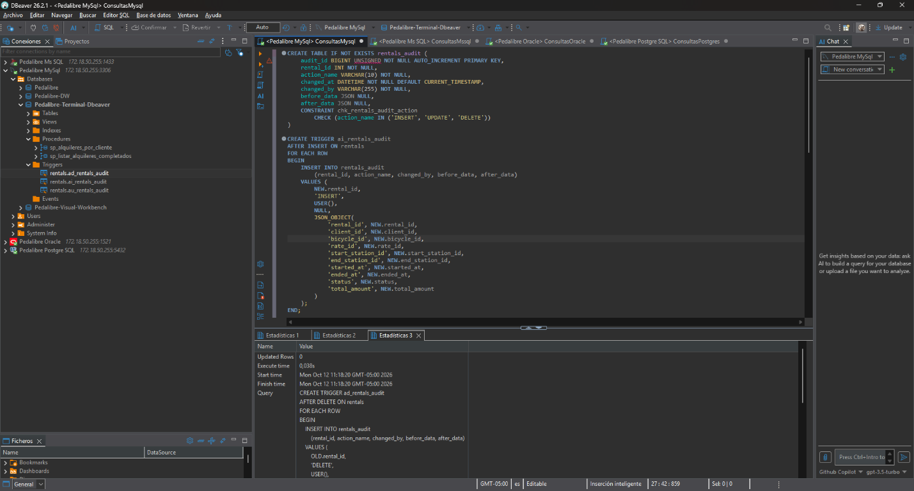

```sql
SELECT audit_id, rental_id, action_name, changed_at, changed_by, before_data, after_data
FROM rentals_audit
WHERE rental_id = (
    SELECT rental_id
    FROM rentals_audit
    WHERE action_name = 'DELETE'
    ORDER BY audit_id DESC
    LIMIT 1
)
  AND action_name = 'INSERT'
ORDER BY audit_id DESC
LIMIT 1;
```

**Evidencia de ejecucion — INSERT en MySQL:**

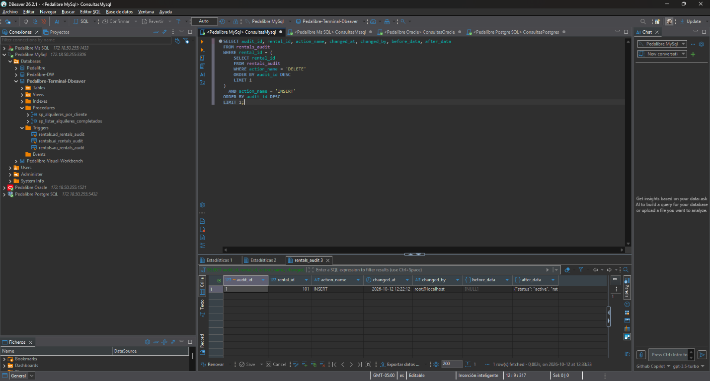

**Retroalimentacion:** Observo que la consulta devuelve el registro `INSERT` del alquiler de prueba `101`; el valor `before_data` es `NULL` y `after_data` conserva los datos iniciales del alquiler.

**Lo que aprendi:** Aprendí que el trigger registra la creación del alquiler sin una imagen previa y conserva en `after_data` los valores con los que se insertó.

```sql
SELECT audit_id, rental_id, action_name, changed_at, changed_by, before_data, after_data
FROM rentals_audit
WHERE rental_id = (
    SELECT rental_id
    FROM rentals_audit
    WHERE action_name = 'DELETE'
    ORDER BY audit_id DESC
    LIMIT 1
)
  AND action_name = 'UPDATE'
ORDER BY audit_id DESC
LIMIT 1;
```

**Evidencia de ejecucion — UPDATE en MySQL:**


**Retroalimentacion:** Observo el segundo registro de auditoría del alquiler `101`: `before_data` conserva el estado `active` y `after_data` muestra el estado `completed`.

**Lo que aprendi:** Aprendí que el trigger UPDATE almacena los valores anteriores y posteriores, permitiendo rastrear con claridad qué cambió en el alquiler.

```sql
SELECT audit_id, rental_id, action_name, changed_at, changed_by, before_data, after_data
FROM rentals_audit
WHERE rental_id = (
    SELECT rental_id
    FROM rentals_audit
    WHERE action_name = 'DELETE'
    ORDER BY audit_id DESC
    LIMIT 1
)
  AND action_name = 'DELETE'
ORDER BY audit_id DESC
LIMIT 1;
```

**Evidencia de ejecucion — DELETE en MySQL:**


**Retroalimentacion:** Observo el tercer registro del alquiler `101`, con `action_name` igual a `DELETE`; `before_data` conserva el estado `completed` y `after_data` queda en `NULL`.

**Lo que aprendi:** Aprendí que la auditoría mantiene los datos previos de una fila eliminada, aunque esa fila ya no exista en `rentals`.

### PostgreSQL

**Datos de prueba (solo DML):** [seed_rentals_audit_postgres.sql](<./Creacion%20de%20Tablas%20y%20Reguistros/Scrips/Postgres/seed_rentals_audit_postgres.sql>)

**Evidencia del estado en PostgreSQL:**

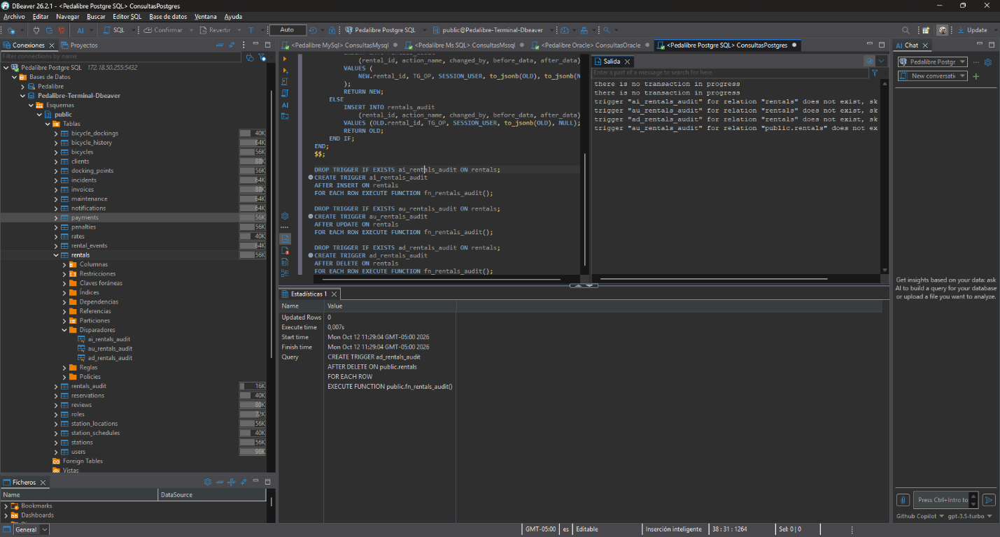

En la captura observo errores que indican que la relación `rentals` no existe al intentar crear el trigger. Por ello, no presento esa captura como evidencia de una instalación funcional. Primero debo verificar la tabla y el esquema de la conexión PostgreSQL; después de corregir el estado, usaré las consultas siguientes para revisar la auditoría tras ejecutar el seed DML.

```sql
SELECT audit_id, rental_id, action_name, changed_at, changed_by, before_data, after_data
FROM public.rentals_audit
WHERE rental_id = (
    SELECT rental_id
    FROM public.rentals_audit
    WHERE action_name = 'DELETE'
    ORDER BY audit_id DESC
    LIMIT 1
)
  AND action_name = 'INSERT'
ORDER BY audit_id DESC
LIMIT 1;
```

**Evidencia de ejecucion — INSERT en PostgreSQL:**


**Retroalimentacion:** Observo el registro `INSERT` del alquiler de prueba `101`, generado por la conexión `postgres`; `before_data` es `NULL` y `after_data` contiene los valores iniciales.

**Lo que aprendi:** Aprendí que PostgreSQL también registra la fila creada como estado posterior, junto con el usuario que originó el cambio.

```sql
SELECT audit_id, rental_id, action_name, changed_at, changed_by, before_data, after_data
FROM public.rentals_audit
WHERE rental_id = (
    SELECT rental_id
    FROM public.rentals_audit
    WHERE action_name = 'DELETE'
    ORDER BY audit_id DESC
    LIMIT 1
)
  AND action_name = 'UPDATE'
ORDER BY audit_id DESC
LIMIT 1;
```

**Evidencia de ejecucion — UPDATE en PostgreSQL:**

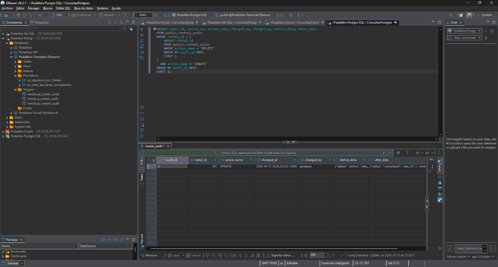

**Retroalimentacion:** Observo el evento `UPDATE` del alquiler `101`: en `before_data` aparece el estado `active` y en `after_data`, el estado `completed`.

**Lo que aprendi:** Aprendí que los valores previo y posterior permiten comparar el estado de la fila sin depender de que siga existiendo en la tabla principal.

```sql
SELECT audit_id, rental_id, action_name, changed_at, changed_by, before_data, after_data
FROM public.rentals_audit
WHERE rental_id = (
    SELECT rental_id
    FROM public.rentals_audit
    WHERE action_name = 'DELETE'
    ORDER BY audit_id DESC
    LIMIT 1
)
  AND action_name = 'DELETE'
ORDER BY audit_id DESC
LIMIT 1;
```

**Evidencia de ejecucion — DELETE en PostgreSQL:**

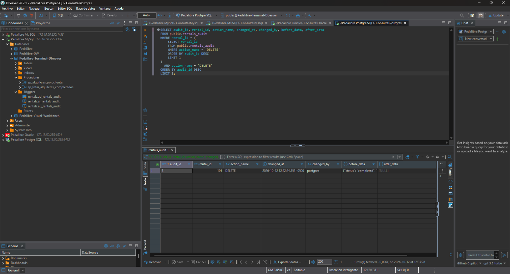

**Retroalimentacion:** Observo que el evento `DELETE` del alquiler `101` conserva en `before_data` el estado `completed`, mientras que `after_data` es `NULL`.

**Lo que aprendi:** Aprendí que el trigger registra la eliminación conservando los datos anteriores a ella, lo que permite auditar la operación después del borrado.

### Microsoft SQL Server

**Datos de prueba (solo DML):** [seed_rentals_audit_mssql.sql](<./Creacion%20de%20Tablas%20y%20Reguistros/Scrips/Mssql/seed_rentals_audit_mssql.sql>)

**Evidencia de los triggers existentes en SQL Server:**

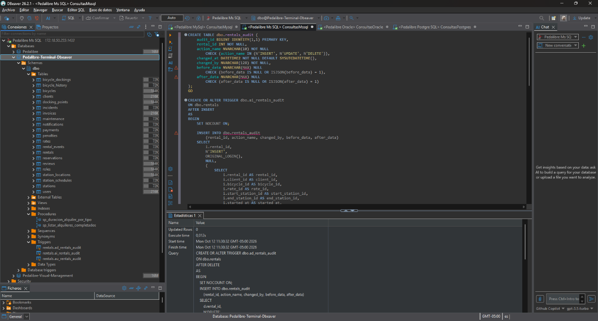

```sql
SELECT TOP (1) audit_id, rental_id, action_name, changed_at, changed_by, before_data, after_data
FROM dbo.rentals_audit
WHERE rental_id = (
    SELECT TOP (1) rental_id
    FROM dbo.rentals_audit
    WHERE action_name = N'DELETE'
    ORDER BY audit_id DESC
)
  AND action_name = N'INSERT'
ORDER BY audit_id DESC;
```

**Evidencia de ejecucion — INSERT en SQL Server:**

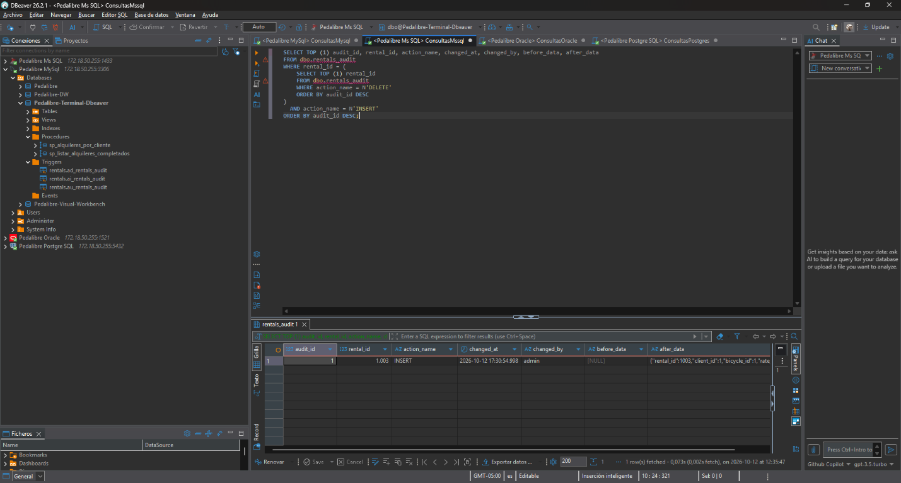

**Retroalimentacion:** Observo el primer evento de auditoría del alquiler `1003`, con acción `INSERT`, usuario `admin` y `before_data` en `NULL`; `after_data` contiene la fila creada.

**Lo que aprendi:** Aprendí que SQL Server registra la inserción con los valores nuevos y deja vacía la imagen anterior, como corresponde a una fila recién creada.

```sql
SELECT TOP (1) audit_id, rental_id, action_name, changed_at, changed_by, before_data, after_data
FROM dbo.rentals_audit
WHERE rental_id = (
    SELECT TOP (1) rental_id
    FROM dbo.rentals_audit
    WHERE action_name = N'DELETE'
    ORDER BY audit_id DESC
)
  AND action_name = N'UPDATE'
ORDER BY audit_id DESC;
```

**Evidencia de ejecucion — UPDATE en SQL Server:**

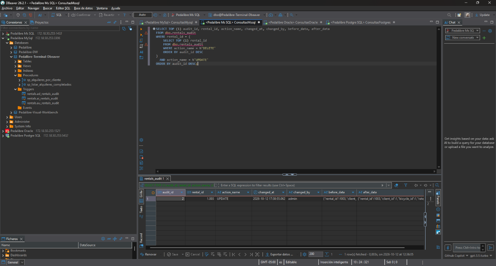

**Retroalimentacion:** Observo el evento `UPDATE` del alquiler `1003`; `before_data` registra el estado anterior `active` y `after_data` el nuevo estado `completed`.

**Lo que aprendi:** Aprendí que el trigger de SQL Server conserva ambas versiones de los datos, haciendo visible la transición que produjo la actualización.

```sql
SELECT TOP (1) audit_id, rental_id, action_name, changed_at, changed_by, before_data, after_data
FROM dbo.rentals_audit
WHERE rental_id = (
    SELECT TOP (1) rental_id
    FROM dbo.rentals_audit
    WHERE action_name = N'DELETE'
    ORDER BY audit_id DESC
)
  AND action_name = N'DELETE'
ORDER BY audit_id DESC;
```

**Evidencia de ejecucion — DELETE en SQL Server:**

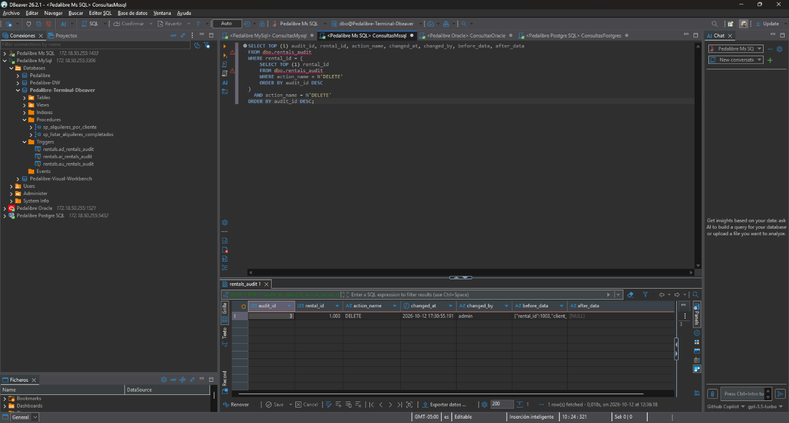

**Retroalimentacion:** Observo el evento `DELETE` del alquiler `1003`; la imagen previa contiene el estado `completed` y `after_data` es `NULL`.

**Lo que aprendi:** Aprendí que SQL Server permite conservar en la tabla de auditoría la última versión de una fila que ya fue eliminada de `rentals`.

### Oracle

**Datos de prueba (solo DML):** [seed_rentals_audit_oracle.sql](<./Creacion%20de%20Tablas%20y%20Reguistros/Scrips/Oracle/seed_rentals_audit_oracle.sql>)

**Evidencia de los triggers existentes en Oracle:**

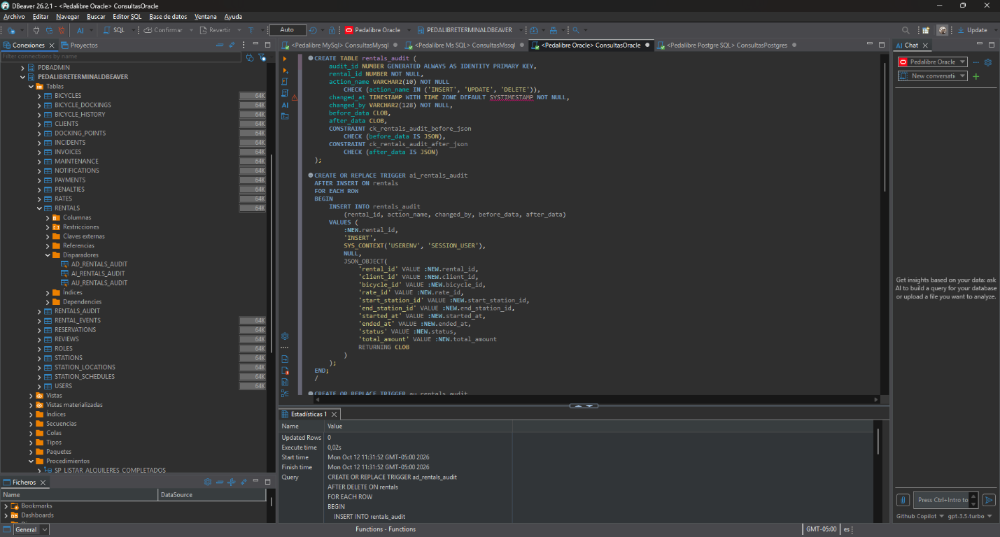

```sql
SELECT audit_id, rental_id, action_name, changed_at, changed_by, before_data, after_data
FROM rentals_audit
WHERE rental_id = (
    SELECT rental_id
    FROM (
        SELECT rental_id
        FROM rentals_audit
        WHERE action_name = 'DELETE'
        ORDER BY audit_id DESC
    )
    WHERE ROWNUM = 1
)
  AND action_name = 'INSERT'
ORDER BY audit_id DESC
FETCH FIRST 1 ROW ONLY;
```

**Evidencia de ejecucion — INSERT en Oracle:**


**Retroalimentacion:** Observo que Oracle registró el evento `INSERT` del alquiler `101`, asociado al usuario `PEDALIBRETERMINALDBEAVER`; `before_data` es `NULL` y `after_data` contiene la fila inicial.

**Lo que aprendi:** Aprendí que la auditoría en Oracle también conserva los valores posteriores y el usuario que realizó la inserción.

```sql
SELECT audit_id, rental_id, action_name, changed_at, changed_by, before_data, after_data
FROM rentals_audit
WHERE rental_id = (
    SELECT rental_id
    FROM (
        SELECT rental_id
        FROM rentals_audit
        WHERE action_name = 'DELETE'
        ORDER BY audit_id DESC
    )
    WHERE ROWNUM = 1
)
  AND action_name = 'UPDATE'
ORDER BY audit_id DESC
FETCH FIRST 1 ROW ONLY;
```

**Evidencia de ejecucion — UPDATE en Oracle:**

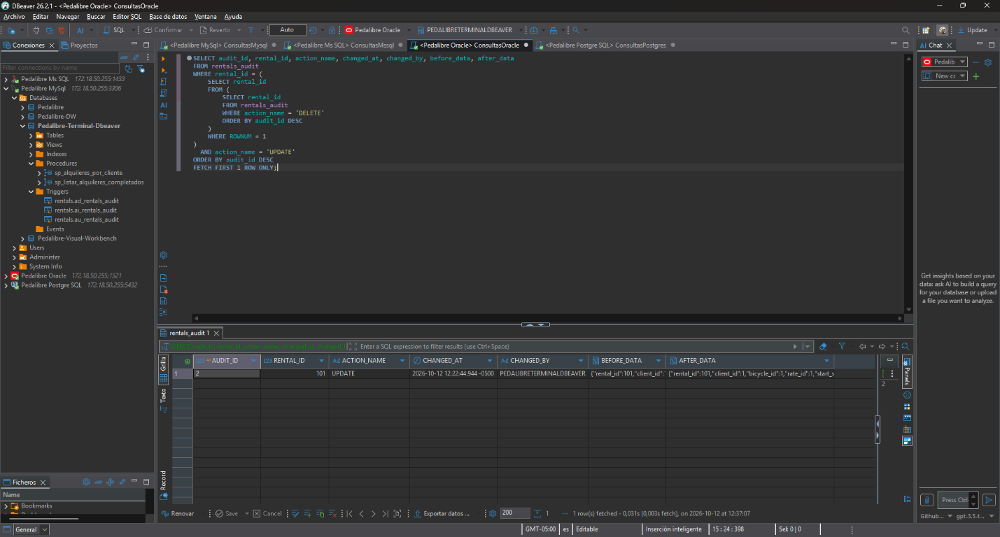

**Retroalimentacion:** Observo el evento `UPDATE` del alquiler `101`: `before_data` muestra el estado `active` y `after_data` refleja el estado `completed`.

**Lo que aprendi:** Aprendí que la auditoría permite comparar el valor anterior y el nuevo incluso cuando el cambio modifica varios campos de la fila.

```sql
SELECT audit_id, rental_id, action_name, changed_at, changed_by, before_data, after_data
FROM rentals_audit
WHERE rental_id = (
    SELECT rental_id
    FROM (
        SELECT rental_id
        FROM rentals_audit
        WHERE action_name = 'DELETE'
        ORDER BY audit_id DESC
    )
    WHERE ROWNUM = 1
)
  AND action_name = 'DELETE'
ORDER BY audit_id DESC
FETCH FIRST 1 ROW ONLY;
```

**Evidencia de ejecucion — DELETE en Oracle:**


**Retroalimentacion:** Observo que el evento `DELETE` del alquiler `101` conserva `completed` en `before_data` y presenta `NULL` en `after_data`.

**Lo que aprendi:** Aprendí que Oracle registra la imagen anterior a la eliminación, lo que permite consultar los valores borrados desde `rentals_audit`.

## Evidencia de trazabilidad

Debajo de cada evidencia puse el título del motor (MySQL, PostgreSQL, SQL Server u Oracle) y una retroalimentación en la que explico para qué sirve la consulta y qué observo en el resultado. En las primeras ocho capturas observo 80 bicicletas disponibles y 67 alquileres completados en cada motor. También dejo marcadas como pendientes las capturas de los procedimientos, los triggers y las consultas que todavía no ejecuto; completaré cada observación cuando tenga el resultado real.

Agregué a [trazabilidad/](./trazabilidad/) las siguientes capturas:

- Bicicletas disponibles: `mysql_bicicletas_disponibles.png`, `postgresql_bicicletas_disponibles.png`, `sqlserver_bicicletas_disponibles.png` y `oracle_bicicletas_disponibles.png`.
- Alquileres completados: `mysql_alquileres_completados.png`, `postgresql_alquileres_completados.png`, `sqlserver_alquileres_completados.png` y `oracle_alquileres_completados.png`.
- Base de datos activa en MySQL: `mysql_base_seleccionada.png`.
- Tablas visibles en MySQL: `mysql_inventario_tablas_mysql.png`.
- Tablas visibles en PostgreSQL: `postgresql_inventario_tablas_postgresql.png`.
- Diez alquileres recientes en PostgreSQL: `postgresql_alquileres_completados_top10_postgresql.png`.
- Tablas visibles en SQL Server: `sqlserver_inventario_tablas_sqlserver.png`.
- Diez alquileres recientes en SQL Server: `sqlserver_alquileres_completados_top10_sqlserver.png`.
- Tablas visibles en Oracle: `oracle_inventario_tablas_oracle.png`.
- Clientes con mas alquileres en MySQL: `mysql_clientes_mas_alquileres_mysql.png`.
- Ultimo alquiler por cliente en PostgreSQL: `postgresql_ultimo_alquiler_por_cliente.png`.
- Puntos de anclaje disponibles en MySQL: `mysql_puntos_disponibles_por_estacion_mysql.png`.
- Incidentes abiertos en MySQL: `mysql_incidentes_abiertos_mysql.png`.
- Ingresos pagados por mes en MySQL: `mysql_ingresos_pagados_por_mes_mysql.png`.
- Alquileres por semana en PostgreSQL: `postgresql_alquileres_por_semana.png`.
- Tiempo de uso de anclajes en PostgreSQL: `postgresql_tiempo_uso_anclajes.png`.
- Incidentes con reportes de revisión en PostgreSQL: `postgresql_incidentes_revision_ilike.png`.
- Calificaciones mensuales en PostgreSQL: `postgresql_calificaciones_por_mes.png`.
- Estados de bicicletas con PIVOT en SQL Server: `sqlserver_bicicletas_por_estado_pivot.png`.
- Inventario JSON en SQL Server: `sqlserver_estaciones_json.png`.
- Impuestos de facturas en SQL Server: `sqlserver_validar_impuestos_facturas.png`.
- Importes de alquileres consecutivos en SQL Server: `sqlserver_comparar_importes_alquileres_lag.png`.
- Rendimiento de tarifas en Oracle: `oracle_rendimiento_tarifas.png`.
- Calendario de alquileres en Oracle: `oracle_calendario_diario_connect_by.png`.
- Incidentes agrupados con ROLLUP en Oracle: `oracle_incidentes_rollup_severidad.png`.
- Participación de ingresos por bicicleta en Oracle: `oracle_participacion_ingresos_bicicletas.png`.
- Alquileres concatenados por cliente en MySQL: `mysql_alquileres_por_cliente_group_concat.png`.
- Pagos por estado con FILTER en PostgreSQL: `postgresql_pagos_por_estado_filter.png`.
- Duración por tipo con DATEDIFF en SQL Server: `sqlserver_duracion_alquiler_por_tipo_datediff.png`.

## Referencias

- [Guía docente de consultas MySQL](https://tecnogua.com/academic/site/bd/gestion/mysql/mysql/)
- [Guía docente de consultas PostgreSQL](https://tecnogua.com/academic/site/bd/gestion/postgresql/postgresql/)
- [Guía docente de consultas Microsoft SQL Server](https://tecnogua.com/academic/site/bd/gestion/mssql/mssql/)
- [Guía docente de consultas Oracle](https://tecnogua.com/academic/site/bd/gestion/oracle/oracle/)
- [Guía del esquema PedalLibre](<./Creacion%20de%20Tablas%20y%20Reguistros/guia.md>)
- [Guia de insercion de datos](<./Creacion%20de%20Tablas%20y%20Reguistros/guia_insert_datos.md>)
