# Consultas SQL de PedalLibre en cuatro motores

## Introducción

En este informe documento las consultas que voy a ejecutar en DBeaver sobre las bases de datos de PedalLibre. Tomo como referencia los ejemplos de consulta de las guías docentes de [MySQL](https://tecnogua.com/academic/site/bd/gestion/mysql/mysql/), [PostgreSQL](https://tecnogua.com/academic/site/bd/gestion/postgresql/postgresql/), [Microsoft SQL Server](https://tecnogua.com/academic/site/bd/gestion/mssql/mssql/) y [Oracle](https://tecnogua.com/academic/site/bd/gestion/oracle/oracle/), adaptándolos a las tablas reales del proyecto.

Me concentro en consultas de lectura que permiten revisar registros, filtrar resultados, relacionar tablas y resumir información. No vuelvo a crear ni modificar tablas o registros, y no incluyo triggers. Las consultas principales usan sintaxis común a los cuatro motores; las consultas para limitar resultados se muestran por separado cuando cambia la sintaxis.

## Base de datos y tablas

En la carpeta [Creacion de Tablas y Reguistros](./Creacion%20de%20Tablas%20y%20Reguistros/) consulté la guía del esquema y los scripts de datos de prueba. Estos describen 21 tablas del dominio PedalLibre: `roles`, `users`, `clients`, `stations`, `station_locations`, `station_schedules`, `docking_points`, `bicycles`, `bicycle_dockings`, `reservations`, `rates`, `rentals`, `rental_events`, `penalties`, `maintenance`, `payments`, `incidents`, `notifications`, `bicycle_history`, `reviews` e `invoices`. La guía de inserción y la semilla MySQL contemplan 100 registros por tabla; también confirmaste que ya cargaste los datos en los cuatro motores. En DBeaver voy a validar la base seleccionada y los conteos antes de empezar con las consultas.

Por tanto, las tablas que consultaré son las tablas adicionales del proyecto, creadas sobre cada motor; no son tablas que se creen automáticamente al instalar MySQL, PostgreSQL, SQL Server u Oracle. La verificación se basa en los archivos SQL del proyecto; no he abierto las conexiones locales para comprobar en vivo el estado actual de cada servidor.

### Conexiones que usaré

| Motor | Base de datos o esquema indicado |
|---|---|
| MySQL | `Pedalibre-Terminal-Dbeaver` |
| Microsoft SQL Server | `Pedalibre-Terminal-Dbeaver` |
| PostgreSQL | `Pedalibre-Terminal-Dbeaver` |
| Oracle | Esquema `PEDALIBRETERMINALDBEAVER` |

**MySQL:** la guía del esquema y el script de datos de prueba usan la base `Pedalibre-Terminal-Dbeaver`. Antes de ejecutar, confirmo con `SELECT DATABASE()` que esa sea la base seleccionada en DBeaver.

## Procedimiento en DBeaver

1. Abro DBeaver y localizo la conexión correspondiente al motor con el que voy a trabajar.
2. Confirmo que la conexión esté activa y selecciono la base de datos o el esquema de la tabla PedalLibre. Para Oracle uso el esquema `PEDALIBRETERMINALDBEAVER`.
3. Abro un editor SQL asociado a esa conexión y verifico el nombre de la conexión/base antes de ejecutar cualquier comando.
4. Compruebo que existen las tablas del proyecto con el comando de inspección indicado para el motor. Si no aparecen `bicycles`, `rentals`, `payments` y las demás tablas del esquema, detengo la ejecución y corrijo la conexión o el esquema seleccionado.
5. Ejecuto una consulta a la vez: selecciono el bloque completo y uso **Ejecutar sentencia** en DBeaver. Las consultas de este informe son de solo lectura.
6. Reviso las filas devueltas en la cuadrícula de resultados. Las filas exactas pueden variar según los datos cargados en la base.
7. Debajo de cada bloque SQL encuentro la ruta de su captura pendiente. Tomo la imagen en DBeaver mostrando conexion, sentencia y resultado; la guardo con ese nombre en `trazabilidad/`. Despues completo lo que observe y aprendi basandome en las filas reales. Para MySQL, ejecuto cada consulta de esta seccion individualmente en DBeaver.

## Consultas principales

Los siguientes bloques son SQL compatible con los cuatro motores. Los ejecuto después de seleccionar la base o esquema correcto en DBeaver.

### 1. Consultar bicicletas disponibles

Reviso las bicicletas que están disponibles y ordeno el resultado por identificador.

```sql
SELECT bicycle_id, serial_number, bicycle_type, status
FROM bicycles
WHERE status = 'available'
ORDER BY bicycle_id;
```

**Evidencia de ejecucion:**
**MySQL: Consultar bicicletas disponibles**
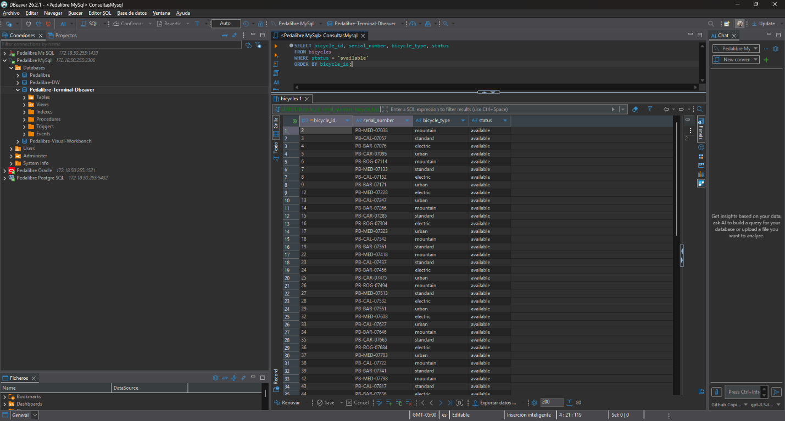

**Retroalimentacion:** La sentencia filtra `bicycles` por `status = 'available'` y ordena por identificador. Observacion: la captura muestra 80 filas recuperadas y todas tienen estado `available`.

**PostgreSQL: Consultar bicicletas disponibles**
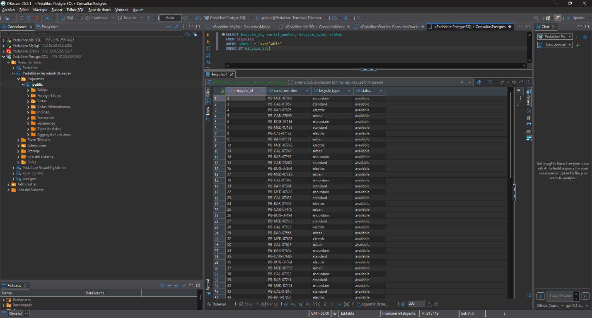

**Retroalimentacion:** La sentencia filtra `bicycles` por `status = 'available'` y ordena por identificador. Observacion: la captura muestra 80 filas recuperadas y todas tienen estado `available`.

**SQL Server: Consultar bicicletas disponibles**
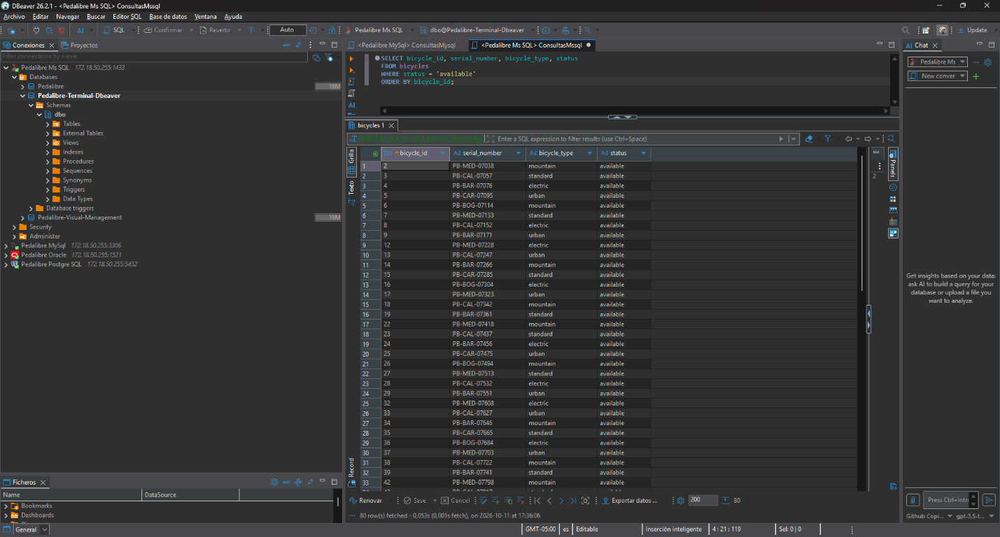

**Retroalimentacion:** La sentencia filtra `bicycles` por `status = 'available'` y ordena por identificador. Observacion: la captura muestra 80 filas recuperadas y todas tienen estado `available`.

**Oracle: Consultar bicicletas disponibles**
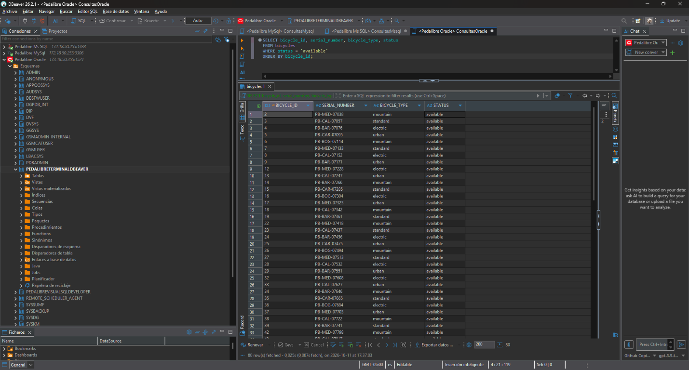

**Retroalimentacion:** La sentencia filtra `bicycles` por `status = 'available'` y ordena por identificador. Observacion: la captura muestra 80 filas recuperadas y todas tienen estado `available`.

**Lo que aprendi:** Aprendi que `WHERE` permite seleccionar solo las bicicletas disponibles y `ORDER BY` organiza su identificador.

### 2. Consultar alquileres completados

Aplico un filtro por estado y ordeno los alquileres desde el más reciente. La consulta devuelve todos los alquileres completados; las variantes para limitar a 10 resultados aparecen en la sección de cada motor.

```sql
SELECT rental_id, client_id, bicycle_id, started_at, ended_at, total_amount, status
FROM rentals
WHERE status = 'completed'
ORDER BY started_at DESC;
```

**Evidencia de ejecucion:**
**MySQL: Consultar alquileres completados**
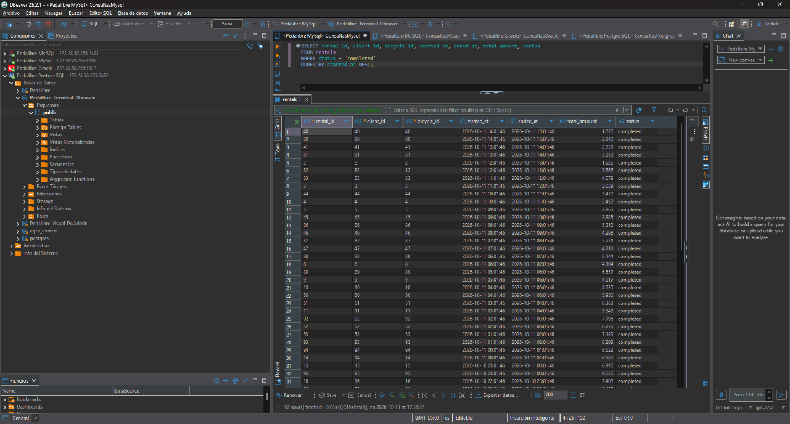

**Retroalimentacion:** La sentencia filtra `rentals` por estado `completed` y ordena por inicio descendente. Observacion: la captura muestra 67 alquileres completados ordenados del mas reciente al mas antiguo.

**PostgreSQL: Consultar alquileres completados**
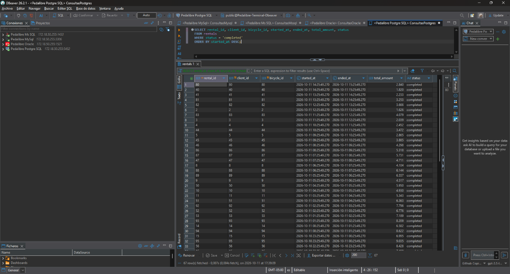

**Retroalimentacion:** La sentencia filtra `rentals` por estado `completed` y ordena por inicio descendente. Observacion: la captura muestra 67 alquileres completados ordenados del mas reciente al mas antiguo.

**SQL Server: Consultar alquileres completados**
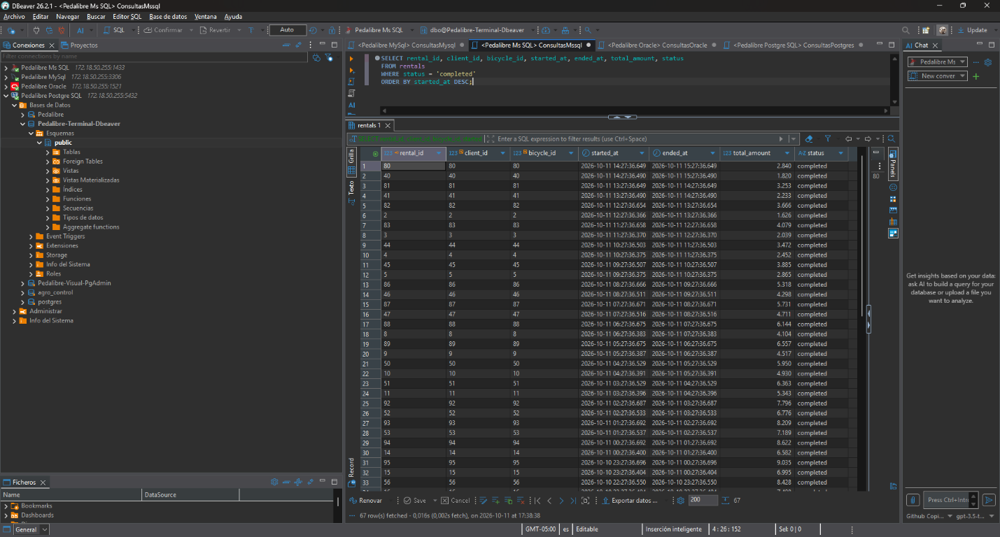

**Retroalimentacion:** La sentencia filtra `rentals` por estado `completed` y ordena por inicio descendente. Observacion: la captura muestra 67 alquileres completados ordenados del mas reciente al mas antiguo.

**Oracle: Consultar alquileres completados**
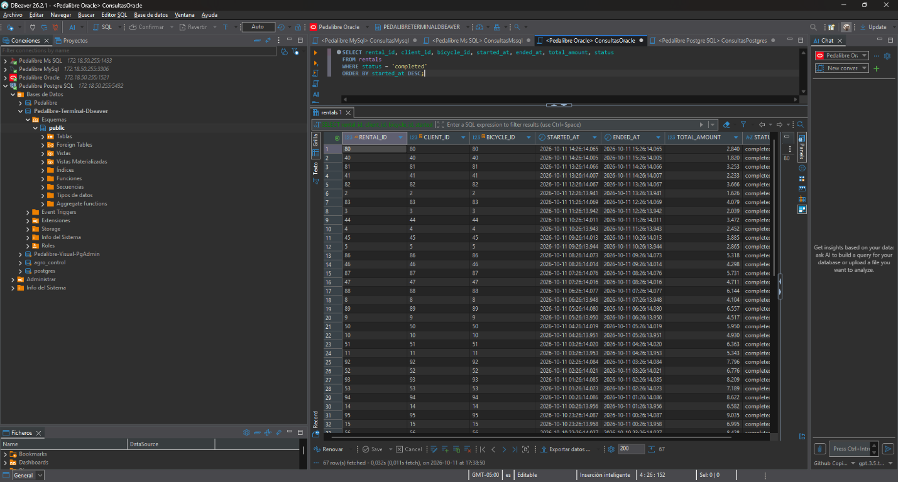

**Retroalimentacion:** La sentencia filtra `rentals` por estado `completed` y ordena por inicio descendente. Observacion: la captura muestra 67 alquileres completados ordenados del mas reciente al mas antiguo.

**Lo que aprendi:** Aprendi a filtrar los alquileres por estado y ordenar los mas recientes primero; la variante del motor limita las filas mostradas.

### 3. Consultar detalle de alquileres relacionados

Relaciono alquileres, clientes, bicicletas, tarifa y estaciones. Uso `LEFT JOIN` para conservar el alquiler aunque no tenga estación de inicio o fin asociada.

```sql
SELECT
    r.rental_id,
    c.first_name,
    c.last_name,
    b.serial_number,
    rate.name AS rate_name,
    start_station.name AS start_station,
    end_station.name AS end_station,
    r.started_at,
    r.ended_at,
    r.status,
    r.total_amount
FROM rentals r
JOIN clients c ON c.client_id = r.client_id
JOIN bicycles b ON b.bicycle_id = r.bicycle_id
JOIN rates rate ON rate.rate_id = r.rate_id
LEFT JOIN stations start_station ON start_station.station_id = r.start_station_id
LEFT JOIN stations end_station ON end_station.station_id = r.end_station_id
ORDER BY r.started_at DESC;
```

**Evidencia de ejecucion:**
**MySQL: Consultar detalle de alquileres relacionados**
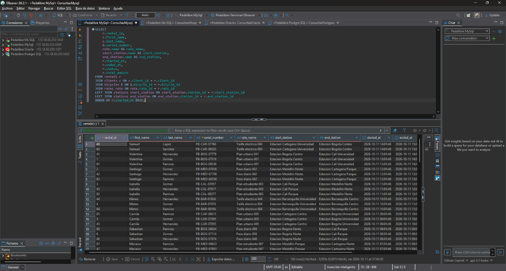

**Retroalimentacion:** El resultado presenta el identificador del alquiler junto con el nombre del cliente, serial de la bicicleta, tarifa y estaciones de inicio y fin. La captura muestra 100 filas recuperadas; los `JOIN` combinan las entidades relacionadas y los `LEFT JOIN` permiten conservar el alquiler aunque alguna estación no esté asociada.

**PostgreSQL: Consultar detalle de alquileres relacionados**
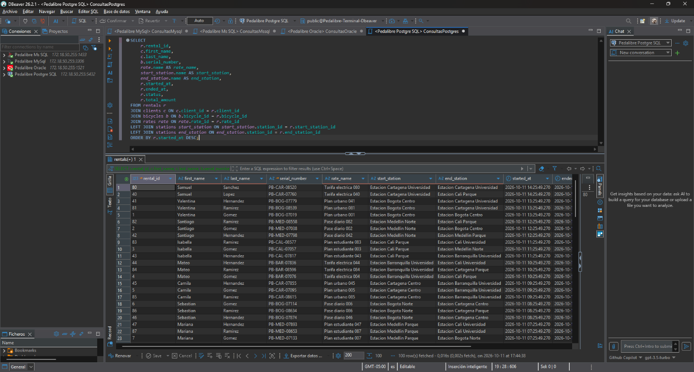

**Retroalimentacion:** El resultado presenta el identificador del alquiler junto con el nombre del cliente, serial de la bicicleta, tarifa y estaciones de inicio y fin. La captura muestra 100 filas recuperadas; los `JOIN` combinan las entidades relacionadas y los `LEFT JOIN` permiten conservar el alquiler aunque alguna estación no esté asociada.

**SQL Server: Consultar detalle de alquileres relacionados**
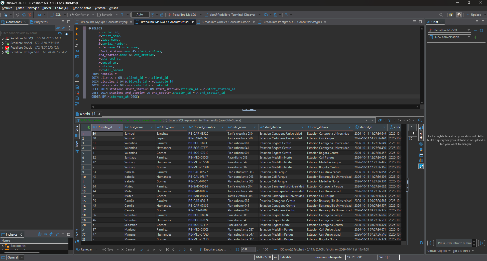

**Retroalimentacion:** El resultado presenta el identificador del alquiler junto con el nombre del cliente, serial de la bicicleta, tarifa y estaciones de inicio y fin. La captura muestra 100 filas recuperadas; los `JOIN` combinan las entidades relacionadas y los `LEFT JOIN` permiten conservar el alquiler aunque alguna estación no esté asociada.

**Oracle: Consultar detalle de alquileres relacionados**
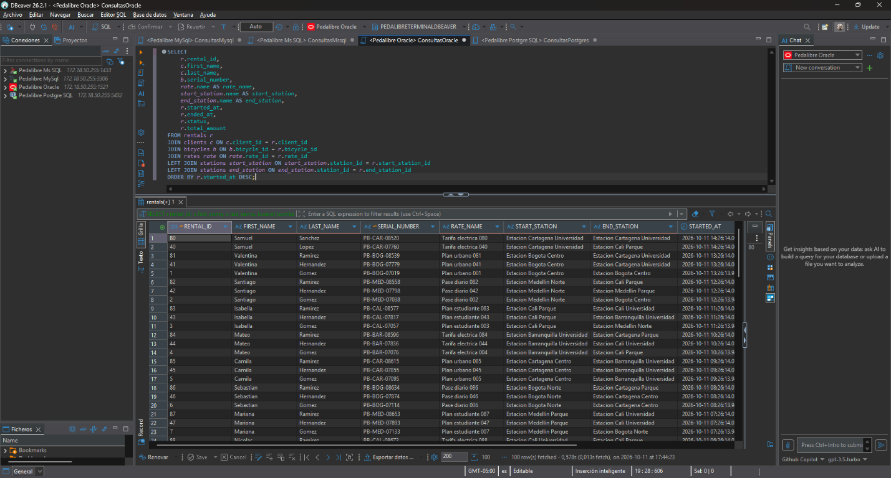

**Retroalimentacion:** El resultado presenta el identificador del alquiler junto con el nombre del cliente, serial de la bicicleta, tarifa y estaciones de inicio y fin. La captura muestra 100 filas recuperadas; los `JOIN` combinan las entidades relacionadas y los `LEFT JOIN` permiten conservar el alquiler aunque alguna estación no esté asociada.

**Lo que aprendi:** Aprendi que puedo reunir datos relacionados con `JOIN` y conservar estaciones opcionales con `LEFT JOIN`.

### 4. Resumir alquileres por estado

Uso `GROUP BY` y funciones de agregado para comparar cantidad e importe promedio por estado. `HAVING` conserva los grupos que contienen al menos un alquiler.

```sql
SELECT
    status,
    COUNT(*) AS rental_count,
    SUM(total_amount) AS total_amount,
    AVG(total_amount) AS average_amount
FROM rentals
GROUP BY status
HAVING SUM(total_amount) > 0
ORDER BY status;
```

**Evidencia de ejecucion:**
**MySQL: Resumir alquileres por estado**
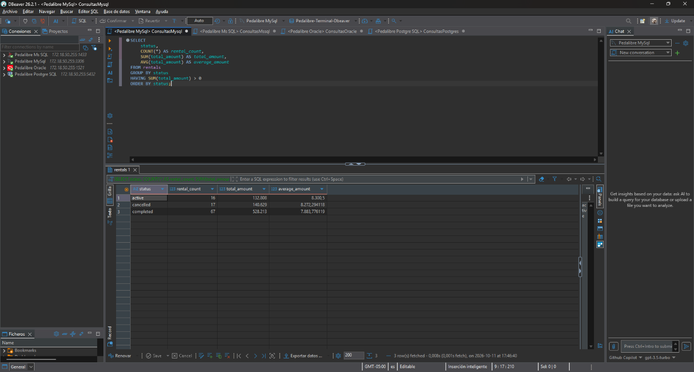

**Retroalimentacion:** La consulta agrupa los alquileres por estado y calcula la cantidad, el importe total y el promedio. Observo tres grupos: 16 `active`, 17 `cancelled` y 67 `completed`; sus importes totales son 132.808, 140.629 y 528.213, respectivamente.

**PostgreSQL: Resumir alquileres por estado**
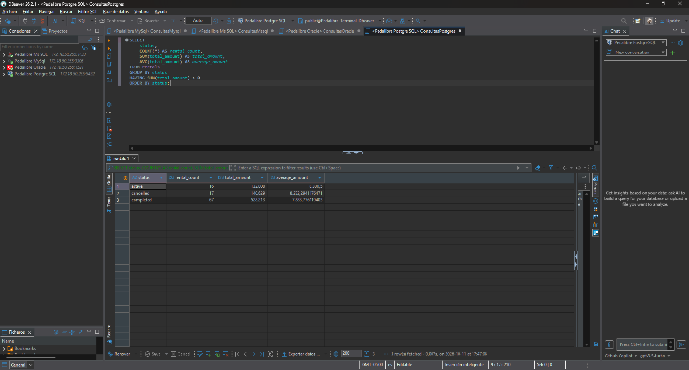

**Retroalimentacion:** La consulta agrupa los alquileres por estado y calcula la cantidad, el importe total y el promedio. Observo tres grupos: 16 `active`, 17 `cancelled` y 67 `completed`; sus importes totales son 132.808, 140.629 y 528.213, respectivamente.

**SQL Server: Resumir alquileres por estado**
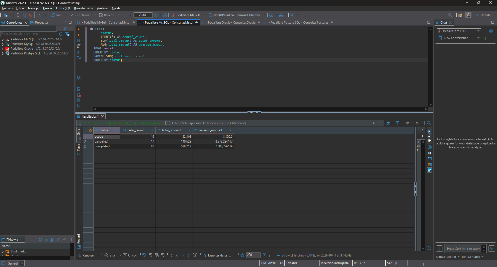

**Retroalimentacion:** La consulta agrupa los alquileres por estado y calcula la cantidad, el importe total y el promedio. Observo tres grupos: 16 `active`, 17 `cancelled` y 67 `completed`; sus importes totales son 132.808, 140.629 y 528.213, respectivamente.

**Oracle: Resumir alquileres por estado**
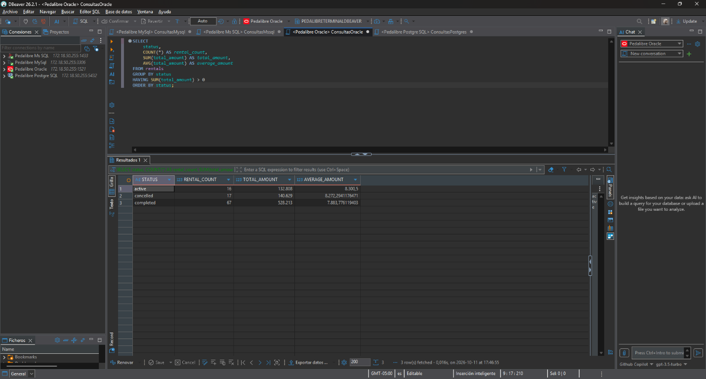

**Retroalimentacion:** La consulta agrupa los alquileres por estado y calcula la cantidad, el importe total y el promedio. Observo tres grupos: 16 `active`, 17 `cancelled` y 67 `completed`; sus importes totales son 132.808, 140.629 y 528.213, respectivamente.

**Lo que aprendi:** Aprendi a agrupar alquileres por estado y resumirlos con `COUNT`, `SUM` y `AVG`.

### 5. Resumir pagos por método y estado

Consulto el número de pagos y el importe total agrupados por método y estado.

```sql
SELECT
    payment_method,
    status,
    COUNT(*) AS payment_count,
    SUM(amount) AS total_paid
FROM payments
GROUP BY payment_method, status
ORDER BY payment_method, status;
```

**Evidencia de ejecucion:**
**MySQL: Resumir pagos por metodo y estado**
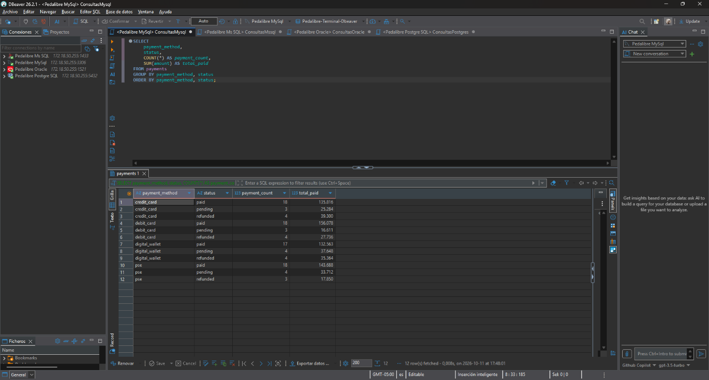

**Retroalimentacion:** La consulta forma grupos por metodo y estado, y muestra la cantidad y la suma de los importes. Observo 12 combinaciones entre `credit_card`, `debit_card`, `digital_wallet` y `pse`, cada una con los estados `paid`, `pending` o `refunded`.

**PostgreSQL: Resumir pagos por metodo y estado**
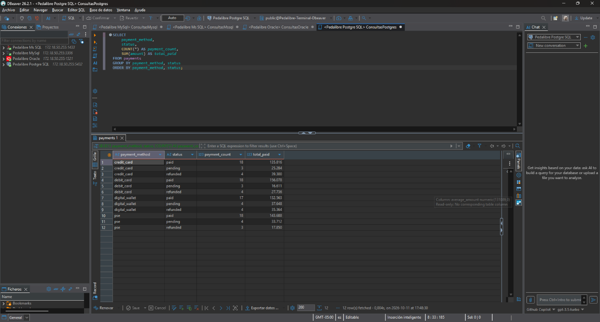

**Retroalimentacion:** La consulta forma grupos por metodo y estado, y muestra la cantidad y la suma de los importes. Observo 12 combinaciones entre `credit_card`, `debit_card`, `digital_wallet` y `pse`, cada una con los estados `paid`, `pending` o `refunded`.

**SQL Server: Resumir pagos por metodo y estado**
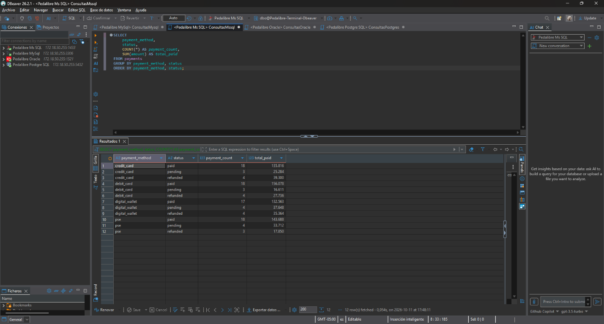

**Retroalimentacion:** La consulta forma grupos por metodo y estado, y muestra la cantidad y la suma de los importes. Observo 12 combinaciones entre `credit_card`, `debit_card`, `digital_wallet` y `pse`, cada una con los estados `paid`, `pending` o `refunded`.

**Oracle: Resumir pagos por metodo y estado**
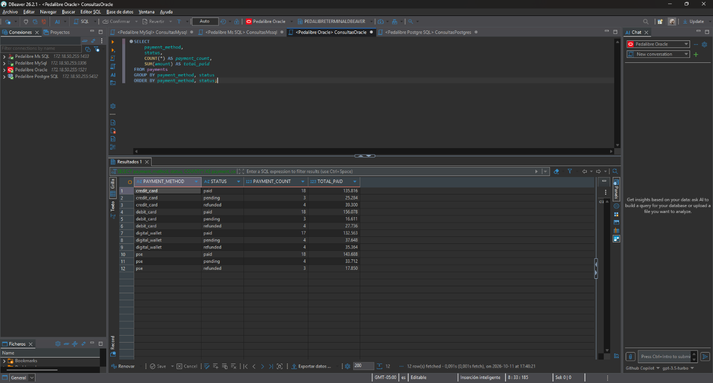

**Retroalimentacion:** La consulta forma grupos por metodo y estado, y muestra la cantidad y la suma de los importes. Observo 12 filas. En una fila figura `digital_wallet` y en otra `digital_Wallet`, con distinta capitalizacion; por eso Oracle separa esas variantes en grupos distintos.

**Lo que aprendi:** Aprendi a agrupar pagos por metodo y estado para comparar cantidades e importes.

## Comandos específicos de cada motor

### MySQL

Conecto a la base indicada y verifico el esquema. Si la lista está vacía o no corresponde a PedalLibre, no continúo hasta seleccionar la base correcta.

```sql
SELECT DATABASE() AS base_actual;
```

La respuesta debe ser `Pedalibre-Terminal-Dbeaver`. Si aparece otro nombre, cambio la conexión activa en DBeaver antes de continuar.

**Evidencia de ejecucion:**
**MySQL: Verificar la base de datos activa**
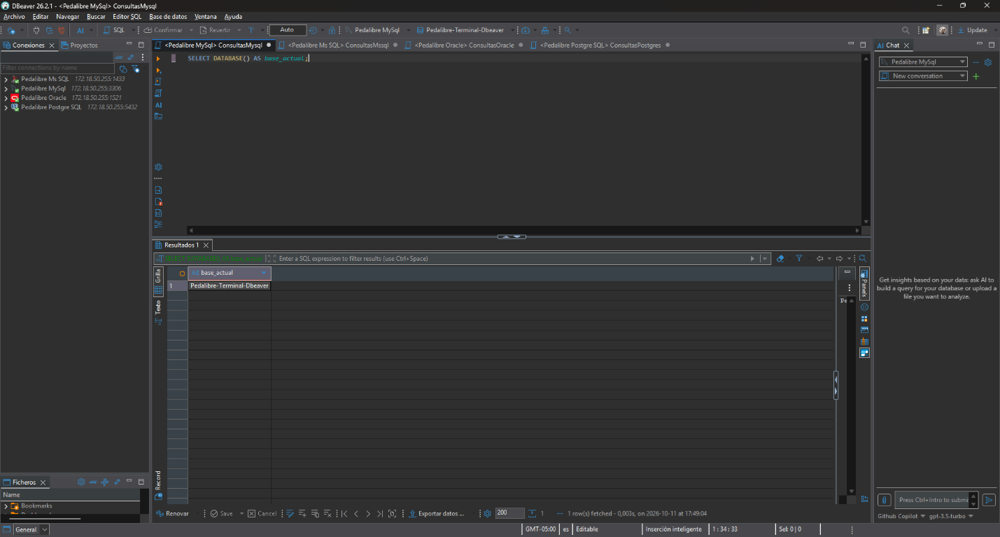

**Retroalimentacion:** La sentencia `SELECT DATABASE()` identifica la base MySQL activa en esta conexion. Observo `Pedalibre-Terminal-Dbeaver`, por lo que confirmo que la consulta se ejecuta en la base indicada.

**Lo que aprendi:** Aprendi a comprobar la base activa antes de consultar sus tablas.

```sql
SHOW TABLES;
```

**Evidencia de ejecucion:**
**MySQL: Verificar las tablas de la base**
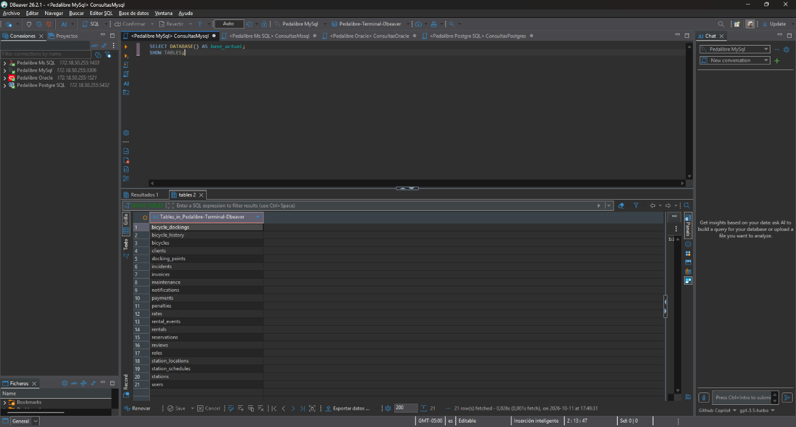

**Retroalimentacion:** `SHOW TABLES` lista las tablas visibles en la base MySQL seleccionada, sin consultar sus registros. Observo 21 tablas del proyecto, entre ellas `bicycles`, `clients`, `payments` y `rentals`; esto confirma que el esquema esperado está visible en DBeaver.

**Lo que aprendi:** Aprendi a comprobar que tablas estan visibles en la base seleccionada de MySQL.

Para confirmar que se cargaron los datos de prueba, cuento las filas de las 21 tablas. La guía de inserción espera 100 registros en cada una; comparo ese valor con el resultado que realmente muestre DBeaver.

```sql
SELECT 'roles' AS tabla, COUNT(*) AS registros FROM roles
UNION ALL SELECT 'users', COUNT(*) FROM users
UNION ALL SELECT 'clients', COUNT(*) FROM clients
UNION ALL SELECT 'stations', COUNT(*) FROM stations
UNION ALL SELECT 'station_locations', COUNT(*) FROM station_locations
UNION ALL SELECT 'station_schedules', COUNT(*) FROM station_schedules
UNION ALL SELECT 'docking_points', COUNT(*) FROM docking_points
UNION ALL SELECT 'bicycles', COUNT(*) FROM bicycles
UNION ALL SELECT 'bicycle_dockings', COUNT(*) FROM bicycle_dockings
UNION ALL SELECT 'rates', COUNT(*) FROM rates
UNION ALL SELECT 'reservations', COUNT(*) FROM reservations
UNION ALL SELECT 'rentals', COUNT(*) FROM rentals
UNION ALL SELECT 'rental_events', COUNT(*) FROM rental_events
UNION ALL SELECT 'penalties', COUNT(*) FROM penalties
UNION ALL SELECT 'maintenance', COUNT(*) FROM maintenance
UNION ALL SELECT 'payments', COUNT(*) FROM payments
UNION ALL SELECT 'incidents', COUNT(*) FROM incidents
UNION ALL SELECT 'notifications', COUNT(*) FROM notifications
UNION ALL SELECT 'bicycle_history', COUNT(*) FROM bicycle_history
UNION ALL SELECT 'reviews', COUNT(*) FROM reviews
UNION ALL SELECT 'invoices', COUNT(*) FROM invoices
ORDER BY tabla;
```

**Evidencia de ejecucion:**
**MySQL: Contar registros por tabla**
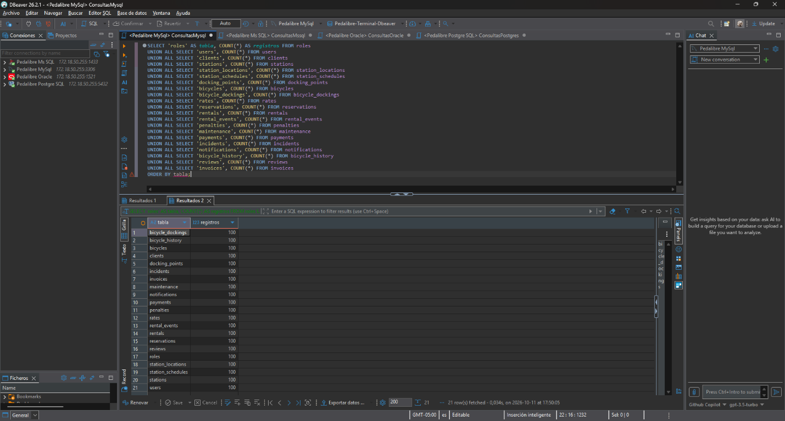

**Retroalimentacion:** La consulta cuenta las filas de cada una de las 21 tablas. Observo que cada tabla muestra 100 registros, coincidiendo con la cantidad esperada en la guia de insercion.

**Lo que aprendi:** Aprendi a validar con `COUNT(*)` la cantidad de registros cargados antes de analizar los datos.

Para limitar la consulta de alquileres completados a 10 filas, agrego `LIMIT 10` al final:

```sql
SELECT rental_id, client_id, bicycle_id, started_at, ended_at, total_amount, status
FROM rentals
WHERE status = 'completed'
ORDER BY started_at DESC
LIMIT 10;
```

**Evidencia de ejecucion:**
**MySQL: Mostrar los 10 alquileres completados mas recientes**
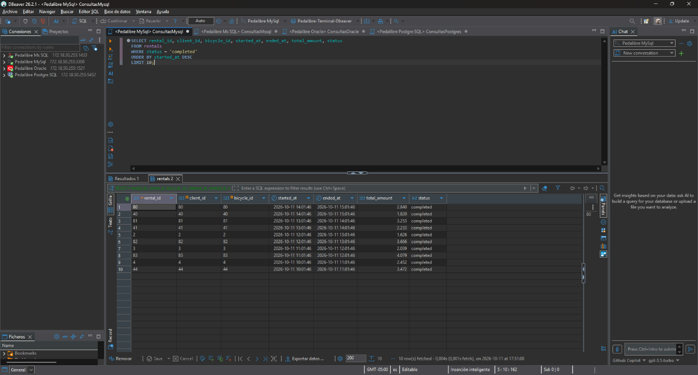

**Retroalimentacion:** `LIMIT 10` restringe la salida a los 10 alquileres completados mas recientes, ordenados por fecha de inicio descendente. Observo diez filas con estado `completed`; la primera corresponde al registro mas reciente mostrado.

**Lo que aprendi:** Aprendi a filtrar los alquileres por estado y ordenar los mas recientes primero; la variante del motor limita las filas mostradas.

### PostgreSQL

Verifico las tablas visibles en el esquema `public`:

```sql
SELECT table_name
FROM information_schema.tables
WHERE table_schema = 'public'
  AND table_type = 'BASE TABLE'
ORDER BY table_name;
```

**Evidencia de ejecucion:**
**PostgreSQL: Verificar las tablas de la base**
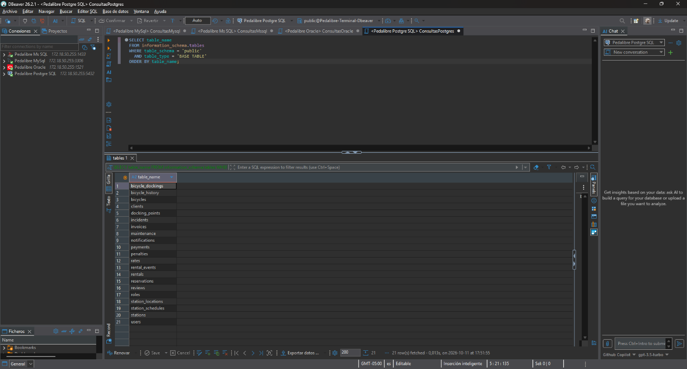

**Retroalimentacion:** La consulta revisa el catalogo `information_schema.tables` y filtra el esquema `public` para mostrar solo tablas base. Observo las 21 tablas del proyecto PedalLibre.

**Lo que aprendi:** Aprendi a consultar el catalogo de PostgreSQL para verificar las tablas del esquema `public`.

Para limitar la consulta de alquileres completados a 10 filas, uso `LIMIT 10`:

```sql
SELECT rental_id, client_id, bicycle_id, started_at, ended_at, total_amount, status
FROM rentals
WHERE status = 'completed'
ORDER BY started_at DESC
LIMIT 10;
```

**Evidencia de ejecucion:**
**PostgreSQL: Mostrar los 10 alquileres completados mas recientes**
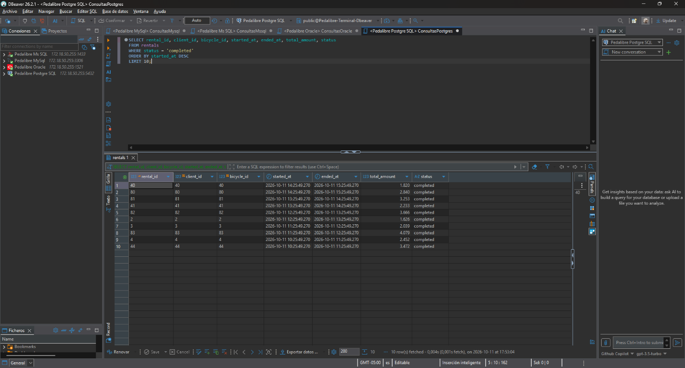

**Retroalimentacion:** `LIMIT 10` limita la salida a los 10 alquileres completados con fecha de inicio mas reciente. Observo diez filas, todas con estado `completed`, ordenadas por `started_at` descendente.

**Lo que aprendi:** Aprendi a filtrar los alquileres por estado y ordenar los mas recientes primero; la variante del motor limita las filas mostradas.

### Microsoft SQL Server

Verifico las tablas del esquema actual:

```sql
SELECT TABLE_SCHEMA, TABLE_NAME
FROM INFORMATION_SCHEMA.TABLES
WHERE TABLE_TYPE = 'BASE TABLE'
ORDER BY TABLE_SCHEMA, TABLE_NAME;
```

**Evidencia de ejecucion:**
**SQL Server: Verificar las tablas de la base**
*Captura pendiente: `sqlserver_inventario_tablas_postgresql.png`.*

**Retroalimentacion:** `SHOW TABLES` lista las tablas visibles en la base MySQL seleccionada. Revisa que aparezcan las tablas PedalLibre antes de continuar.

**Lo que aprendi:** Aprendi a consultar `INFORMATION_SCHEMA` para identificar las tablas del esquema de SQL Server.

Para limitar la consulta de alquileres completados a 10 filas, uso `TOP (10)`:

```sql
SELECT TOP (10)
    rental_id, client_id, bicycle_id, started_at, ended_at, total_amount, status
FROM rentals
WHERE status = 'completed'
ORDER BY started_at DESC;
```

**Evidencia de ejecucion:**
**SQL Server: Mostrar los 10 alquileres completados mas recientes**
*Captura pendiente: `sqlserver_alquileres_completados_top10_sqlserver.png`.*

**Retroalimentacion:** `LIMIT 10` restringe la salida a los 10 alquileres completados mas recientes. La ejecucion y el resultado de esta variante siguen pendientes de captura.

**Lo que aprendi:** Aprendi a filtrar los alquileres por estado y ordenar los mas recientes primero; la variante del motor limita las filas mostradas.

### Oracle

Verifico las tablas accesibles para el usuario conectado. Si el usuario tiene seleccionado el esquema `PEDALIBRETERMINALDBEAVER`, sus tablas aparecen en `USER_TABLES`.

```sql
SELECT table_name
FROM user_tables
ORDER BY table_name;
```

**Evidencia de ejecucion:**
**Oracle: Verificar las tablas de la base**
*Captura pendiente: `oracle_inventario_tablas_oracle.png`.*

**Retroalimentacion:** `SHOW TABLES` lista las tablas visibles en la base MySQL seleccionada. Revisa que aparezcan las tablas PedalLibre antes de continuar.

**Lo que aprendi:** Aprendi a revisar las tablas que pertenecen al usuario/esquema Oracle conectado.

Para limitar la consulta de alquileres completados a 10 filas, uso `FETCH FIRST 10 ROWS ONLY`:

```sql
SELECT rental_id, client_id, bicycle_id, started_at, ended_at, total_amount, status
FROM rentals
WHERE status = 'completed'
ORDER BY started_at DESC
FETCH FIRST 10 ROWS ONLY;
```

**Evidencia de ejecucion:**
**Oracle: Mostrar los 10 alquileres completados mas recientes**
*Captura pendiente: `oracle_alquileres_completados_top10_oracle.png`.*

**Retroalimentacion:** `LIMIT 10` restringe la salida a los 10 alquileres completados mas recientes. La ejecucion y el resultado de esta variante siguen pendientes de captura.

**Lo que aprendi:** Aprendi a filtrar los alquileres por estado y ordenar los mas recientes primero; la variante del motor limita las filas mostradas.

## Consultas adicionales por motor

En esta sección agrego cuatro consultas para cada motor. Cubren clientes con más alquileres, disponibilidad de puntos por estación, incidentes abiertos e ingresos pagados por mes. Las consultas de cada sección pueden ejecutarse por separado en la conexión correspondiente.

### MySQL

#### Clientes con más alquileres

```sql
SELECT
    c.client_id,
    c.first_name,
    c.last_name,
    COUNT(r.rental_id) AS rental_count
FROM clients c
LEFT JOIN rentals r ON r.client_id = c.client_id
GROUP BY c.client_id, c.first_name, c.last_name
ORDER BY rental_count DESC, c.client_id
LIMIT 5;
```

**Evidencia de ejecucion:**
**MySQL: Identificar clientes con mas alquileres**
*Captura pendiente: `mysql_clientes_mas_alquileres_mysql.png`.*

**Retroalimentacion:** La consulta cuenta alquileres por cliente y ordena para mostrar los cinco con mayor cantidad; `LEFT JOIN` conserva clientes sin alquileres. La ejecucion y las filas reales siguen pendientes de captura.

**Lo que aprendi:** Aprendi a combinar `LEFT JOIN`, `COUNT` y orden descendente para encontrar los clientes con mas alquileres, incluidos quienes aun no tienen uno.

#### Puntos de anclaje disponibles por estación

```sql
SELECT
    s.station_id,
    s.name AS station_name,
    COUNT(dp.docking_point_id) AS docking_point_count,
    SUM(CASE WHEN dp.status = 'available' THEN 1 ELSE 0 END) AS available_points
FROM stations s
LEFT JOIN docking_points dp ON dp.station_id = s.station_id
GROUP BY s.station_id, s.name
ORDER BY s.station_id;
```

**Evidencia de ejecucion:**
**MySQL: Contar anclajes disponibles por estacion**
*Captura pendiente: `mysql_puntos_disponibles_por_estacion_mysql.png`.*

**Retroalimentacion:** La sentencia agrupa los anclajes por estacion y cuenta el total y los que estan disponibles usando `CASE`. La ejecucion y los conteos observados siguen pendientes de captura.

**Lo que aprendi:** Aprendi a contar los puntos de anclaje de cada estacion y a usar `CASE` para contar los disponibles.

#### Incidentes abiertos

```sql
SELECT
    i.incident_id,
    i.severity,
    i.description,
    i.reported_at,
    b.serial_number,
    c.first_name,
    c.last_name
FROM incidents i
LEFT JOIN bicycles b ON b.bicycle_id = i.bicycle_id
LEFT JOIN clients c ON c.client_id = i.client_id
WHERE i.status = 'open'
ORDER BY i.reported_at DESC;
```

**Evidencia de ejecucion:**
**MySQL: Consultar incidentes abiertos**
*Captura pendiente: `mysql_incidentes_abiertos_mysql.png`.*

**Retroalimentacion:** La consulta filtra incidentes abiertos y agrega, si estan asociados, el serial de la bicicleta y el nombre del cliente. La ejecucion y las filas reales siguen pendientes de captura.

**Lo que aprendi:** Aprendi a filtrar incidentes abiertos y anadir datos opcionales de la bicicleta y del cliente con `LEFT JOIN`.

#### Ingresos pagados por mes

```sql
SELECT
    DATE_FORMAT(paid_at, '%Y-%m') AS payment_month,
    COUNT(*) AS payment_count,
    SUM(amount) AS monthly_total
FROM payments
WHERE status = 'paid'
  AND paid_at IS NOT NULL
GROUP BY DATE_FORMAT(paid_at, '%Y-%m')
ORDER BY payment_month;
```

**Evidencia de ejecucion:**
**MySQL: Resumir pagos realizados por mes**
*Captura pendiente: `mysql_ingresos_pagados_por_mes_mysql.png`.*

**Retroalimentacion:** La consulta filtra pagos pagados, agrupa por mes y calcula cantidad e importe mensual. La ejecucion y los valores devueltos siguen pendientes de captura.

**Lo que aprendi:** Aprendi a agrupar los pagos completados por mes; la funcion para expresar ano y mes depende del motor.

### PostgreSQL

#### Clientes con más alquileres

```sql
SELECT
    c.client_id,
    c.first_name,
    c.last_name,
    COUNT(r.rental_id) AS rental_count
FROM clients c
LEFT JOIN rentals r ON r.client_id = c.client_id
GROUP BY c.client_id, c.first_name, c.last_name
ORDER BY rental_count DESC, c.client_id
LIMIT 5;
```

**Evidencia de ejecucion:**
**PostgreSQL: Identificar clientes con mas alquileres**
*Captura pendiente: `postgresql_clientes_mas_alquileres_postgresql.png`.*

**Retroalimentacion:** La consulta cuenta alquileres por cliente y ordena para mostrar los cinco con mayor cantidad; `LEFT JOIN` conserva clientes sin alquileres. La ejecucion y las filas reales siguen pendientes de captura.

**Lo que aprendi:** Aprendi a combinar `LEFT JOIN`, `COUNT` y orden descendente para encontrar los clientes con mas alquileres, incluidos quienes aun no tienen uno.

#### Puntos de anclaje disponibles por estación

```sql
SELECT
    s.station_id,
    s.name AS station_name,
    COUNT(dp.docking_point_id) AS docking_point_count,
    SUM(CASE WHEN dp.status = 'available' THEN 1 ELSE 0 END) AS available_points
FROM stations s
LEFT JOIN docking_points dp ON dp.station_id = s.station_id
GROUP BY s.station_id, s.name
ORDER BY s.station_id;
```

**Evidencia de ejecucion:**
**PostgreSQL: Contar anclajes disponibles por estacion**
*Captura pendiente: `postgresql_puntos_disponibles_por_estacion_postgresql.png`.*

**Retroalimentacion:** La sentencia agrupa los anclajes por estacion y cuenta el total y los que estan disponibles usando `CASE`. La ejecucion y los conteos observados siguen pendientes de captura.

**Lo que aprendi:** Aprendi a contar los puntos de anclaje de cada estacion y a usar `CASE` para contar los disponibles.

#### Incidentes abiertos

```sql
SELECT
    i.incident_id,
    i.severity,
    i.description,
    i.reported_at,
    b.serial_number,
    c.first_name,
    c.last_name
FROM incidents i
LEFT JOIN bicycles b ON b.bicycle_id = i.bicycle_id
LEFT JOIN clients c ON c.client_id = i.client_id
WHERE i.status = 'open'
ORDER BY i.reported_at DESC;
```

**Evidencia de ejecucion:**
**PostgreSQL: Consultar incidentes abiertos**
*Captura pendiente: `postgresql_incidentes_abiertos_postgresql.png`.*

**Retroalimentacion:** La consulta filtra incidentes abiertos y agrega, si estan asociados, el serial de la bicicleta y el nombre del cliente. La ejecucion y las filas reales siguen pendientes de captura.

**Lo que aprendi:** Aprendi a filtrar incidentes abiertos y anadir datos opcionales de la bicicleta y del cliente con `LEFT JOIN`.

#### Ingresos pagados por mes

```sql
SELECT
    TO_CHAR(paid_at, 'YYYY-MM') AS payment_month,
    COUNT(*) AS payment_count,
    SUM(amount) AS monthly_total
FROM payments
WHERE status = 'paid'
  AND paid_at IS NOT NULL
GROUP BY TO_CHAR(paid_at, 'YYYY-MM')
ORDER BY payment_month;
```

**Evidencia de ejecucion:**
**PostgreSQL: Resumir pagos realizados por mes**
*Captura pendiente: `postgresql_ingresos_pagados_por_mes_postgresql.png`.*

**Retroalimentacion:** La consulta filtra pagos pagados, agrupa por mes y calcula cantidad e importe mensual. La ejecucion y los valores devueltos siguen pendientes de captura.

**Lo que aprendi:** Aprendi a agrupar los pagos completados por mes; la funcion para expresar ano y mes depende del motor.

### Microsoft SQL Server

#### Clientes con más alquileres

```sql
SELECT TOP (5)
    c.client_id,
    c.first_name,
    c.last_name,
    COUNT(r.rental_id) AS rental_count
FROM clients c
LEFT JOIN rentals r ON r.client_id = c.client_id
GROUP BY c.client_id, c.first_name, c.last_name
ORDER BY rental_count DESC, c.client_id;
```

**Evidencia de ejecucion:**
**SQL Server: Identificar clientes con mas alquileres**
*Captura pendiente: `sqlserver_clientes_mas_alquileres_sqlserver.png`.*

**Retroalimentacion:** La consulta cuenta alquileres por cliente y ordena para mostrar los cinco con mayor cantidad; `LEFT JOIN` conserva clientes sin alquileres. La ejecucion y las filas reales siguen pendientes de captura.

**Lo que aprendi:** Aprendi a combinar `LEFT JOIN`, `COUNT` y orden descendente para encontrar los clientes con mas alquileres, incluidos quienes aun no tienen uno.

#### Puntos de anclaje disponibles por estación

```sql
SELECT
    s.station_id,
    s.name AS station_name,
    COUNT(dp.docking_point_id) AS docking_point_count,
    SUM(CASE WHEN dp.status = 'available' THEN 1 ELSE 0 END) AS available_points
FROM stations s
LEFT JOIN docking_points dp ON dp.station_id = s.station_id
GROUP BY s.station_id, s.name
ORDER BY s.station_id;
```

**Evidencia de ejecucion:**
**SQL Server: Contar anclajes disponibles por estacion**
*Captura pendiente: `sqlserver_puntos_disponibles_por_estacion_sqlserver.png`.*

**Retroalimentacion:** La sentencia agrupa los anclajes por estacion y cuenta el total y los que estan disponibles usando `CASE`. La ejecucion y los conteos observados siguen pendientes de captura.

**Lo que aprendi:** Aprendi a contar los puntos de anclaje de cada estacion y a usar `CASE` para contar los disponibles.

#### Incidentes abiertos

```sql
SELECT
    i.incident_id,
    i.severity,
    i.description,
    i.reported_at,
    b.serial_number,
    c.first_name,
    c.last_name
FROM incidents i
LEFT JOIN bicycles b ON b.bicycle_id = i.bicycle_id
LEFT JOIN clients c ON c.client_id = i.client_id
WHERE i.status = 'open'
ORDER BY i.reported_at DESC;
```

**Evidencia de ejecucion:**
**SQL Server: Consultar incidentes abiertos**
*Captura pendiente: `sqlserver_incidentes_abiertos_sqlserver.png`.*

**Retroalimentacion:** La consulta filtra incidentes abiertos y agrega, si estan asociados, el serial de la bicicleta y el nombre del cliente. La ejecucion y las filas reales siguen pendientes de captura.

**Lo que aprendi:** Aprendi a filtrar incidentes abiertos y anadir datos opcionales de la bicicleta y del cliente con `LEFT JOIN`.

#### Ingresos pagados por mes

```sql
SELECT
    YEAR(paid_at) AS payment_year,
    MONTH(paid_at) AS payment_month,
    COUNT(*) AS payment_count,
    SUM(amount) AS monthly_total
FROM payments
WHERE status = 'paid'
  AND paid_at IS NOT NULL
GROUP BY YEAR(paid_at), MONTH(paid_at)
ORDER BY payment_year, payment_month;
```

**Evidencia de ejecucion:**
**SQL Server: Resumir pagos realizados por mes**
*Captura pendiente: `sqlserver_ingresos_pagados_por_mes_sqlserver.png`.*

**Retroalimentacion:** La consulta filtra pagos pagados, agrupa por mes y calcula cantidad e importe mensual. La ejecucion y los valores devueltos siguen pendientes de captura.

**Lo que aprendi:** Aprendi a agrupar los pagos completados por mes; la funcion para expresar ano y mes depende del motor.

### Oracle

#### Clientes con más alquileres

```sql
SELECT
    c.client_id,
    c.first_name,
    c.last_name,
    COUNT(r.rental_id) AS rental_count
FROM clients c
LEFT JOIN rentals r ON r.client_id = c.client_id
GROUP BY c.client_id, c.first_name, c.last_name
ORDER BY rental_count DESC, c.client_id
FETCH FIRST 5 ROWS ONLY;
```

**Evidencia de ejecucion:**
**Oracle: Identificar clientes con mas alquileres**
*Captura pendiente: `oracle_clientes_mas_alquileres_oracle.png`.*

**Retroalimentacion:** La consulta cuenta alquileres por cliente y ordena para mostrar los cinco con mayor cantidad; `LEFT JOIN` conserva clientes sin alquileres. La ejecucion y las filas reales siguen pendientes de captura.

**Lo que aprendi:** Aprendi a combinar `LEFT JOIN`, `COUNT` y orden descendente para encontrar los clientes con mas alquileres, incluidos quienes aun no tienen uno.

#### Puntos de anclaje disponibles por estación

```sql
SELECT
    s.station_id,
    s.name AS station_name,
    COUNT(dp.docking_point_id) AS docking_point_count,
    SUM(CASE WHEN dp.status = 'available' THEN 1 ELSE 0 END) AS available_points
FROM stations s
LEFT JOIN docking_points dp ON dp.station_id = s.station_id
GROUP BY s.station_id, s.name
ORDER BY s.station_id;
```

**Evidencia de ejecucion:**
**Oracle: Contar anclajes disponibles por estacion**
*Captura pendiente: `oracle_puntos_disponibles_por_estacion_oracle.png`.*

**Retroalimentacion:** La sentencia agrupa los anclajes por estacion y cuenta el total y los que estan disponibles usando `CASE`. La ejecucion y los conteos observados siguen pendientes de captura.

**Lo que aprendi:** Aprendi a contar los puntos de anclaje de cada estacion y a usar `CASE` para contar los disponibles.

#### Incidentes abiertos

```sql
SELECT
    i.incident_id,
    i.severity,
    i.description,
    i.reported_at,
    b.serial_number,
    c.first_name,
    c.last_name
FROM incidents i
LEFT JOIN bicycles b ON b.bicycle_id = i.bicycle_id
LEFT JOIN clients c ON c.client_id = i.client_id
WHERE i.status = 'open'
ORDER BY i.reported_at DESC;
```

**Evidencia de ejecucion:**
**Oracle: Consultar incidentes abiertos**
*Captura pendiente: `oracle_incidentes_abiertos_oracle.png`.*

**Retroalimentacion:** La consulta filtra incidentes abiertos y agrega, si estan asociados, el serial de la bicicleta y el nombre del cliente. La ejecucion y las filas reales siguen pendientes de captura.

**Lo que aprendi:** Aprendi a filtrar incidentes abiertos y anadir datos opcionales de la bicicleta y del cliente con `LEFT JOIN`.

#### Ingresos pagados por mes

```sql
SELECT
    TO_CHAR(paid_at, 'YYYY-MM') AS payment_month,
    COUNT(*) AS payment_count,
    SUM(amount) AS monthly_total
FROM payments
WHERE status = 'paid'
  AND paid_at IS NOT NULL
GROUP BY TO_CHAR(paid_at, 'YYYY-MM')
ORDER BY payment_month;
```

**Evidencia de ejecucion:**
**Oracle: Resumir pagos realizados por mes**
*Captura pendiente: `oracle_ingresos_pagados_por_mes_oracle.png`.*

**Retroalimentacion:** La consulta filtra pagos pagados, agrupa por mes y calcula cantidad e importe mensual. La ejecucion y los valores devueltos siguen pendientes de captura.

**Lo que aprendi:** Aprendi a agrupar los pagos completados por mes; la funcion para expresar ano y mes depende del motor.

## Evidencia de trazabilidad

Debajo de cada evidencia puse el titulo del motor (MySQL, PostgreSQL, SQL Server u Oracle) y una retroalimentacion que explica para que sirve la consulta y que se observa en el resultado. Las primeras ocho capturas muestran 80 bicicletas disponibles y 67 alquileres completados en cada motor. Las consultas todavia no ejecutadas tienen la captura marcada como pendiente; completare su observacion cuando tenga el resultado real.

Capturas agregadas a [trazabilidad/](./trazabilidad/):

- Bicicletas disponibles: `mysql_bicicletas_disponibles.png`, `postgresql_bicicletas_disponibles.png`, `sqlserver_bicicletas_disponibles.png` y `oracle_bicicletas_disponibles.png`.
- Alquileres completados: `mysql_alquileres_completados.png`, `postgresql_alquileres_completados.png`, `sqlserver_alquileres_completados.png` y `oracle_alquileres_completados.png`.
- Base de datos activa en MySQL: `mysql_base_seleccionada.png`.
- Tablas visibles en MySQL: `mysql_inventario_tablas_mysql.png`.
- Tablas visibles en PostgreSQL: `postgresql_inventario_tablas_postgresql.png`.
- Diez alquileres recientes en PostgreSQL: `postgresql_alquileres_completados_top10_postgresql.png`.

## Referencias

- [Guía docente de consultas MySQL](https://tecnogua.com/academic/site/bd/gestion/mysql/mysql/)
- [Guía docente de consultas PostgreSQL](https://tecnogua.com/academic/site/bd/gestion/postgresql/postgresql/)
- [Guía docente de consultas Microsoft SQL Server](https://tecnogua.com/academic/site/bd/gestion/mssql/mssql/)
- [Guía docente de consultas Oracle](https://tecnogua.com/academic/site/bd/gestion/oracle/oracle/)
- [Guía del esquema PedalLibre](./Creacion%20de%20Tablas%20y%20Reguistros/guia.md)
- [Guia de insercion de datos](./Creacion%20de%20Tablas%20y%20Reguistros/guia_insert_datos.md)
