# Informe del proyecto Django

## ISS-00 — Entorno y proyecto Django

**Estado:** completada según las evidencias recibidas.

### Objetivo

Crear el entorno aislado y el proyecto Django `config`, sin modelos todavía.

### Paso 1. Creación del entorno virtual y del proyecto Django

Creé el entorno virtual, instalé Django 5.2.17, generé el proyecto `config` y guardé las dependencias en `requirements.txt`, siguiendo los comandos de la ISS:

```sh
python3 -m venv .venv
source .venv/bin/activate
python -m pip install "Django==5.2.17"
django-admin startproject config .
python -m pip freeze > requirements.txt
python -m django --version
```

#### Evidencia EVI-00-01 y EVI-00-02 — Entorno y proyecto generados

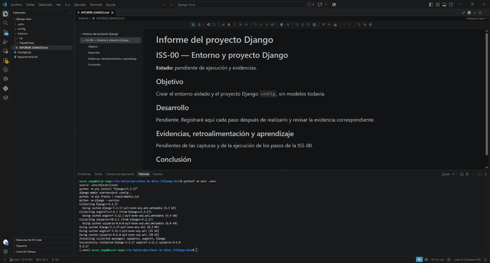

**Qué hice:** creé `.venv`, instalé Django 5.2.17 y generé el proyecto `config`.

**Retroalimentación:** la terminal muestra la instalación de Django 5.2.17 y el explorador muestra `.venv`, `config`, `manage.py` y `requirements.txt`.

**Lo que aprendí:** el entorno virtual aísla las dependencias del proyecto, y `django-admin startproject config .` crea la estructura inicial sin escribir `manage.py` a mano.

### Paso 2. Creación del archivo `.gitignore`

Creé `.gitignore` con las exclusiones indicadas en la ISS.

#### Evidencia complementaria — Archivo `.gitignore`

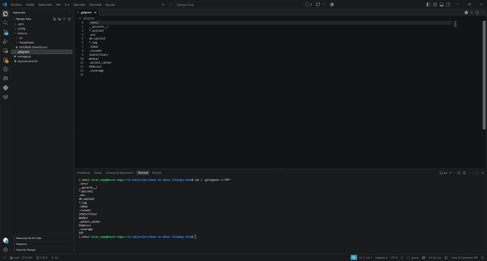

**Qué hice:** agregué al archivo las carpetas y los archivos locales o generados que no deben incluirse en el repositorio.

**Retroalimentación:** la captura muestra el contenido de `.gitignore` y el comando de creación.

**Lo que aprendí:** `.gitignore` permite mantener fuera del repositorio elementos como el entorno virtual, archivos temporales y la base local.

### Paso 3. Verificación de versión y del proyecto

Ejecuté las verificaciones indicadas en la ISS:

```sh
python -m django --version
python manage.py check
```

#### Evidencia de verificación — Django 5.2.17 y resultado de `check`

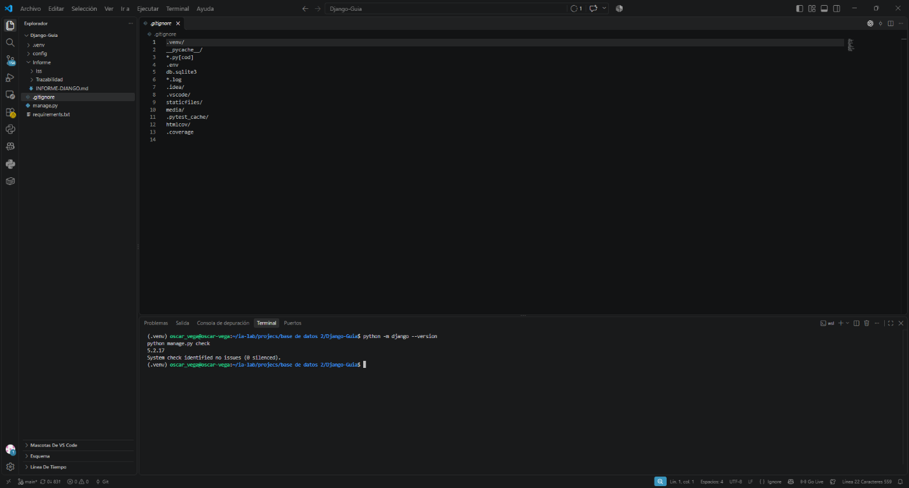

**Qué hice:** comprobé la versión de Django y ejecuté la revisión del sistema del proyecto.

**Retroalimentación:** la terminal muestra la versión `5.2.17` y que la comprobación terminó sin problemas.

**Lo que aprendí:** estas comprobaciones confirman que la versión requerida está instalada y que la configuración inicial pasa la revisión de Django.

### Conclusión

Completé la ISS-00 y obtuve el entorno virtual, el proyecto `config` y el archivo de dependencias. Según las capturas, se instalaron Django 5.2.17 y la revisión del sistema no reportó problemas. La estructura corresponde al proyecto inicial sin modelos de negocio; por ello, los criterios de aceptación de esta unidad quedan en PASS.

## ISS-01 — Settings y selección del motor

**Estado:** completada según las evidencias recibidas.

### Objetivo

Elegir un solo motor por proceso desde `.env`, sin escribir SQL.

### Paso 1. Activación del entorno virtual y confirmación del intérprete

Ejecuté los comandos iniciales de la ISS:

```sh
source .venv/bin/activate
which python
```

#### Evidencia EVI-01-01 — Intérprete del entorno virtual

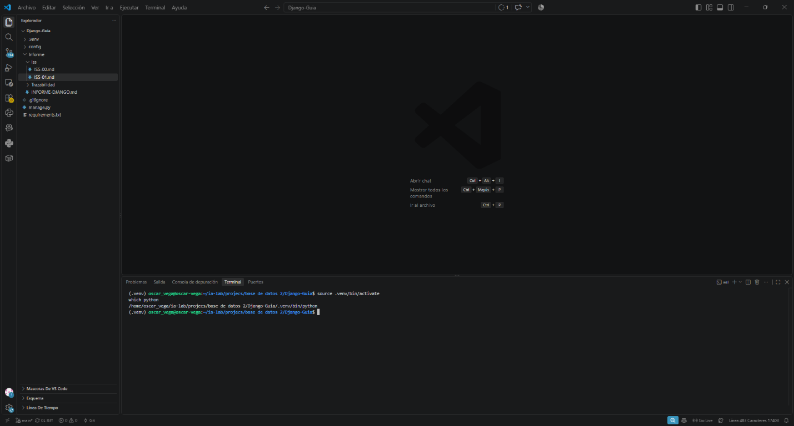

**Qué hice:** activé `.venv` y comprobé la ruta del intérprete.

**Retroalimentación:** la salida de `which python` apunta al ejecutable dentro de `.venv`.

**Lo que aprendí:** debo instalar los paquetes con el intérprete del entorno para que Django pueda utilizarlos.

### Paso 2. Instalación de herramientas del sistema y paquetes Python

Instalé las herramientas de compilación indicadas y los paquetes de la ISS dentro de `.venv`; al finalizar, guardé las dependencias:

```sh
sudo apt install build-essential pkg-config default-libmysqlclient-dev python3.12-dev
python -m pip install "python-dotenv==1.2.3"
python -m pip install "psycopg[binary]==3.3.6"
python -m pip install "mysqlclient==2.3.0"
python -m pip install "mssql-django==2.0.0"
python -m pip install "oracledb==26.0.1"
python -m pip freeze > requirements.txt
```

#### Evidencia EVI-01-02 — Herramientas del sistema

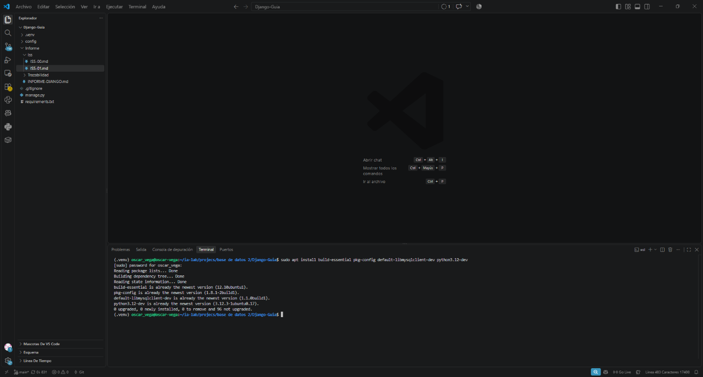

**Qué hice:** instalé `build-essential`, `pkg-config`, `default-libmysqlclient-dev` y `python3.12-dev`.

**Retroalimentación:** la terminal indica que las herramientas estaban instaladas o quedaron disponibles sin errores.

**Lo que aprendí:** `mysqlclient` requiere herramientas y cabeceras del sistema además de la instalación del paquete Python.

#### Evidencias EVI-01-03 y EVI-01-04 — Drivers y dependencias Python

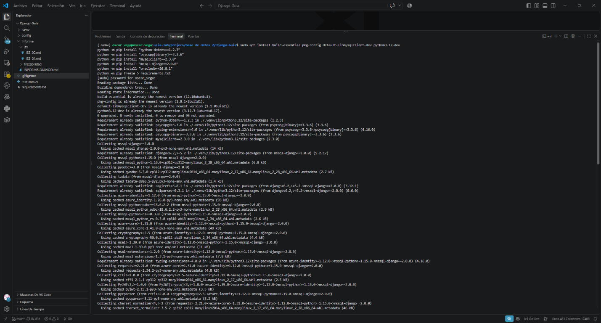

**Qué hice:** instalé las dependencias solicitadas para cargar `.env` y utilizar los motores PostgreSQL, MySQL, SQL Server y Oracle.

**Retroalimentación:** la terminal muestra la resolución y descarga de dependencias, seguida por la finalización de las instalaciones.

**Lo que aprendí:** Django necesita drivers separados para conectarse a los motores de base de datos que admite la configuración del proyecto.

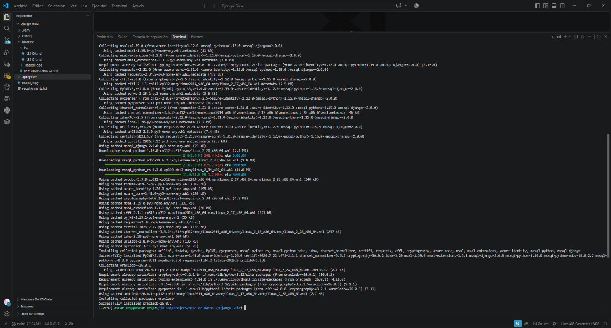

**Qué hice:** completé la instalación de `oracledb` después de instalar el resto de las dependencias.

**Retroalimentación:** pip muestra que `oracledb==26.0.1` se instaló correctamente.

**Lo que aprendí:** dejar fijadas las versiones y guardarlas en `requirements.txt` ayuda a reproducir el entorno.

### Paso 3. Preparación del paquete de settings

Ejecuté los comandos de la guía para retirar el archivo generado y crear el directorio del paquete:

```sh
rm config/settings.py
mkdir -p config/settings
```

#### Evidencia EVI-01-05 — Preparación de `config/settings`

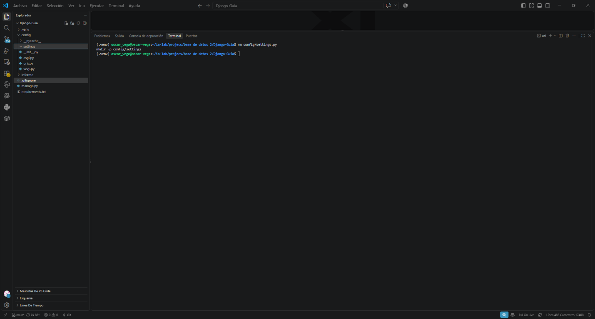

**Qué hice:** eliminé `config/settings.py` y creé el directorio `config/settings`.

**Retroalimentación:** la captura muestra la ejecución de ambos comandos sin errores.

**Lo que aprendí:** la configuración pasa de ser un solo archivo a un paquete llamado `config.settings`.

### Paso 4. Creación de `.env.example` y `.env`

Creé la plantilla de variables y la copié al archivo local de entorno, siguiendo el bloque de la ISS.

#### Evidencia EVI-01-06 — Plantilla `.env.example`

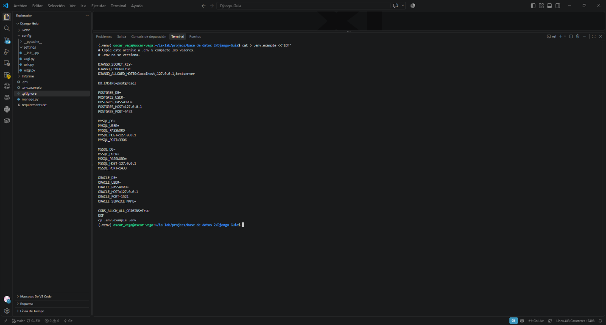

**Qué hice:** escribí la plantilla con las variables de Django y las variables separadas para cada motor, y luego ejecuté `cp .env.example .env`.

**Retroalimentación:** la salida muestra las variables de la plantilla y la copia al archivo `.env`.

**Lo que aprendí:** `.env.example` documenta qué valores requiere el proyecto; `.env` es el archivo local que utiliza el proceso y no se versiona.

### Paso 5. Generación de la clave y selección del motor

Generé la clave secreta mediante el comando de la ISS y completé `.env` para el motor elegido.

#### Evidencia EVI-01-07 — Generación de `DJANGO_SECRET_KEY`

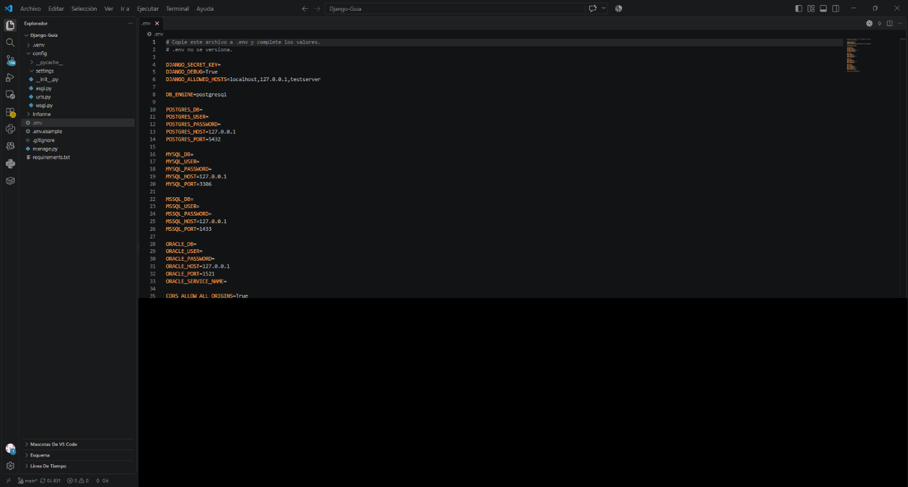

**Qué hice:** generé una clave usando `get_random_secret_key` para incorporarla a `.env`.

**Retroalimentación:** la captura original muestra que Django produjo una clave. En la copia incorporada al informe se ocultó el valor para no exponerlo.

**Lo que aprendí:** `DJANGO_SECRET_KEY` debe tener un valor para que settings pueda iniciar.

#### Evidencia EVI-01-11 — Variables del entorno y `DB_ENGINE`

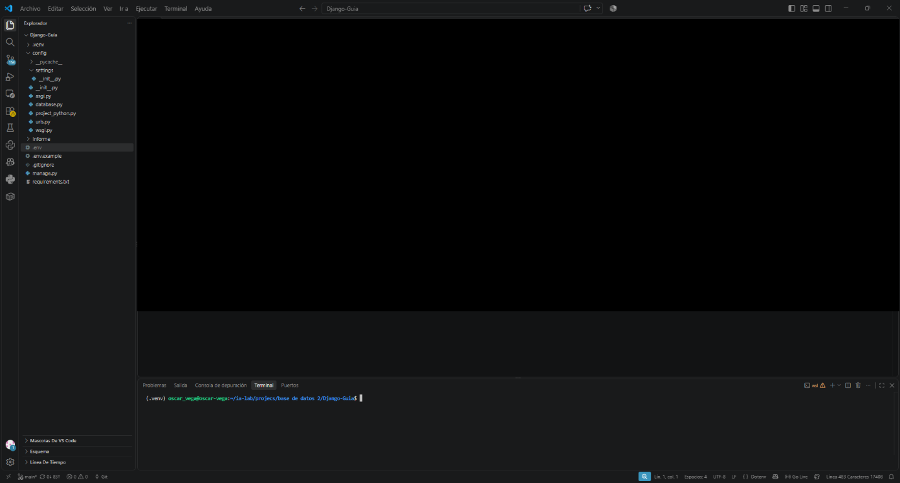

**Qué hice:** configuré `DB_ENGINE=mysql` y completé las variables de conexión de los motores en `.env`.

**Retroalimentación:** la captura original muestra el motor activo MySQL y sus variables de conexión. En la copia incorporada al informe se ocultaron los valores sensibles para no exponerlos.

**Lo que aprendí:** el bloque de variables que se completa debe corresponder al motor elegido en `DB_ENGINE`.

### Paso 6. Creación de `config/database.py`

Creé `config/database.py` con el código de la ISS para validar `DB_ENGINE`, exigir variables requeridas y construir una única configuración `DATABASES["default"]`.

#### Evidencia EVI-01-08 — Selector de motor de base de datos

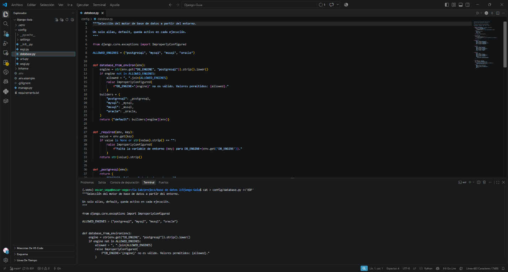

**Qué hice:** implementé la selección entre PostgreSQL, MySQL, SQL Server y Oracle.

**Retroalimentación:** el código mostrado comprueba el motor y define la configuración del alias `default`.

**Lo que aprendí:** aunque existan configuraciones para varios motores, el proceso utiliza un único motor activo.

### Paso 7. Creación del paquete de settings

Escribí `config/settings/__init__.py` con el bloque de configuración de la ISS: carga de `.env`, clave, aplicaciones instaladas, base de datos y opciones generales.

#### Evidencia EVI-01-09 — Configuración principal de Django

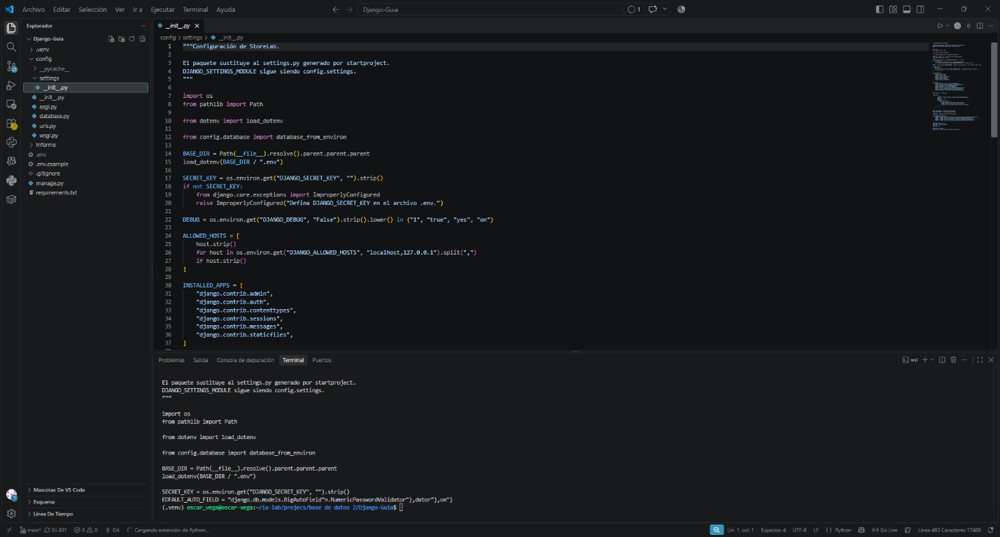

**Qué hice:** trasladé la configuración del proyecto al paquete `config.settings` y conecté los settings con `database_from_environ`.

**Retroalimentación:** el archivo muestra la lectura de `.env`, la validación de la clave y la configuración de Django.

**Lo que aprendí:** settings reúne la configuración necesaria para inicializar el proyecto y delega la selección del motor al módulo de base de datos.

### Paso 8. Creación de `config/project_python.py`

Creé el módulo de la ISS que vuelve a lanzar el comando con `.venv/bin/python` cuando hace falta.

#### Evidencia EVI-01-10 — Intérprete del proyecto

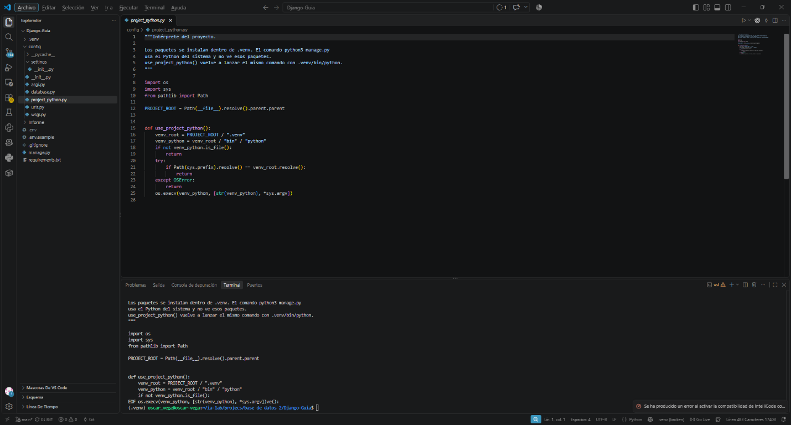

**Qué hice:** escribí la función `use_project_python()` según la guía.

**Retroalimentación:** el archivo contiene la ruta al Python del entorno y la comparación con `sys.prefix`.

**Lo que aprendí:** el proyecto puede redirigir sus comandos al intérprete donde están instaladas sus dependencias.

### Paso 9. Ajustes de `manage.py`, `wsgi.py` y `asgi.py`

Ajusté los tres puntos de entrada para que utilicen el código del entorno y carguen `.env` como prescribe la ISS.

#### Evidencia EVI-01-12 — Ajuste de `manage.py`

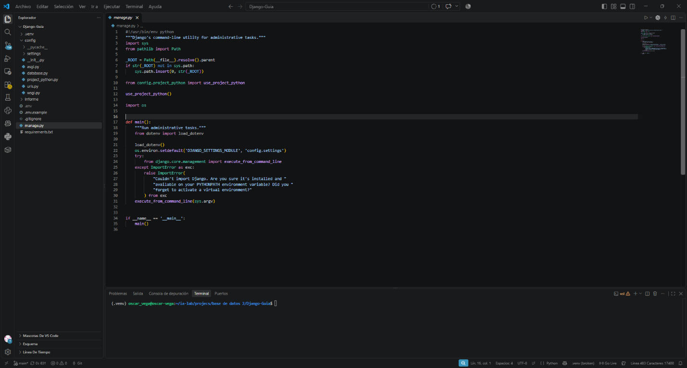

**Qué hice:** agregué la ruta raíz al `sys.path`, llamé a `use_project_python()` y añadí `load_dotenv()` dentro de `main()`.

**Retroalimentación:** la captura muestra la llamada al helper y la carga de variables antes de ejecutar comandos de Django.

**Lo que aprendí:** `manage.py` necesita cargar las variables del entorno antes de ejecutar las tareas administrativas.

#### Evidencia EVI-01-13 — Ajuste de `wsgi.py`

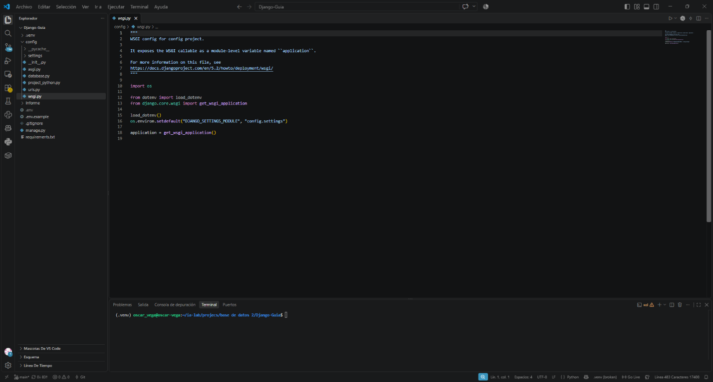

**Qué hice:** añadí `load_dotenv()` antes de establecer `DJANGO_SETTINGS_MODULE` e inicializar la aplicación WSGI.

**Retroalimentación:** la captura muestra la lectura del entorno en el punto de entrada WSGI.

**Lo que aprendí:** el proceso WSGI también debe cargar `.env` para disponer de las variables al iniciar Django.

#### Evidencia EVI-01-14 — Ajuste de `asgi.py`

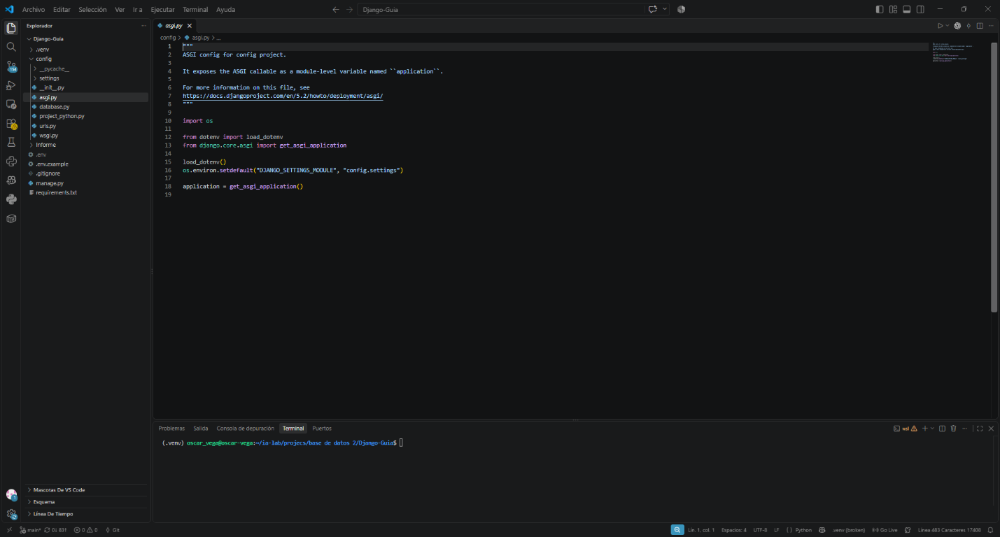

**Qué hice:** apliqué el mismo patrón de carga de `.env` antes de inicializar la aplicación ASGI.

**Retroalimentación:** la captura muestra `load_dotenv()` y la inicialización de ASGI.

**Lo que aprendí:** los dos puntos de entrada del proyecto deben utilizar las variables de entorno.

### Paso 10. Verificación y arranque

Ejecuté los comandos de verificación indicados:

```sh
python manage.py check
python manage.py runserver
```

#### Evidencia EVI-01-15 — Resultado de `check` y servidor en funcionamiento

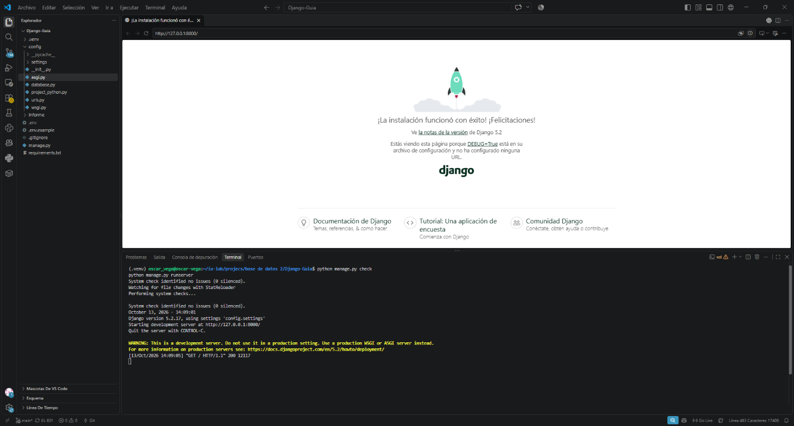

**Qué hice:** ejecuté `check`, inicié el servidor y abrí la página local de Django.

**Retroalimentación:** la terminal muestra que la comprobación terminó sin problemas y que el servidor atendió una solicitud; el navegador muestra la página inicial de Django.

**Lo que aprendí:** con los settings y las variables del entorno definidos, el proyecto puede iniciar el servidor de desarrollo.

### Conclusión

Completé la ISS-01 configurando la selección de un único motor desde `.env`, creando el paquete de settings y ajustando los puntos de entrada. La evidencia del paso final muestra que `check` terminó sin problemas y que la página inicial de Django respondió. Los criterios de selección de cada motor requieren las pruebas descritas en la ruta; el GATE queda pendiente hasta que esas pruebas se ejecuten en la unidad indicada.

## ISS-02 — Apps client, product y sale

**Estado:** completada según las evidencias recibidas.

### Objetivo

Crear las tres apps de negocio con la CLI y registrarlas dentro del paquete `apps`, todavía sin escribir modelos.

### Paso 1. Creación de las apps y del paquete `apps`

Creé las tres apps de negocio usando `startapp` y preparé el paquete `apps`:

```sh
mkdir -p apps/client apps/product apps/sale
python manage.py startapp client apps/client
python manage.py startapp product apps/product
python manage.py startapp sale apps/sale
mkdir -p apps
cat > apps/__init__.py <<'EOF'
EOF
```

#### Evidencia EVI-02-01 — Estructura de las tres apps

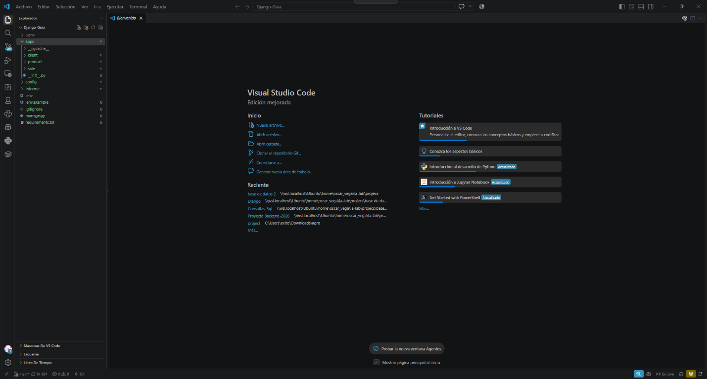

**Qué hice:** creé las carpetas `client`, `product` y `sale` dentro de `apps/`, además de `apps/__init__.py`.

**Retroalimentación:** el explorador muestra las tres apps y el archivo de inicialización del paquete.

**Lo que aprendí:** `startapp` genera la estructura estándar de cada app, y `apps/__init__.py` permite importar el paquete común.

### Paso 2. Configuración de `AppConfig`

Actualicé el `name` y el `label` de cada aplicación, conservando los nombres de clase indicados por la guía.

#### Evidencia EVI-02-02 — `ClientConfig`

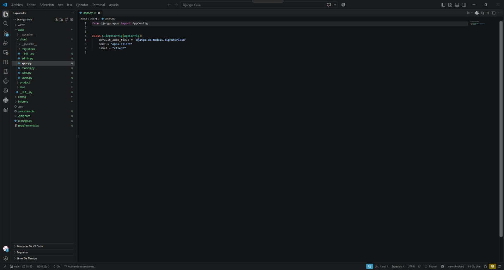

**Qué hice:** configuré `name = "apps.client"` y `label = "client"`.

**Retroalimentación:** los valores aparecen en `ClientConfig` y se conserva el nombre de clase.

**Lo que aprendí:** `name` representa la ruta importable de la app y `label` mantiene el nombre del dominio.

#### Evidencia EVI-02-03 — `ProductConfig`

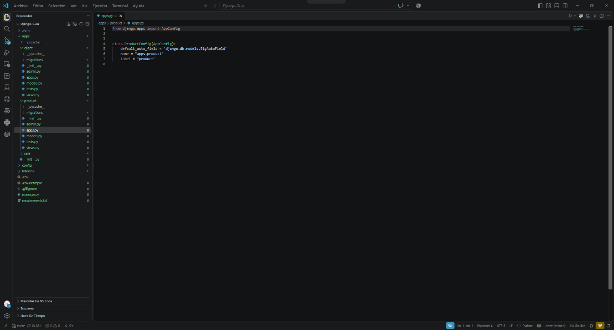

**Qué hice:** configuré `name = "apps.product"` y `label = "product"`.

**Retroalimentación:** los valores aparecen en `ProductConfig`.

**Lo que aprendí:** cada app alojada en `apps/` necesita su ruta completa en `name`.

#### Evidencia EVI-02-04 — `SaleConfig`

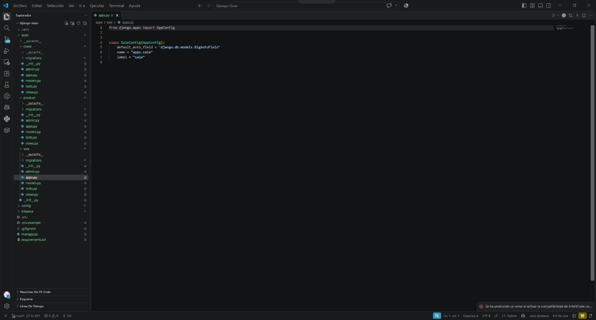

**Qué hice:** configuré `name = "apps.sale"` y `label = "sale"`.

**Retroalimentación:** los valores aparecen en `SaleConfig` y la clase conserva el nombre indicado.

**Lo que aprendí:** las tres apps usan el mismo patrón de configuración y cada una conserva su label de dominio.

### Paso 3. Registro de las apps y ejecución de `check`

Agregué las tres clases a `INSTALLED_APPS` y ejecuté la verificación indicada:

```sh
python manage.py check
```

#### Evidencia — Registro de las apps en settings

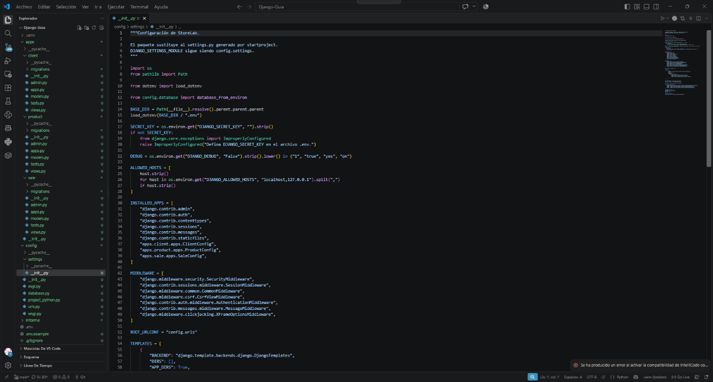

**Qué hice:** agregué `ClientConfig`, `ProductConfig` y `SaleConfig` a `config/settings/__init__.py`.

**Retroalimentación:** la lista muestra las tres rutas de configuración registradas.

**Lo que aprendí:** Django debe cargar las apps desde `INSTALLED_APPS`, además de que sus directorios existan.

#### Evidencia EVI-02-01 — Resultado de `python manage.py check`

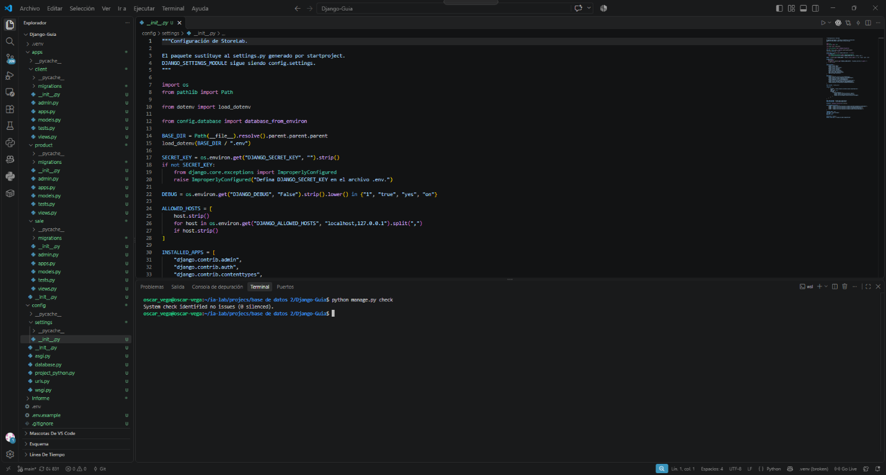

**Qué hice:** ejecuté el comando `python manage.py check`.

**Retroalimentación:** la terminal responde `System check identified no issues (0 silenced)`.

**Lo que aprendí:** esta comprobación detecta problemas de configuración de Django, incluidos errores al cargar las apps.

#### Evidencia complementaria — Settings y ausencia de modelos de negocio

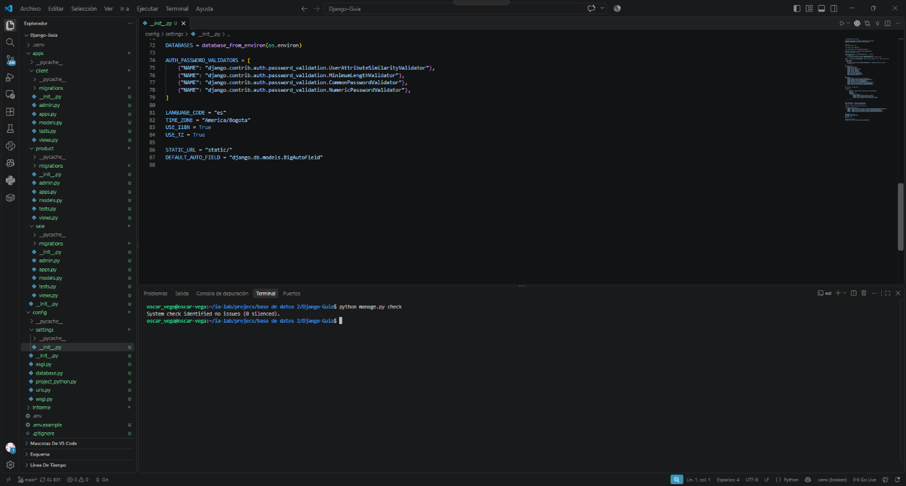

**Qué hice:** documenté la vista adicional de settings y el estado del proyecto después del registro de las apps.

**Retroalimentación:** la captura complementa la revisión del settings; esta unidad no añade modelos de negocio.

**Lo que aprendí:** la ISS-02 prepara las apps para las unidades siguientes y deja la creación de modelos para cuando corresponda.

### Conclusión

Creé y registré `client`, `product` y `sale`, configuré sus nombres de paquete y labels, y ejecuté `python manage.py check`. La salida mostrada no reporta problemas. En esta unidad todavía no se escribieron modelos de negocio; según las evidencias recibidas, el GATE de ISS-02 queda en PASS.

## ISS-03 — Custom User antes de la primera migración

**Estado:** completé parcialmente esta ISS. Me quedan pendientes las pruebas del flujo de autenticación y confirmar todos los criterios de aceptación.

### Objetivo

Definir el usuario de StoreLab sobre `django.contrib.auth` y fijar `AUTH_USER_MODEL` antes de migrar.

### Paso 1. Creación de `apps/common` y `RecordStatus`

Creé el paquete común y definí `RecordStatus` con los estados `ACTIVE` e `INACTIVE`, según el bloque de la guía.

#### Evidencia — Paquete común y estados del registro

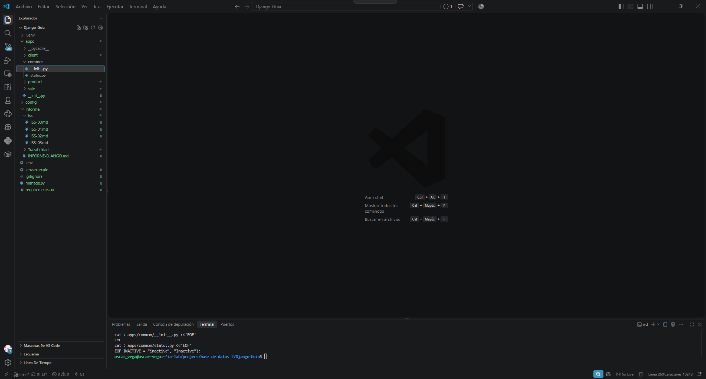

**Qué hice:** creé `apps/common/__init__.py` y escribí `apps/common/status.py` con las opciones de estado.

**Retroalimentación:** la terminal muestra la escritura de ambos archivos y el explorador muestra el paquete y `status.py`.

**Lo que aprendí:** puedo centralizar opciones compartidas para que el usuario y las apps de negocio utilicen la misma definición de estado.

### Paso 2. Creación de la app `security`

Creé el directorio de destino y generé la app de seguridad mediante `startapp`.

#### Evidencia — Estructura inicial de `apps/security`

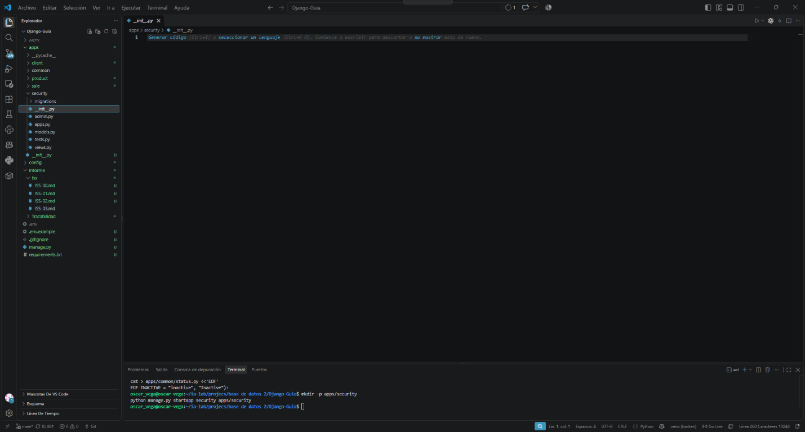

**Qué hice:** ejecuté los comandos de la ISS para crear `apps/security` con la CLI de Django.

**Retroalimentación:** la terminal muestra `python manage.py startapp security apps/security` y el explorador muestra los archivos iniciales de la aplicación.

**Lo que aprendí:** `startapp` genera la estructura estándar de la aplicación dentro del directorio de destino creado previamente.

### Paso 3. Configuración de `SecurityConfig`

Actualicé `apps/security/apps.py` con el nombre importable y el label indicados en la guía.

#### Evidencia — `SecurityConfig`

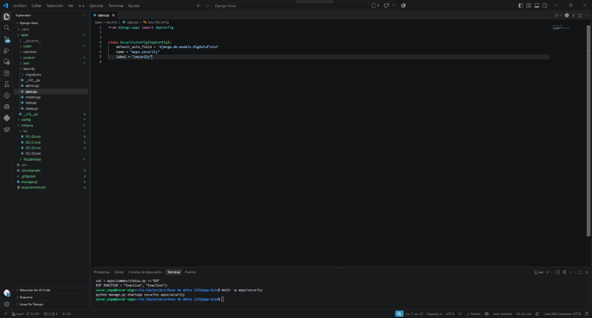

**Qué hice:** configuré `name = "apps.security"` y `label = "security"`, manteniendo la clase `SecurityConfig`.

**Retroalimentación:** la captura muestra los valores en el archivo de configuración de la app.

**Lo que aprendí:** `name` debe reflejar la ubicación de la app dentro del paquete `apps`, mientras que el label identifica a la app en Django.

### Paso 4. Definición del usuario personalizado

Elegí `AbstractUser`, como propone la ISS, y escribí el modelo `User`, su manager, los campos de estado y fechas, la restricción y el comportamiento de `save()`.

#### Evidencia — Modelo `User` y `StoreUserManager`

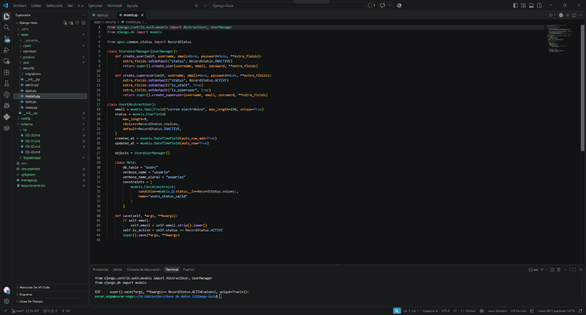

**Qué hice:** escribí el código del modelo y del manager conforme al bloque de la guía.

**Retroalimentación:** la captura muestra el uso de `AbstractUser`, los valores de estado predeterminados, el email único, las fechas y la restricción `users_status_valid`.

**Lo que aprendí:** `AbstractUser` aporta la funcionalidad de autenticación de Django, y el manager permite definir estados iniciales distintos para usuarios normales y superusuarios.

### Paso 5. Registro de security y declaración del usuario de Django

Agregué `SecurityConfig` antes de las apps de negocio y declaré `AUTH_USER_MODEL = "security.User"` antes de ejecutar las migraciones.

#### Evidencia — `INSTALLED_APPS` y `AUTH_USER_MODEL`

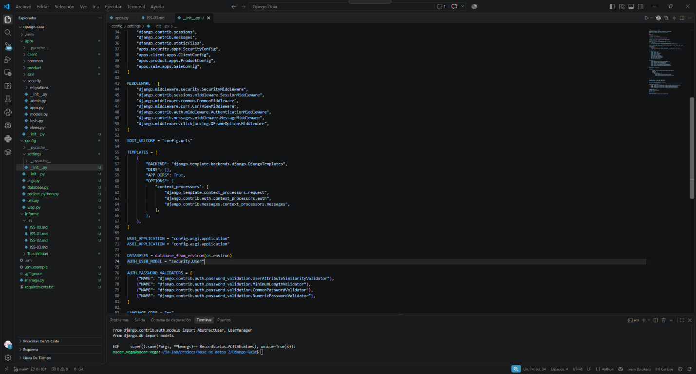

**Qué hice:** registré la app de seguridad en settings y declaré el modelo de usuario personalizado.

**Retroalimentación:** la captura muestra `apps.security.apps.SecurityConfig` delante de las apps de negocio y la asignación de `AUTH_USER_MODEL`.

**Lo que aprendí:** Django debe conocer el modelo personalizado antes de la primera migración para crear el esquema de autenticación correcto desde el inicio.

### Paso 6. Pruebas de selección de base de datos

Reemplacé el archivo de pruebas de la app con `DatabaseSelectionTests`, tal como indica la ISS.

#### Evidencia — `DatabaseSelectionTests`

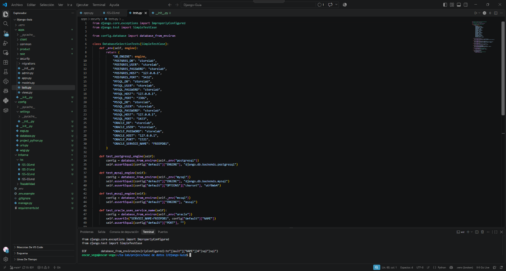

**Qué hice:** escribí pruebas para los cuatro motores, el motor inválido y la ausencia de una variable obligatoria.

**Retroalimentación:** el archivo muestra los casos de prueba y sus valores de entorno de ejemplo.

**Lo que aprendí:** con `SimpleTestCase` puedo verificar la configuración de motores sin abrir una conexión a cada base de datos.

### Paso 7. Generación de migración y ejecución de pruebas

Ejecuté los comandos de la ISS para generar la migración de seguridad, aplicar migraciones y ejecutar `DatabaseSelectionTests`.

#### Evidencia — Migración inicial y seis pruebas PASS

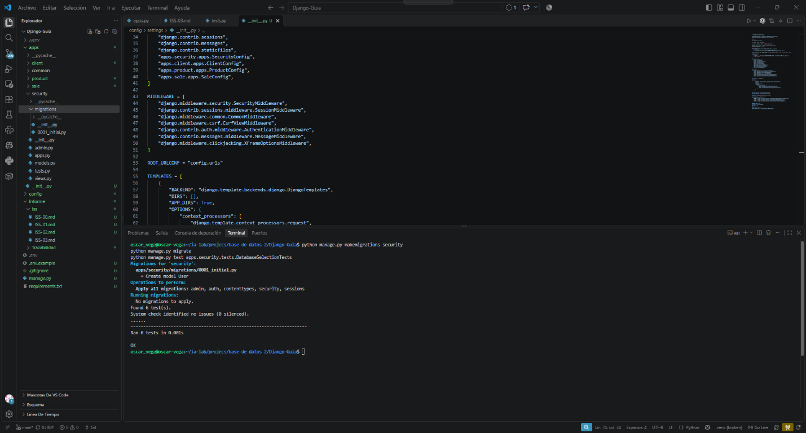

**Qué hice:** ejecuté `makemigrations security`, `migrate` y `python manage.py test apps.security.tests.DatabaseSelectionTests`.

**Retroalimentación:** la salida muestra la creación de `security.0001_initial`, seis pruebas ejecutadas y el resultado `OK`, junto con `System check identified no issues`. Esta captura no demuestra las pruebas de login de `AuthFlowTests` ni identifica por sí sola el motor de base de datos utilizado.

**Lo que aprendí:** la migración del usuario personalizado debe generarse después de configurar `AUTH_USER_MODEL`, y las pruebas de selección comprueban la configuración sin sustituir las pruebas del flujo de autenticación.

### Conclusión

Avancé con la creación de `RecordStatus`, la app `security`, el modelo de usuario personalizado, su registro en settings y las pruebas de selección de motores. La evidencia final muestra seis pruebas de `DatabaseSelectionTests` aprobadas y la migración inicial generada. Dejo el estado como parcialmente completado: la guía especifica `AuthFlowTests` para verificar los criterios de login, y esas pruebas no aparecen en las capturas recibidas. Por ello, todavía no marco el GATE completo como PASS.

## ISS-04 — Modelo Client

**Estado:** completé parcialmente esta ISS. Me queda pendiente documentar las verificaciones del cliente y confirmar los criterios de aceptación.

### Objetivo

Persistir compradores con el diccionario de `clients`.

### Paso 1. Creación de los modelos abstractos compartidos

Creé `apps/common/models.py` con `TimeStampedModel` para las fechas y `StoreLabModel` para el estado y la restricción reutilizable, siguiendo el bloque de la ISS.

#### Evidencia — Modelos base `TimeStampedModel` y `StoreLabModel`

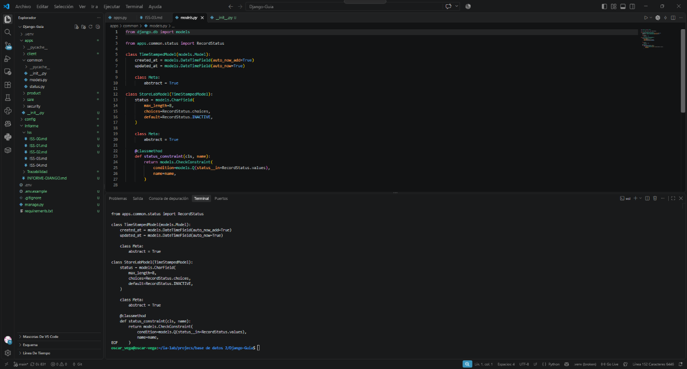

**Qué hice:** definí las clases abstractas y el método `status_constraint()` que produce la restricción de estados permitidos.

**Retroalimentación:** la captura muestra los campos `created_at`, `updated_at`, `status` y el constraint construido a partir de `RecordStatus`.

**Lo que aprendí:** las clases abstractas permiten compartir fechas y estado entre modelos sin crear una tabla propia para la clase base.

### Paso 2. Creación del modelo `Client`

Reescribí `apps/client/models.py` con los campos del comprador, las reglas de validación, la tabla física `clients` y la normalización del correo electrónico.

#### Evidencia — Modelo `Client`

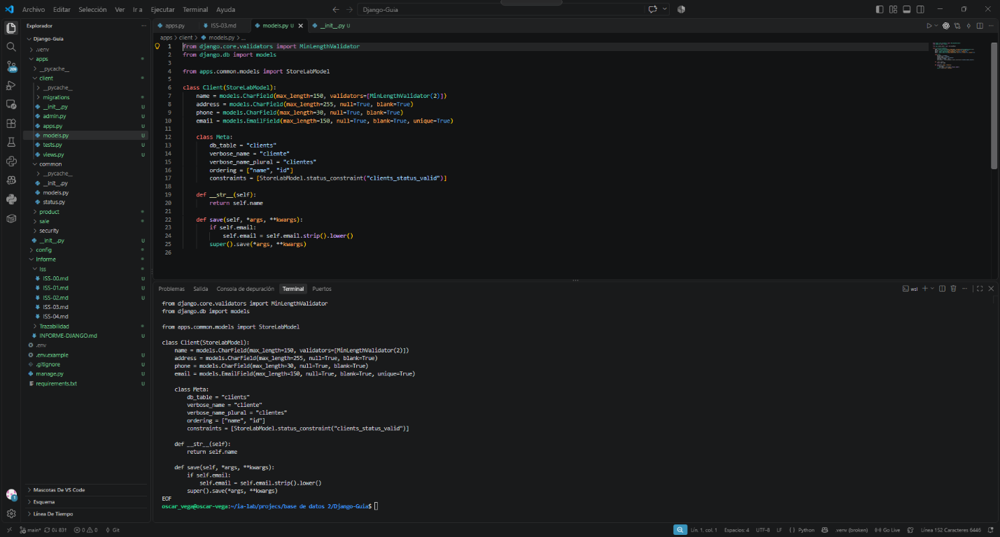

**Qué hice:** definí `Client` como descendiente de `StoreLabModel`, agregué nombre, dirección, teléfono y correo, establecí `db_table = "clients"` y convertí el email a minúsculas al guardar.

**Retroalimentación:** el código de la captura muestra el validador de longitud mínima para el nombre, los campos opcionales y la unicidad del correo.

**Lo que aprendí:** las reglas del modelo y la clase base compartida mantienen consistentes los datos persistidos y preparan la validación que usarán interfaces posteriores.

### Paso 3. Generación y aplicación de la migración

Ejecuté los comandos indicados para crear la migración de `client` y aplicar las migraciones:

```sh
python manage.py makemigrations client
python manage.py migrate
```

#### Evidencia EVI-04-01 — Migración inicial de `client`

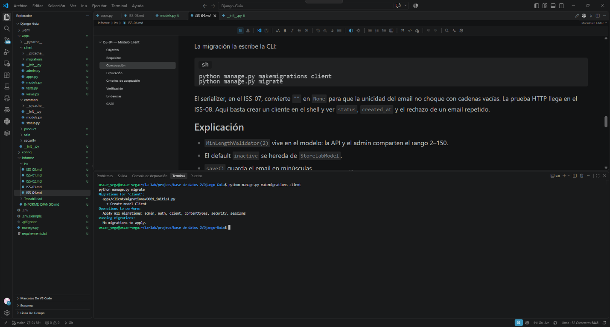

**Qué hice:** generé `apps/client/migrations/0001_initial.py` y ejecuté el comando de migración.

**Retroalimentación:** la terminal muestra la creación de la migración `client.0001_initial` con el modelo `Client`; después, `migrate` informa que no hay migraciones pendientes.

**Lo que aprendí:** Django genera la migración a partir del modelo y registra qué migraciones quedan por aplicar en la base configurada.

### Verificaciones pendientes

La ISS indica crear un cliente en el shell y observar `status`, `created_at` y el rechazo de un email repetido. Esa ejecución todavía no aparece en las capturas recibidas. La prueba HTTP llega en ISS-08 y `ClientApiTests` se menciona como verificación posterior; no afirmo que estas pruebas hayan pasado con la evidencia actual.

### Conclusión

Creé los modelos abstractos reutilizables, definí `Client` y generé su migración inicial. La captura muestra que no quedaron migraciones pendientes, pero aún no tengo evidencia de la creación manual del cliente ni de las comprobaciones de unicidad y longitud. Por eso dejo la ISS-04 parcialmente completada y no marco su GATE como PASS.

## ISS-05 — ProductType y Product

**Estado:** completé parcialmente esta ISS. Tengo evidencia de la definición de los modelos y de la migración; me faltan las pruebas requeridas para confirmar el GATE.

### Objetivo

Modelar el catálogo y la integridad `ProductType 1 → N Product`.

### Paso 1. Definición de `ProductType` y `Product`

Reescribí `apps/product/models.py` con los dos modelos de catálogo y la relación protegida entre ellos.

#### Evidencia — Modelos y migración de producto


**Qué hice:** definí `ProductType` y `Product`, los campos de catálogo, precio y stock, y la clave foránea `product_type` con `on_delete=models.RESTRICT`. Después ejecuté los comandos de migración indicados en la guía:

```sh
python manage.py makemigrations product
python manage.py migrate
```

**Retroalimentación:** la captura muestra el código de ambos modelos y la salida con la creación de `product.0001_initial` y su aplicación.

**Lo que aprendí:** el detalle de la relación se conserva mediante una FK explícita; `RESTRICT` evita eliminar un tipo de producto que esté siendo referenciado.

### Verificaciones pendientes

La captura no muestra la ejecución de `ProductApiTests.test_default_status_and_type_restriction` ni `test_duplicate_product_name`. Por eso todavía no confirmo mediante pruebas el rechazo al borrar un tipo referenciado, el nombre duplicado ni los valores por defecto.

### Conclusión

Definí los modelos `ProductType` y `Product` y generé y apliqué la migración inicial. Me falta evidencia de las pruebas de restricción, unicidad y valores predeterminados, así que dejo la ISS-05 parcialmente completada y el GATE pendiente.

## ISS-06 — Sale y ProductSale

**Estado:** en progreso. Generé la migración de `sale`, pero `migrate` quedó bloqueado por una incompatibilidad en la tabla `clients`.

### Objetivo

Representar la venta y su detalle con precio histórico, sin sustituir el detalle por una relación muchos-a-muchos simple.

### Paso 1. Creación del manager de ventas

Creé `apps/sale/managers.py` con el `SaleQuerySet` y el `SaleManager` vacíos, tal como indica esta ISS.

#### Evidencia — `SaleQuerySet` y `SaleManager`

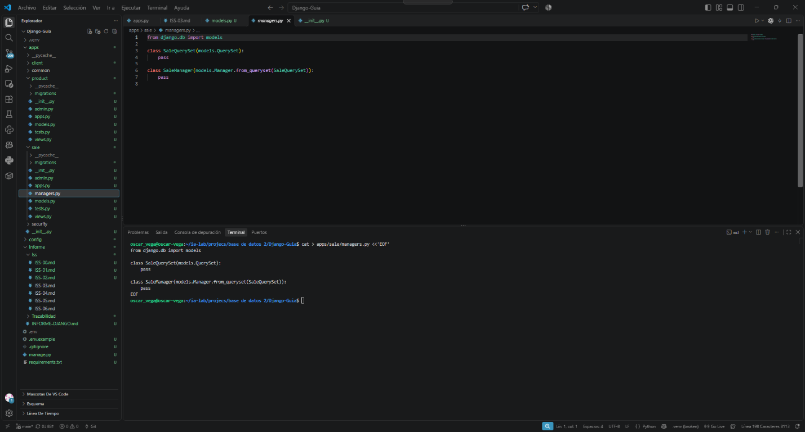

**Qué hice:** declaré el queryset y el manager que utilizará el modelo `Sale`; todavía no agregué el método `register`, que corresponde a ISS-11.

**Retroalimentación:** la captura muestra las dos clases generadas con `pass`, de acuerdo con el alcance de esta unidad.

**Lo que aprendí:** puedo preparar el manager para el modelo sin adelantar operaciones transaccionales que la guía reserva para una ISS posterior.

### Paso 2. Creación de `Sale` y `ProductSale` y generación de migración

Escribí los modelos de venta y detalle siguiendo el bloque de ISS-06 y ejecuté:

```sh
python manage.py makemigrations sale
python manage.py migrate
```

#### Evidencia — Error al aplicar `sale.0001_initial`

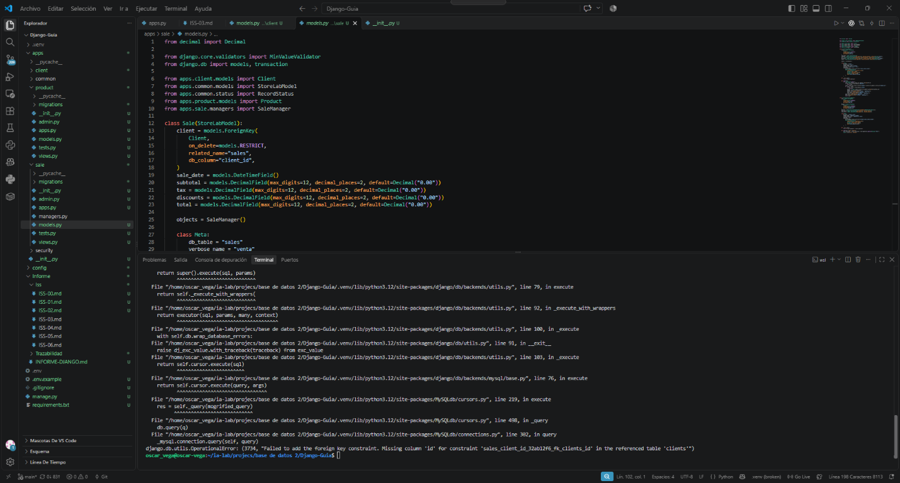

**Qué hice:** generé `sale.0001_initial` y traté de aplicar las migraciones.

**Retroalimentación:** Django generó la migración con los modelos `Sale` y `ProductSale`, pero MySQL detuvo su aplicación con el error 3734: no encuentra la columna `id` en la tabla referenciada `clients` para crear la clave foránea `sales_client_id_32ab12f6_fk_clients_id`. Por tanto, la migración de `sale` no quedó confirmada como aplicada.

**Lo que aprendí:** las claves foráneas de MySQL requieren que la columna referenciada exista en la tabla real y sea compatible con la clave primaria que declara el modelo.

### Solución del error

La causa fue que la base de datos ya tenía tablas creadas. Borré y volví a crear la base de datos para dejarla limpia y permitir que Django construyera las tablas a partir de las migraciones del proyecto.

**Qué hice:** eliminé la base de datos anterior, que ya contenía tablas, y creé nuevamente la base. Después volví a ejecutar `migrate`.

**Retroalimentación:** la captura posterior muestra `Applying sale.0001_initial... OK`, por lo que la migración se aplicó en la base recién creada.

**Lo que aprendí:** las tablas preexistentes pueden no coincidir con el esquema que espera el estado actual de las migraciones. Al recrear la base, Django pudo construir desde cero las tablas y claves foráneas definidas por el proyecto.

### Paso 3. Aplicación exitosa de la migración

Después de recrear la base de datos, ejecuté nuevamente:

```sh
python manage.py migrate
```

#### Evidencia — `sale.0001_initial` aplicada

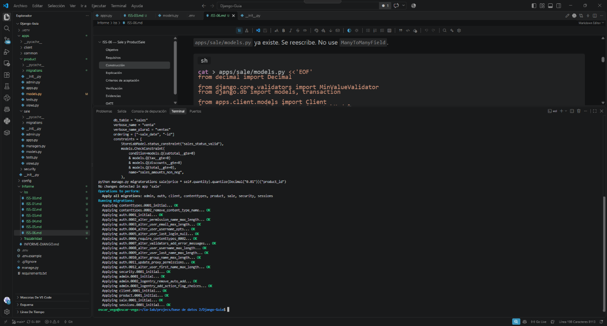

**Qué hice:** apliqué las migraciones del proyecto sobre la base de datos recién creada.

**Retroalimentación:** la terminal muestra que las migraciones se aplicaron y que `sale.0001_initial` terminó con `OK`.

**Lo que aprendí:** después de iniciar una base limpia, las migraciones pueden crear en orden las tablas y sus claves foráneas según los modelos del proyecto.

### Estado y verificaciones pendientes

La migración de `sale` quedó aplicada. Aún me falta la verificación del precio histórico indicada por la ISS; por ello, no marco el GATE completo como PASS.

### Conclusión

Primero encontré el error de clave foránea porque la base ya tenía tablas creadas. Borré y creé de nuevo la base, volví a ejecutar `migrate` y la captura confirma que `sale.0001_initial` se aplicó correctamente. Me queda pendiente la prueba de precio histórico para completar las verificaciones de ISS-06.

## ISS-07 — Serializers y JSON camelCase

**Estado:** completé la instalación de dependencias, la configuración de DRF y los serializers; me quedan pendientes las pruebas de esta ISS.

### Objetivo

Traducir modelos a JSON sin renombrar los campos Python.

### Paso 1. Instalación de dependencias de la API

Instalé Django REST Framework, el renderer/parser camelCase y CORS con los comandos de la guía:

```sh
source .venv/bin/activate
python -m pip install "djangorestframework==3.17.2" "djangorestframework-camel-case==1.4.2" "django-cors-headers==4.9.0"
python -m pip freeze > requirements.txt
```

#### Evidencia — Dependencias instaladas y apps registradas

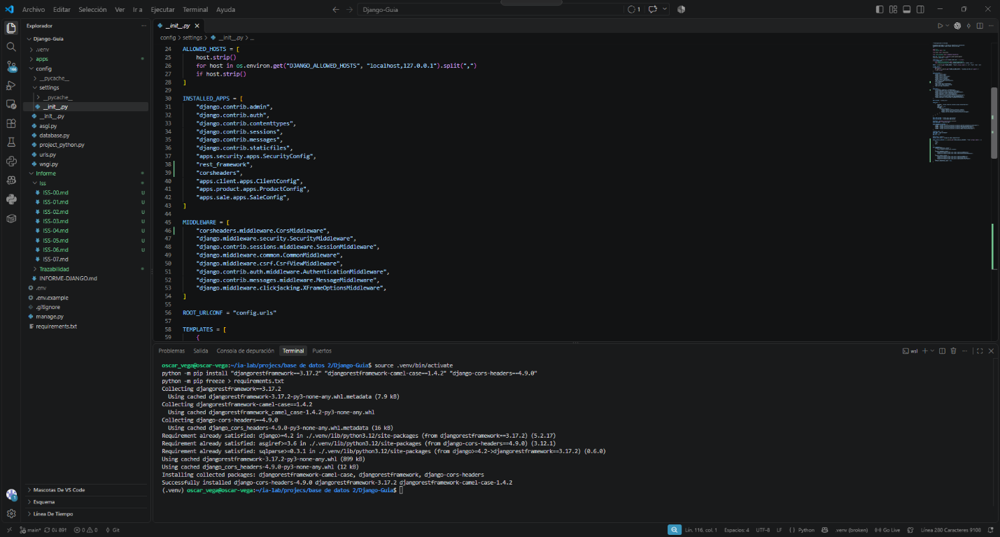

**Qué hice:** instalé los tres paquetes indicados y preparé su registro en `INSTALLED_APPS`.

**Retroalimentación:** la terminal muestra la instalación exitosa de Django REST Framework, camel-case y CORS; el settings visible muestra `rest_framework` y `corsheaders`.

**Lo que aprendí:** los serializers y el renderer/parsers pertenecen a dependencias adicionales a Django y se registran en la configuración para usarlos en la API.

### Paso 2. Configuración de CORS y REST Framework

Configuré `CORS_ALLOW_ALL_ORIGINS` y las clases de permisos, renderers, parsers y paginación según la ISS.

#### Evidencia — `REST_FRAMEWORK` y CORS

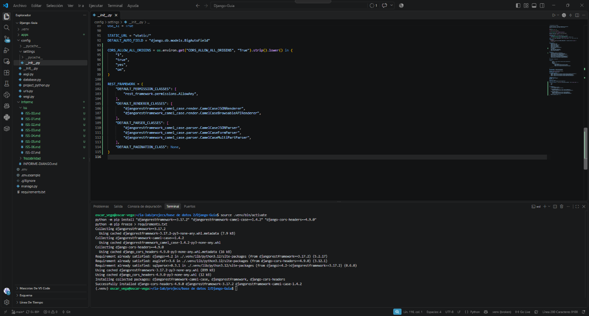

**Qué hice:** añadí la configuración de CORS y definí los renderers y parsers camelCase de REST Framework.

**Retroalimentación:** la captura muestra la configuración `AllowAny`, el renderer JSON camelCase, sus parsers y `DEFAULT_PAGINATION_CLASS = None`.

**Lo que aprendí:** la conversión camelCase se configura en el borde HTTP; los nombres de los campos Python y de la base de datos se mantienen en snake_case.

### Paso 3. Creación de `ClientSerializer`

Creé `apps/client/serializers.py` con los campos expuestos, reglas de lectura y validación del correo y de los campos opcionales.

#### Evidencia — Serializer de clientes

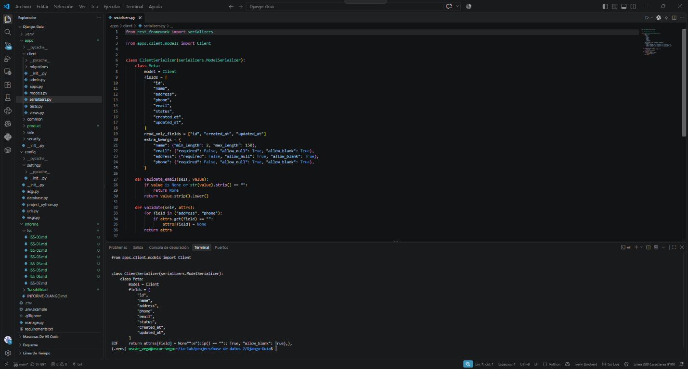

**Qué hice:** definí `ClientSerializer` con lista explícita de campos, campos de solo lectura y validaciones para nombre, email, dirección y teléfono.

**Retroalimentación:** el código muestra que el email vacío se normaliza a `None` y el email escrito se guarda en minúsculas.

**Lo que aprendí:** la lista explícita de campos controla lo que expone la API y las validaciones del serializer preparan los datos antes de persistirlos.

### Paso 4. Creación de serializers para productos

Creé `ProductTypeSerializer` y `ProductSerializer`, exponiendo la relación escribible `product_type_id` y el nombre de tipo solo como lectura.

#### Evidencia — Serializers de tipos y productos

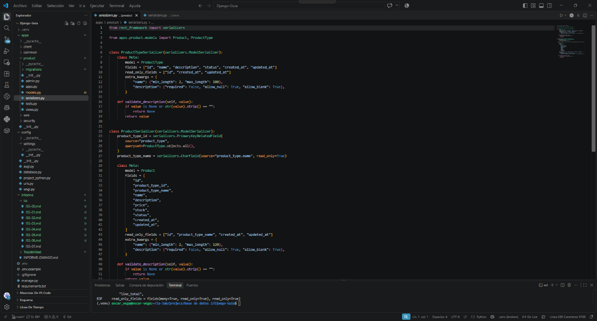

**Qué hice:** declaré los campos de ambos serializers, incluida la relación con `ProductType`.

**Retroalimentación:** la captura muestra `product_type_id` como `PrimaryKeyRelatedField` y `product_type_name` como campo de solo lectura.

**Lo que aprendí:** una API puede aceptar el identificador de la relación y responder también con un campo informativo derivado del objeto relacionado.

### Paso 5. Creación de serializers de lectura para ventas

Creé `ProductSaleSerializer` y `SaleSerializer` en `apps/sale/serializers.py`.

#### Evidencia — Serializers de ventas y líneas

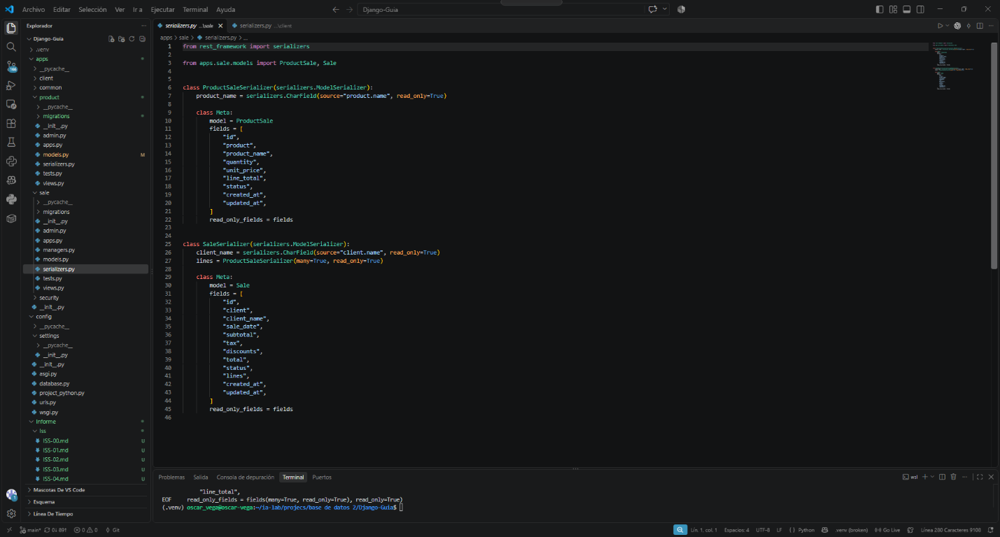

**Qué hice:** definí la representación de las líneas y la venta con `client_name` y `lines` anidados de solo lectura.

**Retroalimentación:** todos los campos mostrados están declarados como solo lectura, de acuerdo con el alcance de ISS-07, que solo consulta ventas.

**Lo que aprendí:** el serializer puede componer datos relacionados en una respuesta JSON sin permitir todavía el alta transaccional de la venta.

### Verificaciones pendientes

La guía indica ejecutar `ClientApiTests.test_create_defaults_and_persists` y `ProductApiTests.test_product_crud_and_available_filter`. Las capturas recibidas muestran el código de los serializers y settings, pero no la salida de esas pruebas. Todavía no marco el GATE de ISS-07 como PASS.

### Conclusión

Instalé las dependencias de la API, configuré CORS y REST Framework y escribí los serializers de clientes, productos y ventas. Las capturas documentan estos pasos. Me falta la evidencia de las pruebas que verifican el JSON camelCase, la normalización del correo y el nombre del tipo de producto; por eso dejo ISS-07 parcialmente completada.

## ISS-08 — Client con ModelViewSet

**Estado:** implementé y probé el CRUD de clientes. Las cuatro pruebas pasaron en la ejecución documentada; quedan pendientes evidencias de los otros motores mencionados por el GATE.

### Objetivo

Publicar el CRUD de clientes con `ModelViewSet`.

### Paso 1. Vista para el recurso de clientes

Creé `apps/client/views.py` con `ClientViewSet`, acceso `AllowAny`, filtro opcional por `status` y baja lógica.

#### Evidencia EVI-08-01 — `ClientViewSet`

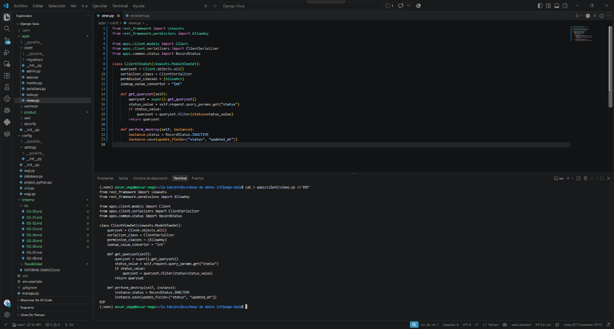

**Qué hice:** implementé las operaciones CRUD genéricas con `ModelViewSet` y personalicé la consulta y la baja lógica.

**Retroalimentación:** la captura muestra `AllowAny`, el filtro por parámetro `status` y `perform_destroy`, que conserva la fila al marcarla inactiva.

**Lo que aprendí:** `ModelViewSet` cubre el CRUD y permite personalizar las partes específicas del recurso sin reimplementar cada método HTTP.

### Paso 2. Pruebas de la API de clientes

Preparé `ClientApiTests` para verificar el alta y persistencia, las validaciones, la baja lógica, el listado, el detalle y la actualización.

#### Evidencia EVI-08-02 — Pruebas del CRUD

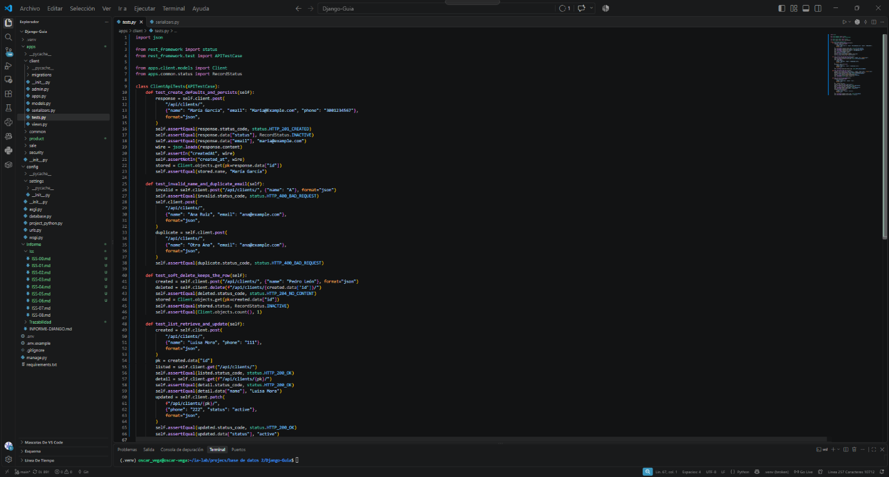

**Qué hice:** escribí las cuatro pruebas indicadas para comprobar los comportamientos principales del endpoint.

**Retroalimentación:** la captura deja visibles las aserciones de alta, respuesta JSON camelCase, validación de correo y persistencia.

**Lo que aprendí:** las pruebas de API comprueban tanto el código HTTP como los datos devueltos y el estado que finalmente queda guardado.

### Paso 3. Primera ejecución de las pruebas

Ejecuté `python manage.py test apps.client`. En este primer intento, el servidor MySQL no permitió crear la base `test_Pedalibre` y devolvió el error `1044`.

#### Evidencia EVI-08-03 — Primer intento bloqueado por permisos de base de datos

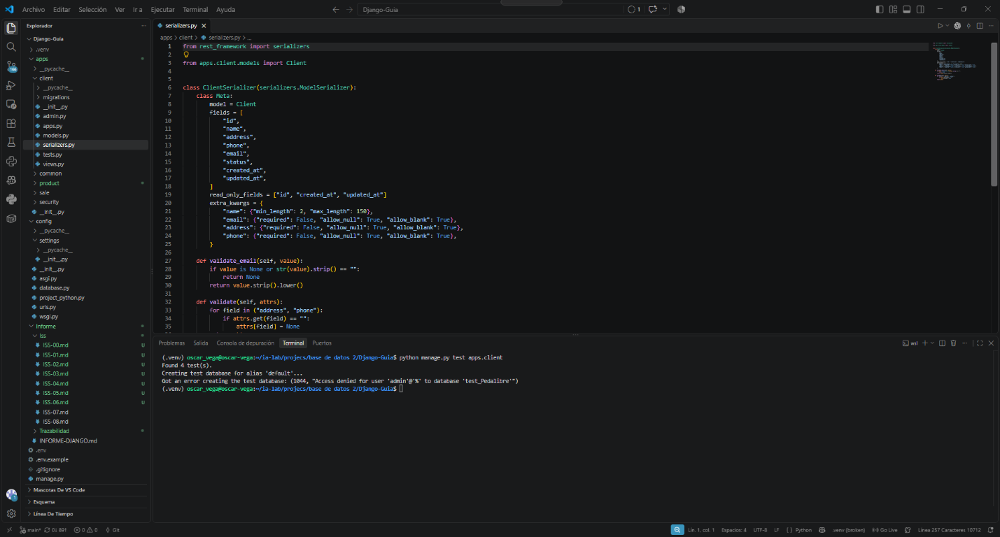

**Qué observé:** Django encontró cuatro pruebas, pero el servidor rechazó la creación de la base de pruebas por permisos.

**Retroalimentación:** este intento no constituye un resultado PASS; identificó una condición de acceso a la base de pruebas que debía resolverse antes de validar la suite.

**Lo que aprendí:** al ejecutar pruebas con una base SQL, Django necesita preparar su propia base de pruebas, además de poder conectarse a la base normal del proyecto.

### Paso 4. Registro de rutas del recurso

Creé `apps/client/urls.py` con `SimpleRouter(use_regex_path=False)` y registré el recurso `clients`.

#### Evidencia EVI-08-04 — Router de clientes

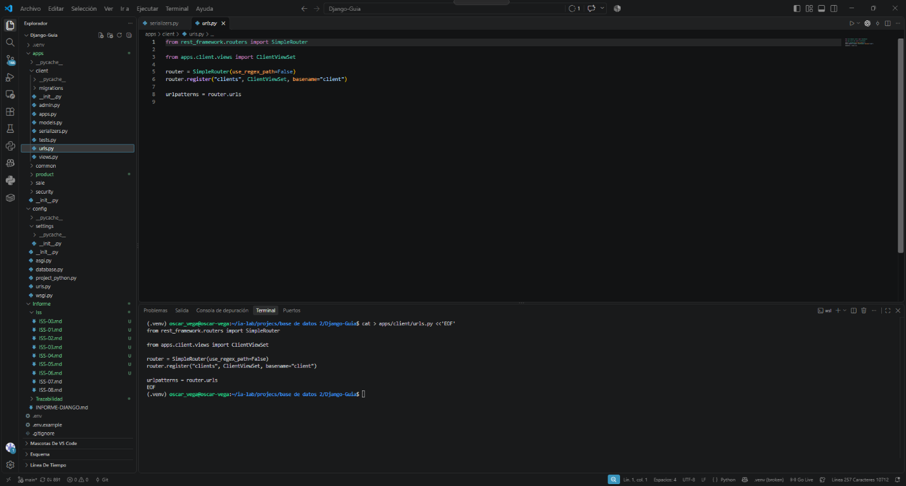

**Qué hice:** registré `ClientViewSet` en el router para generar las rutas de lista/alta y detalle/actualización/baja.

**Retroalimentación:** la captura muestra el convertidor de ruta de tipo entero y el `basename` `client`.

**Lo que aprendí:** el router de DRF conecta las acciones de `ModelViewSet` con las rutas del recurso sin definir cada URL manualmente.

### Paso 5. Inclusión del router en el proyecto

Incluí `apps.client.urls` bajo el prefijo `api/` en `config/urls.py`, para completar la ruta `/api/clients/`.

#### Evidencia EVI-08-05 — Prefijo `/api/`

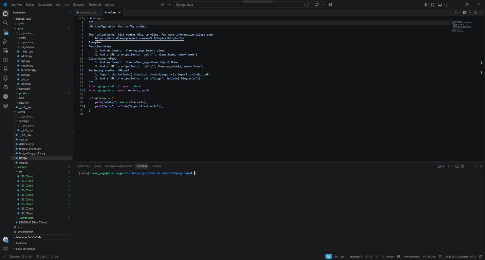

**Qué hice:** agregué el `include` del URLconf de clientes a las rutas principales del proyecto.

**Retroalimentación:** la configuración muestra el prefijo de API conectado al router de la app cliente.

**Lo que aprendí:** Django concatena el prefijo del proyecto con el segmento registrado por la app para formar la URL completa del recurso.

### Paso 6. Ejecución exitosa de las pruebas

Volví a ejecutar `python manage.py test apps.client`. La terminal indicó que `test_Pedalibre` ya existía y ofreció eliminarla para continuar; después, la suite terminó con cuatro pruebas ejecutadas y resultado `OK`.

#### Evidencia EVI-08-06 — Cuatro pruebas aprobadas

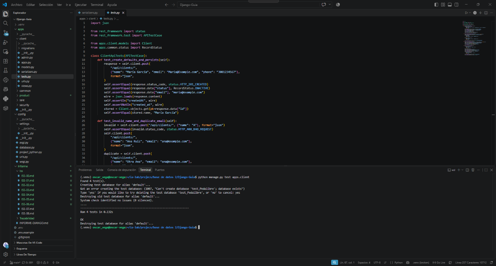

**Qué observé:** después de confirmar la eliminación de la base de pruebas anterior, las cuatro pruebas finalizaron correctamente y Django destruyó la base temporal.

**Retroalimentación:** esta captura sí muestra la verificación exitosa de `ClientApiTests` en la configuración de base de datos activa durante esa ejecución.

**Lo que aprendí:** una base de pruebas residual puede impedir una nueva ejecución; resolver el aviso de Django permitió recrearla y completar las pruebas.

### Criterios y verificaciones pendientes

La captura acredita que las cuatro pruebas del CRUD pasaron en la ejecución mostrada. La guía pide evidencia PASS en PostgreSQL, MySQL y SQL Server; las capturas no acreditan los tres motores. Por ello, mantengo pendiente el GATE completo hasta documentar los motores restantes.

### Conclusión

Implementé el `ClientViewSet`, sus pruebas y las rutas `/api/clients/`. El primer intento de pruebas no pudo crear la base temporal por permisos; en la siguiente ejecución, Django detectó una base de pruebas existente, permitió eliminarla y recrearla, y las cuatro pruebas terminaron en `OK`. Aprendí a distinguir los problemas de preparación de la base de pruebas de los fallos de la API. Dejo el GATE parcialmente completado porque todavía falta la evidencia de todos los motores solicitados.

## ISS-09 — Catálogo con ModelViewSet

**Estado:** implementé el CRUD de tipos y productos, y la captura de pruebas muestra los cuatro casos aprobados. El GATE queda parcial porque no hay evidencia de los tres motores.

### Objetivo

Publicar tipos y productos con el mismo criterio de CRUD homogéneo.

### Paso 1. Vista compartida para el catálogo

Creé `CatalogViewSet` para compartir el permiso abierto, el filtro opcional por `status` y la baja lógica. Añadí `ProductTypeViewSet` y `ProductViewSet`; este último carga `product_type` relacionado con `select_related`.

#### Evidencia EVI-09-01 — Vistas del catálogo

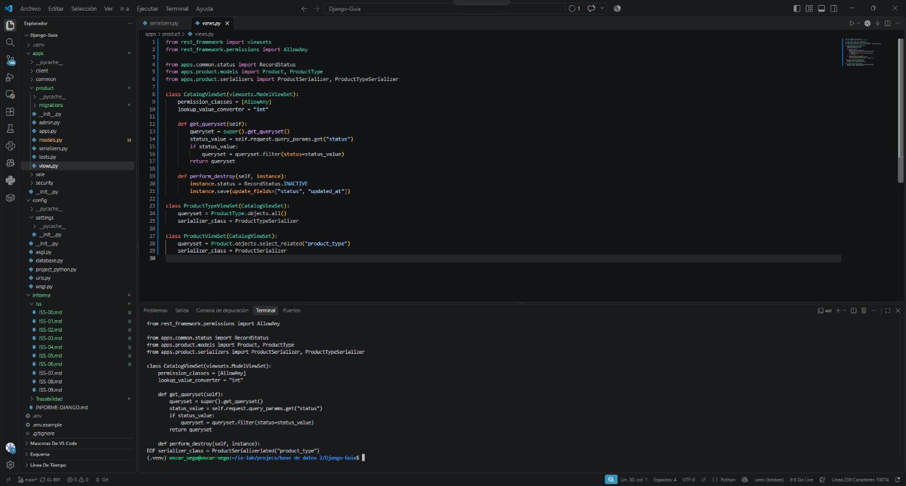

**Qué hice:** implementé los viewsets para tipos y productos reutilizando el comportamiento común del catálogo.

**Retroalimentación:** la captura muestra el permiso `AllowAny`, el convertidor entero, el filtro por estado y la baja lógica. También se ve el uso de `select_related("product_type")` en productos.

**Lo que aprendí:** una clase base puede reunir el comportamiento que comparten recursos CRUD sin dejar de usar `ModelViewSet`.

### Paso 2. Rutas de tipos y productos

Creé `apps/product/urls.py` y registré `product-types` y `products` con un `SimpleRouter`.

#### Evidencia EVI-09-02 — Router del catálogo


**Qué hice:** registré cada viewset con su `basename` para generar las rutas de lista, detalle y acciones CRUD.

**Retroalimentación:** la captura muestra ambos registros en el router; todavía no incluye una ruta para productos disponibles, que corresponde al ISS-10.

**Lo que aprendí:** puedo incluir varios recursos en el URLconf de una app usando el mismo router.

### Paso 3. Inclusión de rutas en el proyecto

Incluí `apps.product.urls` bajo `api/` en `config/urls.py`.

#### Evidencia EVI-09-03 — URLconf del proyecto


**Qué hice:** añadí el URLconf del catálogo junto al de clientes en las rutas principales.

**Retroalimentación:** la captura muestra que ambas apps reciben el prefijo `api/`.

**Lo que aprendí:** el prefijo compartido permite organizar rutas por recurso en sus apps y reunirlas desde el URLconf principal.

### Paso 4. Pruebas de tipos y productos

Reescribí `apps/product/tests.py` con cuatro pruebas para el CRUD de tipos, la actualización y baja lógica de productos, los valores por defecto, la restricción de borrado del tipo relacionado y el rechazo de nombres duplicados.

#### Evidencia EVI-09-04 — Pruebas de tipos y catálogo


**Qué hice:** añadí pruebas HTTP con `APITestCase`; el tipo `Bebida` de apoyo se crea directamente en el ORM, como indica la guía.

**Retroalimentación:** la captura muestra las pruebas de CRUD de tipos y productos y las aserciones para los valores predeterminados y la restricción de borrado.

**Lo que aprendí:** puedo combinar solicitudes al endpoint con aserciones del ORM para verificar la persistencia y las reglas del modelo.

#### Evidencia EVI-09-05 — Validación de nombres duplicados


**Qué hice:** verifiqué que la primera alta del nombre `Café` responda 201, la repetida responda 400 y el precio original permanezca guardado.

**Retroalimentación:** las aserciones distinguen el rechazo de duplicados de la persistencia correcta del primer producto.

**Lo que aprendí:** las restricciones de unicidad del catálogo se deben comprobar a través de la API, además de validar los datos que quedan almacenados.

### Paso 5. Ejecución de la suite de productos

Ejecuté `python manage.py test apps.product`.

#### Evidencia EVI-09-06 — Cuatro pruebas aprobadas


**Qué observé:** Django encontró cuatro pruebas, ejecutó todas y terminó con `OK`.

**Retroalimentación:** la captura verifica la suite de productos en la configuración de base de datos activa en esa ejecución. No identifica evidencia de ejecución en los tres motores.

**Lo que aprendí:** una ejecución satisfactoria de la suite comprueba los casos implementados en ese entorno; para afirmar compatibilidad multi-motor hacen falta resultados separados por motor.

### Criterios y verificaciones pendientes

La suite de cuatro pruebas pasó en la ejecución mostrada. Las capturas no demuestran la ejecución en PostgreSQL, MySQL y SQL Server, así que no afirmo haber cerrado el GATE multi-motor.

### Conclusión

Publiqué los CRUD de tipos y productos, compartí el comportamiento común en `CatalogViewSet`, conecté sus rutas y escribí cuatro pruebas. La evidencia muestra que las cuatro pasaron. Aprendí a reutilizar el comportamiento de baja lógica y a verificar restricciones y defaults mediante la API. Dejo el GATE parcialmente completado hasta contar con evidencia de los tres motores pedidos.

## ISS-10 — Disponibles con ListAPIView

**Estado:** implementé la consulta de productos disponibles y la prueba indicada; la captura muestra un resultado exitoso.

### Objetivo

Publicar una lectura filtrada de productos disponibles que no forma parte del CRUD del producto.

### Paso 1. Ruta para la colección disponible

Agregué una ruta literal `products/available/` antes de las rutas del router en `apps/product/urls.py`.

#### Evidencia EVI-10-01 — Ruta disponible antes del router


**Qué hice:** incorporé el endpoint de lectura especial a `urlpatterns`, antes de concatenar las rutas generadas por el router.

**Retroalimentación:** la captura muestra el patrón de URL y la importación de `AvailableProductListAPIView`. También muestra errores de terminal `ARCHIVO: command not found` y `UBICAR: command not found` en un intento previo de tratar las instrucciones de edición como comandos. Después se aplicó el cambio en el archivo y quedó registrado el endpoint.

**Lo que aprendí:** las indicaciones para ubicar y reemplazar fragmentos explican cómo editar el archivo; no son comandos que se ejecuten literalmente en la terminal.

### Paso 2. Vista de lectura filtrada

Agregué `AvailableProductListAPIView` a `apps/product/views.py`. Su queryset devuelve solo productos activos con stock mayor que cero y tipo de producto activo.

#### Evidencia EVI-10-02 — `ListAPIView` y filtros de disponibilidad


**Qué hice:** implementé la lectura especializada con `ListAPIView` y mantuve los viewsets CRUD del catálogo.

**Retroalimentación:** el queryset combina las tres condiciones indicadas y usa `select_related("product_type")`.

**Lo que aprendí:** `ListAPIView` sirve para una lectura de colección que necesita reglas de filtrado, sin ofrecer operaciones de escritura del CRUD.

### Paso 3. Prueba del filtro de disponibles

Agregué `test_product_crud_and_available_filter` a `ProductApiTests`. La prueba crea por la API un producto activo con stock, consulta la lista, cambia el stock a cero mediante el ORM y comprueba que la lista queda vacía.

#### Evidencia EVI-10-03 — Prueba de disponibilidad


**Qué hice:** añadí el caso de prueba requerido, comprobando el producto en la respuesta y su desaparición de la lista después de agotar el stock.

**Retroalimentación:** la captura muestra las aserciones de 201, 200, un resultado disponible y una respuesta vacía tras cambiar el stock.

**Lo que aprendí:** un producto puede dejar de estar disponible para esta consulta sin ser eliminado del catálogo.

### Paso 4. Ejecución de la prueba específica

Ejecuté el comando prescrito:

```sh
python manage.py test apps.product.tests.ProductApiTests.test_product_crud_and_available_filter
```

#### Evidencia EVI-10-04 — Prueba aprobada


**Qué observé:** la terminal encontró y ejecutó una prueba; terminó con `OK`.

**Retroalimentación:** el resultado verifica el filtro de disponibilidad en la configuración de base de datos activa durante esa ejecución.

**Lo que aprendí:** ejecutar el caso específico me permitió comprobar directamente el comportamiento nuevo sin confundirlo con el resto de la suite.

### Criterios de aceptación

- AC-10-01: la prueba crea un producto activo con stock y comprueba que aparezca en disponibles.
- AC-10-02: al poner el stock en cero, comprueba que el producto desaparece de la lista.

La evidencia del caso específico terminó con `OK`; considero verificados ambos criterios en la ejecución mostrada.

### Conclusión

Publiqué `/api/products/available/` con `ListAPIView` y filtré por estado activo del producto, stock positivo y tipo activo. Añadí la prueba para comprobar que el producto aparece y deja de aparecer al agotarse el stock, y la ejecución terminó en `OK`. Aprendí a separar una lectura filtrada del CRUD. ISS-10 queda verificada en el entorno mostrado; la captura no identifica pruebas en varios motores.

## ISS-11 — Registro de venta con APIView

**Estado:** implementé el registro transaccional y las capturas muestran cuatro pruebas aprobadas. El GATE queda parcial hasta verificar los motores exigidos.

### Objetivo

Registrar cliente, líneas de producto, precio histórico, totales y descuento de stock como una sola transacción.

### Paso 1. Estado inicial del manager y prueba previa de ISS-10

La primera captura muestra el `SaleQuerySet` todavía vacío y la ejecución aprobada de la prueba específica de productos disponibles de ISS-10.

#### Evidencia EVI-11-01 — Estado inicial


**Qué observé:** antes de añadir la operación, `SaleQuerySet` solo tenía `pass`; la prueba de ISS-10 terminó con `OK`.

**Retroalimentación:** esta captura documenta el punto de partida del manager y el cierre de la comprobación específica anterior; no la cuento como prueba de registro de ventas.

**Lo que aprendí:** documentar el estado previo ayuda a distinguir el manager inicial de la operación transaccional añadida en esta ISS.

### Paso 2. Registro transaccional en `SaleQuerySet`

Implementé `SaleQuerySet.register` en `apps/sale/managers.py`. La operación valida los artículos y descuentos, bloquea el cliente y los productos, comprueba estados y existencias, crea la venta y sus líneas con el precio vigente y actualiza el stock dentro de `transaction.atomic()`.

#### Evidencia EVI-11-02 — Validaciones y bloqueos


**Qué hice:** agregué la validación de los artículos y del descuento, el bloqueo del cliente y la consulta de productos relacionados ordenada por id.

**Retroalimentación:** la captura muestra el control del estado del cliente y de los productos, el tipo relacionado y el stock requerido.

**Lo que aprendí:** validar y bloquear los registros antes de descontar stock reduce el riesgo de completar ventas incompatibles con el inventario.

#### Evidencia EVI-11-03 — Totales, líneas y descuento de stock


**Qué hice:** guardé la venta y sus líneas, calculé subtotal, impuesto y total, activé la venta y luego desconté el inventario.

**Retroalimentación:** la captura muestra el cierre del cálculo y el guardado del stock dentro del contexto transaccional.

**Lo que aprendí:** guardar el precio unitario en cada línea conserva el precio histórico, mientras que la transacción permite revertir cabecera, líneas y cambios de stock si ocurre un error.

### Paso 3. Serializers de entrada para el registro

Amplié `apps/sale/serializers.py` con `SaleItemSerializer` y `SaleRegisterSerializer`, incluyendo ids de cliente y producto, cantidad, fecha, descuento opcional y la llamada a `Sale.objects.register`.

#### Evidencia EVI-11-04 — Imports para la entrada


**Qué hice:** incorporé los imports para normalizar errores Django y validar las referencias a cliente y producto.

**Retroalimentación:** la captura muestra los imports agregados junto a los serializers de lectura que ya existían.

**Lo que aprendí:** el serializer traduce la estructura de entrada y comunica como errores de API las validaciones de dominio.

#### Evidencia EVI-11-05 — Referencias a cliente y producto


**Qué hice:** añadí las referencias a los modelos `Client` y `Product` requeridas por los campos relacionales del serializer.

**Retroalimentación:** se observan los querysets usados para validar ids recibidos.

**Lo que aprendí:** validar las claves foráneas en el serializer permite rechazar referencias inexistentes antes de intentar registrar la operación.

#### Evidencia EVI-11-06 — Serializers para alta transaccional


**Qué hice:** definí los campos de entrada y delegué la creación de la venta al manager transaccional, convirtiendo errores de validación de Django a errores de DRF.

**Retroalimentación:** la captura muestra el descuento por defecto, la lista de artículos y la llamada a `Sale.objects.register`.

**Lo que aprendí:** la validación de forma se mantiene en el serializer y la invariante de inventario y transacción vive en el manager.

### Paso 4. Endpoint de registro y rutas

Creé `apps/sale/views.py` para validar la entrada, registrar la venta y responder con su representación y HTTP 201. También creé `apps/sale/urls.py` para `sales/` y lo incluí bajo `api/` en `config/urls.py`.

#### Evidencia EVI-11-07 — Vistas de registro


**Qué hice:** añadí las vistas abiertas de esta fase. La vista de colección delega el POST a la vista de registro, y esta devuelve la venta con sus líneas.

**Retroalimentación:** la captura muestra las clases APIView, la validación del serializer, la carga de líneas y la respuesta 201.

**Lo que aprendí:** el alta transaccional tiene un endpoint explícito en vez de publicar acciones CRUD que no corresponden a la operación de venta.

#### Evidencia EVI-11-08 — URL de ventas


**Qué hice:** creé la ruta `sales/` para el endpoint de colección.

**Retroalimentación:** el URLconf de la app apunta a `SaleCollectionAPIView`; el prefijo `api/` se agrega en el URLconf principal.

**Lo que aprendí:** una operación de negocio con un método específico puede declararse con `path()` sin usar un router.

#### Evidencia EVI-11-09 — Inclusión del URLconf de ventas


**Qué hice:** agregué `apps.sale.urls` bajo el prefijo `api/`.

**Retroalimentación:** la captura muestra el URLconf de ventas junto a los de clientes y productos.

**Lo que aprendí:** el endpoint queda disponible como `/api/sales/` al combinar el prefijo del proyecto con `sales/`.

### Paso 5. Pruebas de transacción

Escribí `SaleTransactionTests` para verificar la venta con dos productos y descuento, el precio histórico y descuento de stock, la reversión ante stock insuficiente, el rollback ante fallo al guardar stock y el rechazo de cliente inactivo.

#### Evidencia EVI-11-10 — Preparación y payload de prueba


**Qué hice:** preparé datos de prueba de cliente y productos activos, junto con un payload HTTP que incluye fecha, descuento y líneas.

**Retroalimentación:** la captura muestra que cliente y productos de apoyo se crean en `setUp` por el ORM.

**Lo que aprendí:** los datos de apoyo pueden prepararse directamente en el ORM para concentrar la prueba en el comportamiento HTTP de registro.

#### Evidencia EVI-11-11 — Totales, precio histórico y stock insuficiente


**Qué hice:** agregué aserciones de subtotal 24.50, total 23.00, impuesto cero, precio histórico 10.00 y stock restante, además del rechazo cuando la cantidad supera las existencias.

**Retroalimentación:** la captura verifica resultados y persistencia en los casos de venta válida y stock insuficiente. La prueba adicional de detalle sí cambia el precio del producto a `99.00` y confirma que la línea conserva `10.00`.

**Lo que aprendí:** la prueba de la operación debe comprobar tanto importes y precios congelados como el inventario resultante.

#### Evidencia EVI-11-12 — Rollback y cliente inactivo


**Qué hice:** probé que un fallo al guardar el descuento de stock no deje ventas ni líneas, y que un cliente inactivo produzca un error 400 sin crear una venta.

**Retroalimentación:** la captura muestra ambos escenarios negativos y las aserciones sobre las filas persistidas.

**Lo que aprendí:** una prueba de rollback confirma que un error en el último paso de la operación no deja cambios parciales.

### Paso 6. Ejecución de `apps.sale`

Ejecuté `python manage.py test apps.sale`.

#### Evidencia EVI-11-13 — Cuatro pruebas aprobadas


**Qué observé:** en esta ejecución inicial Django encontró cuatro pruebas, las ejecutó y terminó con `OK`. Más adelante amplié la clase con las pruebas de consulta y anulación; la suite actualizada terminó con siete pruebas `OK` en la evidencia de ISS-12.

**Retroalimentación:** la captura confirma el resultado de `SaleTransactionTests` en la configuración de base de datos activa para esa ejecución.

**Lo que aprendí:** los casos de registro válido, stock insuficiente, rollback y cliente inactivo pueden verificarse como pruebas HTTP de una misma unidad.

### Criterios y verificaciones pendientes

Las capturas de ISS-11 muestran las cuatro pruebas iniciales; las capturas de ISS-12 muestran después los tres casos añadidos, incluido el cambio del precio vivo a `99.00` con verificación de que el precio histórico sigue en `10.00`. La ejecución actualizada terminó con siete pruebas `OK`. Considero cubiertos los cinco criterios funcionales de ISS-11 en esta ejecución. La guía también pide PASS en los tres motores; las capturas solo identifican una ejecución y no demuestran por separado PostgreSQL, MySQL y SQL Server, por lo que mantengo pendiente la confirmación multi-motor del GATE.

### Conclusión

Implementé el registro de ventas como una operación transaccional con validaciones, captura del precio en la línea, cálculo de totales y descuento de stock. Creé los serializers de entrada, las vistas, la ruta y pruebas de registro, rollback y consulta histórica. La evidencia actualizada muestra siete pruebas aprobadas. Aprendí que `transaction.atomic()` evita dejar cabeceras, líneas o stock en un estado parcial ante un fallo. Mantengo pendiente la evidencia en todos los motores solicitados para cerrar el GATE.

## ISS-12 — Consulta y anulación de ventas

**Estado:** implementé la consulta de colección y detalle, y la anulación lógica; la suite muestra siete pruebas aprobadas.

### Objetivo

Consultar ventas y anularlas sin borrar el registro histórico.

### Paso 1. Consulta de ventas y vista de solo lectura

Extendí `SaleReadViewSet` con las acciones de lista, detalle y baja, sin habilitar alta ni actualización. `SaleCollectionAPIView.get` usa ese queryset y serializer para responder la lista.

#### Evidencia EVI-12-01 — Precio histórico y listado


**Qué hice:** añadí pruebas para consultar el detalle tras cambiar el precio del producto, listar la venta recién registrada y anularla dos veces.

**Retroalimentación:** las aserciones verifican que la línea conserva `unit_price` de `10.00` tras cambiar el catálogo a `99.00`, y que la lista contiene la venta creada.

**Lo que aprendí:** la lectura de la venta usa el precio guardado en su línea, no el precio actual del producto.

### Paso 2. Ruta de detalle y anulación

Agregué `SaleReadViewSet` a `apps/sale/urls.py` para que el detalle acepte únicamente GET y DELETE.

#### Evidencia EVI-12-02 — Ruta GET/DELETE del detalle


**Qué hice:** vinculé el método GET con `retrieve` y DELETE con `destroy` para la ruta `sales/<int:pk>/`.

**Retroalimentación:** el diccionario de `as_view` no publica PUT, PATCH ni POST en el detalle.

**Lo que aprendí:** puedo limitar explícitamente qué acciones HTTP expone un viewset al enlazarlo a una ruta.

### Paso 3. Anulación lógica de la venta

Implementé `perform_destroy` en `SaleReadViewSet` para llamar a `instance.void()`. El método `get` de `SaleCollectionAPIView` devuelve el listado usando el queryset y el serializer de lectura.

#### Evidencia EVI-12-03 — Viewset y lecturas de venta


**Qué hice:** añadí las acciones de lectura y delegué la anulación en el método del modelo.

**Retroalimentación:** la consulta precarga cliente y líneas con producto; la anulación llama `void()` en vez de borrar la venta.

**Lo que aprendí:** separar el viewset de lectura del endpoint de registro evita ofrecer operaciones de escritura no previstas y mantiene la lógica de anulación en el modelo.

### Paso 4. Pruebas de histórico, lista y stock restaurado

Extendí `SaleTransactionTests` con pruebas de precio histórico, listado y anulación repetida.

#### Evidencia EVI-12-04 — Pruebas y ejecución satisfactoria


**Qué observé:** ejecuté `python manage.py test apps.sale`; Django encontró y ejecutó siete pruebas y terminó con `OK`.

**Retroalimentación:** la prueba de anulación llama DELETE dos veces y verifica que el stock vuelva al valor original y la venta quede inactiva. La suite incluye además la prueba que modifica el precio del catálogo y conserva el precio histórico en el detalle.

**Lo que aprendí:** una anulación repetida debe ser idempotente respecto del inventario; las pruebas aseguran que el stock no se reponga dos veces.

### Criterios de aceptación

- AC-12-01: el detalle incluye líneas y el precio histórico guardado.
- AC-12-02: DELETE responde 204.
- AC-12-03: la venta permanece en la base con estado inactivo.
- AC-12-04: anular dos veces restablece el stock una sola vez.

Las pruebas implementadas cubren esos comportamientos y la suite de ventas finalizó con siete pruebas `OK` en la captura. Con esta evidencia considero aprobados los criterios de aceptación de ISS-12.

### Conclusión

Publiqué la lista y el detalle de ventas, mantuve el precio histórico en la respuesta y conecté DELETE con la anulación lógica. La prueba verifica que anular dos veces no duplica el stock; la suite completa de ventas terminó con siete pruebas aprobadas. Aprendí a conservar la venta como histórico y a hacer idempotente la reposición de inventario. Con los criterios de ISS-12 verificados, dejo su GATE aprobado.

## ISS-13 — Django Admin

**Estado:** configuré el superusuario y el admin de los cinco modelos de negocio. `python manage.py check` terminó sin errores y confirmé el acceso al panel `/admin/`. Queda pendiente abrir cada modelo para completar el recorrido visual.

### Objetivo

Explorar las cinco tablas de negocio desde Django Admin, con listas y formularios apropiados, sin rearmar ventas desde el admin.

### Paso 1. Creación del superusuario

Ejecuté `python manage.py createsuperuser` y Django confirmó `Superuser created successfully`. La contraseña no se incluye en el informe ni en la evidencia que se versiona.

#### Evidencia EVI-13-01 — Superusuario creado


**Qué hice:** creé el usuario administrativo desde el comando de Django.

**Retroalimentación:** Django mostró primero avisos de contraseña corta y numérica; acepté el bypass interactivo y terminó confirmando la creación del superusuario.

**Lo que aprendí:** el comando aplica validaciones de contraseña y permite continuar de forma interactiva tras advertir sobre una clave débil. No guardaré ni compartiré la contraseña.

### Paso 2. Registro y configuración del admin de clientes

Configuré `ClientAdmin` con columnas, filtros, búsqueda, edición del estado, ordenamiento y grupos de campos para información, estado y auditoría.

#### Evidencia EVI-13-02 — `ClientAdmin`


**Qué hice:** registré el modelo `Client` y configuré sus opciones de listado y formulario.

**Retroalimentación:** el formulario no incluye contraseña; `created_at` y `updated_at` aparecen como solo lectura en el grupo plegable de auditoría.

**Lo que aprendí:** el admin puede agrupar los campos del formulario y limitar los campos editables sin cambiar el modelo.

### Paso 3. Registro de tipos y productos

Configuré `ProductTypeAdmin` y `ProductAdmin`, incluyendo búsqueda de tipo para la relación del producto y `select_related` en su queryset.

#### Evidencia EVI-13-03 — `ProductTypeAdmin` y `ProductAdmin`


**Qué hice:** registré ambos modelos y definí sus columnas, filtros, búsquedas, campos editables y grupos de formulario.

**Retroalimentación:** el producto muestra `product_type`, `price` y `stock`; no usa campos que no existen en el modelo. El autocompletado está respaldado por los `search_fields` del tipo de producto.

**Lo que aprendí:** un campo de relación puede cambiarse por un autocompletado y cargar su relación con `select_related` para evitar consultas repetidas al mostrar productos.

### Paso 4. Admin de ventas e inline de detalle

Configuré `ProductSaleInline` y `SaleAdmin` para mostrar los importes y las líneas como datos de solo lectura, sin permitir alta ni eliminación desde el admin.

#### Evidencia EVI-13-04 — Venta de solo lectura e inline


**Qué hice:** añadí el detalle de venta como inline tabular y agrupé la información y los importes de la venta.

**Retroalimentación:** los campos de línea son de solo lectura y el inline no permite crear ni eliminar líneas. La venta tampoco permite alta ni borrado.

**Lo que aprendí:** las ventas deben originarse en el flujo transaccional de la API para preservar precio histórico e inventario; el admin sirve para inspeccionarlas.

### Paso 5. Ficha de solo lectura de líneas de venta

Registré `ProductSaleAdmin` con búsqueda, filtros y campos de solo lectura, y deshabilité el alta y borrado.

#### Evidencia EVI-13-05 — Permisos y campos de `ProductSaleAdmin`


**Qué hice:** configuré las columnas y consultas relacionadas del admin de líneas de venta.

**Retroalimentación:** la captura muestra `has_add_permission` y `has_delete_permission` desactivados, junto con `select_related` para las relaciones mostradas.

**Lo que aprendí:** restringir los cambios de las líneas protege la consistencia de ventas y el stock.

#### Evidencia EVI-13-06 — Reglas de ventas y detalles


**Qué hice:** completé la configuración de ventas y sus detalles para inspección solamente.

**Retroalimentación:** venta y línea no ofrecen alta ni borrado desde el admin; los valores de estado y de auditoría no se editan allí.

**Lo que aprendí:** la anulación de una venta debe pasar por `void()` desde la API, no por una edición manual del estado ni por un borrado físico.

### Paso 6. Verificación del proyecto

Ejecuté el comando de verificación prescrito:

```sh
python manage.py check
```

#### Evidencia EVI-13-07 — System check sin errores


**Qué observé:** Django mostró `System check identified no issues (0 silenced)`.

**Retroalimentación:** la verificación confirma que la configuración del admin, incluido el autocompletado, no produce errores del sistema.

**Lo que aprendí:** `manage.py check` detecta problemas de configuración del admin sin necesidad de alterar los datos del proyecto.

### Criterios y comprobaciones pendientes

Las capturas y los archivos de admin documentan el registro y configuración de los cinco modelos; `python manage.py check` pasó. La nueva captura confirma el acceso al panel y muestra los cinco modelos. Queda pendiente abrir cada modelo para completar la comprobación visual pedida por la guía; por eso mantengo el GATE de ISS-13 parcial.

### Comprobación de acceso al admin

#### Evidencia EVI-13-08 — Acceso al panel de administración


**Qué observé:** accedí al panel y aparecen clientes, tipos de producto, productos, ventas y detalles de venta. El panel muestra opciones de alta para clientes y catálogo, pero no para ventas ni detalles.

**Retroalimentación:** esta captura confirma el acceso al admin y la presencia de los cinco modelos; no sustituye abrir cada lista y ficha para revisar su comportamiento.

**Lo que aprendí:** la página principal del admin permite reconocer qué modelos tienen opción de alta, mientras que la comprobación de filtros, búsquedas y formularios requiere entrar en cada modelo.

### Verificación pendiente

Me falta abrir cada modelo y revisar sus listas y fichas en `/admin/`. Por ello, la evidencia confirma el acceso al panel, pero mantengo parcial el GATE de ISS-13.

### Conclusión

Creé el superusuario y configuré los modelos de clientes, tipos, productos, ventas y líneas de venta en Django Admin. Separé los datos editables del catálogo de las ventas, que deben permanecer de solo lectura y conservar el flujo transaccional. `python manage.py check` terminó sin errores y confirmé el acceso al panel. Me falta abrir cada modelo para cerrar la verificación completa.

## ISS-14 — OpenAPI

**Estado:** instalé y configuré `drf-spectacular`, agregué las rutas de esquema, Swagger y ReDoc, y abrí Swagger sin iniciar sesión. La validación del esquema terminó con 8 errores únicos y 1 advertencia; ISS-14 y el cierre de Fase I siguen pendientes.

### Objetivo

Publicar un contrato OpenAPI generado desde las vistas, con nombres camelCase alineados al JSON.

### Paso 1. Instalación de `drf-spectacular`

Instalé `drf-spectacular==0.30.0` y actualicé `requirements.txt` con `pip freeze`.

#### Evidencia EVI-14-01 — Instalación de la dependencia


**Qué hice:** instalé la versión fijada por la ISS y regeneré la lista de dependencias.

**Retroalimentación:** la terminal muestra la instalación satisfactoria de `drf-spectacular==0.30.0`.

**Lo que aprendí:** fijar la versión de una dependencia deja reproducible la herramienta usada para generar el contrato.

### Paso 2. Registro en settings y configuración de OpenAPI

Agregué `drf_spectacular` a `INSTALLED_APPS`, configuré `DEFAULT_SCHEMA_CLASS` y añadí `SPECTACULAR_SETTINGS` con el hook de camelCase y permisos abiertos para servir la documentación.

#### Evidencia EVI-14-02 — Registro de la aplicación


#### Evidencia EVI-14-03 — Configuración del esquema y camelCase


**Qué hice:** registré el generador de esquema y configuré títulos, versión, permisos y hook de serializadores camelCase.

**Retroalimentación:** la configuración mostrada incluye `AllowAny` para servir el esquema y el hook `camelize_serializer_fields`.

**Lo que aprendí:** el esquema puede generarse desde las vistas y adaptar los nombres de propiedades para corresponder con el JSON camelCase.

### Paso 3. Rutas para esquema, Swagger y ReDoc

Agregué al URLconf raíz las rutas `/api/schema/`, `/api/schema/swagger-ui/` y `/api/schema/redoc/` antes de las rutas incluidas de las apps.

#### Evidencia EVI-14-04 — Rutas OpenAPI en `config/urls.py`


**Qué hice:** declaré las tres rutas en el URLconf principal.

**Retroalimentación:** la captura muestra las vistas de `drf_spectacular` enlazadas al esquema y ubicadas antes de los `include` de las apps.

**Lo que aprendí:** el contrato completo pertenece al URLconf raíz del proyecto, no a una app de negocio individual.

### Paso 4. Revisión del admin y arranque del servidor

Accedí a `/admin/` y ejecuté el servidor para revisar la documentación desde el navegador.

#### Evidencia EVI-14-05 — Acceso al admin y resultado de validación


**Qué observé:** el panel administrativo carga. En la terminal, `python manage.py spectacular --file /tmp/storelab-schema.yml --validate` reporta 1 advertencia y `Errors: 8 (8 unique)`. Después, `runserver` inicia y `manage.py check` informa que no hay problemas del sistema.

**Retroalimentación:** que el servidor arranque y `check` pase no hace que la validación OpenAPI pase; los ocho errores siguen sin resolver.

**Lo que aprendí:** cada verificación cubre una condición diferente: `check` comprueba configuración de Django, mientras que `spectacular --validate` comprueba que las vistas se puedan representar correctamente en el esquema.

### Paso 5. Apertura de Swagger UI y revisión de endpoints

Abri Swagger UI sin autorizar credenciales y recorri los grupos de operaciones.

#### Evidencia EVI-14-06 - Swagger UI sin autenticacion


#### Evidencia EVI-14-07 — Operaciones de clientes y tipos


#### Evidencia EVI-14-08 — Operaciones de productos y ventas


**Qué observé:** Swagger muestra operaciones de clientes, tipos, productos y ventas, incluida la consulta de productos disponibles y la baja de ventas.

**Retroalimentación:** las capturas confirman que la interfaz Swagger carga sin haber autorizado un token. No demuestran por sí solas que `--validate` esté limpio ni que los cuerpos representados usen los nombres camelCase esperados.

**Lo que aprendí:** poder abrir la interfaz de documentación no garantiza que el esquema esté libre de errores; también debo validar el esquema generado y revisar sus propiedades.

### Criterios y verificaciones pendientes

- AC-14-01: **pendiente**. La salida mostrada indica ocho errores únicos y una advertencia en `spectacular --validate`.
- AC-14-02: **parcialmente comprobado**. Swagger UI abrió sin Bearer; falta evidenciar la consulta directa del esquema y la apertura de ReDoc.
- AC-14-03: **pendiente**. Se configuró el hook camelCase, pero falta comprobar el cuerpo generado en el esquema.

No marco aprobado el GATE de ISS-14 ni el cierre de la Fase I mientras la validación devuelva errores y falten las comprobaciones indicadas.

#### Evidencia EVI-14-09 — Check, migraciones y pruebas de negocio


**Qué observé:** `check` no reportó problemas, `migrate` indicó que no había migraciones pendientes y `python manage.py test apps.client apps.product apps.sale` terminó con 16 pruebas `OK`.

**Retroalimentación:** esta ejecución comprueba la suite mostrada para las apps de negocio en la base de pruebas configurada. No demuestra los 24 tests ni la ejecución en PostgreSQL, MySQL y SQL Server mencionados en el texto de la guía; tampoco resuelve los ocho errores de `spectacular --validate`.

**Lo que aprendí:** el resultado de las pruebas de negocio y la validación del contrato OpenAPI son comprobaciones independientes, por lo que debo conservar pendientes los criterios que no pasaron.

### Conclusión

Instalé y configuré `drf-spectacular`, añadí las rutas del esquema, Swagger y ReDoc, y abrí Swagger sin Bearer. Aprendí que la interfaz puede estar disponible aunque el generador todavía reporte problemas: la validación mostró ocho errores y una advertencia. Dejo ISS-14 parcial y no doy por superado el cierre de Fase I hasta resolverlos y completar las verificaciones pendientes.

## ISS-15 — RefreshToken

**Estado:** implementé el helper de generación/hash, el modelo `RefreshToken`, la configuración de SimpleJWT y su migración. La captura EVI-17-08 muestra que `AuthFlowTests.test_login_with_username_and_email` terminó con `OK`, y el test comprueba el hash guardado, los campos de la respuesta y que no se incluya `password`. El GATE de ISS-15 sigue pendiente porque el requisito previo de cierre de ISS-14 no está aprobado.

### Paso 1. Helper para generar y hashear el refresh

Creé `apps/security/tokens.py` con `secrets.token_urlsafe(48)` para generar el valor y SHA-256 para obtener su representación hexadecimal.

#### Evidencia EVI-15-01 — Helpers de refresh


**Qué hice:** separé la generación del refresh de su hash persistible.

**Retroalimentación:** el helper retorna un valor aleatorio y la función de hash codifica el token en UTF-8 antes de calcular SHA-256.

**Lo que aprendí:** se puede entregar el refresh al cliente y almacenar solo un hash que permita verificarlo sin conservar el secreto en claro.

### Paso 2. Modelo `RefreshToken`

Agregué `RefreshToken` después de `User`, con la relación restringida al usuario, hash único, familia, expiración, revocación, reemplazo, estado y auditoría.

#### Evidencia EVI-15-02 — Imports y declaración del modelo


#### Evidencia EVI-15-03 — Campos y métodos del modelo


**Qué hice:** definí la tabla `refresh_tokens`, con `token_hash` único y estado inicial `active`; `is_usable` comprueba estado, revocación, reemplazo y expiración.

**Retroalimentación:** las capturas muestran el modelo y sus campos, incluida la FK `RESTRICT` a `User` y el vínculo opcional al token que lo reemplaza.

**Lo que aprendí:** el estado de persistencia permite invalidar y rastrear sesiones refresh, mientras que la tabla no necesita guardar el token original.

### Paso 3. Instalación y configuración de SimpleJWT

Instalé `djangorestframework-simplejwt==5.5.1`, registré `rest_framework_simplejwt` y configuré la duración y firma indicadas por la ISS. No agregué `token_blacklist`.

#### Evidencia EVI-15-04 — Instalación de SimpleJWT


#### Evidencia EVI-15-05 — Aplicación registrada en settings


#### Evidencia EVI-15-06 — Parámetros SIMPLE_JWT


**Qué hice:** fijé SimpleJWT en las dependencias e incorporé `SIMPLE_JWT` con expiraciones, algoritmo HS256 y el claim `user_id`.

**Retroalimentación:** las capturas muestran la app y los parámetros; la rotación y blacklist de SimpleJWT permanecen desactivadas, de acuerdo con la guía.

**Lo que aprendí:** SimpleJWT gestiona la emisión y verificación del access token, mientras que el estado revocable del refresh se conserva en el modelo propio.

### Paso 4. Migración del modelo

Generé y apliqué la migración de seguridad para crear la tabla de refresh tokens. En una segunda ejecución, Django informó que no había cambios nuevos en el modelo.

#### Evidencia EVI-15-07 — Migración de `RefreshToken`


#### Evidencia EVI-15-08 — No hay migraciones pendientes


**Qué observé:** `security.0002_refreshtoken` se creó y se aplicó con `OK`; en la ejecución siguiente, `makemigrations` informó que no detectó cambios y `migrate` que no había migraciones pendientes.

**Retroalimentación:** el resultado acredita que la migración mostrada se generó y aplicó en la base usada en esa ejecución. No sustituye la prueba de login y del contenido de la respuesta.

**Lo que aprendí:** después de aplicar una migración, repetir `makemigrations` permite verificar que el estado de los modelos y las migraciones está sincronizado.

### Criterios y verificaciones

- AC-15-01: el test de login compara `token_hash` con el hash del refresh devuelto; la salida satisfactoria se ve en EVI-17-08.
- AC-15-02: el test verifica que el token retornado corresponde al hash SHA-256 persistido; la salida satisfactoria se ve en EVI-17-08.
- AC-15-03: el test comprueba la respuesta de login y que no incluya `password`; la salida satisfactoria se ve en EVI-17-08.

La captura EVI-14-09 muestra 16 pruebas de `client`, `product` y `sale`; no la uso para demostrar `AuthFlowTests`. Para este último test sí cuento con la ejecución observada en EVI-17-08. ISS-15 requiere cerrar ISS-14 y el esquema OpenAPI sigue teniendo errores de validación.

### Conclusión

Instalé SimpleJWT, configuré sus parámetros, implementé la generación y el hash del refresh, apliqué la migración de `RefreshToken` y verifiqué los tres criterios con el test de login mostrado en EVI-17-08. Aprendí a separar el access token sin estado del refresh revocable persistido solo como hash. Mantengo pendiente el GATE de ISS-15 hasta superar el requisito previo de ISS-14.

## ISS-16 — Role, RoleUser, Resource y ResourceRole

**Estado:** las clases `HttpMethod`, `Role`, `RoleUser`, `Resource` y `ResourceRole` están presentes en `apps/security/models.py` y la captura muestra aplicada la migración `security.0003_resource_role_resourcerole_roleuser`. No está documentada la semilla de 53 recursos ni la comprobación de la ruta resuelta.

### Construcción y migración documentadas

#### Evidencia EVI-16-01 — `HttpMethod`, `Role` y `RoleUser`


#### Evidencia EVI-16-02 — `Role` y `RoleUser`


#### Evidencia EVI-16-03 — `Resource` y `ResourceRole`


**Qué hice:** definí los cuatro modelos de la matriz, sus estados iniciales inactivos y las restricciones de unicidad mostradas.

**Retroalimentación:** las capturas documentan los modelos y muestran la unicidad de `(role, user)`, `(method, route)` y `(resource, role)`. `Resource.route` almacena un patrón como `api/clients/<int:pk>/`.

**Lo que aprendí:** la autorización depende de relacionar usuario, rol y recurso, y las rutas dinámicas deben almacenarse como patrones para que puedan compararse con las rutas resueltas.

#### Evidencia EVI-16-04 — Migración RBAC aplicada


**Qué observé:** Django creó `security.0003_resource_role_resourcerole_roleuser` con los modelos `Resource`, `Role`, `ResourceRole` y `RoleUser`, y la aplicó con resultado `OK`.

**Retroalimentación:** esta captura comprueba la migración en la base de datos usada en esa ejecución. No demuestra que la semilla haya cargado 53 recursos ni que las rutas guardadas correspondan con `resolve(path).route`.

**Lo que aprendí:** las definiciones de modelos y su migración son pasos distintos de la carga de datos iniciales y de la verificación de patrones de ruta.

### Criterios y verificaciones pendientes

- AC-16-01: la migración de las cuatro tablas se ve aplicada en EVI-16-04.
- AC-16-02: las restricciones únicas están en el código mostrado; no se aportó una prueba de inserciones duplicadas.
- AC-16-03: **pendiente**. Falta la evidencia de `seed_rbac` con las 53 filas y la consulta que confirme `api/clients/<int:pk>/`.

ISS-16 requiere ISS-15 superado. El test de autenticación requerido por ISS-15 ya cuenta con resultado satisfactorio en EVI-17-08, pero el GATE de ISS-15 sigue condicionado al cierre de ISS-14 por los errores de `spectacular --validate`. Además, ISS-16 aún requiere la evidencia de la semilla y de la ruta resuelta. Por eso no marco aprobado su GATE.

### Conclusión

Definí y migré las entidades RBAC, y aprendí que las tablas creadas no prueban por sí solas que la semilla haya poblado los recursos con sus patrones correctos. Dejo pendiente la carga y consulta de los 53 recursos, además de superar los GATE de ISS-14 e ISS-15.

## ISS-17 — Login OPEN

**Estado:** la evidencia visual documenta la creación de los serializers, las vistas de autenticación, el helper de pruebas y el `include` de seguridad en las rutas del proyecto. La captura de ejecución muestra los dos tests de `AuthFlowTests` completados con `OK`. Aun así, no marco superado el GATE de ISS-17 mientras siga pendiente el requisito ISS-16.

### Construcción y pruebas observadas

Guardé la guía ejecutable en [ISS-17.md](Iss/ISS-17.md). En las capturas se observa `LoginSerializer`, `LoginAPIView`, los helpers `token_payload` e `issue_refresh`, la inclusión de las rutas de seguridad y la configuración de `AuthFlowTests`. La salida compartida muestra la ejecución conjunta de dos tests y ejecuciones individuales, todas con resultado `OK`.

#### Evidencia EVI-17-01 — Serializers de autenticación


#### Evidencia EVI-17-02 — Helpers y LoginAPIView


#### Evidencia EVI-17-03 — Validación del login


#### Evidencia EVI-17-04 — Configuración y pruebas de autenticación


#### Evidencia EVI-17-05 — Rutas del proyecto


#### Evidencia EVI-17-06 — Serializers completos


#### Evidencia EVI-17-07 — Helper de usuario para pruebas


#### Evidencia EVI-17-08 — Ejecución de tests


**Qué observé:** las capturas muestran las piezas principales del flujo OPEN y la salida de tests con `Ran 2 tests` y `OK`. El test `test_inactive_user_and_bad_password_are_401` del código compartido envía solicitudes tanto con contraseña incorrecta como con el usuario inactivo, ambas comprobadas como 401. También se observa que el email se prueba sin distinguir mayúsculas y minúsculas.

**Retroalimentación:** las pruebas aportadas cubren login con username y email, ausencia de `password` en la respuesta, hash del refresh persistido, contraseña incorrecta y usuario inactivo. No interpreto el resultado de tests como evidencia de los criterios RBAC pendientes de ISS-16 ni del cierre de OpenAPI de ISS-14.

**Lo que aprendí:** una vista OPEN debe desactivar la autenticación previa y responder con el mismo error ante credenciales inválidas; los tests de API verifican el flujo HTTP junto con los cambios persistidos del refresh.

### Criterios y requisitos aún pendientes

- AC-17-01 y AC-17-02: la captura de tests muestra el test de login por username/email en ejecución satisfactoria.
- AC-17-03 y AC-17-04: el test de usuario inactivo y contraseña incorrecta se ejecutó satisfactoriamente según la captura.
- AC-17-05: el test comprueba que la respuesta no contiene `password`.
- GATE ISS-17: no lo marco superado porque el requisito ISS-16 superado no está acreditado; sigue pendiente verificar `seed_rbac`, las 53 filas y `resolve(path).route`. ISS-14 también continúa pendiente de cerrar por los errores de `spectacular --validate`.

### Conclusión

Implementé y probé el flujo de login OPEN mostrado en las capturas: username o email, access y refresh, y respuestas 401 para credenciales inválidas. Aprendí a comprobar tanto la forma de la respuesta como la persistencia del hash del refresh mediante tests de API. Mantengo pendiente el GATE de ISS-17 hasta cerrar sus requisitos previos ISS-16 e ISS-14.

## ISS-18 — Refresh con rotación

**Estado:** guardé la guía ejecutable en [ISS-18.md](Iss/ISS-18.md). Al revisar el árbol de trabajo local encontré `RefreshAPIView`, la ruta `auth/refresh/` y `test_refresh_rotates_and_reuse_revokes_family` ya presentes como cambios sin commit. No ejecuté el comando de prueba ni hice commit de esos archivos.

La implementación visible cubre la rotación del token, el registro de `replaced_by` y el bloqueo de la familia al reutilizar el refresh anterior. No hay todavía una captura del resultado del test de ISS-18, así que AC-18-01, AC-18-02 y AC-18-03 siguen pendientes de verificación. El GATE de ISS-17 también continúa sin aprobar por el requisito ISS-16; antes de cerrar la unidad debo completar la evidencia pendiente de `seed_rbac`, las 53 filas y la ruta resuelta.
