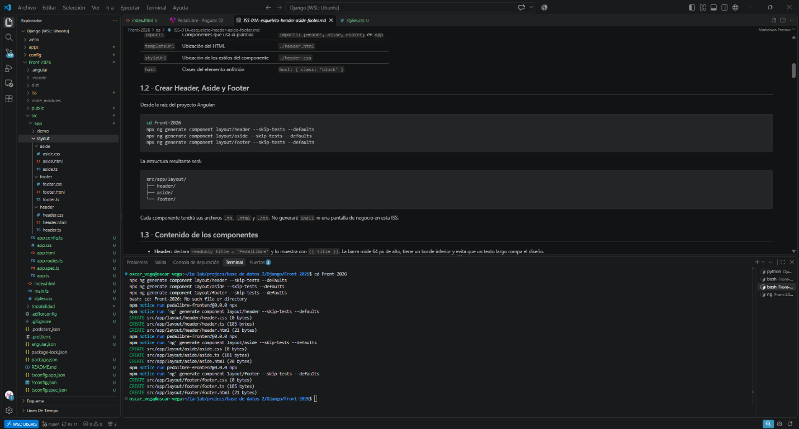
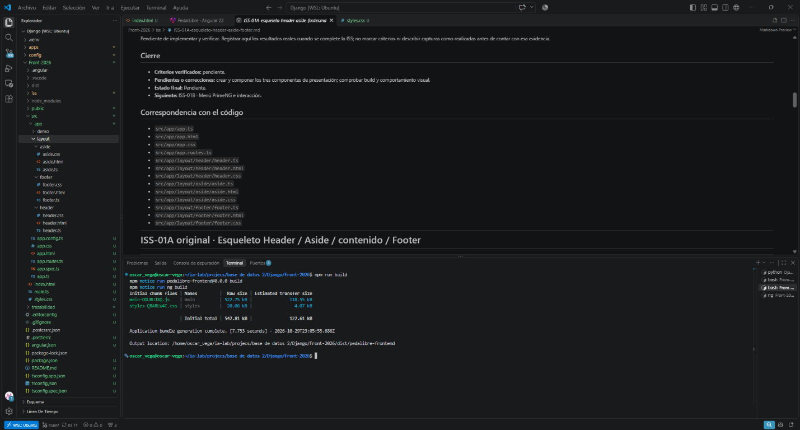

# ISS-01A · Esqueleto Header / Aside / contenido / Footer

> **Proyecto:** Frontend de PedalLibre
> **Capa:** Construir
> **Depende de:** ISS-01 · Bootstrap Angular 22 con CLI
> **Habilita:** ISS-01B · Menú PrimeNG e interacción
> **Estado:** En curso

## Objetivo para PedalLibre

Componer dentro de `App` el primer esqueleto visual de PedalLibre con cuatro regiones: Header, Aside, contenido principal y Footer. La pantalla usará datos y textos fijos, sin conectarse a la API Django. Esta ISS no incorpora menú interactivo, Drawer, rutas de negocio, autenticación ni permisos.

## Contexto actual

- El proyecto Angular está en `Front-2026/` y la ISS-01 está completada.
- Reemplacé `<app-demo-local />` por Header, Aside, contenido y Footer; `app.routes.ts` sigue con una lista de rutas vacía.
- La demostración local de ISS-01 deja de mostrarse en `app.html` al componer el esqueleto. El componente se conserva como material de consulta.
- El nombre visible de marca será **PedalLibre**, no StoreLab.
- No crearé `Shell` ni componentes de funciones de negocio en esta ISS. El menú interactivo y el `RouterOutlet` se consideran en la ISS-01B.

## Criterios de aceptación para PedalLibre

- [x] **1.1** Los componentes standalone aparecen en una plantilla cuando el padre los incluye en `imports` y usa su `selector`.
- [x] **1.2** Existen `src/app/layout/header/`, `aside/` y `footer/`, con archivos `.ts`, `.html` y `.css`, generados con Angular CLI y `--skip-tests`.
- [x] **1.3** Header muestra `PedalLibre` mediante interpolación de `title`; Aside y Footer son componentes de presentación.
- [x] **1.3** Los archivos CSS de los tres componentes quedan sin reglas de estilos de negocio.
- [x] **1.4** `App` importa Header, Aside y Footer; `app.html` compone `<app-header />`, `<aside>` con `<app-aside />`, `<main id="contenido">` y `<app-footer />`.
- [x] **1.4** `app.html` ya no compone `<app-demo-local />`; `app.routes.ts` continúa vacío.
- [ ] **1.5** La pantalla presenta las cuatro regiones, mantiene el Footer al final cuando hay poco contenido y no tiene desplazamiento horizontal en una ventana de 390 px.
- [ ] **1.5** La pantalla no genera solicitudes a `/api`.
- [ ] `ng build` termina correctamente. No ejecutar pruebas automatizadas como parte de esta ISS.

## 1.1 · Componentes y composición

Un componente reúne una clase, una plantilla y, cuando se necesita, estilos propios. Para que un componente standalone aparezca en la vista, el componente padre lo declara en `imports` y escribe su selector en la plantilla.

| Campo | Función | Ejemplo en esta ISS |
|---|---|---|
| `selector` | Etiqueta con la que se usa el componente | `selector: 'app-header'` → `<app-header />` |
| `imports` | Componentes que usa la plantilla | `imports: [Header, Aside, Footer]` en `App` |
| `templateUrl` | Ubicación del HTML | `./header.html` |
| `styleUrl` | Ubicación de los estilos del componente | `./header.css` |
| `host` | Clases del elemento anfitrión | `host: { class: 'block' }` |

## 1.2 · Crear Header, Aside y Footer

Desde la raíz del proyecto Angular:

```bash
cd Front-2026
npx ng generate component layout/header --skip-tests --defaults
npx ng generate component layout/aside --skip-tests --defaults
npx ng generate component layout/footer --skip-tests --defaults
```

La estructura resultante será:

```text
src/app/layout/
├── header/
├── aside/
└── footer/
```

Cada componente tiene sus archivos `.ts`, `.html` y `.css`. No generaré `Shell` ni una pantalla de negocio en esta ISS.

### Evidencias del avance



**Explicación:** Ejecuté los tres comandos `ng generate component` con `--skip-tests --defaults`. La terminal registra que al principio intenté `cd Front-2026` estando ya dentro de esa carpeta y el comando indicó que la ruta no existía; luego los tres comandos de generación se ejecutaron correctamente y crearon los archivos bajo `src/app/layout/`.

## 1.3 · Contenido de los componentes

- **Header:** declara `readonly title = 'PedalLibre'` y lo muestra con `{{ title }}`. La barra mide 64 px de alto, tiene un borde inferior y evita que un texto largo rompa el diseño.
- **Aside:** presenta una región de navegación con `aria-label="Navegación principal"` y una indicación neutral como **Navegación**. El menú interactivo se implementa en ISS-01B; el ancho se fija al componer el layout.
- **Footer:** muestra **PedalLibre · Aplicación web**.
- Los tres componentes son de presentación: no inyectan servicios, no consultan la API Django ni implementan permisos.
- Los archivos `.css` permanecen vacíos de reglas de negocio; no se agregan selectores globales ni se sobrescriben estilos internos de PrimeNG.

## 1.4 · Componer las regiones en `App`

- `App` declara `imports: [Header, Aside, Footer]`.
- La plantilla organiza Header, zona central y Footer con `flex min-h-screen flex-col`.
- El Aside vive dentro de `<aside class="w-64 shrink-0">`.
- El contenido se incluye en `<main id="contenido" class="min-w-0">`, con un encabezado **Inicio** y el texto **Bienvenido a PedalLibre.**
- El Footer ocupa el ancho disponible y queda al borde inferior cuando el contenido es corto.
- Se retira `<app-demo-local />` de la plantilla raíz, pero no se elimina su componente.
- `app.routes.ts` permanece vacío. `RouterOutlet` se considera en ISS-01B.

## 1.5 · Verificación y cierre

La verificación prevista para esta ISS es de compilación y revisión visual: iniciar la aplicación, observar las cuatro regiones, revisar el Footer y el desbordamiento horizontal en 390 px, y confirmar que esta pantalla no llama a `/api`. No ejecutaré pruebas automatizadas.

Comando de compilación:

```bash
npm run build
```

### Resultado

Generé los tres componentes, completé sus plantillas para PedalLibre y compuse las cuatro regiones en `App`. La captura siguiente es del build ejecutado después de generar los componentes, antes de completar la composición. Después de los cambios ejecuté `npm run build` desde `Front-2026/`; terminó correctamente con un bundle inicial de `414.37 kB`. La revisión visual a 390 px y la confirmación en navegador de que no hay solicitudes a `/api` quedan pendientes.



**Explicación:** La terminal muestra `npm run build` finalizando correctamente con un bundle inicial de `542.81 kB`. Corresponde al estado de la captura, antes de completar la composición de Header, Aside, contenido y Footer.

## Cierre

- **Criterios verificados:** componentes generados; contenido de presentación escrito; composición de las cuatro regiones implementada; demo local retirada de la plantilla raíz; rutas vacías.
- **Pendientes o correcciones:** comprobar el build después de la composición y revisar la vista en navegador a 390 px, Footer y ausencia de llamadas a `/api`.
- **Estado final:** En curso.
- **Siguiente:** ISS-01B · Menú PrimeNG e interacción.

## Correspondencia con el código

- `src/app/app.ts`
- `src/app/app.html`
- `src/app/app.css`
- `src/app/app.routes.ts`
- `src/app/layout/header/header.ts`
- `src/app/layout/header/header.html`
- `src/app/layout/header/header.css`
- `src/app/layout/aside/aside.ts`
- `src/app/layout/aside/aside.html`
- `src/app/layout/aside/aside.css`
- `src/app/layout/footer/footer.ts`
- `src/app/layout/footer/footer.html`
- `src/app/layout/footer/footer.css`

---

# ISS-01A original · Esqueleto Header / Aside / contenido / Footer

> **Referencia:** texto original compartido para ISS-01A. Se conserva debajo de la adaptación PedalLibre. Los títulos marcados **(EXENTO EN PEDALIBRE)** identifican instrucciones o resultados específicos de StoreLab que no se deben aplicar como requisitos del proyecto.

> **🛠 Unidad ISS-01A · Esqueleto Header / Aside / contenido / Footer** — capa **🛠 CONSTRUIR**
>
> [🧠 Comprender este bloque →](https://tecnogua.com/academic/site/frontend2026/django/aprender/ISS-01A-esqueleto-header-aside-footer/) · [↑ Ruta Frontend-Django](https://tecnogua.com/academic/site/frontend2026/django/)
>
> | Capa | Página | Para qué |
> |---|---|---|
> | 🧠 **Aprender** | [Esqueleto Header / Aside / contenido / Footer](https://tecnogua.com/academic/site/frontend2026/django/aprender/ISS-01A-esqueleto-header-aside-footer/) | comprender, explicar y relacionar |
> | 🛠 **Construir** | esta página | ejecutar, verificar y entregar |

---

## Contexto mínimo (EXENTO EN PEDALIBRE: proyecto y marcas StoreLab)

Si abres este archivo aislado —o lo llevas a otra IA—, esto es lo que hay que saber antes de ejecutarlo.

- **Proyecto:** `front-storelab-django` — Angular 22 (standalone + signals), PrimeNG 22 en modo styled con Aura y Tailwind CSS 4. Sin CSS de negocio ni PrimeFlex.
- **Estado al terminar ISS-01:** `App` compone un único componente (`demo/ejemplo`) con una etiqueta en `app.html`; no hay rutas ni HTTP.
- **Backend de referencia:** `pry-django` en `http://localhost:8000/api`. Esta ISS no llama a la API.
- **Patrón visual:** `PATRON-VISUAL.md`.

| Campo | Valor original |
|---|---|
| **Este ISS** | Primer esqueleto: Header, Aside, contenido y Footer |
| **Feature / tabla** | `layout/` (tres componentes de presentación) + composición en `App` |
| **API** | ninguna |
| **Depende de** | [ISS-01 — Bootstrap Angular 22 con CLI](https://tecnogua.com/academic/site/frontend2026/django/construir/ISS-01-bootstrap-angular-22/) |
| **Habilita** | [ISS-01B — Menú PrimeNG e interacción](https://tecnogua.com/academic/site/frontend2026/django/construir/ISS-01B-menu-primeng-e-interaccion/) → [ISS-02](https://tecnogua.com/academic/site/frontend2026/django/construir/ISS-02-nucleo-modelos-y-layout/) |

## Contenido de este ISS

- 1.1 Qué es un componente y por qué el padre debe importarlo
- 1.2 Generar las tres piezas de `layout/`
- 1.3 Contenido de cada componente
- 1.4 Componer las cuatro regiones en `App`
- 1.5 Comprobar antes de avanzar
- Verificación del ISS
- Cierre del ISS
- Correspondencia con el código
- GATE

---

## Objetivo (EXENTO EN PEDALIBRE: StoreLab)

Construir primero la pantalla. Al terminar, `http://localhost:4200` muestra Header arriba, Aside a la izquierda del contenido y Footer abajo a todo el ancho, con datos fijos y sin llamadas a la API.

**Bloqueado por:** [ISS-01](https://tecnogua.com/academic/site/frontend2026/django/construir/ISS-01-bootstrap-angular-22/).

**Evidencia de aprendizaje:** explicar cómo `imports`, el `selector` y la plantilla del padre hacen aparecer cada componente.

> **Misma estructura que Express.** El `Shell`, el Drawer, `input()`/`output()` y las rutas llegan en ISS-01B. Esta ISS solo compone las cuatro regiones dentro de `App`. La marca del Header es **StoreLab**; en Express es **StoreLab Express II**.
>
> **`demo/ejemplo` no se usa en ningún ISS posterior.** Fue la introducción a Angular de ISS-01. Al reemplazar `app.html` deja de verse. El componente y su prueba siguen en el proyecto como material de consulta.

## Criterios de aceptación (ISS-01A) — consolidados (EXENTO EN PEDALIBRE: los nombres y criterios propios de StoreLab)

- [x] **1.1** Un componente generado no aparece hasta que el padre lo declara en `imports` y usa su `selector`
- [x] **1.2** Existen `layout/header/`, `layout/aside/` y `layout/footer/`, cada una con `.ts`, `.html` y `.css`, generadas con el CLI
- [x] **1.3** `header.ts` declara `title` y `header.html` lo muestra con `{{ title }}`
- [x] **1.3** Los tres `.css` de `layout/` no contienen reglas
- [x] **1.4** `app.ts` importa `Header`, `Aside` y `Footer`
- [x] **1.4** `app.html` compone `<app-header />`, `<aside>` con `<app-aside />`, `<main>` y `<app-footer />`
- [x] **1.4** `app.html` ya no contiene `<app-ejemplo />`
- [x] **1.5** Se ven las cuatro regiones, el Footer queda abajo y no hay desplazamiento horizontal
- [x] **1.5** En Network no aparece ninguna petición `/api`
- [x] `ng build` termina con código 0 y las pruebas pasan

---

## 1.1 Qué es un componente y por qué el padre debe importarlo

Un componente reúne una clase, una plantilla y un archivo de estilos.

| Campo | Pregunta que responde | Ejemplo en este ISS |
|---|---|---|
| `selector` | ¿Con qué etiqueta se usa en otra plantilla? | `selector: 'app-header'` → `<app-header />` |
| `imports` | ¿Qué usa **su** plantilla? | `[]` en el Header de ISS-01A |
| `templateUrl` | ¿Dónde está el HTML? | `./header.html` |
| `styleUrl` | ¿Dónde están los estilos privados? | `./header.css` |
| `host` | ¿Qué clases lleva el elemento anfitrión? | `host: { class: 'block' }` |

El componente existe en disco, pero no se ve hasta que `App` lo declara en `imports` y escribe su etiqueta. Son dos pasos.

---

## 1.2 Generar las tres piezas de `layout/`

**Criterios de este sub-ítem**

- [x] Las tres carpetas existen con `.ts`, `.html` y `.css`
- [x] Se generaron con `--skip-tests`
- [x] `header` → `app-header`, `aside` → `app-aside`, `footer` → `app-footer`

```bash
ng generate component layout/header --skip-tests --defaults
ng generate component layout/aside --skip-tests --defaults
ng generate component layout/footer --skip-tests --defaults
```

```text
src/app/layout/
├── header/
├── aside/
└── footer/
```

La pantalla se comprueba desde `app.spec.ts`. No se genera `Shell` ni `features/inicio` en esta ISS.

---

## 1.3 Contenido de cada componente

**Criterios de este sub-ítem**

- [x] El Header tiene `title` y lo muestra con interpolación
- [x] Aside y Footer son presentación pura
- [x] Los `.css` quedan sin reglas

Los tres no inyectan servicios, no consultan la API Django y no conocen permisos.

El Header guarda `readonly title = 'StoreLab'`. `{{ title }}` escribe ese texto. `h-16` fija 64 px, `border-b` separa la barra y `truncate` evita que un texto largo la rompa.

El Aside es un `<nav aria-label="Navegación principal">` oscuro con **Menú de StoreLab** y el aviso de que en ISS-01B pasa a `p-panelmenu`. El ancho no se decide aquí.

El Footer dice **StoreLab · Gestión de clientes, productos y ventas**.

Cada `.css` contiene solo el comentario que explica por qué está vacío.

---

## 1.4 Componer las cuatro regiones en `App`

**Criterios de este sub-ítem**

- [x] `imports: [Header, Aside, Footer]`
- [x] El Aside va dentro de `<aside class="w-64 shrink-0">`
- [x] El contenido vive en `<main id="contenido">` con `min-w-0`
- [x] `<app-ejemplo />` desaparece de `app.html`
- [x] `routes` sigue vacío

`App` declara `protected readonly title = 'Inicio'`. La plantilla apila Header, zona central y Footer con `flex min-h-screen flex-col`. El Aside mide 16 rem (`w-64`) y no se encoge. `min-w-0` deja que el contenido se reduzca sin crear scroll horizontal. El Footer queda al borde inferior cuando hay poco contenido.

`provideRouter` ya está configurado. Sin rutas, cualquier URL muestra esta misma composición. `RouterOutlet` se presenta en ISS-01B.

La prueba comprueba las tres regiones, el nombre **StoreLab** en el Header y el texto **Inicio** / **Bienvenido a StoreLab.** en `<main>`. `aside app-aside` verifica que el componente está dentro del elemento que fija el ancho.

---

## 1.5 Comprobar antes de avanzar

**Criterios de este sub-ítem**

- [x] `ng serve` compila sin errores
- [x] Se ven las cuatro regiones y el Footer queda abajo
- [x] A 390 px no aparece scroll horizontal
- [x] Network no llama a `/api`
- [x] `ng build` termina con código 0

| Comprobación visual | Resultado |
|---|---|
| Header | Barra blanca de 64 px con **StoreLab** |
| Aside | Columna oscura de 256 px con **Menú de StoreLab** |
| Contenido | **Inicio** y **Bienvenido a StoreLab.** |
| Footer | Franja inferior a todo el ancho |
| Con poco contenido | El Footer queda en el borde inferior |
| Network | Sin peticiones `/api` |

**Siguiente:** [ISS-01B](https://tecnogua.com/academic/site/frontend2026/django/construir/ISS-01B-menu-primeng-e-interaccion/) convierte el Aside en un `p-panelmenu`, añade el botón de menú y el Drawer, y presenta `RouterOutlet`.

---

## Verificación del ISS (EXENTO EN PEDALIBRE: no ejecutar pruebas automatizadas)

```bash
ng build
npm test -- --watch=false
ls src/app/layout/header src/app/layout/aside src/app/layout/footer
grep -c '[{}]' src/app/layout/*/*.css
grep -c 'app-ejemplo' src/app/app.html || echo 'no aparece: correcto'
```

### Resultado en este workspace (24-oct-2026) (EXENTO EN PEDALIBRE: ejecución y resultados de StoreLab)

| Comprobación | Resultado original |
|---|---|
| `ng build` | código **0**, `Initial total` **421.27 kB** |
| `npm test -- --watch=false` | **8** pruebas: 4 de `App` y 4 de `demo/ejemplo` |
| `http://127.0.0.1:4200/` | **200**, título **StoreLab · Angular 22** |
| Header | 64 px de alto, `y = 0`, ancho de la ventana |
| Aside | 256 px, `x = 0`, `y = 64` |
| Contenido | `<main>` desde `x = 256` |
| Footer | queda en el borde inferior (`y + alto = alto de la ventana`) |
| Scroll horizontal | `scrollWidth = clientWidth` a 567 px y a **390 px** |
| A 390 px | el Aside sigue en 256 px y `<main>` se reduce a 134 px, sin desbordar |
| Network | sin peticiones `/api` |
| `app-ejemplo` en `app.html` | no aparece |
| Licencia | banda **Invalid PrimeUI License**; no es un error de compilación |

El bundle baja de 614.28 kB a 421.27 kB porque `App` ya no importa `demo/ejemplo`. PrimeNG sigue instalado; sus módulos se cargan cuando un componente los importa, en ISS-01B.

---

## Cierre del ISS (EXENTO EN PEDALIBRE: resultado original de StoreLab)

La pantalla tiene las cuatro regiones, el Footer se mantiene abajo y la aplicación no llama a la API. `demo/ejemplo` queda en `src/app/demo/ejemplo/` y no se compone.

**Siguiente:** [ISS-01B — Menú PrimeNG e interacción](https://tecnogua.com/academic/site/frontend2026/django/construir/ISS-01B-menu-primeng-e-interaccion/).

## Correspondencia con el código

- src/app/app.ts
- src/app/app.html
- src/app/app.css
- src/app/app.routes.ts
- src/app/app.spec.ts
- src/app/layout/header/header.ts
- src/app/layout/header/header.html
- src/app/layout/header/header.css
- src/app/layout/aside/aside.ts
- src/app/layout/aside/aside.html
- src/app/layout/aside/aside.css
- src/app/layout/footer/footer.ts
- src/app/layout/footer/footer.html
- src/app/layout/footer/footer.css

## GATE (EXENTO EN PEDALIBRE: pruebas automatizadas)

```text
TODOS los AC = PASS  → se puede avanzar a ISS-01B
ALGÚN AC = FAIL       → se corrige y se repite
```

| AC | Comprobación | Resultado original |
|---|---|---|
| 1.2 | tres carpetas de `layout/` con `.ts`, `.html` y `.css` | PASS |
| 1.3 | `{{ title }}` muestra **StoreLab**; los CSS no tienen llaves | PASS |
| 1.4 | `App` compone las cuatro regiones y no compone `app-ejemplo` | PASS |
| 1.5 | Footer al borde, sin scroll horizontal a 390 px, sin `/api` | PASS |
| build | `ng build` 0 y 8 pruebas en verde | PASS |

---

> **Navegación de la ruta:** **←** [ISS-01 · 🛠 Construir](https://tecnogua.com/academic/site/frontend2026/django/construir/ISS-01-bootstrap-angular-22/) · [↑ Ruta Frontend-Django](https://tecnogua.com/academic/site/frontend2026/django/) · **→** [ISS-01B · 🛠 Construir](https://tecnogua.com/academic/site/frontend2026/django/construir/ISS-01B-menu-primeng-e-interaccion/)
