# ISS-01B · Menú PrimeNG y primera interacción

> **Proyecto:** Frontend de PedalLibre
> **Capa:** Construir
> **Depende de:** ISS-01A · Esqueleto Header / Aside / contenido / Footer
> **Habilita:** ISS-02 · Núcleo, modelos y layout
> **Estado:** Completada

## Objetivo para PedalLibre

Convertir el esqueleto de ISS-01A en una pantalla que responda a las interacciones. El Aside recibirá opciones y las pintará con `p-panelmenu`; el Header avisará cuando se pulse el botón de menú; y la pantalla `Construir` decidirá si alterna el Aside de escritorio o abre un Drawer móvil. Al elegir una opción cambiará el título local, sin cambiar la URL ni conectarse a la API Django.

Esta ISS no implementa autenticación, permisos, sesión, navegación de negocio ni llamadas HTTP. El menú es una demostración local basada en recursos del proyecto: **Inicio**, **Clientes**, **Bicicletas disponibles**, **Tarifas** y **Acceso**. Sus opciones no afirman que las pantallas funcionales o los endpoints estén conectados.

## Contexto actual

- El frontend Angular vive en `Front-2026/`.
- ISS-01 estableció PrimeNG 22 con Aura y Tailwind CSS 4.
- ISS-01A generó `Header`, `Aside` y `Footer` y compuso esas regiones en `App`.
- Los componentes de layout serán de presentación: reciben datos con `input()` y emiten avisos con `output()`. El único estado de esta ISS vive en `Construir`.
- `demo/demo-local/` pertenece a la introducción de ISS-01; no se agrega a una ruta ni al menú de esta ISS.
- La marca y los textos visibles deben decir **PedalLibre**, no StoreLab.

## Criterios de aceptación para PedalLibre

- [x] **1.1** La documentación distingue `input()` (dato del padre al hijo), `output()` (aviso del hijo al padre) y `signal()` (estado local del componente).
- [x] **1.2** `Aside` declara `items = input<MenuItem[]>([])`; su plantilla presenta el modelo con `<p-panelmenu [model]="items()" [multiple]="true" />`. El Aside no crea opciones ni conoce rutas.
- [x] **1.2** `aside.css` permanece vacío de reglas; el estilo procede de Aura y de las utilidades existentes.
- [x] **1.3** `Header` emite `menuRequested` al activar un botón siempre visible. El Header no conoce el ancho de pantalla ni abre el Drawer por sí mismo.
- [x] **1.4** Existe `src/app/features/construir/` con `construir.ts`, `construir.html` y `construir.css`.
- [x] **1.4** `mobileOpen`, `sidebarCollapsed` y `title` son signals propiedad de `Construir`. Elegir una opción actualiza el título y cierra el Drawer.
- [x] **1.4** La disposición reutiliza Header, Aside y Footer. El menú se provee desde `Construir`; el Aside de escritorio y el del Drawer reciben el mismo modelo.
- [x] **1.5** `app.ts` importa `RouterOutlet` y `app.html` contiene únicamente `<router-outlet />`.
- [x] **1.5** `app.routes.ts` carga `Construir` con `loadComponent`, redirige la ruta vacía y las rutas desconocidas a `construir`.
- [x] **1.6** A 1280 px se muestran las cinco opciones y el botón está visible.
- [x] **1.6** El botón del Header alterna el Aside en escritorio y abre el Drawer en móvil; la selección local actualiza el título y cierra el Drawer.
- [x] **1.6** A 390 px el Aside fijo no se muestra; el Drawer presenta las cinco opciones.
- [x] **1.6** Las opciones son acciones locales: no cambian la URL ni hacen solicitudes a `/api`.
- [x] `ng build` termina correctamente y el build muestra `Construir` como chunk diferido.

La comprobación de pruebas automatizadas queda exenta en PedalLibre y no se ejecuta como requisito de esta ISS.

La navegación a pantallas reales, autenticación, permisos y peticiones a `clients`, `bicycles`, `rates` o `auth` pertenecen a sus ISS correspondientes. En esta ISS las opciones solo cambian un título local.

## 1.1 · `input()`, `output()` y `signal()`

| Concepto | Qué resuelve | Uso en esta ISS |
|---|---|---|
| `input()` | El padre entrega un dato; el hijo lo presenta sin apropiárselo | `items` en Aside y `appName` en Header |
| `output()` | El hijo emite un aviso; el padre decide qué hacer | `menuRequested` y `navigated` |
| `signal()` | Estado local reactivo de un componente | `title`, `mobileOpen` y `sidebarCollapsed` en `Construir` |
| `[propiedad]` | El padre enlaza un dato a la plantilla del hijo | `[model]="items()"` |
| `(evento)` | El padre responde al aviso del hijo | `(menuRequested)="onMenuToggle()"` |
| `[(visible)]` | Sincroniza apertura y cierre de un componente | `[(visible)]="mobileOpen"` en el Drawer |
| `MenuItem[]` | Contrato del menú de PrimeNG: etiqueta, icono y acción | `items` se define en `Construir` |

El Header y el Aside no mantienen una segunda copia del estado. `Construir` decide cuándo abrir el Drawer y qué título mostrar. Esta separación permite reutilizar las piezas visuales sin introducir servicios de autenticación ni acoplarlas a una ruta de negocio.

Angular 22 genera componentes standalone por defecto; no agregar `standalone: true` redundante.

## 1.2 · El Aside recibe el menú con `input()`

Desde `Front-2026/`, generar la pantalla sin un spec vacío:

```bash
npx ng generate component features/construir --skip-tests --defaults
```

`src/app/layout/aside/aside.ts` importa `input`, `output`, `MenuItem` y `PanelMenuModule`. El componente recibe el modelo del padre y avisa cuando se elige una opción. No construye el menú, no decide rutas y no consulta la API.

Desde `Front-2026/`, crear o reemplazar `aside.ts` con:

```bash
cat > src/app/layout/aside/aside.ts <<'EOF'
import { Component, input, output } from '@angular/core';
import { MenuItem } from 'primeng/api';
import { PanelMenuModule } from 'primeng/panelmenu';

@Component({
  host: { class: 'block h-full' },
  selector: 'app-aside',
  imports: [PanelMenuModule],
  templateUrl: './aside.html',
  styleUrl: './aside.css',
})
export class Aside {
  readonly appName = input('PedalLibre');
  readonly items = input<MenuItem[]>([]);
  readonly navigated = output<void>();

  onNavigationClick(event: Event): void {
    const target = event.target;
    if (target instanceof HTMLElement && target.closest('a, button, [role="button"]')) {
      this.navigated.emit();
    }
  }
}
EOF
```

Crear o reemplazar `aside.html` con:

```bash
cat > src/app/layout/aside/aside.html <<'EOF'
<div class="flex h-full flex-col border-r border-slate-200 bg-white text-slate-900">
  <div class="flex h-16 items-center border-b border-slate-200 px-5">
    <p class="truncate text-sm font-semibold">{{ appName() }}</p>
  </div>

  <div class="flex-1 overflow-y-auto p-3">
    <nav aria-label="Navegación principal" (click)="onNavigationClick($event)">
      <p-panelmenu [model]="items()" [multiple]="true" />
    </nav>
  </div>
</div>
EOF
```

`aside.css` permanece vacío. El componente recibe estos valores:

```text
readonly appName = input('PedalLibre');
readonly items = input<MenuItem[]>([]);
readonly navigated = output<void>();
```
El clic delegado en el `nav` puede identificar una activación de enlace, botón o control accesible y emitir `navigated`. Se debe conservar el nombre accesible de la navegación. No se agregan en esta ISS datos de sesión, rol, permisos o cierre de sesión.

`aside.css` permanece vacío de reglas; las clases de plantilla y Aura definen la presentación. El ancho se decide en la composición, no dentro de `Aside`.

## 1.3 · El Header avisa al padre con `output()`

`Header` recibe su nombre con `input()` y declara `menuRequested = output<void>()`. El botón siempre está presente y lleva `aria-label="Mostrar u ocultar el menú"`. Al activarlo, el Header solo emite el aviso; no determina si se trata de escritorio o móvil.

Desde `Front-2026/`, crear o reemplazar `header.ts` con:

```bash
cat > src/app/layout/header/header.ts <<'EOF'
import { Component, input, output } from '@angular/core';
import { ButtonModule } from 'primeng/button';

@Component({
  host: { class: 'block' },
  selector: 'app-header',
  imports: [ButtonModule],
  templateUrl: './header.html',
  styleUrl: './header.css',
})
export class Header {
  readonly appName = input('PedalLibre');
  readonly menuRequested = output<void>();
}
EOF
```

Crear o reemplazar `header.html` con:

```bash
cat > src/app/layout/header/header.html <<'EOF'
<header
  class="sticky top-0 z-30 flex h-16 items-center gap-3 border-b border-slate-200 bg-white px-4 sm:px-6"
>
  <button
    pButton
    type="button"
    text
    rounded
    aria-label="Mostrar u ocultar el menú"
    (click)="menuRequested.emit()"
  >
    <i pButtonIcon class="pi pi-bars"></i>
  </button>

  <p class="min-w-0 flex-1 truncate text-sm font-semibold text-slate-900">
    {{ appName() }}
  </p>
</header>
EOF
```

El contrato del componente es:

```text
readonly appName = input('PedalLibre');
readonly menuRequested = output<void>();
```
No usar `lg:hidden` en el botón: debe estar visible en escritorio para poder alternar el Aside fijo, y en móvil para abrir el Drawer. El padre (`Construir`) decide la acción según el ancho; Header no consulta `matchMedia`.

`header.css` permanece sin reglas. No mostrar avatar, rol, sesión ni cierre de sesión: esos datos no forman parte de esta ISS.

## 1.4 · `features/construir`: estado local y Drawer móvil

`Construir` es el componente de la pantalla y el único responsable del estado:

- `mobileOpen = signal(false)` controla la visibilidad del Drawer.
- `sidebarCollapsed = signal(false)` alterna el Aside fijo en escritorio.
- `title = signal('Inicio')` refleja la selección local actual.
- `items: MenuItem[]` contiene cinco entradas locales: **Inicio**, **Clientes**, **Bicicletas disponibles**, **Tarifas** y **Acceso**.
- Un único método `seleccionar(titulo)` actualiza `title` y cierra `mobileOpen`.
- `onMenuToggle()` alterna `sidebarCollapsed` desde 1024 px; por debajo de ese ancho abre `mobileOpen`.

El punto de corte `1024px` coincide con `lg` de Tailwind. La consulta de media debe actualizarse si cambia el ancho de escritorio y limpiar su listener al destruir el componente. Si se usa un helper, mantenerlo local, tipado y sin dependencias externas.

Composición de `construir.html`:

- Presenta una única composición Header / Aside / contenido / Footer.
- En escritorio, el Aside fijo usa `w-72 shrink-0`; se puede retirar del DOM cuando `sidebarCollapsed()` es verdadero para que el contenido recupere el espacio.
- Por debajo de `lg`, el Aside fijo no se muestra y se reutiliza el componente dentro del Drawer.
- Ambos Aside reciben `[items]="items"` y el mismo evento `(navigated)="mobileOpen.set(false)"`.
- El contenido presenta `{{ title() }}` y un mensaje neutral de PedalLibre. No se muestran referencias a StoreLab, ventas de productos ni una integración ya existente con Django.
- `p-drawer` se enlaza con `[(visible)]="mobileOpen"` y se abre desde la izquierda.
- `construir.css` permanece sin reglas.

El usuario puede elegir una opción con el menú y el título cambia sin navegación. En móvil, además, el Drawer se cierra. La opción de menú es un ejemplo local, no un enlace a recursos protegidos ni un permiso concedido.

## 1.5 · `App` pasa a ser punto de entrada con router-outlet

`App` deja de componer directamente el layout y se convierte en el punto de entrada del router:

```ts
import { Component } from '@angular/core';
import { RouterOutlet } from '@angular/router';

@Component({
  selector: 'app-root',
  imports: [RouterOutlet],
  templateUrl: './app.html',
  styleUrl: './app.css',
})
export class App {}
```

`app.html` contiene solo:

```html
<router-outlet />
```

`app.routes.ts` usa carga diferida y redirige rutas vacías o desconocidas:

```ts
import { Routes } from '@angular/router';

export const routes: Routes = [
  {
    path: 'construir',
    loadComponent: () =>
      import('./features/construir/construir').then((module) => module.Construir),
  },
  { path: '', pathMatch: 'full', redirectTo: 'construir' },
  { path: '**', redirectTo: 'construir' },
];
```

`loadComponent` permite que `Construir` y sus dependencias formen un chunk diferido en vez de entrar en el bundle inicial. La opción del menú no cambia a otra ruta en esta ISS; la única ruta de la pantalla es `/construir`.

## 1.6 · Comprobar antes de avanzar

La revisión es visual y manual. No ejecutaré pruebas automatizadas para cerrar esta ISS.

Desde la carpeta del repositorio:

```bash
cd Front-2026
npm start
```

| Comprobación | Resultado esperado |
|---|---|
| `/` | Redirige a `/construir` |
| Escritorio a 1280 px | Aside con las cinco opciones, botón visible y sin scroll horizontal |
| Botón en escritorio | Oculta o muestra el Aside; no abre Drawer |
| Móvil a 390 px | Aside fijo oculto; botón visible |
| Botón en móvil | Abre Drawer desde la izquierda con las cinco opciones |
| Elegir una opción | Cambia el título; en móvil cierra el Drawer |
| URL | Permanece en `/construir` al seleccionar una opción |
| Network | No hay solicitudes `/api` |
| Footer | Permanece abajo cuando el contenido es corto |
| Build | Correcto; `construir` aparece como chunk diferido |

Para comprobar Network, abrir las herramientas del navegador, seleccionar la pestaña **Network/Red**, recargar y filtrar por `api`. No es necesario enviar peticiones manuales al backend.

### Evidencias del avance

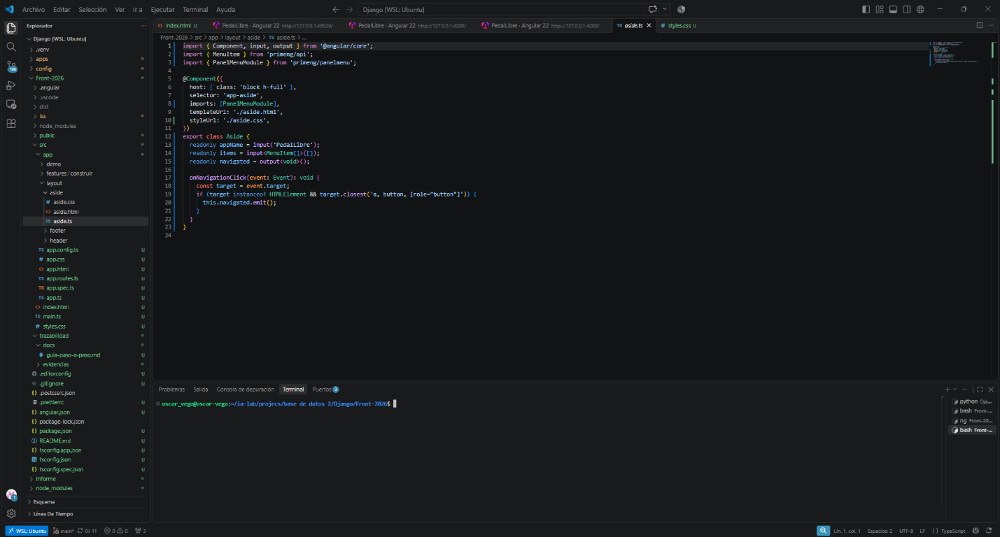

**Explicación:** En el editor se ve `Aside` importando `input`, `output`, `MenuItem` y `PanelMenuModule`. El componente declara `items` como entrada y emite `navigated`; no define el modelo de opciones.

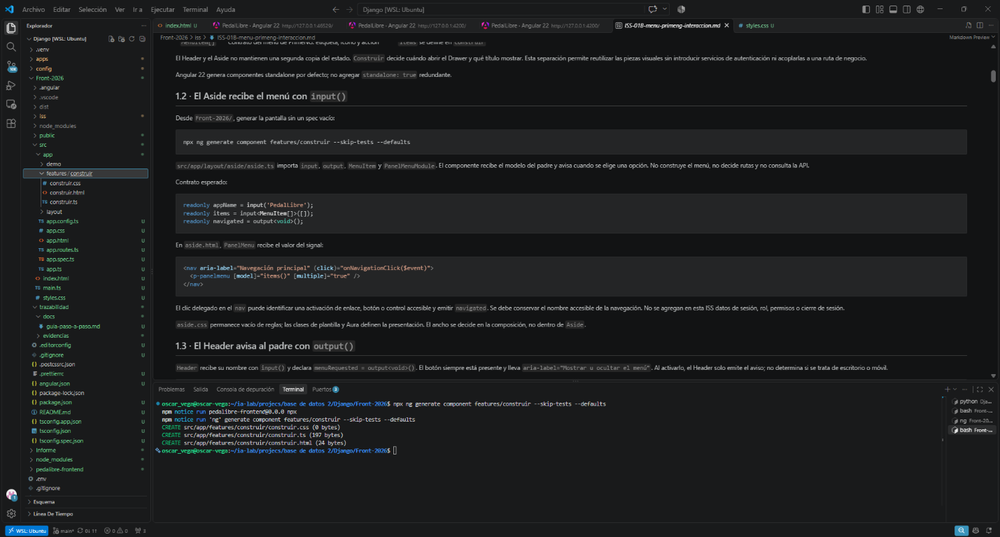

**Explicación:** La terminal muestra que ejecuté `ng generate component features/construir --skip-tests --defaults` desde `Front-2026/` y que Angular creó los archivos del componente.

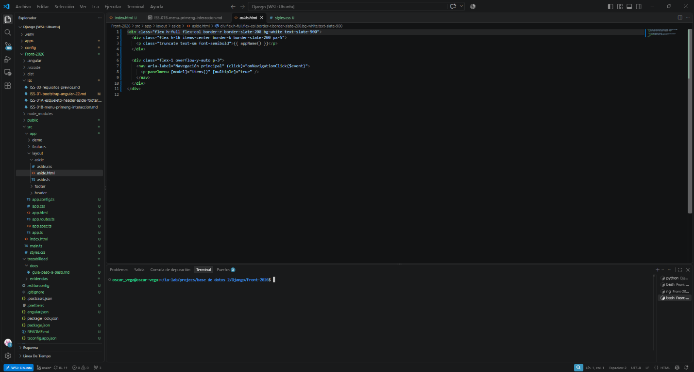

**Explicación:** La plantilla conserva el nombre accesible de navegación, delega el clic al método del componente y enlaza el modelo con `[model]="items()"`.

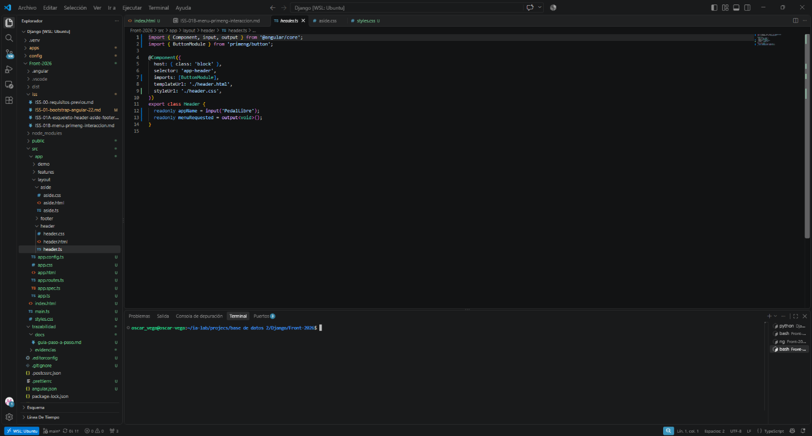

**Explicación:** `Header` importa `input` y `output`, recibe el nombre PedalLibre y declara `menuRequested` como aviso que el padre atenderá.

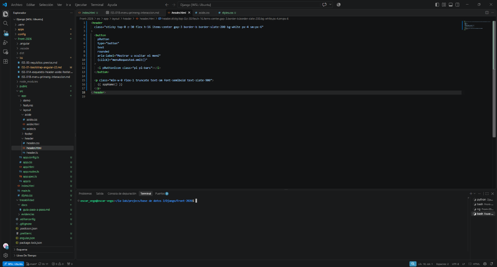

**Explicación:** La plantilla emite `menuRequested` al pulsar el botón con etiqueta accesible; no condiciona su visibilidad con `lg:hidden`.

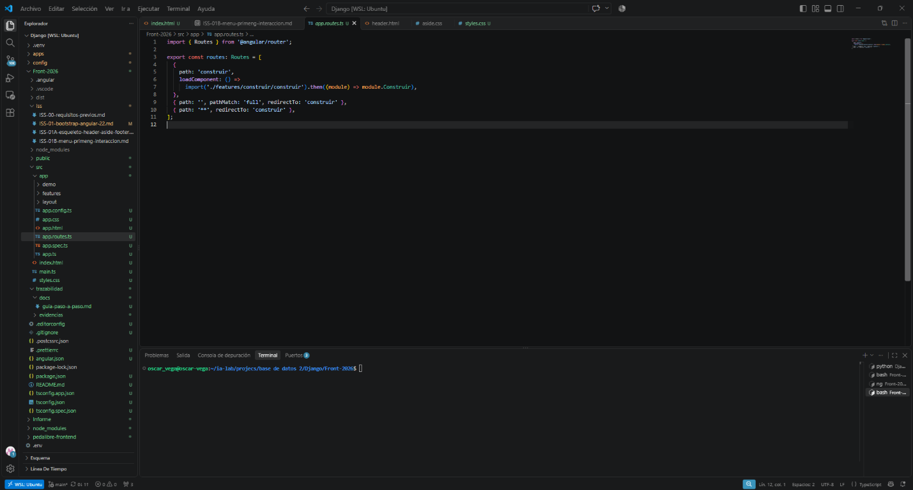

**Explicación:** `app.routes.ts` carga `Construir` mediante `loadComponent` y redirige la ruta vacía y las desconocidas a `construir`.

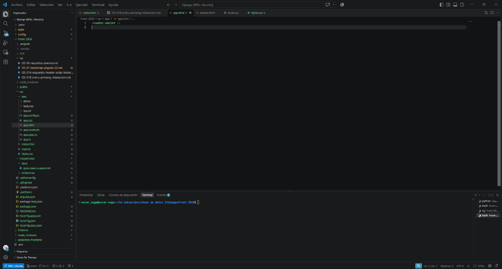

**Explicación:** La captura muestra `<router-outlet />` como contenido de `app.html`.

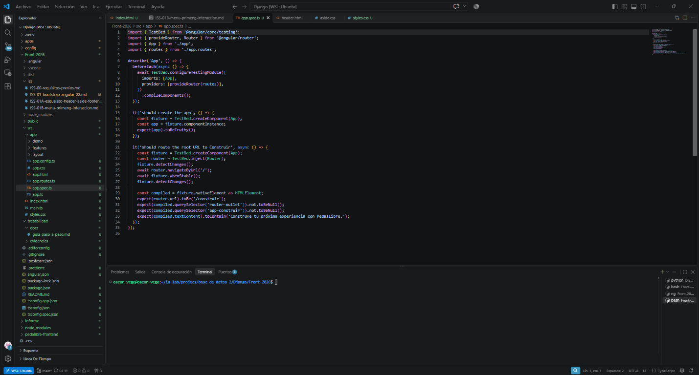

**Explicación:** La captura muestra código en `app.spec.ts`; no muestra la ejecución de pruebas. No la considero evidencia de pruebas ejecutadas y no ejecuté pruebas para esta ISS.

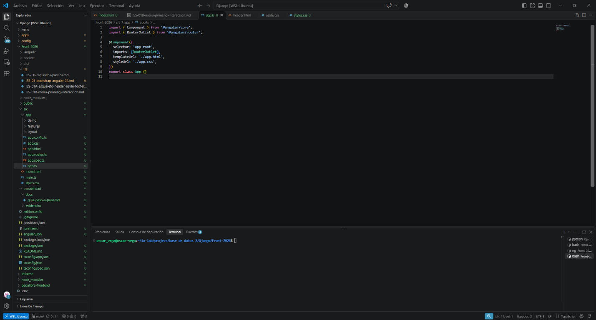

**Explicación:** `app.ts` importa `RouterOutlet` y configura el componente raíz para que el router presente la pantalla seleccionada.

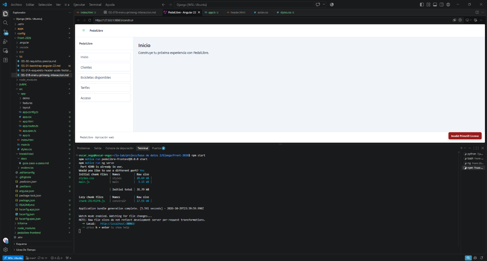

**Explicación:** Ejecuté `npm start`; como el puerto 4200 estaba ocupado, acepté el puerto alternativo `38663`. El navegador muestra `/construir` en escritorio con las cinco opciones del menú. La salida de Angular informa un bundle inicial de `31.79 kB` y un chunk diferido `construir` de `17.55 kB`. La captura no muestra la prueba del Drawer a 390 px ni la selección de una opción.

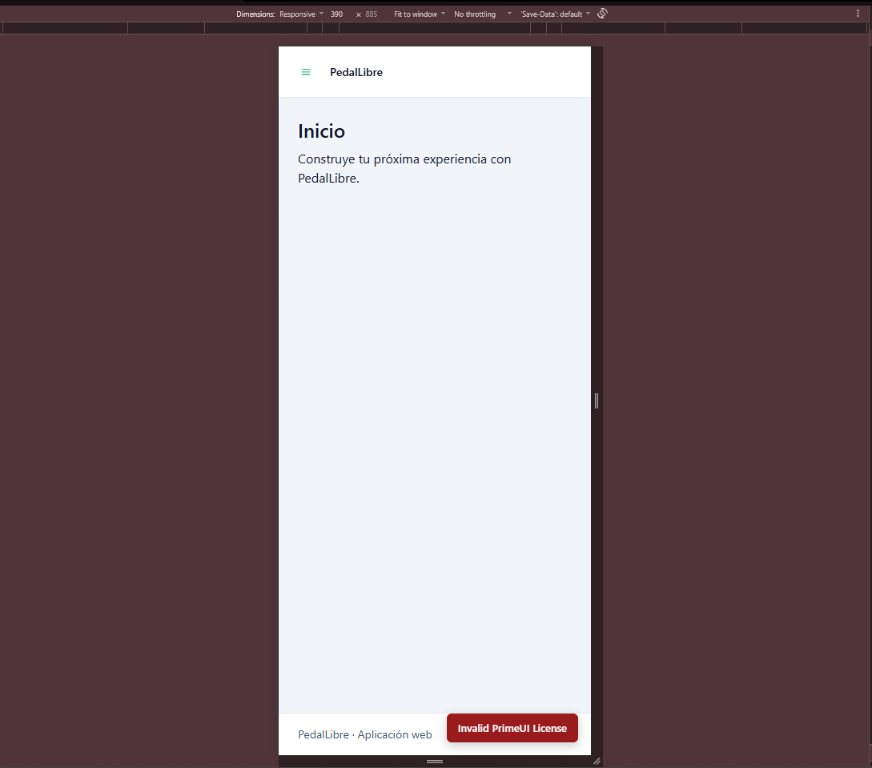

**Explicación:** La captura muestra la aplicación en viewport responsive de 390 px. El Header, el contenido y el Footer se ven sin el Aside fijo; el botón de menú permanece visible.

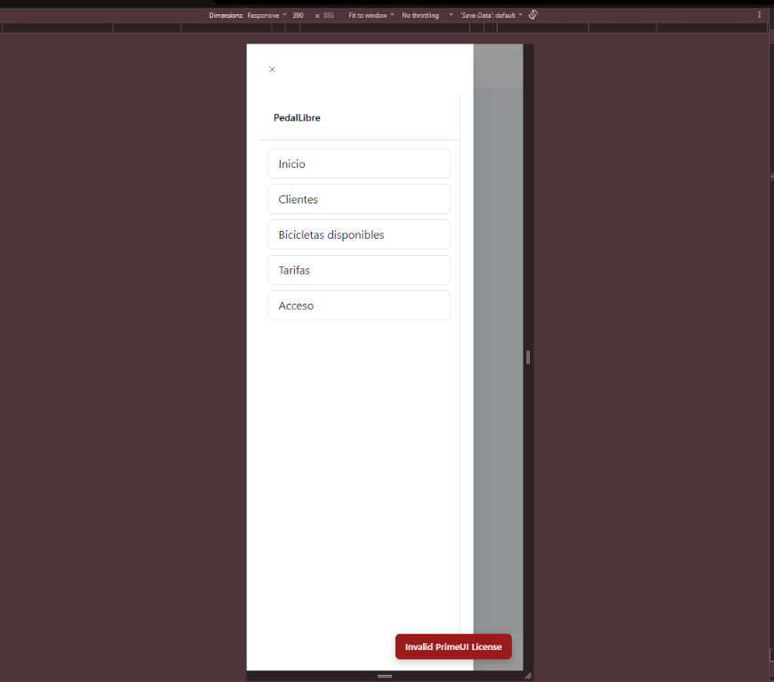

**Explicación:** Abrí el botón de menú en la vista móvil. El Drawer aparece desde la izquierda y presenta Inicio, Clientes, Bicicletas disponibles, Tarifas y Acceso.

### Resultado

La implementación del menú, el estado local, el punto de entrada del router y la carga diferida están hechos. Las capturas muestran la vista de escritorio, el build con chunk diferido, la vista móvil a 390 px y el Drawer abierto. El código mantiene la selección en el estado local y no conecta el menú con la API.

## Cierre

- **Criterios verificados:** componentes de presentación conectados con `input()`/`output()`; menú local; estado con signals; ruta diferida y redirecciones; vista de escritorio; build con chunk diferido; Aside oculto y Drawer abierto a 390 px.
- **Pendientes o correcciones:** ninguno para cerrar esta ISS. Las opciones siguen siendo locales; no consumen la API ni representan pantallas de negocio terminadas.
- **Estado final:** Completada. No ejecuté pruebas automatizadas.
- **Siguiente:** ISS-02 · Núcleo, modelos y layout.

## Correspondencia con el código

- `src/app/app.ts`
- `src/app/app.html`
- `src/app/app.routes.ts`
- `src/app/layout/header/header.ts`
- `src/app/layout/header/header.html`
- `src/app/layout/header/header.css`
- `src/app/layout/aside/aside.ts`
- `src/app/layout/aside/aside.html`
- `src/app/layout/aside/aside.css`
- `src/app/layout/footer/footer.ts`
- `src/app/layout/footer/footer.html`
- `src/app/layout/footer/footer.css`
- `src/app/features/construir/construir.ts`
- `src/app/features/construir/construir.html`
- `src/app/features/construir/construir.css`
- `src/app/core/utils/media-query.ts` (si se usa un helper para observar el ancho)

---

# ISS-01B original · Menú PrimeNG y primera interacción

> **Referencia:** texto original compartido para ISS-01B. Se conserva debajo de la adaptación PedalLibre. Las secciones y criterios marcados **(EXENTO EN PEDALIBRE)** permanecen como referencia de StoreLab; no son requisitos del proyecto.

> **🛠 Unidad ISS-01B · Menú PrimeNG y primera interacción — capa 🛠 CONSTRUIR**
>
> 🧠 Comprender este bloque → · ↑ Ruta Frontend-Django
>
> | Capa | Página | Para qué |
> |---|---|---|
> | 🧠 Aprender | Menú PrimeNG y primera interacción | comprender, explicar y relacionar |
> | 🛠 Construir | esta página | ejecutar, verificar y entregar |

## Contexto mínimo (EXENTO EN PEDALIBRE: proyecto, backend y marcas de StoreLab)

Si abres este archivo aislado —o lo llevas a otra IA—, esto es lo que hay que saber antes de ejecutarlo.

- **Proyecto:** `front-storelab-django` — Angular 22 (standalone + zoneless + signals), PrimeNG 22 en modo styled con Aura y Tailwind CSS 4. Sin CSS de negocio ni PrimeFlex.
- **Estado al terminar ISS-01A:** App compone Header, Aside, contenido y Footer con etiquetas; el contenido es fijo (`{{ title }}`) y no hay rutas ni HTTP.
- **Backend de referencia:** `pry-django` en `http://localhost:8000/api`. Esta ISS no llama a la API.
- **Patrón visual:** tema vs. utilidades, capas CSS en `PATRON-VISUAL.md`.
- **Comandos del CLI y versiones:** `CLI-Y-ALINEACION.md`.

**Misma estructura que Express.** El menú, el Drawer y el `router-outlet` se construyen igual. La marca del Header y del Aside es StoreLab; en Express es StoreLab Express II. El texto de bienvenida anuncia la API Django.

| Campo | Valor original |
|---|---|
| Este ISS | Menú PrimeNG y primera interacción |
| Feature / tabla | `layout/` (inputs y outputs) + `features/construir` + `app.routes.ts` |
| API | ninguna (sin HTTP todavía) |
| Depende de | ISS-01A — Esqueleto Header/Aside/Footer |
| Habilita | ISS-02 — Núcleo, modelos y layout |

## Contenido de este ISS

- 1.1 Los conceptos que se agregan, uno por vez
- 1.2 El Aside recibe el menú con `input()`
- 1.3 El Header avisa al padre con `output()`
- 1.4 `features/construir`: estado local y Drawer móvil
- 1.5 App pasa a ser punto de entrada con `router-outlet`
- 1.6 Comprobar antes de avanzar
- Verificación del ISS
- Cierre del ISS
- Correspondencia con el código
- GATE

## Objetivo (EXENTO EN PEDALIBRE: textos y nombres StoreLab)

Pasar de una maqueta a una pantalla que responde. Al terminar: PanelMenu en el Aside, botón de menú en el Header, Drawer en pantalla pequeña y selección que cambia el contenido local. Sin rutas de negocio y sin API.

**Bloqueado por:** ISS-01A.

**Evidencia de aprendizaje:** capturas de escritorio y móvil, más la explicación de qué dato viaja por `input()` y qué aviso vuelve por `output()`.

**Equipo y terminal:** Ubuntu WSL, terminal del editor, carpeta del frontend. Los ejemplos que crean o reemplazan archivos se ejecutan en una copia de práctica; en el workspace consolidado inspecciona y ajusta los archivos existentes.

## Criterios de aceptación (ISS-01B) — consolidados (EXENTO EN PEDALIBRE: suite automatizada)

- [ ] 1.1 Explica la diferencia entre `input()` (dato del padre al hijo), `output()` (aviso del hijo al padre) y `signal()` (estado propio)
- [ ] 1.2 `aside.ts` declara `items = input<MenuItem[]>([])` y `aside.html` lo pinta con `<p-panelmenu [model]="items()" [multiple]="true" />`
- [ ] 1.2 `aside.css` sigue sin reglas: la apariencia es de Aura y Tailwind
- [ ] 1.3 El Header emite `menuRequested` y su botón está siempre visible: por debajo de `lg` abre el Drawer, desde `lg` alterna el Aside fijo
- [ ] 1.4 Existe `src/app/features/construir/` con `construir.ts`, `construir.html`, `construir.css` y `construir.spec.ts`
- [ ] 1.4 `mobileOpen`, `sidebarCollapsed` y `title` son signal; elegir una opción cambia el título y cierra el Drawer
- [ ] 1.4 El layout se compone una sola vez en `construir.html` y se reutiliza en el Drawer
- [ ] 1.5 `app.ts` importa `RouterOutlet` y `app.html` contiene solo `<router-outlet />`
- [ ] 1.5 `app.routes.ts` declara construir con `loadComponent`, redirige `''` y `**` a construir
- [ ] 1.6 A 1280 px se ve el Aside con las cinco opciones; a 390 px se oculta y el botón abre el Drawer
- [ ] 1.6 A 1280 px el botón de menú se ve y oculta/muestra el Aside sin abrir el Drawer
- [ ] 1.6 La URL no cambia al elegir una opción y Network no registra llamadas `/api`
- [ ] `ng build` termina con código 0, construir se empaqueta como chunk diferido y las pruebas pasan

`demo/ejemplo` no participa. La introducción a Angular quedó en ISS-01. No tiene ruta, no está en el menú y no se compone en este ISS.

---

## 1.1 Los conceptos que se agregan, uno por vez

**Criterios de este sub-ítem**

- [ ] Distingue los tres canales de datos: entrada, salida y estado
- [ ] Reconoce `MenuItem[]` como el contrato del menú de PrimeNG
- [ ] Explica `[(visible)]` como ida y vuelta en un solo atributo

| Concepto | Qué resuelve | Dónde se ve en este ISS |
|---|---|---|
| `input()` | Dato que el padre entrega al hijo; el hijo no lo modifica | `items` en Aside, `appName` en Header |
| `output()` | Aviso del hijo al padre; el hijo no navega ni cierra nada por su cuenta | `menuRequested`, `navigated` |
| `signal()` | Estado propio del componente, observado por la plantilla | `title`, `mobileOpen` en Construir |
| `[propiedad]` | Enlace de la clase a la plantilla | `[model]="items()"` en PanelMenu |
| `(evento)` | Acción al recibir un aviso | `(menuRequested)="mobileOpen.set(true)"` |
| `[(visible)]` | Ida y vuelta: el Drawer abre y también actualiza el estado al cerrarse | `[(visible)]="mobileOpen"` |
| `MenuItem[]` | Forma tipada del menú de PrimeNG: label, icon, command | `items` en Construir |

**La frontera del ISS.** Los tres componentes de `layout/` son presentación: reciben datos y avisan. El único con estado es Construir. Esa separación permite reutilizar el layout en ISS-02 sin duplicar Header, Aside ni Footer, y evita inyectar servicios de autenticación en componentes visuales.

**PARCHE — standalone: true sobra.** Angular 22 genera componentes standalone por defecto. Los ejemplos de material antiguo lo incluyen; es válido, pero redundante. Este curso no lo escribe.

---

## 1.2 El Aside recibe el menú con `input()` (EXENTO EN PEDALIBRE: datos de sesión StoreLab)

**Criterios de este sub-ítem**

- [ ] Aside declara `items = input<MenuItem[]>([])`
- [ ] La plantilla usa `[model]="items()"`: se lee el signal con paréntesis
- [ ] El Aside no construye el menú ni conoce rutas: solo lo pinta
- [ ] `aside.css` no contiene reglas

`src/app/layout/aside/aside.ts`:

```ts
import { Component, input, output } from '@angular/core';
import { MenuItem } from 'primeng/api';
import { ButtonModule } from 'primeng/button';
import { PanelMenuModule } from 'primeng/panelmenu';

@Component({
  host: { class: 'block h-full' },
  selector: 'app-aside',
  imports: [ButtonModule, PanelMenuModule],
  templateUrl: './aside.html',
  styleUrl: './aside.css',
})
export class Aside {
  readonly appName = input('StoreLab');
  readonly items = input<MenuItem[]>([]);
  readonly showSession = input(false);
  readonly username = input('');
  readonly roleLabel = input('Sin rol');
  readonly permissionCount = input(0);
  readonly navigated = output<void>();
  readonly logoutRequested = output<void>();

  onNavigationClick(event: Event): void {
    if ((event.target as HTMLElement).closest('a, button, [role="button"]')) {
      this.navigated.emit();
    }
  }
}
```

`src/app/layout/aside/aside.html`:

```html
<div class="flex h-full flex-col border-r border-slate-200 bg-white text-slate-900">
  <div class="flex h-16 items-center gap-3 border-b border-slate-200 px-5">
    
    <div class="min-w-0">
      <p class="truncate text-sm font-semibold text-slate-900">{{ appName() }}</p>
      <p class="text-[11px] uppercase tracking-wider text-slate-400">
        Panel administrativo
      </p>
    </div>
  </div>

  <div class="flex-1 overflow-y-auto p-3">
    <nav aria-label="Navegación principal" (click)="onNavigationClick($event)">
      <p-panelmenu [model]="items()" [multiple]="true" />
    </nav>
  </div>

  @if (showSession()) {
    <div class="border-t border-slate-200 p-4">
      <p class="text-sm font-medium text-slate-900">{{ username() || 'Invitado' }}</p>
      <p class="text-xs text-slate-400">{{ roleLabel() }}</p>
      <div class="mt-3 flex items-center justify-between text-xs text-slate-400">
        <span>{{ permissionCount() }} permisos</span>
        <button
          pButton
          type="button"
          text
          rounded
          aria-label="Cerrar sesión"
          (click)="logoutRequested.emit()"
        >
          <i pButtonIcon class="pi pi-sign-out"></i>
        </button>
      </div>
    </div>
  }
</div>
```

Tres decisiones que se leen en el código:

| Decisión | Por qué |
|---|---|
| `items` es input, no signal propio | El menú pertenece a la pantalla; el Aside solo lo muestra. Si tuviera su propio signal, habría dos fuentes de verdad |
| `onNavigationClick` escucha en el `<nav>` | Un solo listener cubre todos los ítems, presentes y futuros |
| `closest('a, button, [role="button"]')` | El clic real cae en el `<span>` del icono o del texto; `closest` sube hasta el control |

`aria-label="Navegación principal"` nombra la región para lectores de pantalla y permite localizarla en las pruebas.

---

## 1.3 El Header avisa al padre con `output()` (EXENTO EN PEDALIBRE: sesión y marca StoreLab)

**Criterios de este sub-ítem**

- [ ] El botón de menú lleva `aria-label="Mostrar u ocultar el menú"` y no lleva `lg:hidden`
- [ ] Al pulsarlo emite `menuRequested`; el Header no abre nada ni consulta el ancho
- [ ] `showSession` sigue en false: no hay datos de sesión hasta ISS-08
- [ ] `header.css` no contiene reglas

`src/app/layout/header/header.ts`:

```ts
import { Component, input, output } from '@angular/core';
import { MenuItem } from 'primeng/api';
import { AvatarModule } from 'primeng/avatar';
import { ButtonModule } from 'primeng/button';
import { MenuModule } from 'primeng/menu';
import { TagModule } from 'primeng/tag';

@Component({
  host: { class: 'block' },
  selector: 'app-header',
  imports: [AvatarModule, ButtonModule, MenuModule, TagModule],
  templateUrl: './header.html',
  styleUrl: './header.css',
})
export class Header {
  readonly appName = input('StoreLab');
  readonly username = input('');
  readonly initials = input('IN');
  readonly roleLabel = input('Sin rol');
  readonly authEnabled = input(true);
  readonly showSession = input(false);
  readonly userItems = input<MenuItem[]>([]);
  readonly menuRequested = output<void>();
}
```

`src/app/layout/header/header.html`:

```html
<header
  class="sticky top-0 z-30 flex h-16 items-center gap-3 border-b border-slate-200 bg-white px-4 sm:px-6"
>
  <button
    pButton
    type="button"
    text
    rounded
    aria-label="Mostrar u ocultar el menú"
    (click)="menuRequested.emit()"
  >
    <i pButtonIcon class="pi pi-bars"></i>
  </button>

  <div class="min-w-0 flex-1">
    <p class="truncate text-sm font-semibold text-slate-900">{{ appName() }}</p>
    <p class="truncate text-xs text-slate-500">
      Gestión de clientes, productos y ventas
    </p>
  </div>

  @if (showSession() && !authEnabled()) {
    <p-tag value="Fase I · sin auth" severity="warn" [rounded]="true" />
  }
  @if (username()) {
    <p-tag
      [value]="roleLabel()"
      severity="info"
      [rounded]="true"
      class="hidden sm:inline-flex"
    />
  }

  @if (showSession()) {
    <button
      pButton
      type="button"
      severity="secondary"
      outlined
      (click)="userMenuPanel.toggle($event)"
      aria-label="Menú de usuario"
    >
      <p-avatar [label]="initials()" shape="circle" size="normal" />
      <span class="hidden max-w-32 truncate text-sm font-medium text-slate-700 sm:block">
        {{ username() }}
      </span>
      <i class="pi pi-chevron-down pr-1 text-[10px] text-slate-400"></i>
    </button>
    <p-menu #userMenuPanel [model]="userItems()" [popup]="true" appendTo="body" />
  }
</header>
```

**Por qué el hijo no abre el Drawer.** El Drawer vive en Construir. Si el Header lo abriera, tendría que conocer el estado de otra pantalla. Con `output()` el Header solo dice «se pulsó el botón»; quien decide qué hacer es el padre: `<app-header (menuRequested)="onMenuToggle()" />`. Esa es la diferencia entre un componente reutilizable y uno acoplado.

**PARCHE — `class="lg:hidden"` era un error de diseño.** La primera versión ocultaba el botón con `lg:hidden`, así que desaparecía justo desde 1024 px, que es donde el Aside fijo ya se ve. El botón debe estar siempre; lo que cambia es qué hace según el ancho. El Header no consulta el ancho: quien decide es el padre, con `onMenuToggle()`.

`sticky top-0 z-30` mantiene la barra visible al hacer scroll y por encima del contenido. `@if (showSession())` deja el bloque de usuario fuera del DOM hasta ISS-08.

---

## 1.4 `features/construir`: estado local y Drawer móvil

**Criterios de este sub-ítem**

- [ ] `mobileOpen`, `sidebarCollapsed` y `title` son signal, no propiedades normales
- [ ] Los cinco comandos del menú llaman a un único método `seleccionar`
- [ ] `seleccionar` cambia el título y cierra el Drawer
- [ ] `onMenuToggle` alterna el Aside fijo en escritorio y abre el Drawer en móvil
- [ ] El Aside aparece una vez en el layout de escritorio y otra en el Drawer, con el mismo `items`
- [ ] `construir.css` no contiene reglas

```bash
ng generate component features/construir --skip-tests --defaults
```

El `--skip-tests` no es para evitar pruebas: la prueba de esta pantalla se escribe completa en este ISS (más abajo) y sustituye a la plantilla vacía del CLI.

`src/app/features/construir/construir.ts`:

Crear o reemplazar `construir.ts` con:

```bash
cat > src/app/features/construir/construir.ts <<'EOF'
import { Component, signal } from '@angular/core';
import { MenuItem } from 'primeng/api';
import { ButtonModule } from 'primeng/button';
import { CardModule } from 'primeng/card';
import { DrawerModule } from 'primeng/drawer';
import { watchMediaQuery } from '../../core/utils/media-query';
import { Aside } from '../../layout/aside/aside';
import { Footer } from '../../layout/footer/footer';
import { Header } from '../../layout/header/header';

@Component({
  host: { class: 'block' },
  selector: 'app-construir',
  imports: [Aside, ButtonModule, CardModule, DrawerModule, Footer, Header],
  templateUrl: './construir.html',
  styleUrl: './construir.css',
})
export class Construir {
  private readonly isDesktop = watchMediaQuery('(min-width: 1024px)');
  readonly sidebarCollapsed = signal(false);
  readonly mobileOpen = signal(false);
  readonly title = signal('Inicio');

  readonly items: MenuItem[] = [
    { label: 'Inicio', icon: 'pi pi-home', command: () => this.seleccionar('Inicio') },
    { label: 'Clientes', icon: 'pi pi-users', command: () => this.seleccionar('Clientes') },
    {
      label: 'Tipos de producto',
      icon: 'pi pi-tags',
      command: () => this.seleccionar('Tipos de producto'),
    },
    { label: 'Productos', icon: 'pi pi-box', command: () => this.seleccionar('Productos') },
    { label: 'Ventas', icon: 'pi pi-shopping-cart', command: () => this.seleccionar('Ventas') },
  ];

  protected onMenuToggle(): void {
    if (this.isDesktop()) {
      this.sidebarCollapsed.update((collapsed) => !collapsed);
      return;
    }
    this.mobileOpen.set(true);
  }

  protected seleccionar(titulo: string): void {
    this.title.set(titulo);
    this.mobileOpen.set(false);
  }
}
EOF
```

### El helper que decide el ancho

`src/app/core/utils/media-query.ts`:

Crear `src/app/core/utils/media-query.ts` con:

```bash
mkdir -p src/app/core/utils
cat > src/app/core/utils/media-query.ts <<'EOF'
import { DestroyRef, Signal, inject, signal } from '@angular/core';

export function watchMediaQuery(query: string): Signal<boolean> {
  const destroyRef = inject(DestroyRef);
  const media =
    typeof window !== 'undefined' && typeof window.matchMedia === 'function'
      ? window.matchMedia(query)
      : null;
  const matches = signal(media?.matches ?? false);

  if (media) {
    const listener = (event: MediaQueryListEvent): void => matches.set(event.matches);
    media.addEventListener('change', listener);
    destroyRef.onDestroy(() => media.removeEventListener('change', listener));
  }

  return matches.asReadonly();
}
EOF
```

| Decisión | Por qué |
|---|---|
| La consulta es `(min-width: 1024px)`, igual que `lg` de Tailwind | Un solo lugar define la frontera |
| signal, no un booleano leído al vuelo | Si el usuario redimensiona, el comportamiento del botón se actualiza |
| `addEventListener` + `DestroyRef` | Observa el cambio y limpia el listener al destruir el componente |
| `false` cuando no existe `matchMedia` | El entorno sin API de medios se comporta como móvil |

**Alternativa que se descartó.** Se podría dejar que la media query la resolviera el CSS y el padre no supiera el ancho; pero el mismo botón debe servir para dos acciones distintas. La consulta en TypeScript permite distinguirlas.

### Plantilla de Construir

Crear o reemplazar `construir.html` con:

```bash
cat > src/app/features/construir/construir.html <<'EOF'
<div class="flex min-h-screen flex-col bg-slate-100">
  <app-header (menuRequested)="onMenuToggle()" />

  <div class="flex flex-1">
    @if (!sidebarCollapsed()) {
      <aside class="hidden w-72 shrink-0 lg:block">
        <app-aside [items]="items" (navigated)="mobileOpen.set(false)" />
      </aside>
    }

    <main id="contenido" class="min-w-0 flex-1 p-4 sm:p-6">
      <p-card class="block">
        <h1 class="text-2xl font-semibold text-slate-900">{{ title() }}</h1>
        <p class="mt-3 text-slate-600">
          Bienvenido a StoreLab. Elige una opción del menú para explorar la estructura.
        </p>
        <p class="mt-2 text-sm text-slate-500">
          Esta primera pantalla usa datos locales. Los formularios y la conexión con la API
          Django se incorporan después.
        </p>
      </p-card>
    </main>
  </div>

  <app-footer />
</div>

<p-drawer [(visible)]="mobileOpen" header="Menú" position="left" styleClass="w-72">
  <app-aside [items]="items" (navigated)="mobileOpen.set(false)" />
</p-drawer>
EOF
```

### Flujos originales

**Un clic de menú, de principio a fin:**

```text
clic en una opción
  ├─ PanelMenu ejecuta item.command()
  │     └─ seleccionar(titulo) → actualiza title y mobileOpen.set(false)
  └─ el clic llega al <nav>, que emite navigated
        └─ Construir: (navigated)="mobileOpen.set(false)"
```

Dos caminos terminan en el mismo estado. El `command` funciona con teclado; `navigated` cubre el caso en que el Aside se reutilice con enlaces reales en ISS-02. Ambos llaman a `.set(false)`.

| Pieza | Dónde se decide | Qué no hace |
|---|---|---|
| `items` | Construir | El Aside no inventa opciones |
| `title` | Construir | El Header no conoce el título |
| `mobileOpen` | Construir | El Aside no sabe si está en un Drawer |
| `sidebarCollapsed` | Construir | El Aside no sabe si el botón lo ocultó |

`w-72` en el Aside y `styleClass="w-72"` en el Drawer mantienen el mismo ancho.

**Flujo del botón de menú:**

```text
clic en el botón del Header
  ├─ Header: (click)="menuRequested.emit()"
  └─ Construir: onMenuToggle()
        ├─ ancho ≥ 1024px → alterna sidebarCollapsed
        └─ ancho < 1024px → mobileOpen.set(true)
```

| Ancho | Qué se ve antes | Qué hace el botón |
|---|---|---|
| ≥ 1024 px (`lg`) | Aside fijo de 288 px | Lo oculta y devuelve el espacio al contenido |
| < 1024 px | Solo el Header | Abre el Drawer con el mismo menú |

`@if (!sidebarCollapsed())` envuelve el Aside: en escritorio desaparece del DOM, no deja un hueco de 288 px.

---

## Prueba de la pantalla (EXENTO EN PEDALIBRE: no ejecutar pruebas automatizadas)

El material original crea `src/app/features/construir/construir.spec.ts`, ejecuta pruebas unitarias y lee signals desde la instancia. Esta parte se conserva aquí como referencia; no es una tarea de PedalLibre ni debe ejecutarse para avanzar.

```ts
import { TestBed } from '@angular/core/testing';
import { Construir } from './construir';

describe('Construir', () => {
  beforeEach(async () => {
    await TestBed.configureTestingModule({
      imports: [Construir],
    }).compileComponents();
  });

  it('should compose the layout and start on Inicio', async () => {
    const fixture = TestBed.createComponent(Construir);
    await fixture.whenStable();
    const compilado = fixture.nativeElement as HTMLElement;
    expect(compilado.querySelector('app-header')).toBeTruthy();
    expect(compilado.querySelector('aside app-aside')).toBeTruthy();
    expect(compilado.querySelector('app-footer')).toBeTruthy();
    expect(compilado.querySelector('main h1')?.textContent).toContain('Inicio');
  });
});
```

El original incluye también casos automatizados para opciones de menú, visibilidad del botón, cambio del título, apertura y cierre del Drawer, y simulación de `matchMedia` para escritorio. Se mantienen como referencia del documento fuente; no se incorporan a los criterios PedalLibre de esta ISS.

---

## 1.5 App pasa a ser punto de entrada con `router-outlet`

**Criterios de este sub-ítem**

- [ ] `app.ts` importa solo `RouterOutlet`
- [ ] `app.html` contiene únicamente `<router-outlet />`
- [ ] `app.routes.ts` usa `loadComponent` para construir
- [ ] `''` y `**` redirigen a construir

Este es el momento de presentar `RouterOutlet`: ahora existe una pantalla real que mostrar por URL. En una frase: `<router-outlet />` es un ancla; el router inserta a su lado el componente de la ruta activa.

`src/app/app.ts`:

Desde `Front-2026/`, crear o reemplazar `app.ts` con:

```bash
cat > src/app/app.ts <<'EOF'
import { Component } from '@angular/core';
import { RouterOutlet } from '@angular/router';

@Component({
  host: { class: 'block' },
  selector: 'app-root',
  imports: [RouterOutlet],
  templateUrl: './app.html',
  styleUrl: './app.css',
})
export class App {}
EOF
```

Crear o reemplazar `app.html` con:

```bash
cat > src/app/app.html <<'EOF'
<router-outlet />
EOF
```

Crear o reemplazar `app.routes.ts` con:

```bash
cat > src/app/app.routes.ts <<'EOF'
import { Routes } from '@angular/router';

export const routes: Routes = [
  {
    path: 'construir',
    loadComponent: () =>
      import('./features/construir/construir').then((module) => module.Construir),
  },
  { path: '', pathMatch: 'full', redirectTo: 'construir' },
  { path: '**', redirectTo: 'construir' },
];
EOF
```

| Ruta | Qué hace |
|---|---|
| `construir` | Carga diferida del prototipo |
| `''` con `pathMatch: 'full'` | `/` redirige a `/construir`; sin `full` coincidiría con todo |
| `**` | Una URL desconocida vuelve a `/construir` en vez de dejar la pantalla vacía |

**Por qué `loadComponent` y no `component`.** Con `component`, el código de Construir y de PrimeNG entraría en el bundle inicial. Con `loadComponent`, se descarga un chunk aparte solo al visitar la URL.

El enlace a `/login` todavía no existe; la pantalla de login se trabaja en ISS-08. Este ISS no importa `RouterLink` ni escribe `<a routerLink="/login">`.

### Prueba del punto de entrada (EXENTO EN PEDALIBRE)

El archivo original `src/app/app.spec.ts` usa `TestBed`, `provideRouter([])` y pruebas para la creación de App y el `router-outlet`. Se conserva como referencia; no ejecutar pruebas automatizadas para completar esta ISS de PedalLibre.

---

## 1.6 Comprobar antes de avanzar

**Criterios de este sub-ítem**

- [ ] A 1280 px se ve el Aside con las cinco opciones y no hay scroll horizontal
- [ ] A 1280 px el botón de menú se ve y al pulsarlo oculta el Aside sin abrir el Drawer
- [ ] A 390 px el Aside no se ve y el botón del Header abre el Drawer
- [ ] Elegir una opción cambia el título y cierra el Drawer
- [ ] La URL no cambia y Network no registra `/api`
- [ ] Con teclado se recorre el menú y se activa con Enter
- [ ] `ng build` termina con código 0

El original usa `npm start` y propone estas comprobaciones visuales:

| Comprobación visual | Resultado original esperado |
|---|---|
| `/` | Redirige a `/construir` |
| Escritorio (≥ 1024 px) | Aside blanco de 288 px con logo y cinco opciones; título Inicio |
| Escritorio, pulsar el botón | El Aside desaparece y el contenido ocupa el ancho; no se abre Drawer |
| Escritorio, pulsar otra vez | El Aside vuelve a la izquierda |
| Elegir Clientes | El `<h1>` pasa a Clientes; la URL sigue en `/construir` |
| Móvil (390 px) | Sin Aside; botón visible en Header |
| Móvil, pulsar el botón | Drawer desde la izquierda con las cinco opciones |
| Elegir en el Drawer | Título nuevo y Drawer cerrado |
| Con poco contenido | Footer al borde inferior de la ventana |
| Network | Sin peticiones `/api`; sí el chunk diferido de construir |

**PARCHE — botón de menú.** Con `lg:hidden` el botón desaparecía a partir de 1024 px, justo donde el Aside fijo se muestra. El botón debe estar siempre visible y su acción depende del ancho.

**Siguiente:** ISS-02 conserva estas piezas y agrega modelos, HTTP y las rutas del negocio.

---

## Verificación del ISS (EXENTO EN PEDALIBRE: ejecución de pruebas automatizadas)

El original propone los siguientes comandos. En PedalLibre se conservan como referencia; no ejecutaré el bloque de pruebas:

```bash
# 1. Compila y separa el chunk diferido
ng build

# 2. El Aside recibe el menú y el Header emite el aviso
grep -n "input<MenuItem\[\]>" src/app/layout/aside/aside.ts
grep -n "menuRequested" src/app/layout/header/header.ts

# 2b. El botón no se esconde en escritorio
grep -rn "lg:hidden" src/app/layout/header/header.html || echo "sin lg:hidden: correcto"

# 3. La pantalla tiene el estado y compone el layout
grep -n "signal(" src/app/features/construir/construir.ts
grep -n "app-header\|app-aside\|app-footer\|p-drawer" src/app/features/construir/construir.html

# 4. App es solo el outlet y las rutas cargan diferido
grep -n "RouterOutlet" src/app/app.ts
grep -n "loadComponent" src/app/app.routes.ts
```

El original también sugiere buscar llaves en los CSS y ejecutar `npm test -- --watch=false`. La suite automatizada queda expresamente exenta en PedalLibre.

### Resultado en este workspace (24-oct-2026) (EXENTO EN PEDALIBRE: resultados de StoreLab)

| Comprobación | Resultado original |
|---|---|
| `ng build` | código 0; Initial total 499.68 kB (< 750 kB, sin warning) |
| Chunks | inicial: anónimo 354.95 kB + main 117.09 kB + estilos 27.65 kB; diferido construir 226.46 kB |
| `npm test -- --watch=false` | 3 archivos, 13 pruebas (App 2, Construir 7, Ejemplo 4) |
| `/` | Redirige a `/construir`; título StoreLab · Angular 22 |
| Escritorio 1280×800 | Aside visible, 288 px; 5 opciones; sin scroll horizontal ni Drawer |
| Escritorio, botón | visible; al pulsar el Aside sale del DOM |
| Escritorio, segundo clic | Aside vuelve con las cinco opciones |
| Escritorio, clic en Clientes | `<h1>` pasa a Clientes; URL sigue en `/construir` |
| Móvil 390×844 | Aside oculto; botón visible; sin scroll horizontal; Footer al borde inferior |
| Móvil, clic en el botón | Drawer desde la izquierda, 288×844 px, con las cinco opciones |
| Drawer, elegir Productos | `<h1>` pasa a Productos y el Drawer desaparece del DOM |
| Network | 0 peticiones `/api`; sí `/brand/storelab-mark.svg` y el chunk de construir |
| Logo | naturalWidth 150 |
| Teclado | Encabezados de PanelMenu con `role="button"` y `tabindex="0"`; Enter sobre Inicio cambia el `<h1>` |

El DOM de PrimeNG confirma el comportamiento: al abrir el Drawer existe `.p-drawer` y al seleccionar una opción se elimina del DOM. La prueba automática original comprueba el signal `mobileOpen`, fuente de verdad del componente.

## Cierre del ISS (EXENTO EN PEDALIBRE: afirmaciones de finalización originales)

La pantalla responde: el Aside pinta el menú que recibe, el Header avisa sin conocer el estado ajeno, el Drawer funciona en móvil y App queda como punto de entrada con `router-outlet`. No hay llamadas a la API y los tres CSS de `layout/` siguen vacíos.

**Siguiente:** ISS-02 — Núcleo, modelos y layout.

## Correspondencia con el código

Esta guía es la que contiene los comandos (`ng generate`, `cat >`) y la explicación paso a paso para construir el frontend desde cero. El código no se duplica en `docs/`: la referencia completa son los archivos reales del proyecto, enlazados al final de esta ISS.

Los ejemplos breves muestran incrementos y no sustituyen todos los archivos del componente. Las configuraciones de las primeras etapas omiten deliberadamente la sesión y las rutas que se construyen después; en el proyecto consolidado la seguridad final está activa. No combines imports de una etapa final con stubs que todavía no implementaste.

La sesión es un stub. `showSession` es false por defecto en Header y Aside. Los inputs existen para que ISS-08 los complete con datos reales, sin reescribir el layout. Mientras estén en false, esos bloques no se renderizan: no hay avatar ni botón de cerrar sesión vacíos.

### Código completo de referencia

Los fragmentos de esta ISS se estudian por incrementos. Estos archivos contienen la implementación consolidada original, incluida la seguridad de la fase final:

- `public/brand/storelab-mark.svg`
- `src/app/app.css`
- `src/app/app.html`
- `src/app/app.routes.ts`
- `src/app/app.spec.ts`
- `src/app/app.ts`
- `src/app/core/utils/media-query.ts`
- `src/app/features/construir/construir.css`
- `src/app/features/construir/construir.html`
- `src/app/features/construir/construir.spec.ts`
- `src/app/features/construir/construir.ts`
- `src/app/layout/aside/aside.css`
- `src/app/layout/aside/aside.html`
- `src/app/layout/aside/aside.ts`
- `src/app/layout/footer/footer.css`
- `src/app/layout/footer/footer.html`
- `src/app/layout/footer/footer.ts`
- `src/app/layout/header/header.css`
- `src/app/layout/header/header.html`
- `src/app/layout/header/header.ts`

## GATE (EXENTO EN PEDALIBRE: pruebas automatizadas y resultados de StoreLab)

```text
TODOS los AC = PASS  → se puede avanzar a ISS-02
ALGÚN AC = FAIL       → se corrige y se repite
```

| AC | Comprobación | Resultado original |
|---|---|---|
| 1.2 | `items = input<MenuItem[]>([])` y `[model]="items()"` | PASS |
| 1.3 | Botón siempre visible, sin `lg:hidden`, emite `menuRequested` | PASS |
| 1.4 | `title`, `mobileOpen` y `sidebarCollapsed` son signal; Drawer reutiliza el Aside | PASS |
| 1.5 | `app.html` es solo `<router-outlet />`; construir carga con `loadComponent` | PASS |
| 1.6 | 1280 px alterna el Aside; 390 px abre y cierra el Drawer; URL fija; 0 `/api` | PASS |
| build | `ng build` 0 y 13 pruebas en verde | PASS |

---

> **Navegación de la ruta:** ← ISS-01A · 🛠 Construir · ↑ Ruta Frontend-Django · → ISS-02 · 🛠 Construir
