# Guía paso a paso del frontend

> **Proyecto:** Frontend Django
> **Formato:** bitácora personal, escrita en primera persona
> **Recorrido:** ISS-00 a ISS-11
> **Estado:** en desarrollo

## Propósito

En esta guía registro, con mis propias palabras, cómo voy desarrollando el frontend del proyecto. Sigo las ISS de la [guía del docente](https://tecnogua.com/academic/site/frontend2026/django/construir/ISS-00-requisitos-previos/), desde ISS-00 hasta ISS-11.

Por cada ISS documento lo que hice realmente, cómo comprobé que funciona, las evidencias visuales, la retroalimentación recibida y lo que aprendí. No marco un paso como realizado ni agrego capturas hasta contar con la información o evidencia correspondiente.

## Cómo llevaré la bitácora

1. Consulto la ISS correspondiente en la guía del docente.
2. Desarrollo el paso y describo en primera persona las acciones que realicé.
3. Anoto los comandos o decisiones relevantes y el resultado que observé.
4. Guardo las capturas compartidas en `../evidencias/`, las inserto en la sección de la ISS y explico debajo de cada una qué muestra.
5. Registro la retroalimentación: qué está bien, qué debo corregir y por qué.
6. Cierro con una reflexión breve sobre lo que aprendí y marco el estado según la evidencia disponible.

Las capturas deben mostrar lo necesario para verificar el trabajo. Antes de guardarlas, oculto contraseñas, tokens, claves y otros datos sensibles.

## Ubicación de las evidencias

Las imágenes se guardan en [`../evidencias/`](../evidencias/), con nombres descriptivos y numerados por ISS. En la bitácora inserto cada captura con un enlace relativo y escribo justo debajo una explicación del resultado que muestra.

## Seguimiento

| ISS | Tema | Estado |
|---|---|---|
| ISS-00 | Requisitos previos | Completada; las pruebas de integración quedan para las ISS que consuman la API |
| ISS-01 | Bootstrap Angular 22 con CLI | Completada; demo PedalLibre, build y seis pruebas verificados |
| ISS-01B | Menú PrimeNG y primera interacción | Completada; escritorio, Drawer móvil a 390 px y build con chunk diferido documentados |
| ISS-02 | Núcleo: environment, modelos y servicios PedalLibre | Completada con evidencia visual; sin build ni pruebas |
| ISS-03 | Clientes: listado, formulario y estado activo | Completada con evidencias; API devuelve 401, CRUD autenticado no verificado |
| ISS-04 | CRUD de tarifas PedalLibre (adaptación del original de tipos de producto) | Completada con evidencias de implementación; API responde 401, CRUD autorizado y pruebas automáticas pendientes |
| ISS-05 | CRUD de bicicletas PedalLibre (adaptación del original de productos) | Completada con evidencias; build y suite existente aprobados; alcance de pruebas documentado |
| ISS-06 | Alquileres y registro PedalLibre (adaptación del original de ventas) | Cerrada con evidencia; bundle de pruebas y 6 pruebas generales aprobados, sin pruebas específicas de alquileres ni build de producción |
| ISS-07 | Por registrar desde la guía del docente | Pendiente |
| ISS-08 | Por registrar desde la guía del docente | Pendiente |
| ISS-09 | Por registrar desde la guía del docente | Pendiente |
| ISS-10 | Por registrar desde la guía del docente | Pendiente |
| ISS-11 | Por registrar desde la guía del docente | Pendiente |

Los títulos y criterios de cada ISS se completarán al consultar su página correspondiente. El estado refleja el trabajo y las evidencias documentadas, no solo la existencia de esta plantilla.

## Registro de desarrollo

### ISS-00 · Requisitos previos

**Referencia:** [ISS-00 — Requisitos previos](https://tecnogua.com/academic/site/frontend2026/django/construir/ISS-00-requisitos-previos/)

**Estado:** En curso; entorno y CLI comprobados con capturas. Adapté la guía para trabajar con PedalLibre.

#### Objetivo

Registrar cómo preparé y comprobé el entorno antes de comenzar a escribir código Angular, contrastando la ISS-00 con el backend PedalLibre del repositorio.

#### Pasos que realicé

1. **0.1 — Node y npm (verificado):**
   - Ejecuté `node --version` y `npm --version`; obtuve Node `v24.21.0` y npm `12.1.0`.
   - Consulté `npm view @angular/cli version engines --json`. La versión publicada era `22.2.5` y el rango de Node incluía `^24.15.0`, por lo que mi versión instalada era compatible.
   - Actualicé npm con `npm install -g npm@12.2.1`.

2. **0.2 — Angular CLI (verificado):**
   - Instalé el CLI con `npm install -g @angular/cli`.
   - Ejecuté `ng version` y `command -v ng`; obtuve Angular CLI `22.2.5`, Node `v24.21.0`, npm `12.2.1` y la ruta `/home/oscar_vega/.nvm/versions/node/v24.21.0/bin/ng`.

3. **0.3 — Editor y navegador (parcial):**
   - Abrí el proyecto en VS Code y comprobé que puedo usar su terminal integrada.
   - Abrí la página de inicio de sesión del administrador Django en `http://127.0.0.1:8000/admin/`.
   - Todavía no registré una comprobación de DevTools.

4. **0.4 — Backend Django (parcial):**
   - Ejecuté `python manage.py check` y `python manage.py runserver`.
   - En la terminal vi que el servidor de desarrollo inició en `http://127.0.0.1:8000/`.
   - Abrí `/admin/` y vi el formulario de inicio de sesión.

5. **Consulta de clientes (resultado observado; evidencia no adjunta):**
   - Ejecuté `curl -i http://127.0.0.1:8000/api/clients/`. La respuesta mostró `HTTP/1.1 200 OK` y un arreglo JSON.
   - La captura de esa respuesta contiene datos personales visibles de clientes. No la copié a las evidencias del proyecto; repetiré la comprobación guardando solo el estado HTTP y la forma de la respuesta, sin mostrar registros.

6. **Prueba de login desde terminal (no completada):**
   - Intenté ejecutar un bloque Python para probar el login y consultar endpoints.
   - La terminal devolvió `EOF when reading a line`; no completé el ingreso del usuario y la contraseña ni validé las consultas con token.
   - No registré credenciales ni tokens.

7. **Adaptación de la ISS:**
   - Identifiqué que las instrucciones originales describen StoreLab y no coinciden con PedalLibre.
   - Acordé trabajar con PedalLibre y documenté las equivalencias de rutas y autenticación en `../iss/ISS-00-requisitos-previos.md`.

#### Evidencias

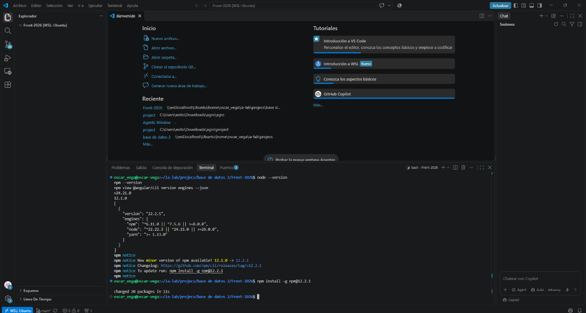

**Explicación:** En esta captura registro las versiones de Node y npm y la consulta de los requisitos de Node para Angular CLI. La versión de Node que aparece es compatible con el rango mostrado.

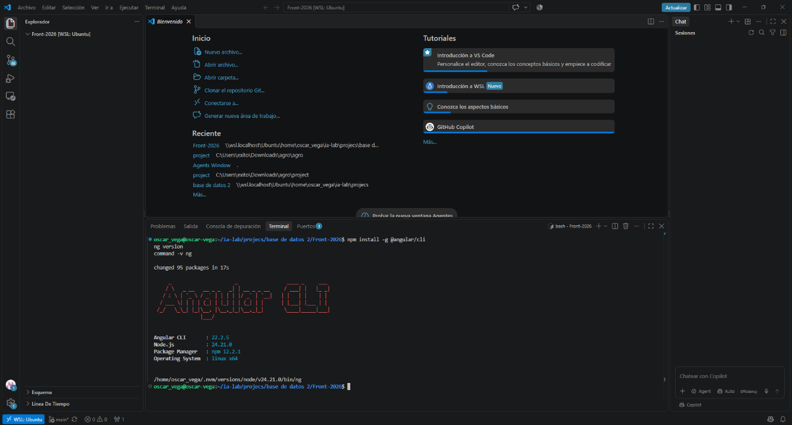

**Explicación:** En esta captura muestro la instalación y la verificación de Angular CLI 22. Se observa la versión 22.2.5 junto con las versiones de Node y npm del entorno.

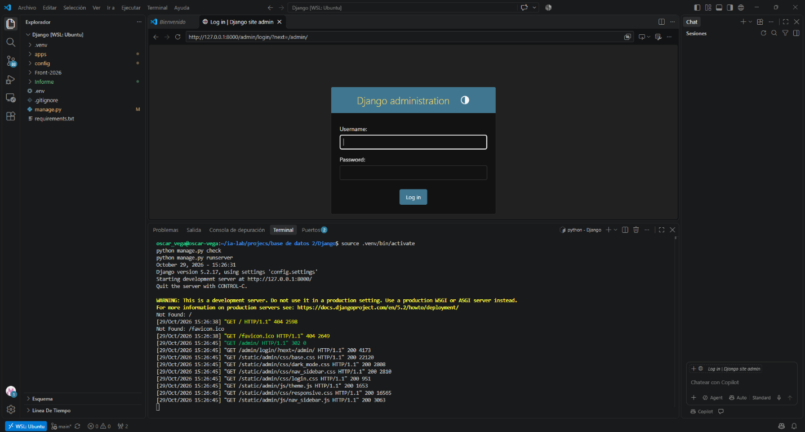

**Explicación:** En esta captura se ve el servidor de desarrollo de Django en ejecución y el formulario de inicio de sesión de `/admin/`. Esto comprueba que la página carga; no significa que haya iniciado sesión en el administrador.

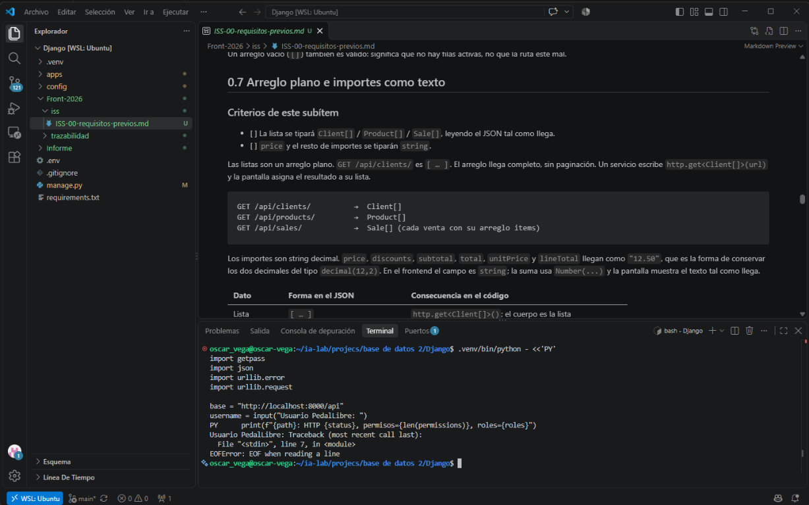

**Explicación:** En esta captura documento el intento de probar el login desde la terminal. La ejecución terminó con `EOF when reading a line`, por lo que no completé el ingreso de credenciales ni confirmé la autenticación.

La captura de `curl /api/clients/` que compartí muestra datos personales de clientes. No la incorporé al repositorio para evitar publicar esa información; repetiré la comprobación con una salida resumida que no exponga registros.

#### Retroalimentación

Comprobé que Node, npm y Angular CLI son compatibles, que el servidor Django inicia y que `/admin/` carga. La consulta de clientes devolvió 200; no guardaré la captura con datos personales. El intento de probar el login desde la terminal terminó con `EOF when reading a line`, por lo que no confirmé el login ni las rutas protegidas con JWT. Esas comprobaciones se harán cuando una ISS requiera integrar la API y no bloquean el inicio del frontend.

#### Qué aprendí

Aprendí a comprobar la compatibilidad entre Node y Angular CLI antes de crear el proyecto. También confirmé que debo adaptar las rutas de la guía al backend PedalLibre y proteger los datos personales cuando guardo evidencias de consultas.

#### Cierre

- **Criterios verificados:** Node/npm y Angular CLI; `manage.py check` y `runserver` ejecutados; `/admin/` abierto; `/api/clients/` respondió 200 en la captura compartida.
- **Pendientes para las ISS de integración:** validar login y permisos con JWT, comprobar CORS desde el navegador y revisar el contrato de tarifas cuando el frontend consuma esos recursos. No necesito repetir la consulta de clientes para cerrar los requisitos del entorno.
- **Estado final:** Completada; puedo avanzar a ISS-01.

---

### ISS-01 · Bootstrap Angular 22 con CLI

**Referencia:** consultar el enlace a ISS-01 desde la ruta de construcción del docente.

**Estado:** Completada.

#### Pasos que realicé

1. **Creación del proyecto Angular:**
   - Creé el scaffold Angular dentro de `Front-2026/`; ahí están `angular.json`, `package.json` y `src/`.
   - En un primer intento ejecuté también `ng new pedalibre-frontend` desde la carpeta superior. Se creó una carpeta adicional fuera de `Front-2026/`; no es el workspace que uso para esta ISS.

2. **Instalación de dependencias en el frontend:**
   - Ejecuté Tailwind, PostCSS, PrimeNG, Aura, PrimeIcons y Angular CDK desde `Front-2026/`. `package.json` registra las dependencias.
   - npm mostró avisos porque cuatro scripts de instalación no están aprobados por `allowScripts`. No habilité scripts de forma general; el build y las pruebas sí funcionaron.
   - Comprobé las versiones con `npm ls`: Tailwind y `@tailwindcss/postcss` 4.3.3, PrimeNG 22.1.4, Aura 3.1.0, PrimeIcons 8.0.2 y Angular CDK 22.2.5.

3. **Configuración de estilos y PrimeNG:**
   - Creé `.postcssrc.json` con `@tailwindcss/postcss`.
   - En `src/styles.css` declaré las capas de tema, base, PrimeNG y utilidades, e importé Tailwind y PrimeIcons.
   - Configuré Aura, `darkModeSelector: '.app-dark'`, las capas CSS, `MessageService`, `ConfirmationService` y el router.

4. **Demostración local de Angular:**
   - Creé `DemoLocal` y lo compuse desde `App` mediante `<app-demo-local />`.
   - La demostración usa datos identificados como ejemplo y no consulta la API. Implementé `signal`, el impuesto derivado con `computed`, el registro con `effect`, edición del nombre, cambio de precio/estado y reinicio.
   - Ajusté `index.html` a `lang="es"` y al título `PedalLibre · Angular 22`.
   - Configuré el presupuesto inicial del build a 750 kB de advertencia y 1 MB de error.

5. **Ejecución, build y pruebas:**
   - Abrí la demostración en el navegador. Como el puerto 4200 estaba ocupado, Angular inició en `http://127.0.0.1:46529/`.
   - Ejecuté `npm run build`: terminó correctamente con un bundle inicial de `542.51 kB`.
   - La prueba generada originalmente por Angular todavía buscaba el saludo del scaffold. La actualicé para comprobar que se muestra la demo local y añadí cuatro pruebas para los datos iniciales, el cálculo derivado, la edición del nombre, el estado y el reinicio.
   - Volví a ejecutar `npm test -- --watch=false`: pasaron los dos archivos de prueba y las seis pruebas.

#### Evidencias

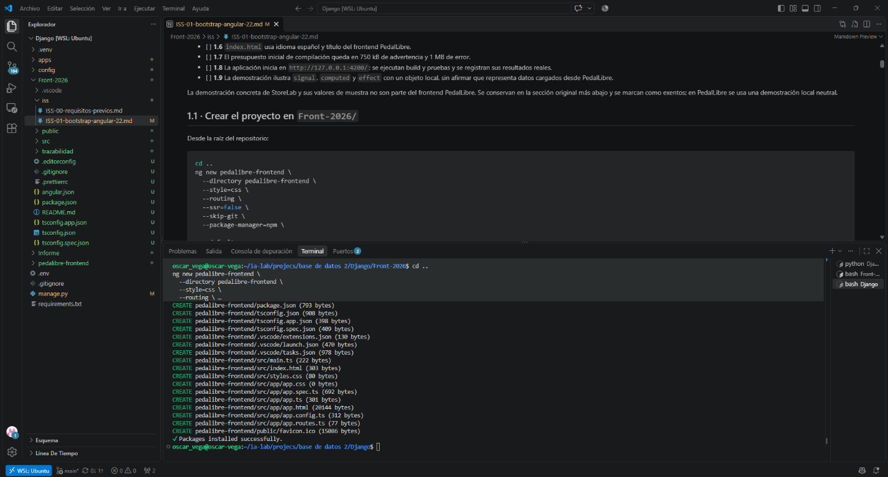

**Explicación:** En este primer intento ejecuté `cd ..` antes de `ng new pedalibre-frontend --directory pedalibre-frontend`. Angular creó la carpeta adicional fuera de `Front-2026/`; conservé la captura como registro del error de ubicación y trabajé en el scaffold que ya está dentro de `Front-2026/`.

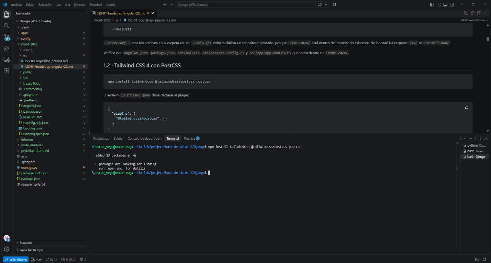

**Explicación:** El prompt muestra que este primer `npm install` se ejecutó en `Django/`, no en el workspace. Más adelante repetí la instalación desde `Front-2026/`, como se ve en la evidencia ISS-01-07.

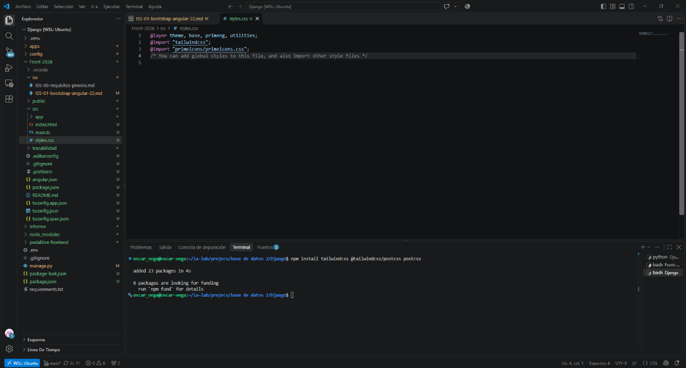

**Explicación:** En `Front-2026/src/styles.css` escribí el orden de capas y los imports de Tailwind y PrimeIcons. Después instalé las dependencias desde el workspace y la hoja quedó compilada con ellas.

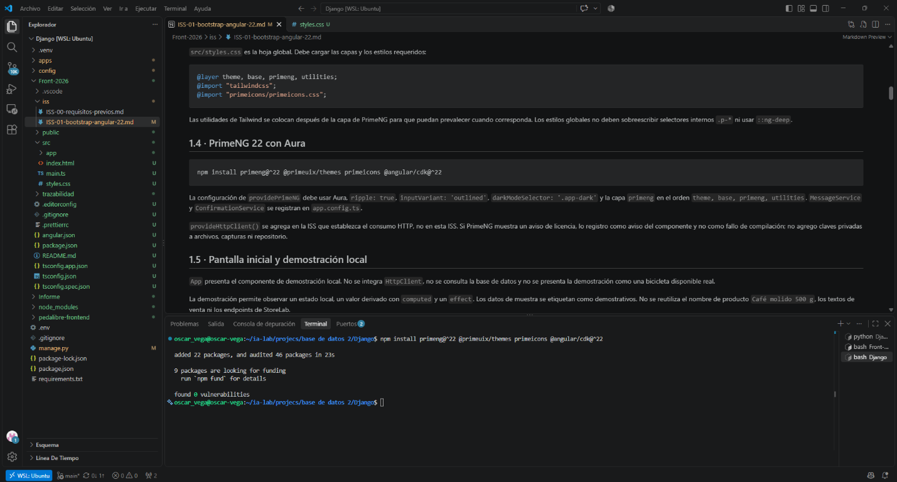

**Explicación:** Este primer intento agregó paquetes desde `Django/`, fuera de `Front-2026/`. Luego instalé las dependencias en el workspace correcto y comprobé que aparecen en el `package.json` del frontend.

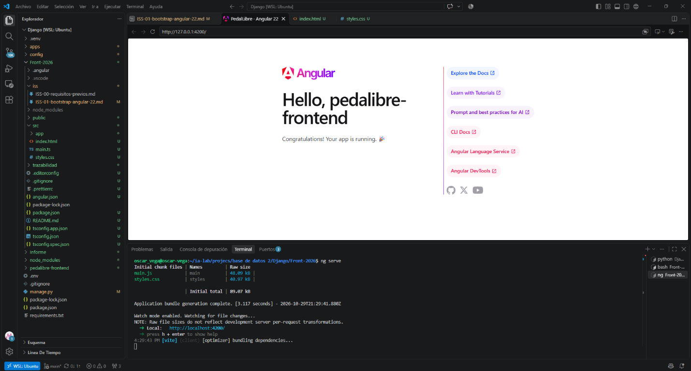

**Explicación:** Esta captura registra el primer arranque, cuando todavía se veía la plantilla de bienvenida generada por Angular. La evidencia ISS-01-16 muestra el estado posterior con la demo local.

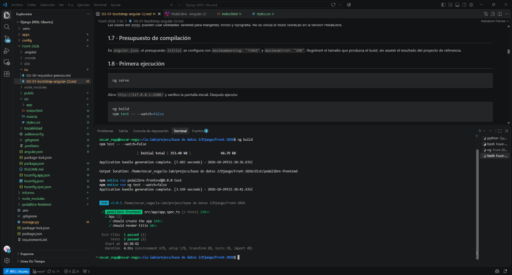

**Explicación:** Esta captura registra el build inicial y las dos pruebas generadas por el CLI, antes de terminar la demo. Después actualicé las pruebas para la aplicación real y ejecuté de nuevo la suite: seis pruebas aprobaron.

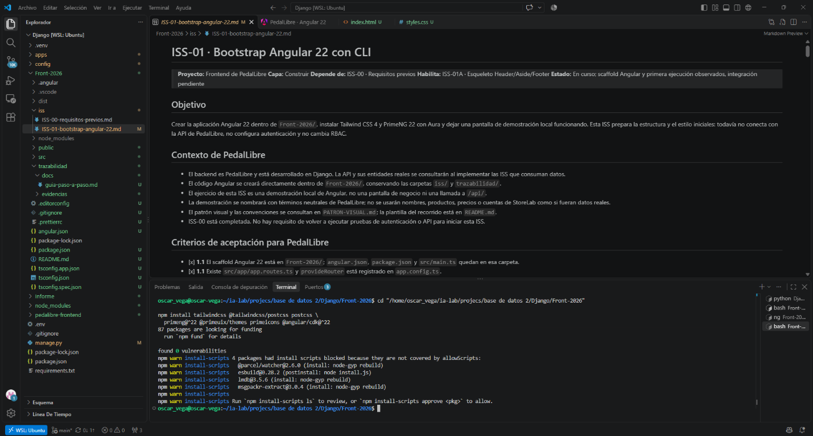

**Explicación:** El prompt ahora está en `Django/Front-2026/` y npm instaló las dependencias en este workspace. La salida reporta 87 paquetes agregados y cero vulnerabilidades; también advierte que cuatro scripts de instalación fueron bloqueados por `allowScripts`.

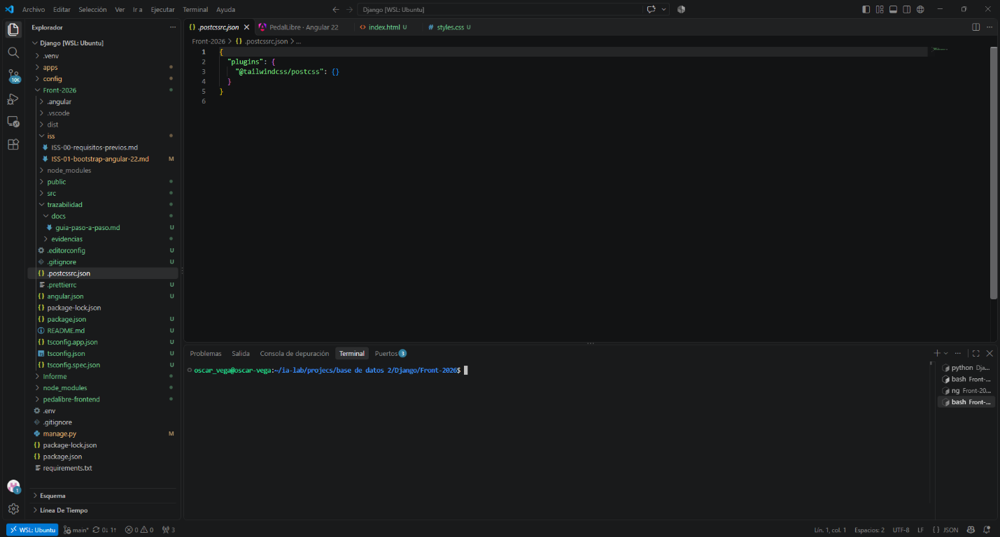

**Explicación:** Creé `.postcssrc.json` en la raíz de `Front-2026/` y declaré el plugin `@tailwindcss/postcss`.

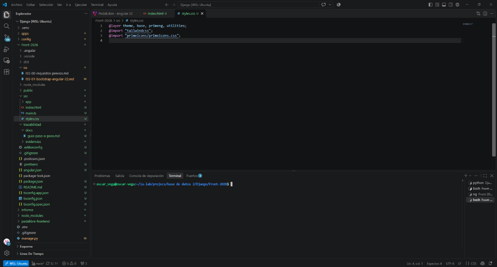

**Explicación:** En `src/styles.css` quedaron las capas `theme`, `base`, `primeng` y `utilities`, junto con los imports de Tailwind y PrimeIcons.

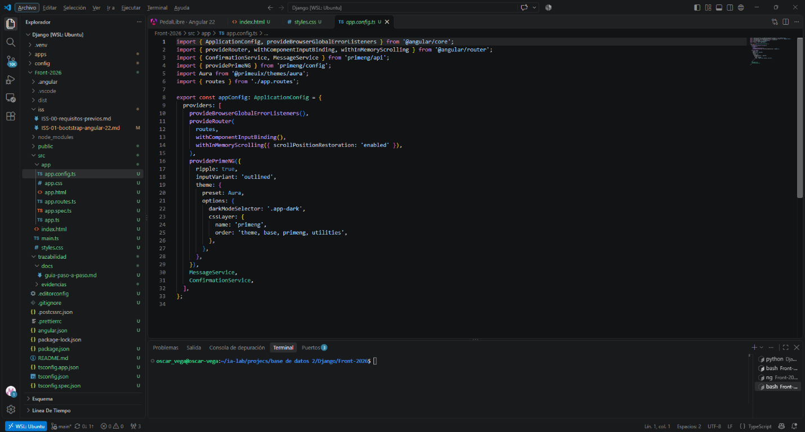

**Explicación:** Configuré Aura, el modo oscuro `.app-dark`, las capas CSS y los servicios `MessageService` y `ConfirmationService`. El router conserva sus opciones de binding y restauración del scroll.

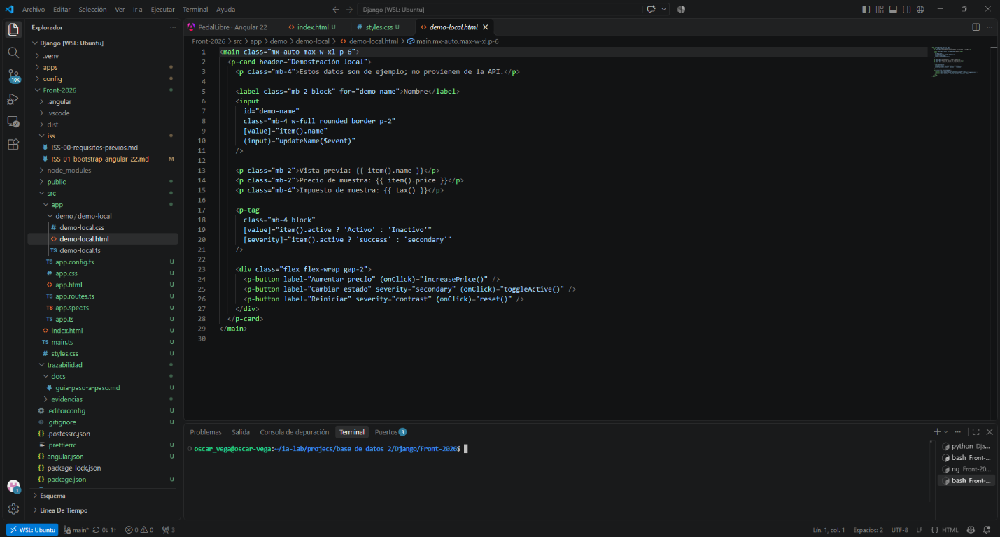

**Explicación:** La plantilla muestra datos explícitamente identificados como ejemplo y controles para editar el nombre, aumentar el precio de muestra, cambiar el estado y reiniciar.

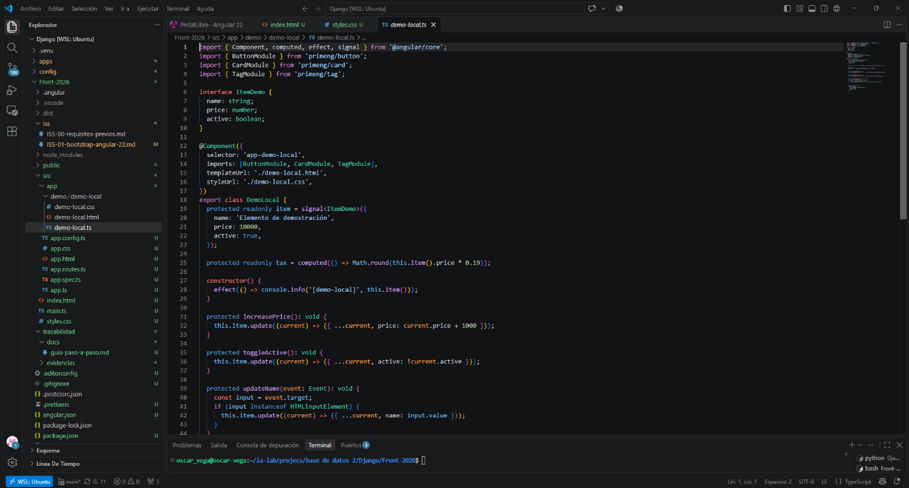

**Explicación:** `DemoLocal` mantiene un objeto local en `signal`, calcula el impuesto con `computed` y observa cambios con `effect`. No realiza peticiones a la API.

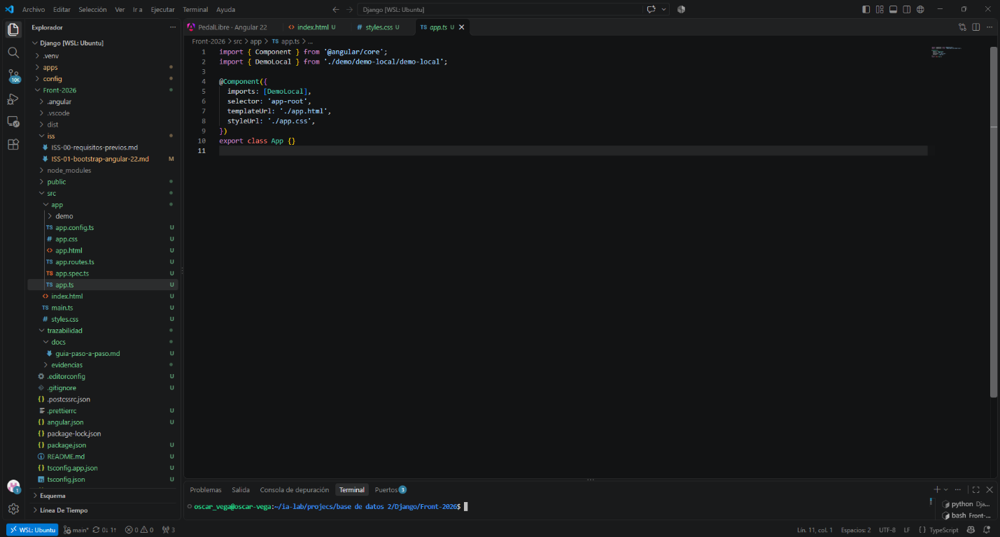

**Explicación:** `App` importa `DemoLocal` como componente standalone y lo usa como contenido inicial.

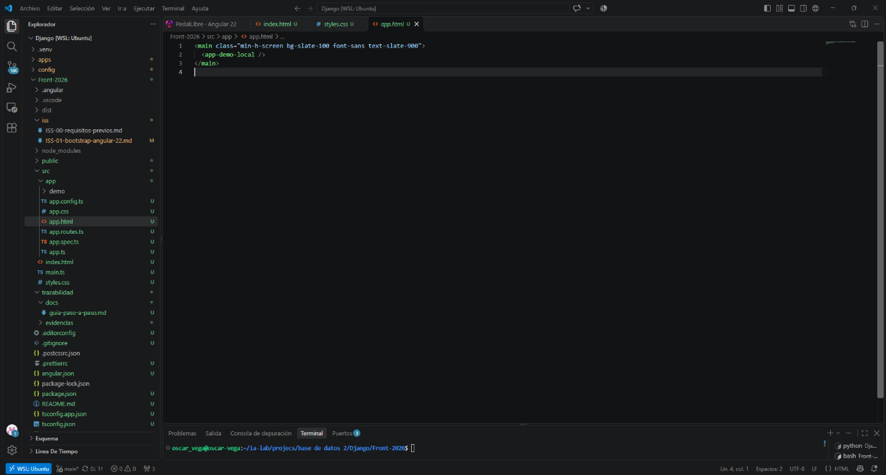

**Explicación:** `app.html` compone `<app-demo-local />` dentro del contenedor con utilidades de Tailwind.

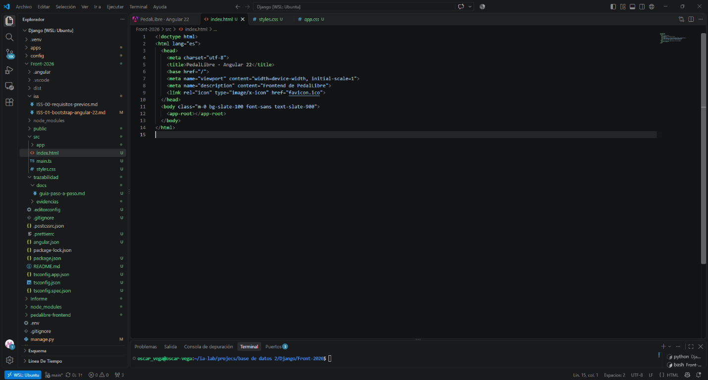

**Explicación:** Configuré `lang="es"`, el título `PedalLibre · Angular 22`, la descripción del frontend y las clases del `body`.

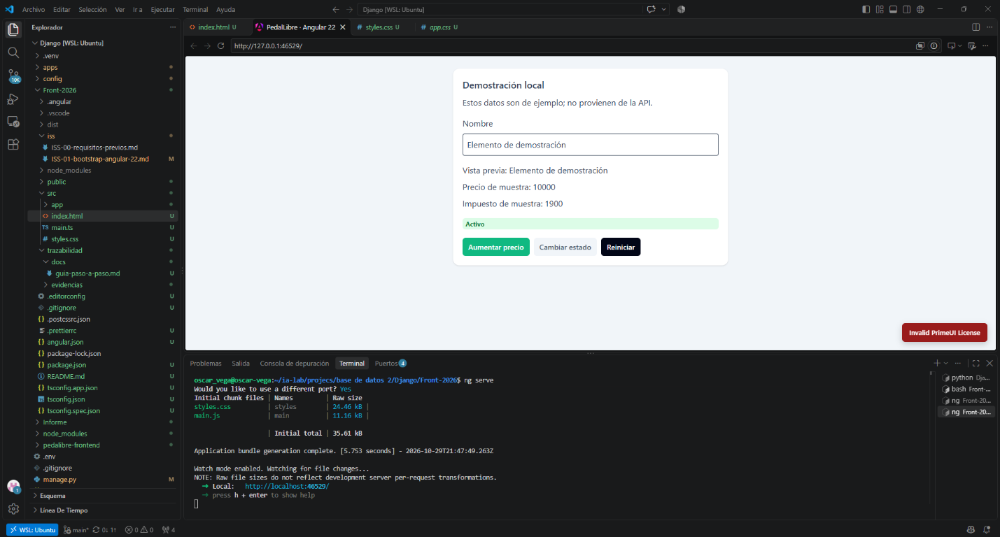

**Explicación:** La captura muestra la demo en el puerto alternativo `46529`, porque `4200` estaba ocupado. Se ven los datos de muestra, el impuesto calculado y los botones. El aviso `Invalid PrimeUI License` aparece como aviso visual de licencia; la página se renderizó.

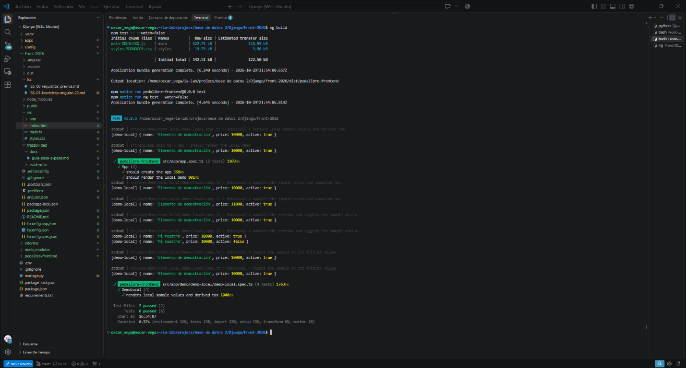

**Explicación:** En esta captura se ve que ejecuté `ng build` y `npm test -- --watch=false` desde `Front-2026/`. El build terminó correctamente con un bundle inicial de `542.51 kB`; la salida muestra dos archivos de pruebas y seis pruebas aprobadas.

#### Retroalimentación

Completé la configuración dentro de `Front-2026/`, mostré la demo local y verifiqué build y pruebas. El primer intento dejó una carpeta extra fuera del workspace y las primeras instalaciones se hicieron desde el nivel superior; corregí el procedimiento instalando las dependencias en la carpeta frontend. npm advirtió que algunos scripts estaban bloqueados por `allowScripts`, pero el build terminó correctamente y las seis pruebas pasaron. Angular usó el puerto alternativo `46529` porque `4200` estaba ocupado.

#### Qué aprendí

Aprendí a comprobar la carpeta actual antes de instalar dependencias y a reemplazar las pruebas generadas por Angular cuando cambia la pantalla inicial. También confirmé que el build, las pruebas y la vista del navegador deben corresponder al estado final, no solo al scaffold inicial.

#### Cierre

- **Criterios verificados:** scaffold y rutas Angular; Tailwind/PostCSS; estilos globales; PrimeNG/Aura y servicios; demo local; título/idioma; presupuesto; build exitoso de `542.51 kB`; seis pruebas aprobadas.
- **Pendientes o correcciones:** ninguno para cerrar ISS-01. En otra sesión se puede iniciar ISS-01A según la secuencia del proyecto.
- **Estado final:** Completada.

---

### ISS-01B · Menú PrimeNG y primera interacción

**Estado:** Completada.

#### Pasos que realicé

1. Generé el componente `Construir` desde `Front-2026/`.
2. Configuré `Aside` para recibir el modelo de opciones por `input()` y presentarlo con `p-panelmenu`. El clic emite `navigated`.
3. Configuré `Header` para recibir el nombre de la aplicación y emitir `menuRequested` desde el botón de menú.
4. Implementé `Construir` con signals para el título, el Drawer y el Aside de escritorio. Las opciones locales son Inicio, Clientes, Bicicletas disponibles, Tarifas y Acceso.
5. Convertí `App` en punto de entrada con `router-outlet`; las rutas redirigen a `construir` y cargan el componente de forma diferida.
6. Inicié la aplicación con `npm start`. El puerto 4200 estaba ocupado, así que acepté el puerto alternativo 38663. La captura muestra la página `/construir` en escritorio y el chunk diferido.
7. Revisé la vista responsive a 390 px: el Aside fijo no aparece y el botón abre el Drawer con las cinco opciones locales.

#### Evidencias

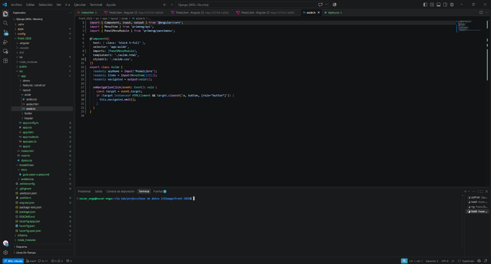

**Explicación:** En el editor se ve `Aside` importando `input`, `output`, `MenuItem` y `PanelMenuModule`. El componente declara `items` como entrada y emite `navigated`; no define el modelo de opciones.

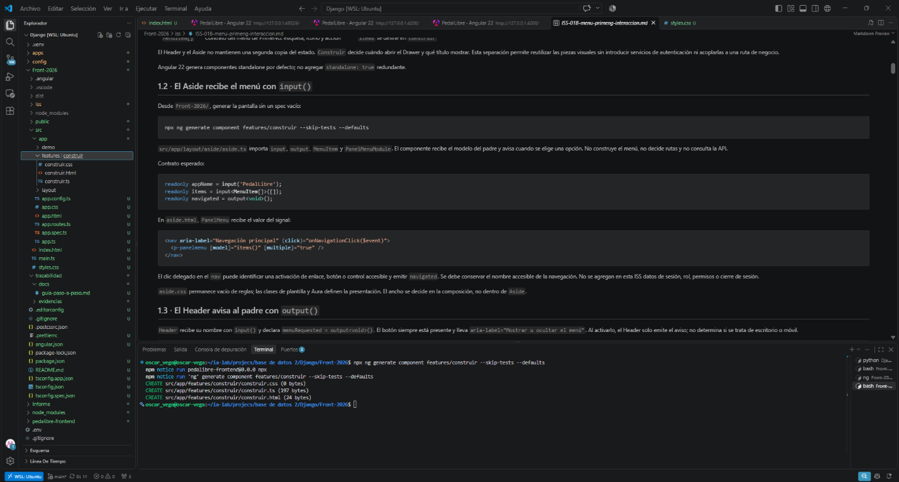

**Explicación:** La terminal muestra que ejecuté `ng generate component features/construir --skip-tests --defaults` desde `Front-2026/` y que Angular creó los archivos del componente.

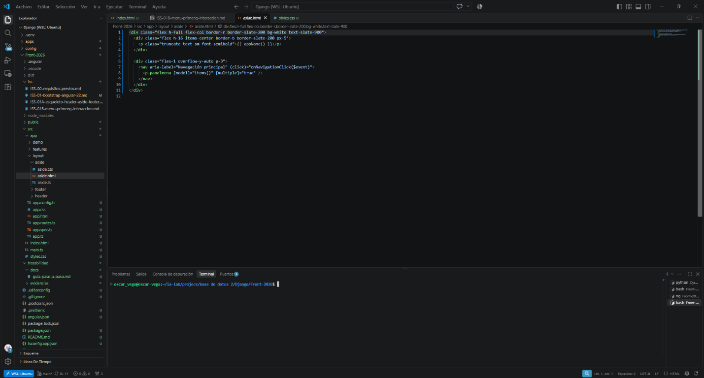

**Explicación:** La plantilla conserva el nombre accesible de navegación, delega el clic al método del componente y enlaza el modelo con `[model]="items()"`.

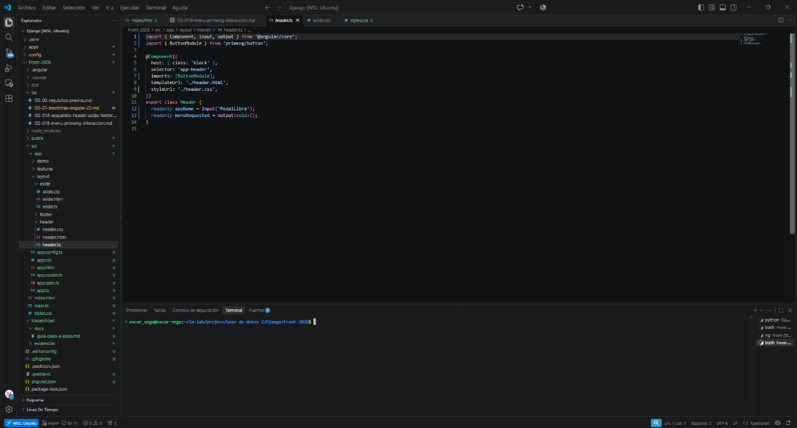

**Explicación:** `Header` recibe el nombre PedalLibre con `input()` y declara `menuRequested` como aviso que el padre atenderá.

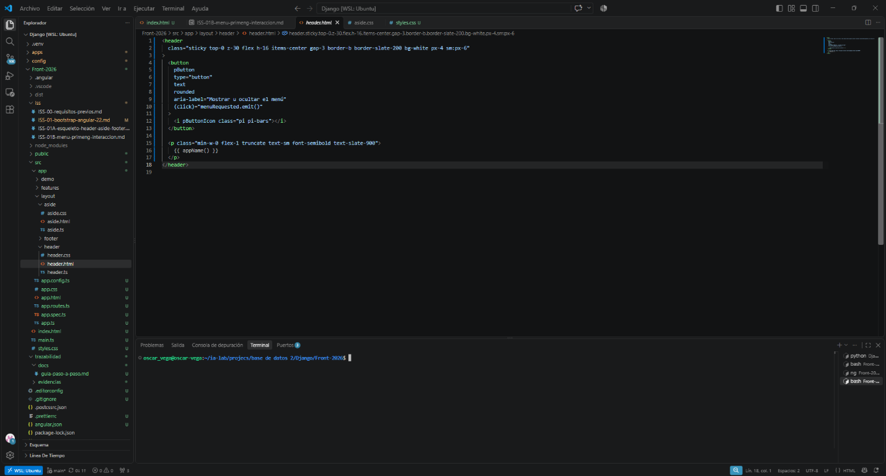

**Explicación:** La plantilla emite `menuRequested` al pulsar el botón con etiqueta accesible; no condiciona su visibilidad con `lg:hidden`.

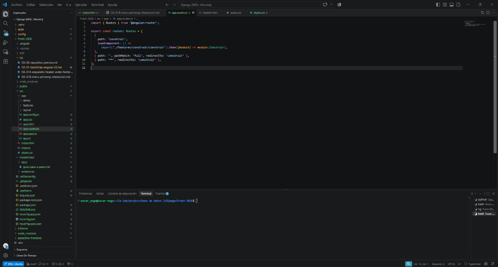

**Explicación:** `app.routes.ts` carga `Construir` mediante `loadComponent` y redirige la ruta vacía y las desconocidas a `construir`.

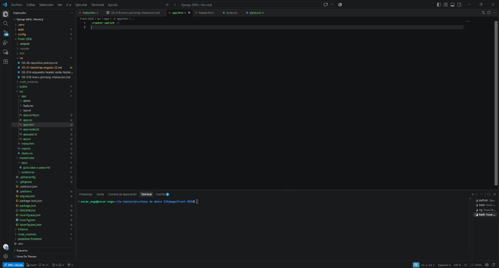

**Explicación:** La captura muestra `<router-outlet />` como contenido de `app.html`.

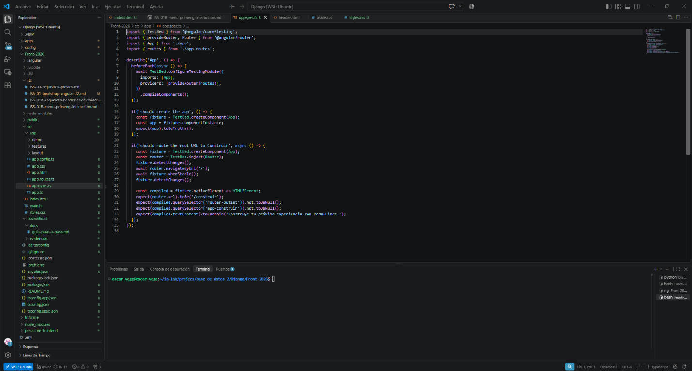

**Explicación:** La captura muestra código en `app.spec.ts`; no muestra la ejecución de pruebas. No la considero evidencia de pruebas ejecutadas y no ejecuté pruebas para esta ISS.

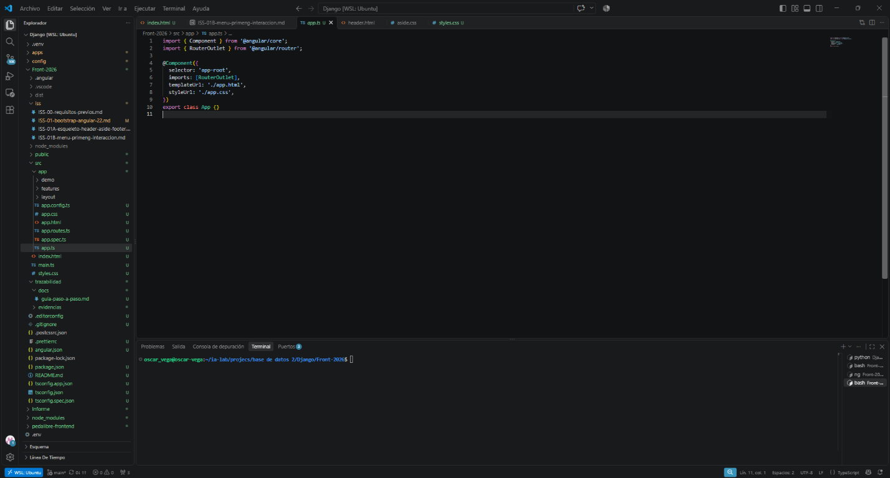

**Explicación:** `app.ts` importa `RouterOutlet` y configura el componente raíz para que el router presente la pantalla seleccionada.

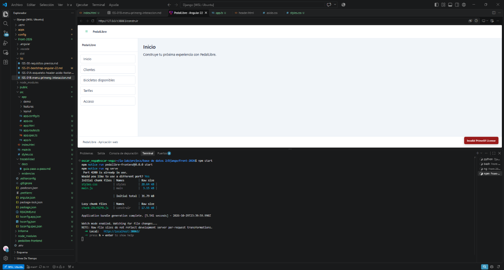

**Explicación:** La captura muestra la aplicación en `/construir` a escritorio con las cinco opciones locales. Angular informa un bundle inicial de `31.79 kB` y un chunk diferido `construir` de `17.55 kB`; el servidor usó el puerto `38663` porque `4200` estaba ocupado.

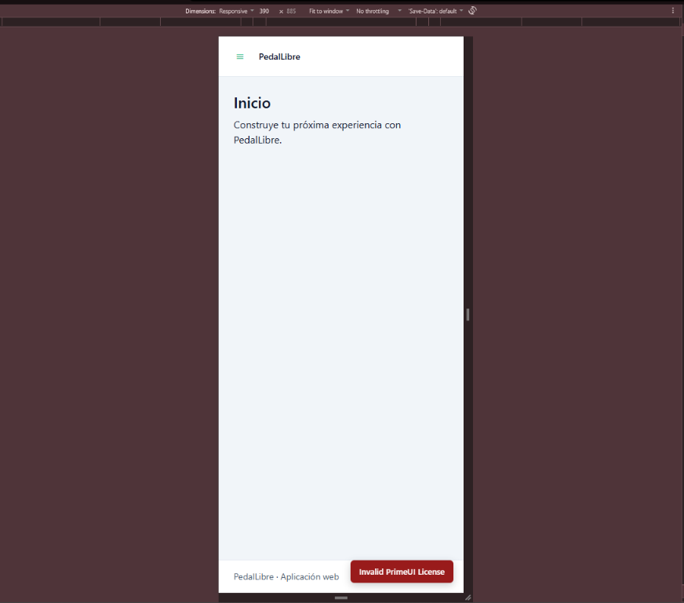

**Explicación:** La captura muestra la aplicación en viewport responsive de 390 px. El Header, el contenido y el Footer se ven sin el Aside fijo; el botón de menú permanece visible.

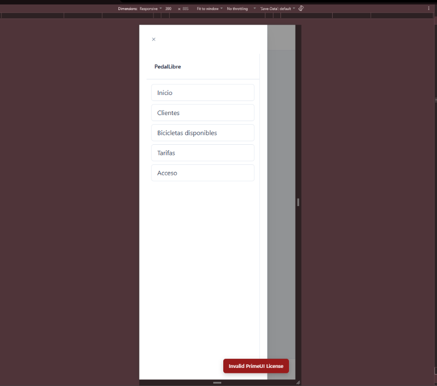

**Explicación:** Abrí el botón de menú en la vista móvil. El Drawer aparece desde la izquierda y presenta Inicio, Clientes, Bicicletas disponibles, Tarifas y Acceso. Esta captura no muestra todavía la selección de una opción.

La selección del menú está conectada a `seleccionar()`, que cambia el título local y cierra el estado del Drawer. Las opciones no tienen enlaces ni llamadas HTTP; son ejemplos de navegación para esta ISS.

#### Retroalimentación

Implementé el menú local, las entradas y salidas de los componentes, el Drawer y el punto de entrada con rutas. Las capturas muestran la vista de escritorio, el build con chunk diferido y el Drawer abierto a 390 px. Las opciones son locales y no están conectadas a servicios de API.

#### Qué aprendí

`input()` permite que el padre entregue datos al componente visual y `output()` permite que el hijo avise sin decidir qué acción debe realizar el padre. El estado del título, el Aside y el Drawer queda en `Construir`.

#### Cierre

- **Criterios verificados:** implementación del menú y del router; vista de escritorio; build con chunk diferido; Aside oculto y Drawer abierto a 390 px; opciones locales sin rutas de negocio ni consumo de API.
- **Pendientes o correcciones:** ninguno para cerrar ISS-01B.
- **Estado final:** Completada. No ejecuté pruebas automatizadas.

---

### ISS-02 · Núcleo: environment, modelos y servicios PedalLibre

**Estado:** Completada con evidencia visual. No ejecuté build ni pruebas automatizadas.

La adaptación PedalLibre está documentada en [ISS-02 · Núcleo, modelos y servicios](../../iss/ISS-02-nucleo-modelos-layout.md). Esta ISS configura los environments, refleja los serializers de cliente, bicicleta y tarifa, prepara los servicios HTTP y registra `provideHttpClient()`. Los apartados sin consumidor actual se identifican como didácticos y no se implementan como funcionalidades.

#### Pasos que realicé

- Generé los environments de Angular y configuré `apiUrl` para el backend local de PedalLibre.
- Definí los modelos TypeScript de cliente, bicicleta y tarifa respetando los campos serializados por Django.
- Preparé servicios para clientes, bicicletas disponibles y tarifas usando `HttpClient`.
- Registré `provideHttpClient()` en la configuración de la aplicación.
- Dejé las partes sobre notificaciones, formato de errores, filtros, Shell adicional y componentes sin consumidor como material didáctico, no como requisitos de esta implementación.

#### Evidencias

**Revisión:** la interfaz presenta `Invalid PrimeUI License`; esta captura no acredita una licencia válida.

**Revisión:** la terminal muestra la generación de los archivos de entorno con Angular CLI.

**Revisión:** `environment.ts` muestra la URL API de PedalLibre y `production: true`.

**Revisión:** `environment.development.ts` muestra la misma URL y `production: false`.

**Revisión:** muestra `Client` y `ClientPayload` con los campos serializados en `snake_case`.

**Revisión:** muestra el tipo de respuesta de bicicleta.

**Revisión:** muestra `price` como string y las fechas opcionales de la tarifa.

**Revisión:** muestra las operaciones GET, POST, PUT y PATCH de `ClientApi`.

**Revisión:** muestra la llamada de `BicycleApi` a `/bicycles/available/`.

**Revisión:** muestra las operaciones GET, POST, PUT y PATCH de `RateApi`.

**Revisión:** `app.config.ts` registra `provideHttpClient()` junto al router y a la configuración PrimeNG existente.

#### Retroalimentación

Las capturas respaldan los environments, modelos, servicios y la configuración de `HttpClient`. La licencia PrimeUI aparece inválida en la primera captura; su resolución es un pendiente separado. No hay evidencia visual de build o pruebas y no los ejecuté, según la instrucción recibida.

#### Qué aprendí

Aprendí a reflejar directamente en TypeScript el contrato JSON real de Django, a centralizar las rutas HTTP en servicios y a habilitar `HttpClient` desde los providers de Angular. También confirmé que una captura de código evidencia su configuración, pero no sustituye una validación de build o pruebas.

#### Cierre

- **Criterios verificados:** environments, modelos, servicios de clientes/bicicletas/tarifas y registro de `HttpClient`, respaldados por capturas.
- **Pendientes o correcciones:** la captura informa licencia PrimeUI inválida; build y pruebas no ejecutados. Estos puntos quedan registrados y no se presentan como validaciones realizadas.
- **Estado final:** Completada con evidencia visual, sin build ni pruebas.

---

### ISS-03 · Clientes: listado, formulario y estado activo

**Estado:** Completada con evidencias documentales; revisé la pantalla en el navegador. El listado presenta el 401 que responde la API; el CRUD autenticado, build y pruebas siguen pendientes y no se presentan como aprobados.

La guía adaptada al contrato de PedalLibre está en [ISS-03 · Clientes](../../iss/ISS-03-crud-clientes.md). Define listado/filtro local, creación/edición y cambio de `is_active` mediante PATCH. Las capturas recibidas muestran avances de implementación en modelos, servicio, filtro, formulario, listado y composición de `Construir`, además del resultado de la consulta real en el navegador.

#### Pasos que realicé

- Preparé `Client` y `ClientPayload` con los campos serializados por PedalLibre.
- Implementé en `ClientApi` las operaciones de consulta, creación, reemplazo, actualización y cambio de `is_active`.
- Preparé el filtro local reutilizable sin modificar las filas originales.
- Generé los componentes de lista y formulario; luego completé el formulario reactivo y la plantilla.
- Implementé la lista con signals para carga, edición, guardado, filtro y errores, y conecté la pantalla de clientes desde `Construir`.
- Abrí `/construir`, seleccioné **Clientes** y observé el mensaje **La API requiere una sesión válida**.
- Consulté `/api/clients/` y la respuesta fue **401 Unauthorized**, con `Authentication credentials were not provided`.
- No se pudieron verificar el listado de datos, el filtro sin nuevas peticiones ni las operaciones POST/PATCH: el backend exige autenticación. No intenté evadir esa protección.
- No ejecuté build ni pruebas automatizadas.

#### Evidencias

Las primeras quince capturas muestran código y generación de componentes. No muestran resultados de build o pruebas.

**Explicación:** Se ve `Client` con los campos de PedalLibre en `snake_case` y `ClientPayload` con los campos editables.

**Explicación:** Se ve `ClientApi` construyendo sus rutas desde `environment.apiUrl`, con barra final, y sus métodos de consulta y escritura.

**Explicación:** Se muestra `filterRows` como función local que devuelve una copia si no hay búsqueda y compara los campos elegidos sin llamar a la API.

**Explicación:** La terminal muestra la generación de `client-list` y `client-form` con Angular CLI.

**Explicación:** Esta captura corresponde al componente recién generado, antes de completar su lógica y formulario.

**Explicación:** Esta captura corresponde al componente recién generado, antes de completar la lista.

**Explicación:** Se muestra `ClientForm` con inputs y outputs, validadores y carga del registro seleccionado mediante `effect()`.

**Explicación:** Se ve la plantilla con los campos de documento, nombres, apellidos, teléfono y correo, junto con mensajes de validación.

**Explicación:** Se observan los signals del listado y el cálculo de las filas visibles filtradas por los campos del cliente.

**Explicación:** Se muestran los métodos para abrir el formulario y seleccionar POST o PATCH según el registro en edición.

**Explicación:** Se ve el cambio de `is_active` mediante el servicio y la traducción visible de errores HTTP.

**Explicación:** La plantilla muestra estados de carga, error, lista vacía y sin coincidencias, además de la tabla de clientes.

**Explicación:** Se muestran las acciones de edición y activación/desactivación, y el formulario dentro del diálogo.

**Explicación:** `Construir` importa `ClientList` y conserva el menú local existente.

**Explicación:** La plantilla presenta `app-client-list` cuando la selección actual es Clientes, sin crear una ruta nueva.

Las siguientes capturas sí son de la comprobación en navegador:

**Explicación:** La app está abierta en `/construir` con la opción Clientes seleccionada. El frontend muestra el error de sesión devuelto por la API; la captura también deja visible el aviso de licencia PrimeUI inválida, que queda como pendiente independiente.

**Explicación:** Django REST Framework responde 401 a `GET /api/clients/` porque no se enviaron credenciales. Por ello, esta prueba confirma el manejo visible del error, pero no verifica la carga del listado ni las operaciones del CRUD.

No guardé una captura del administrador que mostraba datos personales de un cliente. Las evidencias de implementación sin datos personales están numeradas ISS-03-01 a ISS-03-15.

#### Retroalimentación

La revisión confirma que la pantalla llega al backend y muestra explícitamente el 401; no se debe cambiar permisos ni tratarlo como un éxito del listado. Para cerrar la ISS faltan pruebas con una sesión autorizada, verificar filtro/alta/edición/estado activo y los estados restantes, además de build y pruebas automatizadas.

#### Qué aprendí

#### Cierre

- **Criterios respaldados por capturas:** código de modelos, servicios, filtro, formulario, lista e integración; la pantalla muestra el 401 real de la API.
- **Pendientes o correcciones:** repetir el recorrido con autenticación válida; verificar listado, filtro, POST, PATCH y estados; ejecutar build/pruebas cuando se solicite.
- **Estado final:** Completada con las evidencias disponibles; la verificación CRUD autenticada queda pendiente.

---

### ISS-04 · CRUD de tarifas PedalLibre

**Estado:** Completada con evidencias de implementación; la API responde 401 sin sesión válida, por lo que las operaciones CRUD autorizadas y las pruebas automáticas no se verificaron.

El original ISS-04 de tipos de producto no tiene una entidad equivalente en PedalLibre. El siguiente recurso de catálogo disponible es **Tarifas**, documentado en [ISS-04 · CRUD de tarifas](../../iss/ISS-04-crud-tarifas.md). La guía usa el serializer real y conserva al final el material original de tipos de producto, separado de la adaptación.

#### Pasos que realicé

Implementé el formulario y el listado de tarifas, el filtro local, las acciones de crear/editar/activar-desactivar y la integración de `RateList` en la opción Tarifas de `Construir`. La captura del navegador muestra la aplicación compilada y abierta en `/construir`; al consultar la API aparece el mensaje de sesión requerida.

#### Evidencias

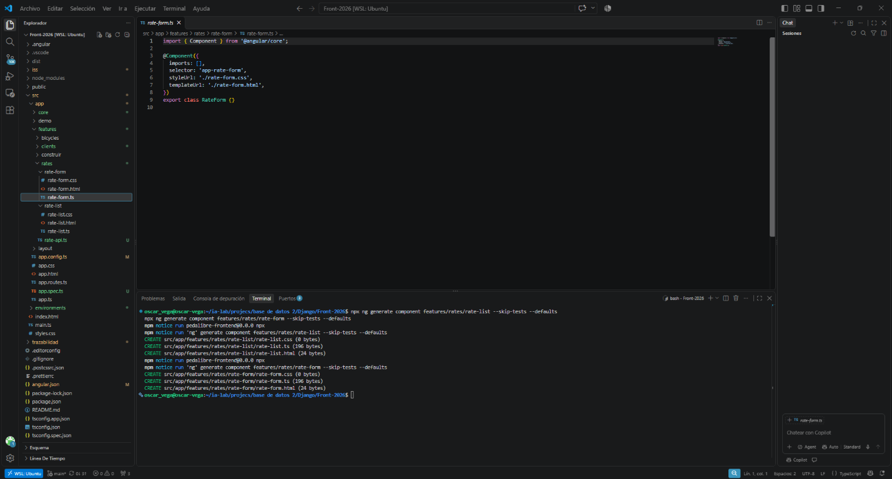

**Explicación:** Se generó el componente standalone del formulario de tarifas.

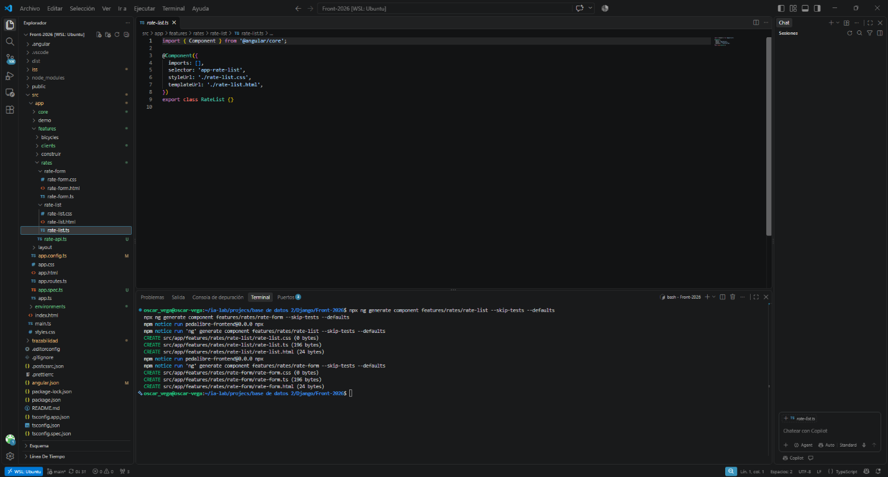

**Explicación:** Se generó el componente standalone del listado de tarifas.

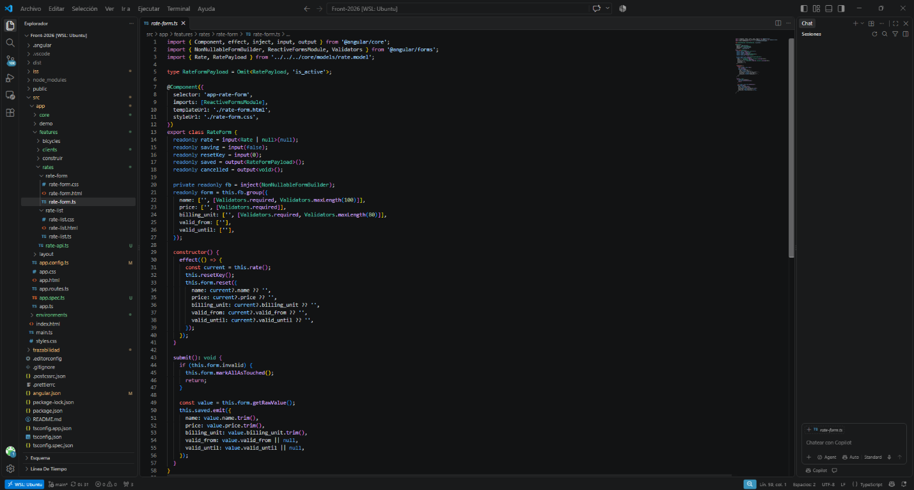

**Explicación:** El formulario define sus campos y validadores, reinicia los valores al cambiar `resetKey` y emite el payload con las fechas vacías como `null`.

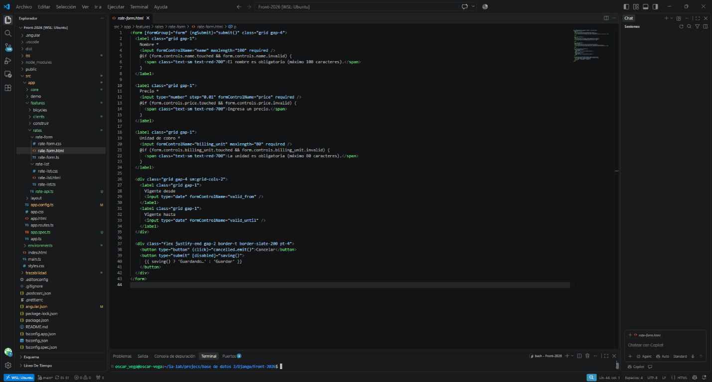

**Explicación:** La plantilla incluye campos requeridos, mensajes de validación, fechas opcionales y acciones de cancelar/guardar.

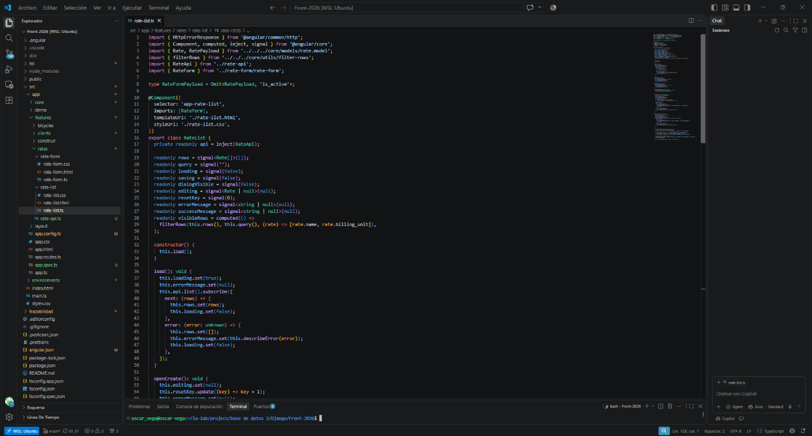

**Explicación:** El listado mantiene estado local, consulta `RateApi.list()` y filtra nombre y unidad de cobro.

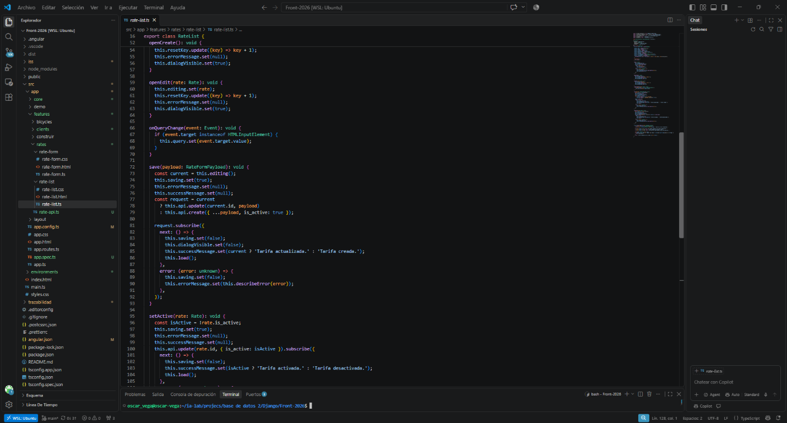

**Explicación:** El alta envía `is_active: true`, la edición usa PATCH con el payload del formulario y activar/desactivar actualiza `is_active`.

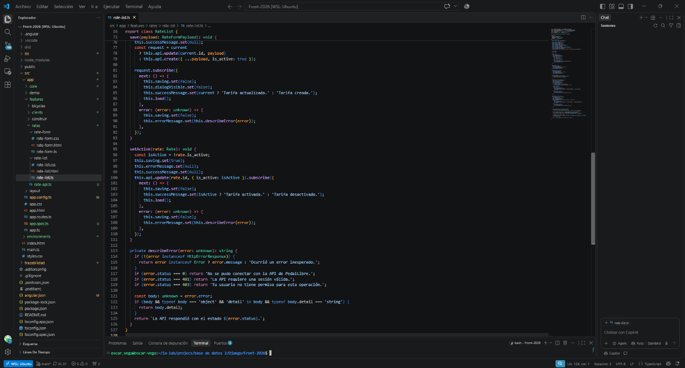

**Explicación:** Se traducen errores de conexión, 401 y 403 en mensajes visibles; no se simula una respuesta exitosa.

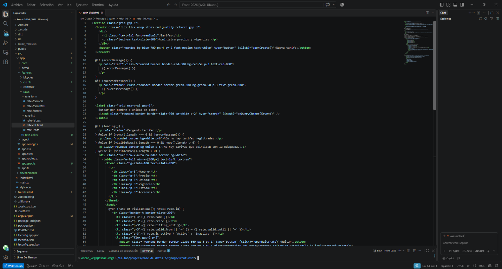

**Explicación:** La vista implementa mensajes de carga/error/éxito, buscador y estados de tabla vacía y sin coincidencias.

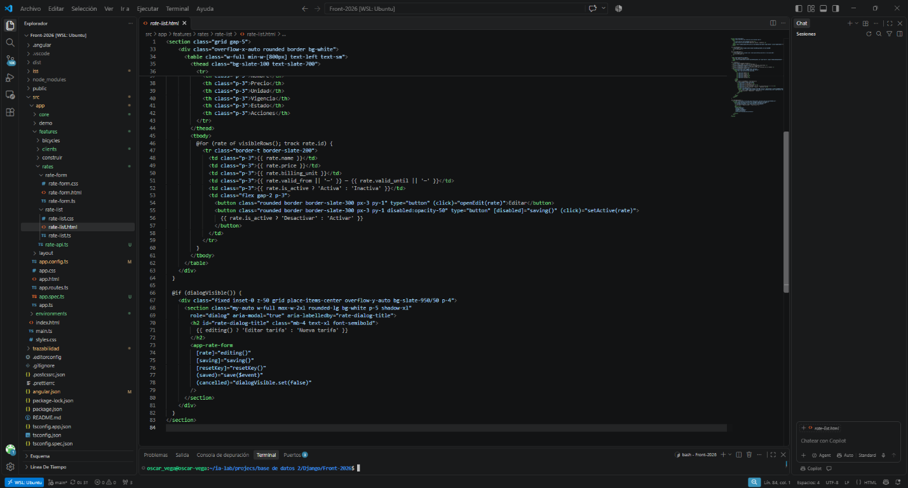

**Explicación:** Se muestran los campos del recurso, acciones para editar y cambiar estado, y el formulario dentro de un diálogo.

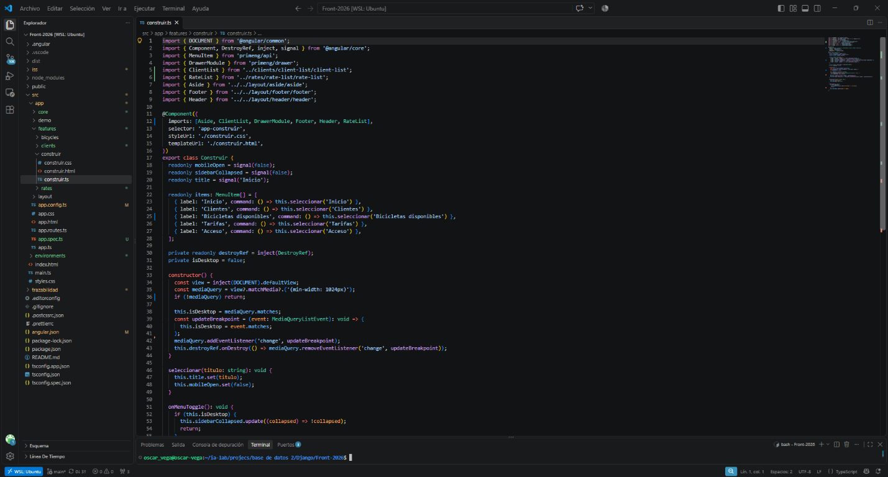

**Explicación:** `Construir` importa `RateList` y mantiene la opción local Tarifas en su menú.

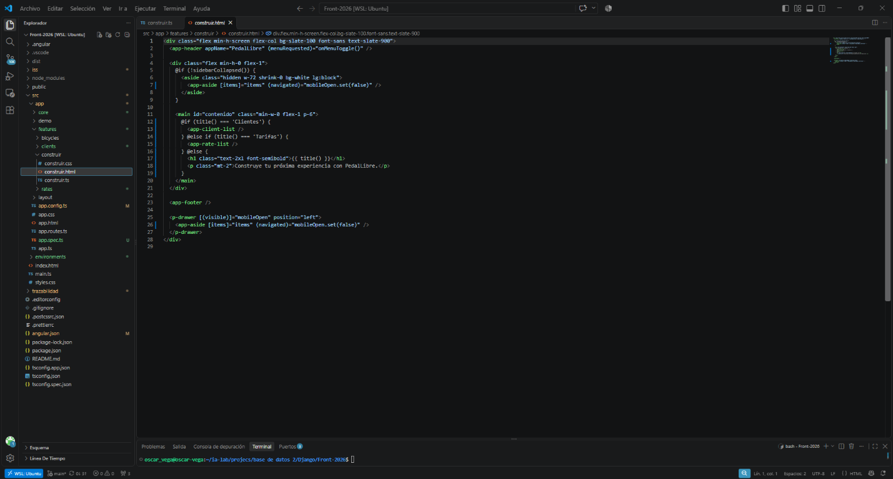

**Explicación:** La selección Tarifas presenta `app-rate-list` sin crear otra ruta ni reemplazar Header, Aside o Footer.

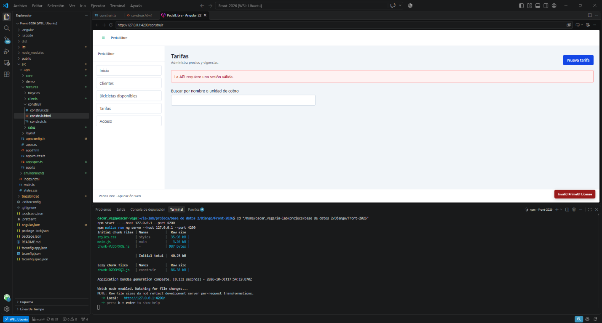

**Explicación:** La app está en `/construir`, conserva el layout y muestra el error de sesión requerido por la API; la terminal reporta compilación completa. Esta captura no prueba operaciones CRUD autorizadas ni las pruebas automáticas.

#### Retroalimentación

La revisión de las capturas respalda la implementación de la interfaz y la compilación mostrada en terminal. La llamada de tarifas no puede validar la respuesta de negocio sin credenciales: el backend devuelve 401. Deben conservarse RBAC y la limitación en el registro; quedan pendientes las operaciones CRUD con una sesión autorizada y las pruebas automáticas.

#### Qué aprendí

Aprendí que la adaptación debe partir del contrato real del backend, no de trasladar mecánicamente el CRUD original: PedalLibre no tiene tipos de producto y el recurso disponible es tarifas. Aunque se reutiliza el patrón de listado, búsqueda y formulario, el estado se cambia con PATCH sobre `is_active` y no existe baja por DELETE. También aprendí a separar el avance documental de la implementación: como la API aplica RBAC, no se puede afirmar que el CRUD está verificado sin acceso autorizado.

#### Cierre

- **Criterios respaldados por la implementación y capturas:** integración en `Construir`, formulario, listado, búsqueda local, acciones de alta/edición/estado y presentación de errores.
- **Pendientes o correcciones:** verificar el CRUD con sesión autorizada y ejecutar pruebas automatizadas.
- **Estado final:** Completada con evidencias de implementación; la API respondió 401 sin sesión válida.

---

### ISS-05 · CRUD de bicicletas PedalLibre

**Estado:** Completada con evidencias. Build y suite existente aprobados; alcance de pruebas documentado.

PedalLibre no tiene productos, tipos de producto ni existencias numéricas. La adaptación de ISS-05 administra el catálogo real de **bicicletas**, diferenciando el catálogo `/api/bicycles/` de la consulta operativa `/api/bicycles/available/`. La guía está en [ISS-05 · CRUD de bicicletas](../../iss/ISS-05-crud-bicicletas.md); el original de productos queda separado al final. Las pruebas documentadas usan peticiones HTTP simuladas y no requieren login.

#### Pasos que realicé

- Definí el modelo camelCase y el servicio HTTP para el catálogo, detalle, creación, actualización y disponibilidad.
- Generé los componentes y preparé el formulario y el listado con validaciones, filtros, acciones y manejo visible de errores.
- Integré el listado de bicicletas en `Construir`, conservando las pantallas previas.
- Ejecuté `npm test -- --watch=false`; la salida muestra 2 archivos existentes y 6 pruebas aprobadas (`app.spec.ts` y `demo-local.spec.ts`). No aparecen specs de Bicycle, por lo que las pruebas unitarias específicas del feature siguen pendientes.
- Ejecuté `npm run build`; Angular completó la generación del bundle correctamente.
- Comprobé que los dos CSS del feature están vacíos.
- Cerré la ISS con la evidencia disponible. Las seis pruebas registradas pertenecen a `app.spec.ts` y `demo-local.spec.ts`; no se afirma cobertura unitaria específica de Bicycle.

#### Evidencias

**EVI-05-01 · Modelo de bicicleta**

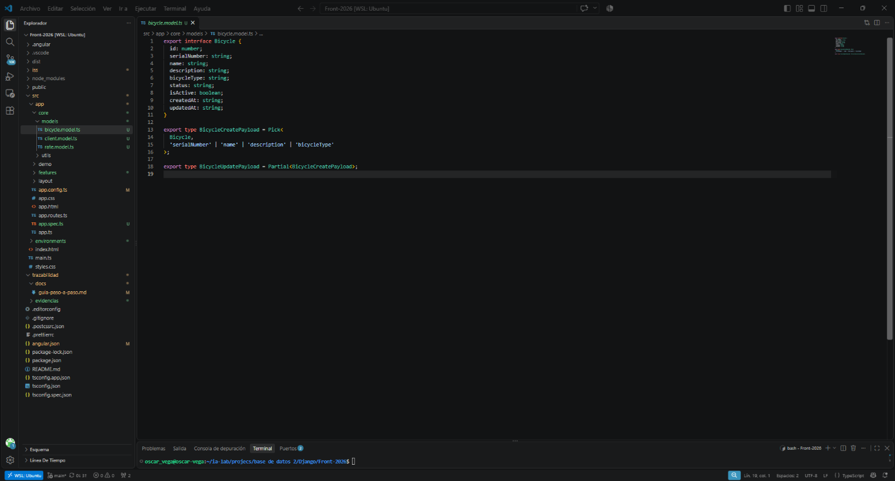

**EVI-05-02 · Servicio de bicicletas**

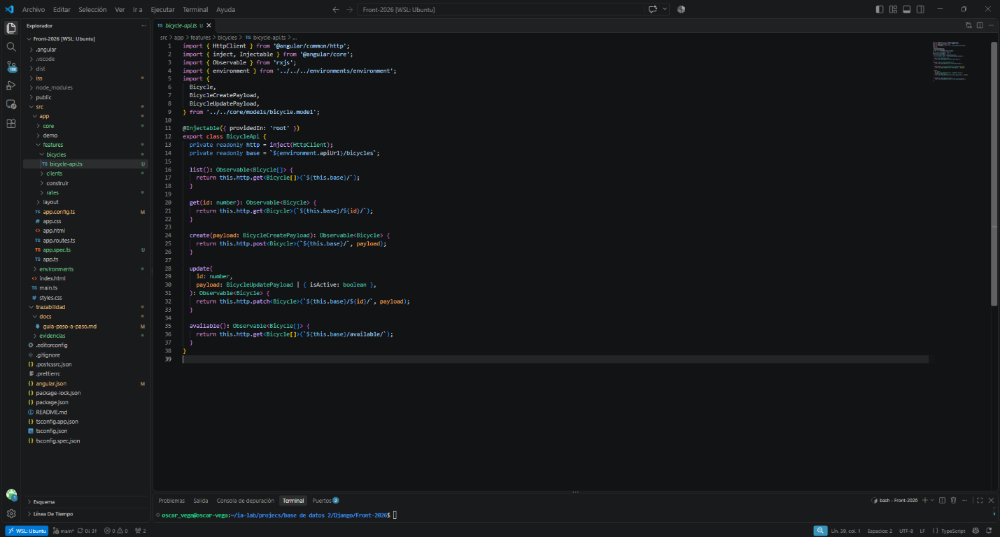

**EVI-05-03 · Generación de componentes**

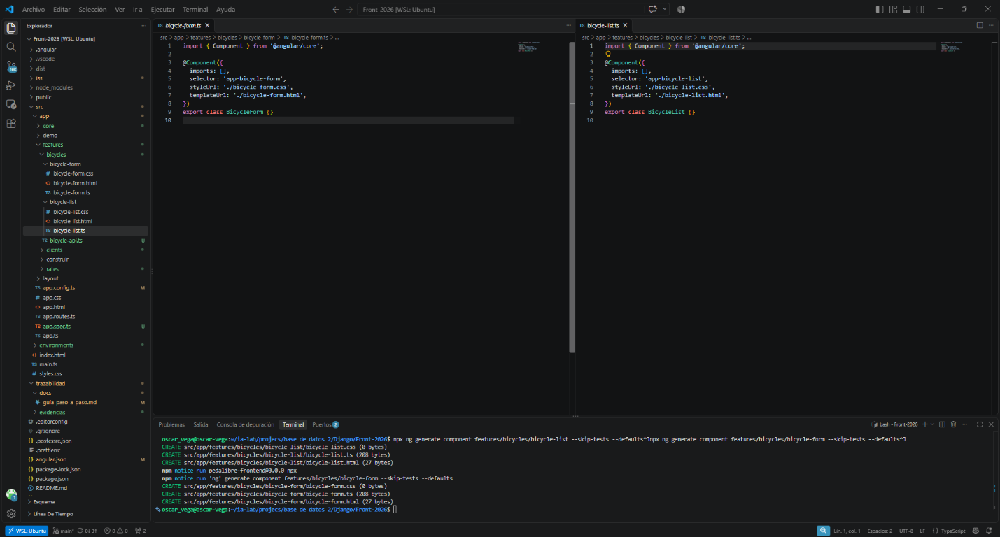

**EVI-05-04 · Formulario reactivo**

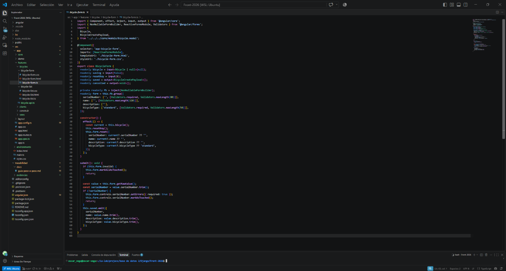

**EVI-05-05 · Plantilla del formulario**

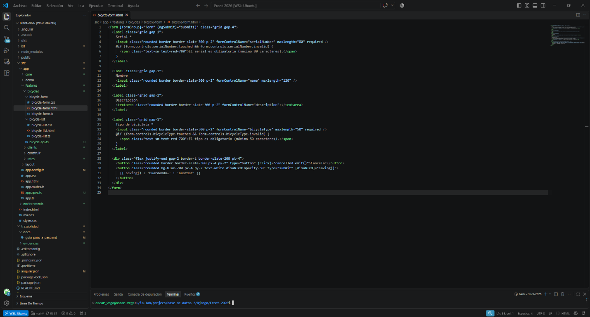

**EVI-05-06 · Carga y filtro del listado**

**EVI-05-07 · Guardado y edición**

**EVI-05-08 · Estado y errores**

**EVI-05-09 · Plantilla del listado**

**EVI-05-10 · Acciones y diálogo**

**EVI-05-11 · Componente `Construir`**

**EVI-05-12 · Plantilla de `Construir`**

**EVI-05-13 · Suite de pruebas existente**

La salida corresponde a `app.spec.ts` y `demo-local.spec.ts` (6 pruebas). No muestra pruebas `bicycle-*`; no se presenta como verificación unitaria específica de ISS-05.

**EVI-05-14 · Build**

**EVI-05-15 · CSS sin reglas**

**EVI-05-16 · Pruebas específicas pendientes**

La terminal muestra que `npm test -- --watch=false` ejecutó 2 archivos y 6 pruebas; el `find` previo no encontró `*.spec.ts` para bicicletas. Esta captura no cierra la cobertura específica de ISS-05.

#### Retroalimentación

No se requiere login para las pruebas unitarias: las respuestas de la API se simulan. Las capturas acreditan seis pruebas generales existentes, el build y el chequeo de CSS. Se cierra la ISS según lo solicitado, dejando explícito que no se ejecutaron specs específicos de Bicycle y que ninguna captura acredita operaciones reales autorizadas contra la API.

#### Qué aprendí

Aprendí que en PedalLibre una bicicleta no equivale a un producto con existencias: su disponibilidad depende también del anclaje, la estación y el mantenimiento. El CRUD debe limitarse a sus datos de catálogo y distinguir el indicador administrativo `isActive` del estado operativo y de la consulta específica de bicicletas disponibles.

#### Cierre

- **Criterios respaldados por evidencia:** estructura del modelo y servicio, formulario, listado, acciones e integración, build exitoso, CSS vacío y suite general aprobada, según EVI-05-01 a EVI-05-16.
- **Alcance anotado:** las seis pruebas ejecutadas son generales, no específicas de Bicycle; no se verificó la API real porque no hay login.
- **Estado final:** ISS-05 completada con las evidencias disponibles y sus límites de verificación documentados.

---

### ISS-06 · Alquileres y registro PedalLibre

**Estado:** Cerrada con alcance documentado. El bundle de pruebas compiló y pasaron seis pruebas generales; no existen pruebas específicas de alquileres verificadas.

El backend de PedalLibre no tiene ventas ni productos; ISS-06 se adaptó al recurso real de alquileres. La guía define lectura, registro, bicicletas disponibles y restricciones RBAC en [ISS-06 · Alquileres y registro](../../iss/ISS-06-alquileres-y-registro.md). Las capturas recibidas documentan modelo, servicio, formulario, lógica del listado y navegación en `Construir`.

#### Pasos que realicé

- Registré la captura del modelo `Rental` camelCase como EVI-06-01.
- Identifiqué el motivo del error: `cat > archivo` no crea directorios padre. La guía ahora indica ejecutar `mkdir -p` desde `Front-2026` antes de crear el servicio y pegar cada heredoc completo hasta su línea `EOF`.
- Las capturas posteriores muestran `rental-api.ts`, el formulario y `RentalList` creados, además de su integración en `Construir`.
- Corregí la plantilla faltante `rental-list.html` y conecté `<app-rental-list />` en la rama Alquileres de `Construir`.
- Ejecuté `npm test -- --watch=false`: el bundle de pruebas compiló y pasaron 2 archivos con 6 pruebas generales (`app.spec.ts` y `demo-local.spec.ts`). No son pruebas específicas de alquileres.
- No se verificó `npm run build`, pruebas con mocks para el feature ni operaciones contra la API real.

#### Evidencias

**EVI-06-01 · Modelo de alquiler**

La primera captura muestra el modelo abierto en el editor. El error inicial de terminal para `rental-api.ts` fue `No such file or directory`; las capturas EVI-06-02 a EVI-06-10 son posteriores y muestran el servicio y el resto de la implementación parcial.

**EVI-06-02 · Servicio API de alquileres**

**EVI-06-03 · Signals e inputs del formulario**

**EVI-06-04 · Validación y payload**

**EVI-06-05 · Plantilla del formulario**

**EVI-06-06 · Carga inicial del listado**

**EVI-06-07 · Catálogos del alquiler**

**EVI-06-08 · Resolución de nombres y registro**

**EVI-06-09 · Manejo de errores**

**EVI-06-10 · Integración en `Construir`**

**EVI-06-11 · Ejecución de pruebas generales**

La terminal muestra `Application bundle generation complete`, dos archivos de pruebas aprobados y seis pruebas en total. Los archivos son `app.spec.ts` y `demo-local.spec.ts`; no cubren `RentalApi`, `RentalForm` ni `RentalList`.

#### Retroalimentación

El error inicial de ruta se corrigió preparando la estructura del feature; las capturas posteriores muestran el servicio creado. Hay que ejecutar cada bloque heredoc completo para evitar errores de pegado.

#### Qué aprendí

Aprendí que una compilación del bundle de pruebas y una suite verde no demuestran por sí solas que cada feature esté cubierto: debo revisar qué archivos y casos ejecutó Vitest. También confirmé que el template del componente debe existir y estar conectado en la plantilla padre para que Angular pueda compilar e integrar `RentalList`.

#### Cierre

- **Criterios respaldados por capturas:** modelo, servicio, formulario, listado e integración en `Construir` (EVI-06-01 a EVI-06-10); bundle de pruebas y suite general aprobados (EVI-06-11).
- **Alcance pendiente:** no se ejecutaron specs específicos de `RentalApi`, `RentalForm` o `RentalList`, ni `npm run build`, ni pruebas contra la API real. No pedir login.
- **Estado final:** ISS-06 cerrada con las limitaciones de verificación documentadas; la suite general aprobada no se presenta como cobertura del feature.

---

### ISS-07 · Por registrar desde la guía del docente

**Estado:** Pendiente.

#### Pasos que realicé

#### Evidencias

#### Retroalimentación

#### Qué aprendí

#### Cierre

- **Criterios respaldados por la implementación y capturas:** integración en `Construir`, formulario, listado, búsqueda local, operaciones de alta/edición/cambio de estado y presentación de errores.
- **Pendientes o correcciones:** repetir el recorrido CRUD con sesión autorizada y ejecutar pruebas automatizadas.
- **Estado final:** Completada con evidencias de implementación; verificación de API autenticada pendiente por 401.

---

### ISS-08 · Por registrar desde la guía del docente

**Estado:** Pendiente.

#### Pasos que realicé

#### Evidencias

#### Retroalimentación

#### Qué aprendí

#### Cierre

- **Criterios verificados:** pendiente.
- **Pendientes o correcciones:** pendiente.
- **Estado final:** Pendiente.

---

### ISS-09 · Por registrar desde la guía del docente

**Estado:** Pendiente.

#### Pasos que realicé

#### Evidencias

#### Retroalimentación

#### Qué aprendí

#### Cierre

- **Criterios verificados:** pendiente.
- **Pendientes o correcciones:** pendiente.
- **Estado final:** Pendiente.

---

### ISS-10 · Por registrar desde la guía del docente

**Estado:** Pendiente.

#### Pasos que realicé

#### Evidencias

#### Retroalimentación

#### Qué aprendí

#### Cierre

- **Criterios verificados:** pendiente.
- **Pendientes o correcciones:** pendiente.
- **Estado final:** Pendiente.

---

### ISS-11 · Por registrar desde la guía del docente

**Estado:** Pendiente.

#### Pasos que realicé

#### Evidencias

#### Retroalimentación

#### Qué aprendí

#### Cierre

- **Criterios verificados:** pendiente.
- **Pendientes o correcciones:** pendiente.
- **Estado final:** Pendiente.
