# Informe de desarrollo del proyecto Django

---

## Universidad de La Guajira

### Facultad de Ingeniería

| Dato | Información |
| :-- | :-- |
| Programa | Ingeniería de Sistemas |
| Estudiante | [Escribe aquí tu nombre completo] |
| Asignatura | Desarrollo Web — 2026-II semestre |
| Área del proyecto | Base de Datos II |
| Docente | ING. JAIDER J. QUINTERO MENDOZA, PhD G en Innovación |
| Proyecto | Desarrollo de PedalLibre con Django |

---

## Presentación

En este informe documento el desarrollo de PedalLibre con Django siguiendo, en orden, las instrucciones de cada ISS. Para cada paso registro el propósito, los bloques de código que ejecuto, la captura de evidencia, la retroalimentación sobre el resultado, la conclusión y lo que aprendí. Las capturas se presentan dentro del informe, debajo del paso al que corresponden, y también se conservan en la carpeta `Trazabilidad`.

## ISS-00 - Entorno y proyecto Django

### Paso 1 - Creación del entorno virtual e inicio del proyecto

Creé el entorno virtual `.venv`, lo activé, instalé Django 5.2.17, generé el proyecto `config` en la raíz y guardé las dependencias instaladas en `requirements.txt`.

```bash
python3 -m venv .venv
source .venv/bin/activate
python -m pip install "Django==5.2.17"
django-admin startproject config .
python -m pip freeze > requirements.txt
python -m django --version
```


**Retroalimentación de la evidencia:** En la captura observé la ejecución de los comandos, la instalación exitosa de Django 5.2.17 y la versión `5.2.17` impresa al final. En el Explorador de VS Code aparecen `.venv/`, `config/`, `manage.py` y `requirements.txt`, correspondientes a la estructura inicial.

**Conclusión y aprendizaje:** Aprendí que `venv` permite aislar las dependencias del proyecto y que `django-admin startproject config .` genera la configuración en la raíz actual. `requirements.txt` conserva las dependencias para poder reproducir el entorno.

### Paso 2 - Creación del archivo `.gitignore`

Creé el archivo `.gitignore` en la raíz del proyecto `Django` para excluir del control de versiones el entorno virtual, los archivos temporales de Python, la configuración local y otros archivos generados.

```gitignore
.venv/
__pycache__/
*.py[cod]
.env
db.sqlite3
*.log
.idea/
.vscode/
staticfiles/
media/
.pytest_cache/
htmlcov/
.coverage
```


**Retroalimentación de la evidencia:** En la captura observé el comando que crea `.gitignore` desde la raíz `Django`, la ruta impresa por `pwd` y el contenido mostrado después con `cat`. Así comprobé que el archivo quedó en la ubicación indicada y que contiene las reglas de exclusión solicitadas.

**Conclusión y aprendizaje:** Aprendí que `.gitignore` debe estar en la raíz del proyecto para que Git aplique sus reglas a los archivos y carpetas generados dentro de él. Excluir `.venv/`, cachés y archivos locales evita incorporarlos accidentalmente a los commits.

### Paso 3 - Verificación de la instalación y del proyecto

Verifiqué la versión instalada de Django y comprobé la configuración inicial del proyecto.

```bash
python -m django --version
python manage.py check
```


**Retroalimentación de la evidencia:** En la captura observé la versión `5.2.17` y el resultado `System check identified no issues (0 silenced)`. Esto confirma que Django reconoce el proyecto y que la comprobación del sistema no encontró problemas.

**Conclusión y aprendizaje:** Aprendí a verificar tanto la versión instalada como la configuración del proyecto con los comandos oficiales de Django. La comprobación sin errores deja validado el entorno inicial para continuar con el ISS-01.

## ISS-01 - Settings y selección del motor

### Paso 1 - Instalación de dependencias

Instalé las herramientas del sistema necesarias para compilar el controlador de MySQL y agregué al entorno virtual las dependencias de Django, dotenv y los cuatro motores de base de datos. Al final actualicé `requirements.txt` con `pip freeze`.

```bash
sudo apt update
sudo apt install build-essential pkg-config default-libmysqlclient-dev python3.12-dev

source .venv/bin/activate
python -m pip install "Django==5.2.17" "python-dotenv==1.2.3"
python -m pip install "mysqlclient==2.3.0"
python -m pip install "psycopg[binary]==3.3.6" "mssql-django==2.0.0" "oracledb==26.0.1"
python -m pip freeze > requirements.txt
```


**Retroalimentación de las evidencias:** En la primera captura observé que `apt update` finalizó correctamente y que las herramientas de compilación y desarrollo requeridas ya estaban instaladas o actualizadas. En la segunda observé la instalación completada de las dependencias de Python y el regreso al prompt con el entorno `(.venv)` activo. El archivo `requirements.txt` registra Django 5.2.17, python-dotenv 1.2.3, mysqlclient 2.3.0, psycopg 3.3.6, mssql-django 2.0.0 y oracledb 26.0.1, además de sus dependencias.

**Conclusión y aprendizaje:** Aprendí que algunos controladores requieren herramientas del sistema además de paquetes de Python. También aprendí que actualizar `requirements.txt` después de instalar las dependencias deja constancia reproducible de las versiones incorporadas al entorno.

### Paso 2 - Creación del archivo `.env`

Creé `.env` en la raíz del proyecto con la configuración de Django y las variables de conexión para los motores indicados en el ISS-01. Seleccioné MySQL mediante `DB_DIALECT`. El archivo está excluido del control de versiones por `.gitignore`.

Por seguridad, en este informe no reproduzco las claves ni contraseñas. La siguiente estructura identifica las variables configuradas; los valores sensibles se reemplazan por marcadores:

```dotenv
DJANGO_SECRET_KEY=[REDACTADO]
DJANGO_DEBUG=True
DJANGO_ALLOWED_HOSTS=[VALORES_CONFIGURADOS]

DB_DIALECT=mysql
DB_MYSQL_HOST=[VALOR_CONFIGURADO]
DB_MYSQL_PORT=[VALOR_CONFIGURADO]
DB_MYSQL_USERNAME=[REDACTADO]
DB_MYSQL_PASSWORD=[REDACTADO]
DB_MYSQL_NAME=[VALOR_CONFIGURADO]

DB_POSTGRES_HOST=[VALOR_CONFIGURADO]
DB_POSTGRES_PORT=[VALOR_CONFIGURADO]
DB_POSTGRES_USERNAME=[REDACTADO]
DB_POSTGRES_PASSWORD=[REDACTADO]
DB_POSTGRES_NAME=[VALOR_CONFIGURADO]

DB_MSSQL_HOST=[VALOR_CONFIGURADO]
DB_MSSQL_PORT=[VALOR_CONFIGURADO]
DB_MSSQL_USERNAME=[REDACTADO]
DB_MSSQL_PASSWORD=[REDACTADO]
DB_MSSQL_NAME=[VALOR_CONFIGURADO]

DB_ORACLE_HOST=[VALOR_CONFIGURADO]
DB_ORACLE_PORT=[VALOR_CONFIGURADO]
DB_ORACLE_USERNAME=[REDACTADO]
DB_ORACLE_PASSWORD=[REDACTADO]
DB_ORACLE_CONNECT_STRING=[VALOR_CONFIGURADO]
```


**Retroalimentación de la evidencia:** En la captura observé el bloque de configuración en la terminal y el archivo `.env` en el Explorador de VS Code. La clave de Django y las contraseñas aparecen censuradas en esta copia de la imagen. Confirmé además que `.env` está incluido en las reglas de `.gitignore`, por lo que no se incorpora al commit.

**Conclusión y aprendizaje:** Aprendí que las variables de entorno permiten mantener la configuración fuera del código fuente y que los valores sensibles no deben publicarse en informes ni evidencias. Si alguna de las credenciales capturadas correspondiera a un servicio real, tendría que cambiarla, pues el original de la imagen la mostraba sin censura.

### Paso 3 - Configuración del motor de base de datos

Creé `config/database.py` para leer el selector `DB_DIALECT`, validar las variables requeridas para el motor seleccionado y producir únicamente la configuración `DATABASES["default"]`. La configuración admite MySQL, PostgreSQL, SQL Server y Oracle, según el contrato definido por el ISS-01.

```python
import os

from django.core.exceptions import ImproperlyConfigured


def _required(name: str) -> str:
    value = os.getenv(name)
    if value is None or not value.strip():
        raise ImproperlyConfigured(f"Falta la variable de entorno requerida: {name}")
    return value.strip()


dialect = _required("DB_DIALECT").lower()

if dialect == "mysql":
    database = {
        "ENGINE": "django.db.backends.mysql",
        "NAME": _required("DB_MYSQL_NAME"),
        "USER": _required("DB_MYSQL_USERNAME"),
        "PASSWORD": _required("DB_MYSQL_PASSWORD"),
        "HOST": _required("DB_MYSQL_HOST"),
        "PORT": _required("DB_MYSQL_PORT"),
    }
elif dialect == "postgres":
    database = {
        "ENGINE": "django.db.backends.postgresql",
        "NAME": _required("DB_POSTGRES_NAME"),
        "USER": _required("DB_POSTGRES_USERNAME"),
        "PASSWORD": _required("DB_POSTGRES_PASSWORD"),
        "HOST": _required("DB_POSTGRES_HOST"),
        "PORT": _required("DB_POSTGRES_PORT"),
    }
elif dialect == "mssql":
    database = {
        "ENGINE": "mssql",
        "NAME": _required("DB_MSSQL_NAME"),
        "USER": _required("DB_MSSQL_USERNAME"),
        "PASSWORD": _required("DB_MSSQL_PASSWORD"),
        "HOST": _required("DB_MSSQL_HOST"),
        "PORT": _required("DB_MSSQL_PORT"),
    }
elif dialect == "oracle":
    database = {
        "ENGINE": "django.db.backends.oracle",
        "NAME": _required("DB_ORACLE_CONNECT_STRING"),
        "USER": _required("DB_ORACLE_USERNAME"),
        "PASSWORD": _required("DB_ORACLE_PASSWORD"),
    }
else:
    raise ImproperlyConfigured(
        "DB_DIALECT debe ser mysql, postgres, mssql u oracle"
    )

DATABASES = {"default": database}
```


**Retroalimentación de la evidencia:** En la captura observé `database.py` dentro de `config/` y el comando utilizado para crearlo. Revisé el archivo guardado y confirmé que contiene la configuración de los cuatro dialectos, que falla explícitamente si falta una variable requerida y que solo expone el alias `default`. La captura no incluye valores del archivo `.env`.

**Conclusión y aprendizaje:** Aprendí a separar la selección del motor de la configuración general del proyecto. La validación de variables ayuda a identificar una configuración incompleta y evita crear conexiones para motores que no están seleccionados. La integración de este módulo con `settings.py` y la carga de `.env` se registra en el siguiente paso.

### Paso 4 - Integración de `.env` y configuración de Django

Actualicé `config/settings.py` para cargar las variables desde `.env` al iniciar Django. Configuré `SECRET_KEY`, `DEBUG` y `ALLOWED_HOSTS` mediante sus variables de entorno, y reemplacé la base SQLite generada inicialmente por `DATABASES` importado desde `config.database`.

```python
import os
from pathlib import Path

from dotenv import load_dotenv
from django.core.exceptions import ImproperlyConfigured

BASE_DIR = Path(__file__).resolve().parent.parent
load_dotenv(BASE_DIR / ".env")

secret_key = os.getenv("DJANGO_SECRET_KEY")
if not secret_key:
    raise ImproperlyConfigured("Falta la variable de entorno requerida: DJANGO_SECRET_KEY")

SECRET_KEY = secret_key
DEBUG = os.getenv("DJANGO_DEBUG", "False").strip().lower() in {"true", "1", "yes", "on"}
ALLOWED_HOSTS = [
    host.strip()
    for host in os.getenv("DJANGO_ALLOWED_HOSTS", "").split(",")
    if host.strip()
]

# En la sección Database de settings.py:
from config.database import DATABASES
```


**Retroalimentación de las evidencias:** Revisé el archivo `settings.py` guardado y observé que `load_dotenv(BASE_DIR / ".env")` aparece antes de importar `DATABASES`; esto permite que `config.database` lea las variables al importarse. La clave se valida y genera un error explícito si falta, `DEBUG` se interpreta como booleano y `ALLOWED_HOSTS` se separa por comas. La importación de `DATABASES` reemplaza la configuración inicial SQLite. En las capturas no se muestra el contenido de `.env`.

**Conclusión y aprendizaje:** Aprendí que el orden de carga es importante: primero se leen las variables de entorno y después se importa el módulo que construye la conexión. También comprendí cómo evitar dejar la clave secreta directamente en `settings.py`. Esta revisión confirma el código guardado; la comprobación del sistema Django y el inicio del servidor se validarán en el siguiente paso.

### Paso 5 - Verificación de Django e inicio del servidor

Ejecuté la comprobación del sistema y luego inicié el servidor de desarrollo con los comandos indicados en el ISS-01.

```bash
python manage.py check
python manage.py runserver
```


**Retroalimentación de las evidencias:** En la primera captura observé `System check identified no issues (0 silenced)`. En la segunda observé que Django inició en `http://127.0.0.1:8000/`, respondió con estado HTTP 200 y mostró la página de bienvenida. El servidor también informa que hay 18 migraciones pendientes de las aplicaciones integradas de Django.

**Conclusión y aprendizaje:** Aprendí que `check` valida los ajustes del proyecto y que `runserver` permite confirmar visualmente que la aplicación responde. El aviso de migraciones pendientes no impidió el inicio ni la respuesta de la página. No ejecutaré `python manage.py migrate` en este proyecto porque el esquema de PedalLibre se administra con scripts SQL y el ISS indica no alterar las tablas desde migraciones de Django. Antes de continuar, debo detener el servidor con Ctrl+C si sigue activo.

### Paso 6 - Verificación de las tablas existentes de PedalLibre

Verifiqué en DBeaver, mediante una consulta de solo lectura al catálogo `INFORMATION_SCHEMA.TABLES`, que las 21 tablas requeridas para PedalLibre existen en la base MySQL `Pedalibre-Terminal-Dbeaver`. La consulta comparó la lista de tablas de la referencia del proyecto con las tablas físicas y no modificó el esquema.

```sql
SELECT esperada.table_name AS tabla,
       CASE
           WHEN existente.TABLE_NAME IS NULL THEN 'FALTA'
           ELSE 'EXISTE'
       END AS estado
FROM (
    SELECT 'roles' AS table_name
    UNION ALL SELECT 'users'
    UNION ALL SELECT 'clients'
    UNION ALL SELECT 'stations'
    UNION ALL SELECT 'station_locations'
    UNION ALL SELECT 'station_schedules'
    UNION ALL SELECT 'docking_points'
    UNION ALL SELECT 'bicycles'
    UNION ALL SELECT 'bicycle_dockings'
    UNION ALL SELECT 'reservations'
    UNION ALL SELECT 'rates'
    UNION ALL SELECT 'rentals'
    UNION ALL SELECT 'rental_events'
    UNION ALL SELECT 'penalties'
    UNION ALL SELECT 'maintenance'
    UNION ALL SELECT 'payments'
    UNION ALL SELECT 'incidents'
    UNION ALL SELECT 'notifications'
    UNION ALL SELECT 'bicycle_history'
    UNION ALL SELECT 'reviews'
    UNION ALL SELECT 'invoices'
) AS esperada
LEFT JOIN INFORMATION_SCHEMA.TABLES AS existente
    ON existente.TABLE_SCHEMA = 'Pedalibre-Terminal-Dbeaver'
   AND existente.TABLE_NAME = esperada.table_name
   AND existente.TABLE_TYPE = 'BASE TABLE'
ORDER BY esperada.table_name;
```


**Retroalimentación de la evidencia:** En el resultado de DBeaver observé 21 filas y cada una muestra `EXISTE`. Con ello confirmé el requisito de esquema previo al ISS-01 sin ejecutar scripts de borrado o creación.

**Conclusión y aprendizaje:** Aprendí a comprobar las tablas físicas desde `INFORMATION_SCHEMA` con una consulta que no altera la base. El requisito de las 21 tablas queda verificado para la conexión MySQL seleccionada.

**Estado del ISS-01:** Completé la instalación de dependencias, la configuración de `.env` y la selección del motor, la integración con los ajustes de Django, las verificaciones `check` y `runserver`, y confirmé que existen las 21 tablas requeridas.

## ISS-02 - Creación de la app de clientes

> La guía del ISS-02 menciona apps `product` y `sale`, pero la referencia de PedalLibre confirma que no existen productos ni ventas en este dominio. Por eso continúo solo con la app `client` y no creo apps ajenas al esquema PedalLibre.

### Paso 1 - Creación de `apps.client`

Creé el paquete `apps`, utilicé `startapp` para generar la app `client` dentro de `apps/client` y ajusté `ClientConfig` para usar el nombre de paquete y la etiqueta `client`.

```bash
mkdir -p apps/client
python manage.py startapp client apps/client
mkdir -p apps
touch apps/__init__.py
```

```python
class ClientConfig(AppConfig):
    default_auto_field = "django.db.models.BigAutoField"
    name = "apps.client"
    label = "client"
```


**Retroalimentación de las evidencias:** En la primera captura observé la ejecución de los comandos y los archivos que generó `startapp` dentro de `apps/client`. En la segunda observé que `ClientConfig` usa `name = "apps.client"` y `label = "client"`, como requiere la ubicación de la app.

**Conclusión y aprendizaje:** Aprendí que `startapp` genera la estructura inicial de la app y que su `AppConfig.name` debe reflejar el paquete Python completo. La app todavía debe agregarse a `INSTALLED_APPS` para que Django la registre; lo haré en el siguiente paso.

### Paso 2 - Registro de la app y comprobación del proyecto

Agregué la configuración de `client` al final de `INSTALLED_APPS` en `config/settings.py` y ejecuté la comprobación del sistema Django.

```python
INSTALLED_APPS = [
    # Aplicaciones Django integradas...
    "apps.client.apps.ClientConfig",
]
```

```bash
python manage.py check
```


**Retroalimentación de las evidencias:** En la primera captura observé `apps.client.apps.ClientConfig` dentro de `INSTALLED_APPS`. En la segunda, el comando `python manage.py check` terminó con `System check identified no issues (0 silenced)`, sin errores de registro.

**Conclusión y aprendizaje:** Aprendí que crear una app no basta para que Django la cargue: también hay que registrarla en `INSTALLED_APPS`. La verificación confirma que Django reconoce `client`. Aún no he creado modelos de negocio.

**Estado del ISS-02:** La app de clientes fue creada con la CLI, está registrada y supera `check`. No creé `product` ni `sale` porque no pertenecen al esquema PedalLibre descrito en la referencia del proyecto.

## ISS-03 - Preparación de la app de seguridad

### Paso 1 - Creación de `apps.security`

Creé la app `security` con `startapp` dentro del paquete `apps` y configuré su `AppConfig` con el nombre completo `apps.security` y la etiqueta `security`.

```bash
mkdir -p apps/security
python manage.py startapp security apps/security
```

```python
class SecurityConfig(AppConfig):
    default_auto_field = "django.db.models.BigAutoField"
    name = "apps.security"
    label = "security"
```


**Retroalimentación de las evidencias:** En la primera captura observé los archivos generados dentro de `apps/security` y la ejecución de `startapp`. En la segunda confirmé el nombre completo del paquete y la etiqueta `security`. La app todavía no se ha registrado en `INSTALLED_APPS` y no se ha ejecutado ninguna migración.

**Conclusión y aprendizaje:** Aprendí que la app de seguridad debe tener un `AppConfig` acorde con su ubicación en el paquete `apps`. Antes de declarar el modelo de usuario debo compatibilizarlo con la tabla `users` existente, en lugar de copiar sin cambios el ejemplo genérico del ISS.

**Nota de revisión del ISS-03:** La tabla PedalLibre `users` tiene las columnas `user_id`, `role_id`, `username`, `password_hash`, `email`, `is_active` y `created_at`. El ejemplo `AbstractUser` del ISS incluye estructura y campos Django que no corresponden directamente a esa tabla. Por eso no lo registraré ni migraré de forma literal: primero adaptaré el mapeo y mantendré la tabla bajo administración del esquema SQL existente.

### Paso 2 - Definición de estados compartidos

Creé `apps/common/status.py` como módulo compartido, sin convertir `common` en una app Django ni agregarlo a `INSTALLED_APPS`. Definí los estados `active` e `inactive` con `TextChoices`, según el ISS-03.

```python
from django.db import models


class RecordStatus(models.TextChoices):
    ACTIVE = "active", "Active"
    INACTIVE = "inactive", "Inactive"
```


**Retroalimentación de la evidencia:** En la captura observé la creación del directorio `apps/common`, su `__init__.py` y el archivo `status.py` con los valores definidos. Revisé el archivo guardado y confirmé que coincide con la guía.

**Conclusión y aprendizaje:** Aprendí que `TextChoices` centraliza los valores permitidos para reutilizarlos entre modelos. `common` funciona como paquete Python compartido; no es necesario registrarlo como aplicación Django.

### Paso 3 - Adaptación del modelo de usuario a PedalLibre

Adapté `apps/security/models.py` para representar la tabla `users` ya existente, en lugar de copiar el modelo genérico `AbstractUser` del ISS. El modelo hereda de `AbstractBaseUser`, relaciona sus atributos con las columnas físicas (`id` con `user_id` y `password` con `password_hash`) y declara `managed = False` para que Django no intente crear ni modificar esa tabla. También incorporé la comprobación de los hashes SHA-256 heredados de las semillas; cuando la clave coincide, se guarda en el formato de hash de Django.

```python
import hashlib
import string

from django.contrib.auth.base_user import AbstractBaseUser, BaseUserManager
from django.db import models
from django.utils.crypto import constant_time_compare


class UserManager(BaseUserManager):
    use_in_migrations = True

    def create_user(self, username, password=None, role_id=None, **extra_fields):
        if not username:
            raise ValueError("El nombre de usuario es obligatorio.")
        if role_id is None:
            raise ValueError("role_id es obligatorio para los usuarios PedalLibre.")

        email = extra_fields.get("email")
        extra_fields["email"] = (
            self.normalize_email(email).lower() if email else None
        )

        user = self.model(
            username=username.strip(),
            role_id=role_id,
            **extra_fields,
        )
        user.set_password(password)
        user.save(using=self._db)
        return user


class User(AbstractBaseUser):
    id = models.AutoField(primary_key=True, db_column="user_id")
    role_id = models.IntegerField(db_column="role_id")
    username = models.CharField(max_length=100, unique=True)
    password = models.CharField(max_length=255, db_column="password_hash")
    email = models.EmailField(
        max_length=150,
        unique=True,
        null=True,
        blank=True,
    )
    is_active = models.BooleanField(default=True)
    created_at = models.DateTimeField(null=True, blank=True)

    last_login = None

    USERNAME_FIELD = "username"
    REQUIRED_FIELDS = ["role_id"]

    objects = UserManager()

    class Meta:
        db_table = "users"
        managed = False
        ordering = ["username"]

    def check_password(self, raw_password):
        encoded_password = self.password or ""

        if len(encoded_password) == 64 and all(
            character in string.hexdigits for character in encoded_password
        ):
            legacy_hash = hashlib.sha256(
                raw_password.encode("utf-8")
            ).hexdigest()

            if not constant_time_compare(
                legacy_hash,
                encoded_password.lower(),
            ):
                return False

            self.set_password(raw_password)
            self.save(update_fields=["password"])
            return True

        return super().check_password(raw_password)

    def __str__(self):
        return self.username
```

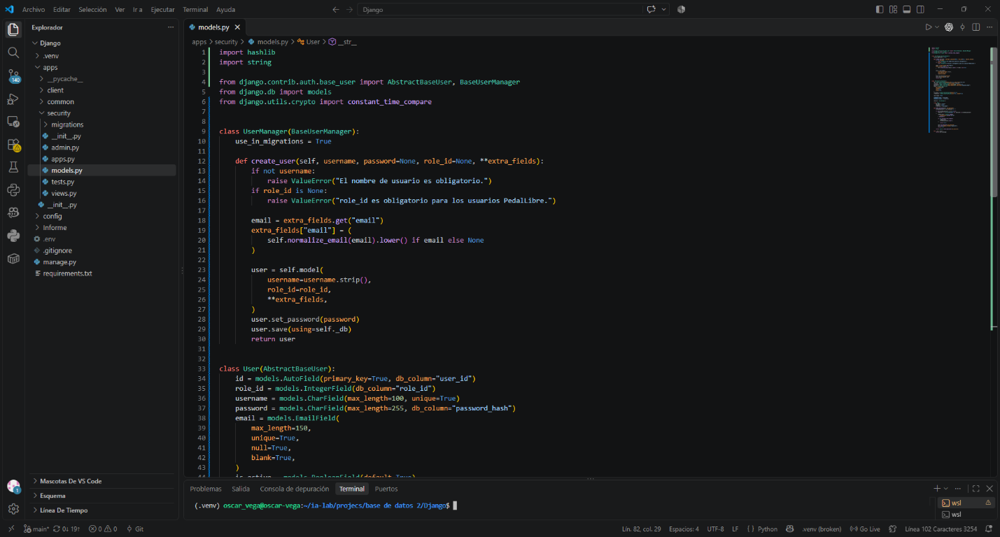

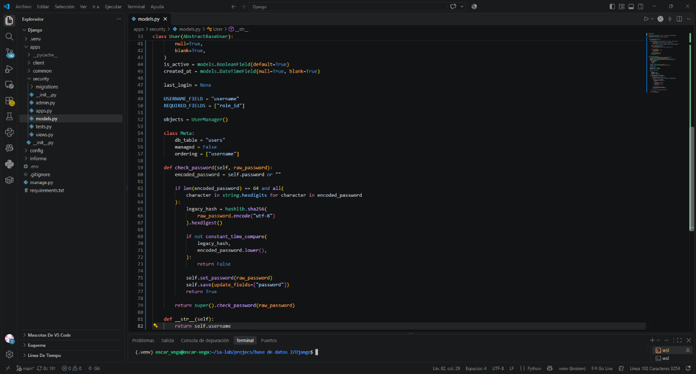

**Retroalimentación de las evidencias:** Revisé el contenido mostrado y el archivo guardado. El mapeo mantiene los campos de la tabla PedalLibre y evita que Django administre su esquema. La verificación que aportan estas capturas es visual; todavía no ejecuté `check` ni pruebas de autenticación. Tampoco registré aún la app en `INSTALLED_APPS` ni definí `AUTH_USER_MODEL`.

**Conclusión y aprendizaje:** Aprendí que un usuario personalizado debe reflejar las columnas reales de la base y que no se debe aplicar literalmente una guía cuyo esquema corresponde a otro proyecto. También aprendí que un hash SHA-256 heredado no es un hash de contraseña compatible con Django; el modelo compara el valor de manera segura y, tras una autenticación correcta, lo actualiza al formato de Django. Mantengo pendiente la integración con los ajustes y no ejecutaré migraciones sobre las tablas PedalLibre.

### Paso 4 - Registro de la app y selección del usuario personalizado

Registré `SecurityConfig` en `INSTALLED_APPS` y configuré `AUTH_USER_MODEL` para que Django utilice `security.User`.

```python
INSTALLED_APPS = [
    # ...
    "apps.client.apps.ClientConfig",
    "apps.security.apps.SecurityConfig",
]

AUTH_USER_MODEL = "security.User"
```

Verifiqué los ajustes del proyecto con:

```bash
python manage.py check
```

```text
System check identified no issues (0 silenced).
```


**Retroalimentación de las evidencias:** En las capturas observé que `ClientConfig`, `SecurityConfig`, la importación de `DATABASES` y `AUTH_USER_MODEL` aparecían duplicados. Corregí `config/settings.py` para dejar una sola entrada de cada uno. Las capturas registran el estado que revisé antes de la corrección; no representan la configuración final.

Después de corregir las duplicaciones, volví a ejecutar:

```bash
python manage.py check
```

El comando terminó correctamente:

```text
System check identified no issues (0 silenced).
```

No recibí una captura del resultado de esa segunda ejecución, así que dejo el resultado de la terminal documentado como texto y no como imagen.

La comprobación confirma que Django reconoce el registro de la app y la referencia al modelo personalizado. No implica que se hayan probado consultas de autenticación contra la base de datos.

**Conclusión y aprendizaje:** Aprendí que la app que define el modelo de usuario y el ajuste `AUTH_USER_MODEL` deben estar alineados desde la configuración inicial. También confirmé que `manage.py check` valida la configuración de Django, pero no reemplaza las pruebas contra los datos reales. No ejecuté `makemigrations` ni `migrate` para conservar intacto el esquema PedalLibre.

### Paso 5 - Pruebas de selección del motor de base de datos

Agregué pruebas unitarias en `apps/security/tests.py` para comprobar la selección de MySQL, PostgreSQL, SQL Server y Oracle, así como el rechazo de un dialecto inválido, una variable obligatoria vacía y la cadena de conexión de Oracle. Las pruebas reemplazan temporalmente las variables de entorno y no abren conexiones a la base de datos.

```python
import importlib
import os
from unittest.mock import patch

from django.core.exceptions import ImproperlyConfigured
from django.test import SimpleTestCase

import config.database as database_config


class DatabaseSelectionTests(SimpleTestCase):
    def database_environment(self, dialect):
        return {
            "DB_DIALECT": dialect,
            "DB_MYSQL_NAME": "pedallibre_test",
            "DB_MYSQL_USERNAME": "test_user",
            "DB_MYSQL_PASSWORD": "test_password",
            "DB_MYSQL_HOST": "localhost",
            "DB_MYSQL_PORT": "3306",
            "DB_POSTGRES_NAME": "pedallibre_test",
            "DB_POSTGRES_USERNAME": "test_user",
            "DB_POSTGRES_PASSWORD": "test_password",
            "DB_POSTGRES_HOST": "localhost",
            "DB_POSTGRES_PORT": "5432",
            "DB_MSSQL_NAME": "pedallibre_test",
            "DB_MSSQL_USERNAME": "test_user",
            "DB_MSSQL_PASSWORD": "test_password",
            "DB_MSSQL_HOST": "localhost",
            "DB_MSSQL_PORT": "1433",
            "DB_ORACLE_CONNECT_STRING": "localhost:1521/PEDALIBRE",
            "DB_ORACLE_USERNAME": "test_user",
            "DB_ORACLE_PASSWORD": "test_password",
        }

    def load_database(self, environment):
        with patch.dict(os.environ, environment, clear=True):
            importlib.reload(database_config)
            return database_config.DATABASES["default"].copy()

    def test_each_database_dialect(self):
        expected_engines = {
            "mysql": "django.db.backends.mysql",
            "postgres": "django.db.backends.postgresql",
            "mssql": "mssql",
            "oracle": "django.db.backends.oracle",
        }

        for dialect, expected_engine in expected_engines.items():
            with self.subTest(dialect=dialect):
                database = self.load_database(
                    self.database_environment(dialect)
                )
                self.assertEqual(database["ENGINE"], expected_engine)

    def test_invalid_database_dialect(self):
        environment = {"DB_DIALECT": "sqlite"}

        with patch.dict(os.environ, environment, clear=True):
            with self.assertRaisesRegex(
                ImproperlyConfigured,
                "DB_DIALECT debe ser mysql, postgres, mssql u oracle",
            ):
                importlib.reload(database_config)

    def test_empty_required_database_variable(self):
        environment = self.database_environment("mysql")
        environment["DB_MYSQL_NAME"] = " "

        with patch.dict(os.environ, environment, clear=True):
            with self.assertRaisesRegex(
                ImproperlyConfigured,
                "DB_MYSQL_NAME",
            ):
                importlib.reload(database_config)

    def test_oracle_service_name_connection_string(self):
        environment = self.database_environment("oracle")
        database = self.load_database(environment)

        self.assertEqual(
            database["NAME"],
            "localhost:1521/PEDALIBRE",
        )
```

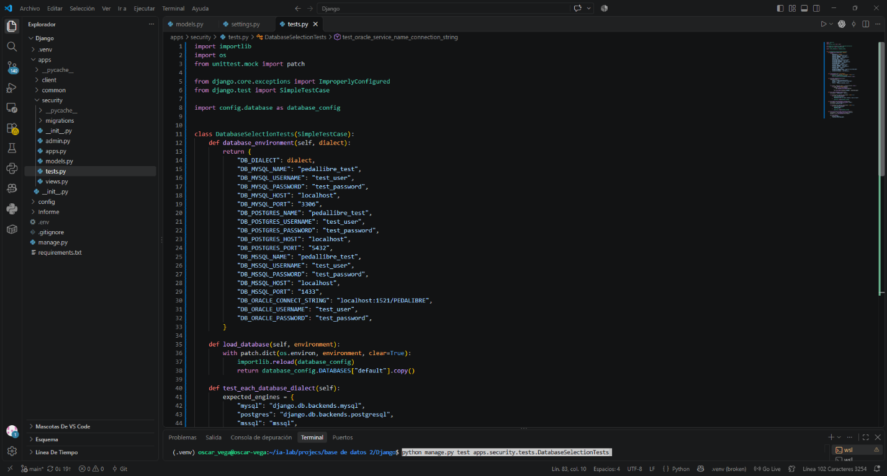

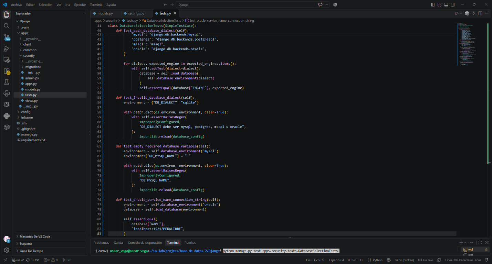

Ejecuté las pruebas con:

```bash
python manage.py test apps.security.tests.DatabaseSelectionTests
```

El resultado fue:

```text
Found 4 test(s).
System check identified no issues (0 silenced).
Ran 4 tests in 0.006s
OK
```

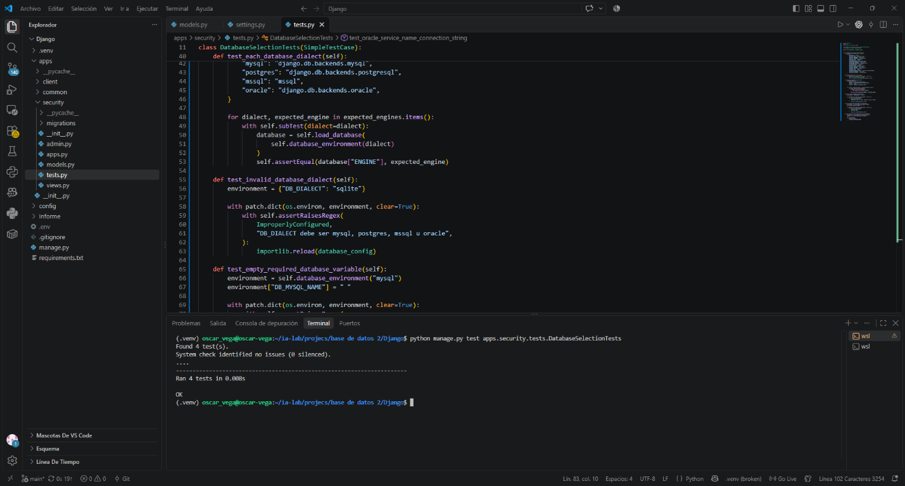

**Retroalimentación de las evidencias:** Revisé el archivo guardado y confirmé las cuatro pruebas. La salida de la terminal muestra que todas finalizaron correctamente y que Django no identificó problemas de configuración. Las pruebas utilizan valores ficticios y no requieren disponibilidad de los servidores de base de datos.

**Conclusión y aprendizaje:** Aprendí a comprobar cada rama del selector y sus errores de configuración aislando las variables de entorno para cada caso. Esto permite detectar problemas del selector sin alterar ni conectarse a las tablas existentes. No ejecuté migraciones.

### Paso 6 - Inspección previa de la migración del usuario

Antes de generar o aplicar migraciones, ejecuté el modo de simulación:

```bash
python manage.py makemigrations security --dry-run --verbosity 3
```

La salida mostró una operación `CreateModel` para `User`, y el estado del modelo incluye `managed = False` para la tabla `users`. Al usar `--dry-run`, Django solo mostró la migración que produciría: no escribió el archivo `0001_initial.py` y no modificó la base de datos.

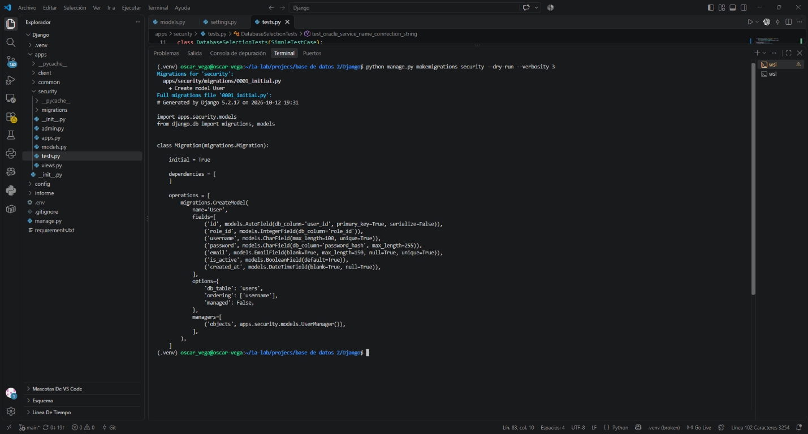

**Retroalimentación de la evidencia:** La simulación confirma que Django prepara el estado del modelo personalizado y conserva la indicación de que `users` no es administrada por Django. Esto no demuestra que el conjunto de migraciones de Django sea inocuo: las migraciones de `auth`, `contenttypes`, `admin` y `sessions` pueden crear sus propias tablas si se aplican. Por esa razón, todavía no ejecutaré `migrate`.

**Conclusión y aprendizaje:** Aprendí que `makemigrations --dry-run` permite revisar el archivo propuesto sin guardarlo ni tocar la base de datos. También confirmé que una migración de estado para un modelo `managed = False` no equivale a una autorización para aplicar todas las migraciones del proyecto.

### Paso 7 - Generación de la migración inicial del usuario

Después de revisar la simulación, generé el archivo de migración con:

```bash
python manage.py makemigrations security
```

Django creó `apps/security/migrations/0001_initial.py` con el estado del modelo `User`. Revisé el archivo y confirmé que incluye `managed = False` y el nombre físico de la tabla `users`. Esta operación generó el archivo local, pero no ejecutó la migración ni modificó la base de datos.


**Retroalimentación de la evidencia:** La captura muestra el archivo y el mensaje `Create model User`. En el contenido guardado comprobé que Django conserva `managed = False`; por tanto, esta migración describe el estado del modelo en el historial de migraciones, sin pedirle a Django administrar la tabla `users`.

**Conclusión y aprendizaje:** Aprendí que `makemigrations` genera el archivo de estado y no aplica cambios a la base de datos. Antes de cualquier ejecución de `migrate`, todavía debo revisar por separado qué tablas crearían las migraciones integradas de Django. No ejecuté `migrate`.

### Paso 8 - Revisión del plan completo de migraciones

Inspeccioné las operaciones pendientes con:

```bash
python manage.py migrate --plan
```

El plan incluyó `security.0001_initial` y operaciones de `contenttypes`, `admin`, `auth` y `sessions`. El comando solo mostró el plan y terminó de forma normal; no aplicó ninguna migración.

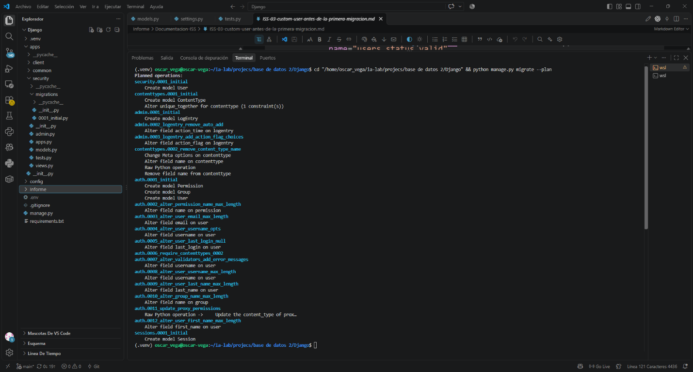

**Retroalimentación de la evidencia:** La salida confirma que aplicar `migrate` no se limitaría al modelo PedalLibre: también procesaría las migraciones integradas de Django. La captura no muestra el SQL detallado de cada operación, por lo que revisaré ese SQL antes de decidir si es compatible con el esquema existente. No ejecuté `migrate`.

**Conclusión y aprendizaje:** Aprendí a revisar el conjunto de migraciones pendientes antes de aplicarlas. El plan permite identificar las apps involucradas y confirmar qué migraciones aparecen pendientes.

### Paso 9 - Aplicación de las migraciones

Ejecuté el comando indicado por el ISS:

```bash
python manage.py migrate
```

La terminal mostró como aplicadas correctamente `security.0001_initial`, las migraciones de `contenttypes`, `admin`, `auth` y `sessions`.

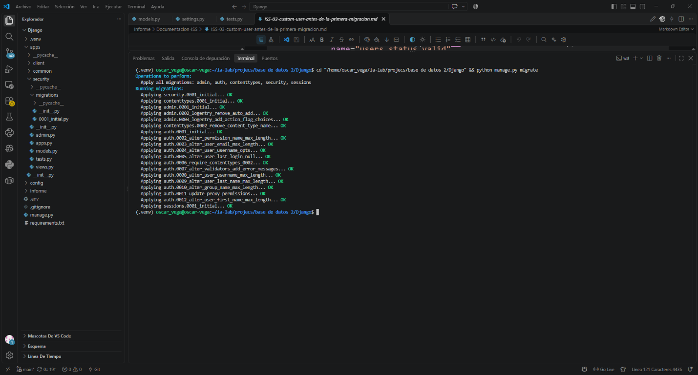

**Retroalimentación de la evidencia:** La salida muestra `OK` para cada migración pendiente y el regreso al prompt. La migración de `security` conserva `managed = False` para el modelo `users`; las apps integradas de Django también registraron sus migraciones.

**Conclusión y aprendizaje:** Aprendí a aplicar el plan de migraciones y comprobar su resultado en la terminal. La evidencia confirma que las migraciones pendientes finalizaron sin error.

### Paso 10 - Pruebas posteriores a las migraciones

Después de aplicar las migraciones, ejecuté la suite indicada en el ISS:

```bash
python manage.py test apps.security.tests.DatabaseSelectionTests
```

Las cuatro pruebas terminaron correctamente:

```text
Found 4 test(s).
System check identified no issues (0 silenced).
Ran 4 tests in 0.009s
OK
```

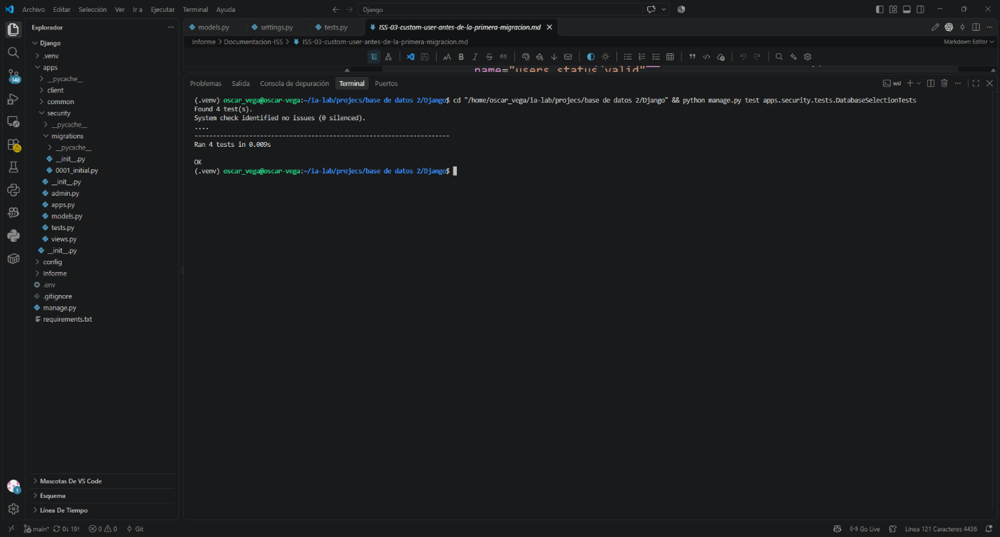

**Retroalimentación de la evidencia:** La captura muestra la ejecución de la suite después de las migraciones y confirma cuatro pruebas aprobadas, sin problemas en la comprobación del sistema.

**Conclusión y aprendizaje:** Aprendí a volver a ejecutar las pruebas después de aplicar migraciones para confirmar que la configuración continúa funcionando. El resultado valida la selección de motores y sus errores configurados; no cubre todavía el flujo de autenticación de PedalLibre.

### Paso 11 - Verificación final de Django

Al terminar las migraciones y pruebas, ejecuté:

```bash
python manage.py check
```

El sistema informó:

```text
System check identified no issues (0 silenced).
```

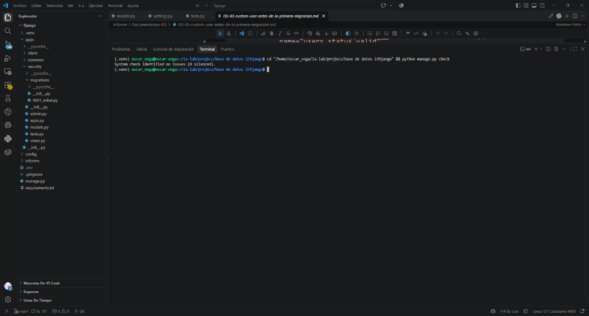

**Retroalimentación de la evidencia:** La terminal muestra que la comprobación terminó sin errores.

**Conclusión y aprendizaje:** Aprendí a comprobar la configuración de Django al cerrar este paso y confirmar que el proyecto sigue sin problemas reportados por el sistema.

## ISS-04 - Modelo Client de PedalLibre

### Paso 1 - Mapeo del modelo Client

Definí `Client` para mapear la tabla física `clients` de PedalLibre. Relacioné el perfil con el usuario existente mediante `user_id` y declaré los campos físicos `first_name`, `last_name`, `document_number`, `phone` y `created_at`. Marqué el modelo como `managed = False` porque el esquema se mantiene con los scripts SQL del proyecto.

```python
from django.conf import settings
from django.db import models


class Client(models.Model):
    id = models.AutoField(primary_key=True, db_column="client_id")
    user = models.OneToOneField(
        settings.AUTH_USER_MODEL,
        on_delete=models.DO_NOTHING,
        db_column="user_id",
        null=True,
        blank=True,
        related_name="client_profile",
    )
    first_name = models.CharField(max_length=100)
    last_name = models.CharField(max_length=100)
    document_number = models.CharField(max_length=50, unique=True)
    phone = models.CharField(max_length=30, null=True, blank=True)
    created_at = models.DateTimeField(null=True, blank=True)

    class Meta:
        db_table = "clients"
        managed = False

    def __str__(self):
        return f"{self.first_name} {self.last_name}"
```


**Retroalimentación de la evidencia:** Revisé el modelo guardado y lo contrasté con la definición SQL de `clients`. Los nombres y longitudes corresponden a las columnas de PedalLibre; el modelo no agrega campos de StoreLab como `status`, `email` o `updated_at`, ni incluye una contraseña del cliente. La terminal muestra `System check identified no issues (0 silenced)`.

**Conclusión y aprendizaje:** Aprendí a mapear el perfil de cliente a la tabla existente sin duplicar datos de autenticación ni modificar el esquema físico. El siguiente paso es generar la migración de estado para `client`; no ejecutaré migraciones que alteren `clients`.

### Paso 2 - Generación de la migración de estado de Client

Generé la migración inicial con:

```bash
python manage.py makemigrations client
```

Django informó `Create model Client` y generó `apps/client/migrations/0001_initial.py`. Revisé el archivo y confirmé que declara `db_table = "clients"` y `managed = False`; por eso esta migración registra el estado del modelo sin crear ni administrar la tabla física.

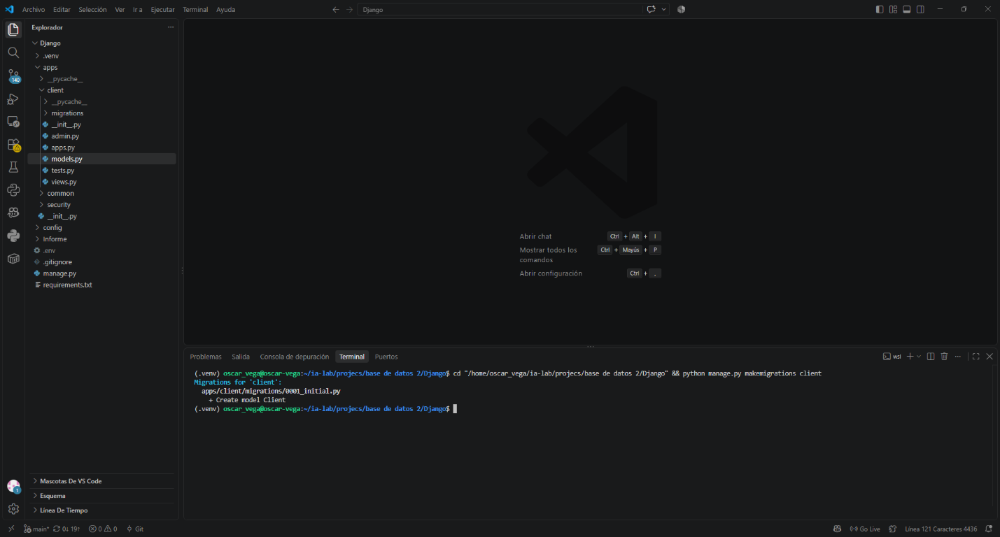

**Retroalimentación de la evidencia:** La terminal confirma la generación de `client.0001_initial`. El archivo refleja los campos de perfil; Django no incluyó en el estado de migración la relación con el usuario no administrado, aunque el modelo Python mantiene el campo `user` mapeado a la columna existente `user_id`.

**Conclusión y aprendizaje:** Aprendí que `makemigrations` crea la representación del modelo para Django y que `managed = False` diferencia esa representación de la creación de la tabla física.

### Paso 3 - Aplicación del estado de migraciones de Client

Ejecuté el comando indicado por el ISS:

```bash
python manage.py migrate
```

Django informó que aplicó `client.0001_initial` correctamente.


**Retroalimentación de la evidencia:** La salida muestra `Applying client.0001_initial... OK`. Como `Client` tiene `managed = False`, la migración registra su estado sin crear ni modificar la tabla física `clients`.

**Conclusión y aprendizaje:** Aprendí a aplicar la migración de la app y a verificar su resultado en la salida de Django.

### Paso 4 - Verificación de configuración del ISS-04

Ejecuté la comprobación del proyecto:

```bash
python manage.py check
```

El sistema respondió:

```text
System check identified no issues (0 silenced).
```

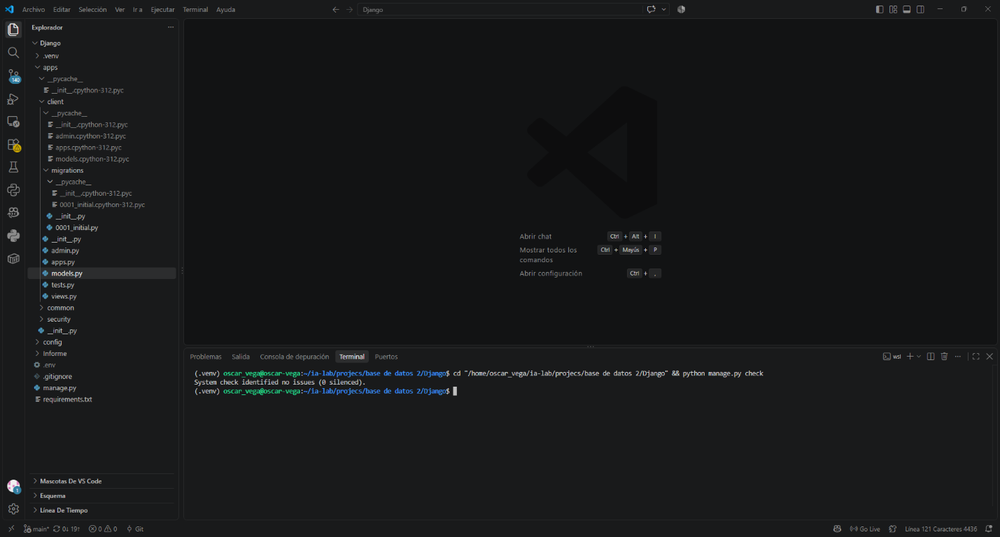

**Retroalimentación de la evidencia:** La captura confirma que Django no detectó errores de configuración tras registrar el modelo y aplicar su migración.

**Conclusión y aprendizaje:** Aprendí a volver a verificar el proyecto al completar el paso de migración para detectar errores de configuración antes de avanzar.

### Paso 5 - Ejecución de las pruebas disponibles de Client

Ejecuté:

```bash
python manage.py test apps.client
```

La salida indicó:

```text
Found 0 test(s).
System check identified no issues (0 silenced).
Ran 0 tests in 0.000s
NO TESTS RAN
```


**Retroalimentación de la evidencia:** El comando terminó sin problemas del sistema, pero Django no encontró pruebas para ejecutar. Por eso este resultado no se registra como pruebas de Client aprobadas.

**Conclusión y aprendizaje:** Aprendí que ejecutar el test runner no significa que haya cobertura si no existen casos de prueba. La guía ubica las pruebas HTTP del CRUD después de construir la API; aún no se implementaron en esta app.

## ISS-05 - Catálogo PedalLibre

### Paso 1 - Creación de la app `catalog`

Creé la app `catalog` dentro de `apps`, definí su nombre completo y etiqueta en `CatalogConfig`, y la registré en `INSTALLED_APPS`.

```bash
mkdir -p apps/catalog
python manage.py startapp catalog apps/catalog
```

```python
class CatalogConfig(AppConfig):
    default_auto_field = "django.db.models.BigAutoField"
    name = "apps.catalog"
    label = "catalog"
```

En `config/settings.py` registré:

```python
"apps.catalog.apps.CatalogConfig",
```


**Retroalimentación de la evidencia:** En la captura observé la estructura generada por `startapp` y la actualización de `INSTALLED_APPS`. Revisé `apps/catalog/apps.py` y confirmé `name = "apps.catalog"` y `label = "catalog"`.

**Conclusión y aprendizaje:** Aprendí a crear una app de catálogo bajo el paquete `apps` y a registrarla con su ruta Python completa para el dominio PedalLibre.

### Paso 2 - Modelos del catálogo PedalLibre

Definí los modelos `Station`, `Bicycle`, `Rate` y `DockingPoint` con las tablas y columnas físicas de PedalLibre. Declaré `managed = False` en cada modelo para mantener el esquema bajo control de los scripts SQL.

```python
from django.db import models


class Station(models.Model):
    id = models.AutoField(primary_key=True, db_column="station_id")
    name = models.CharField(max_length=120)
    address = models.CharField(max_length=255)
    capacity = models.PositiveIntegerField(default=0)
    status = models.CharField(max_length=30, default="active")
    created_at = models.DateTimeField(null=True, blank=True)

    class Meta:
        db_table = "stations"
        managed = False

    def __str__(self):
        return self.name


class Bicycle(models.Model):
    id = models.AutoField(primary_key=True, db_column="bicycle_id")
    serial_number = models.CharField(max_length=80, unique=True)
    bicycle_type = models.CharField(max_length=50, default="standard")
    status = models.CharField(max_length=30, default="available")
    created_at = models.DateTimeField(null=True, blank=True)

    class Meta:
        db_table = "bicycles"
        managed = False

    def __str__(self):
        return self.serial_number


class Rate(models.Model):
    id = models.AutoField(primary_key=True, db_column="rate_id")
    name = models.CharField(max_length=100)
    price = models.DecimalField(max_digits=10, decimal_places=2)
    billing_unit = models.CharField(max_length=30)
    is_active = models.BooleanField(default=True)

    class Meta:
        db_table = "rates"
        managed = False

    def __str__(self):
        return self.name


class DockingPoint(models.Model):
    id = models.AutoField(primary_key=True, db_column="docking_point_id")
    station = models.ForeignKey(
        Station,
        on_delete=models.DO_NOTHING,
        db_column="station_id",
        related_name="docking_points",
    )
    code = models.CharField(max_length=30)
    status = models.CharField(max_length=30, default="available")

    class Meta:
        db_table = "docking_points"
        managed = False
        constraints = [
            models.UniqueConstraint(
                fields=("station", "code"),
                name="uq_docking_points_code",
            ),
        ]

    def __str__(self):
        return self.code
```

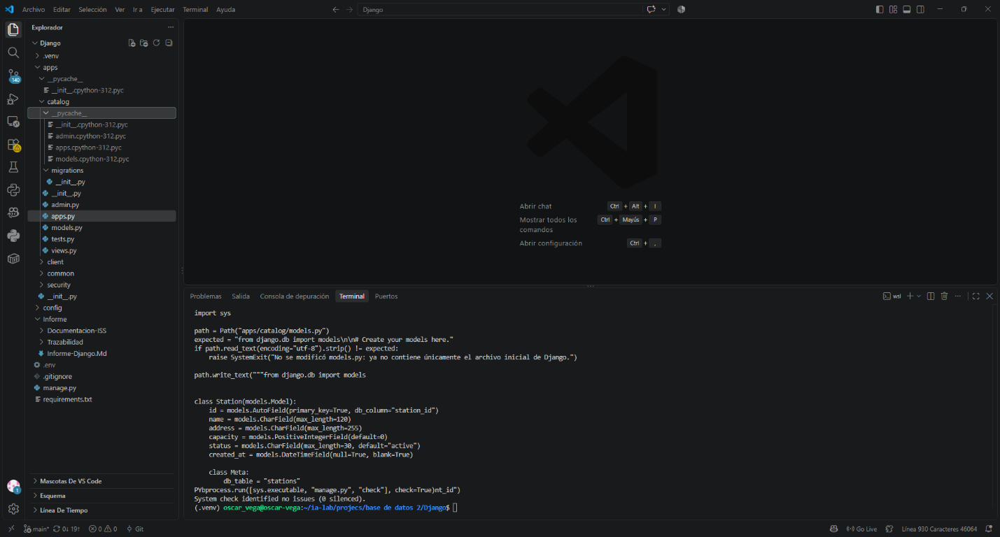

**Retroalimentación de la evidencia:** Revisé el archivo completo y lo contrasté con las definiciones SQL de las tablas. `manage.py check` terminó con `System check identified no issues (0 silenced)`. Los modelos describen el catálogo real, sin crear entidades de productos.

**Conclusión y aprendizaje:** Aprendí a representar entidades de catálogo existentes con `db_table`, `db_column` y `managed = False`, conservando la relación de los puntos de anclaje con su estación.

### Paso 3 - Generación de la migración inicial del catálogo

Generé la migración inicial con:

```bash
python manage.py makemigrations catalog
```

Django informó que creó los modelos `Bicycle`, `DockingPoint`, `Rate` y `Station` en `apps/catalog/migrations/0001_initial.py`. Revisé el archivo y confirmé que cada modelo declara su tabla física y `managed = False`.

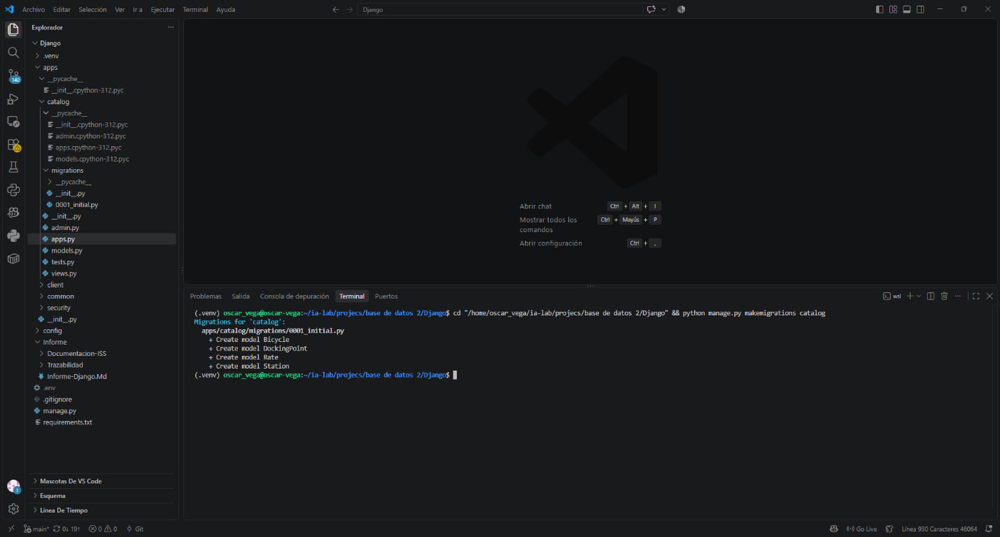

**Retroalimentación de la evidencia:** La salida confirma la generación de la migración inicial para los cuatro modelos, sin mostrar una aplicación contra la base de datos.

**Conclusión y aprendizaje:** Aprendí que la migración de catálogo registra el estado de los modelos en Django; las tablas PedalLibre siguen bajo administración de los scripts SQL.

### Paso 4 - Aplicación de la migración de estado del catálogo

Ejecuté el comando indicado por el ISS:

```bash
python manage.py migrate
```

Django informó `Applying catalog.0001_initial... OK`.

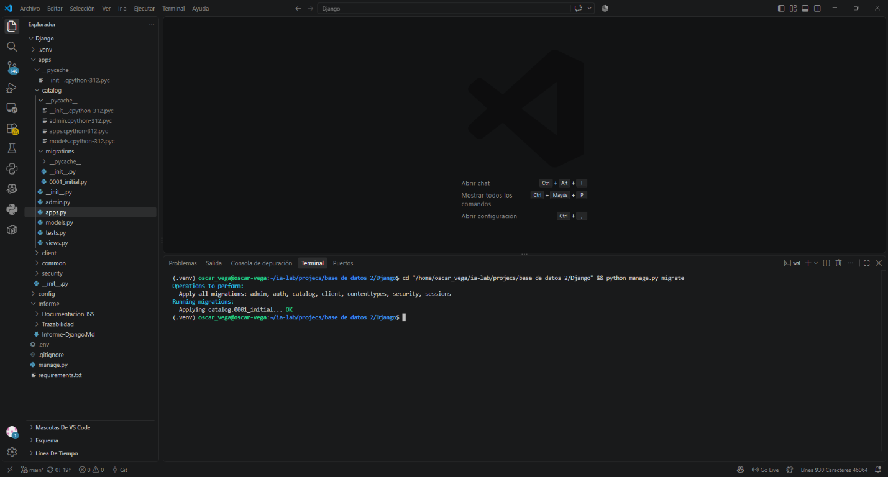

**Retroalimentación de la evidencia:** La salida confirma que la migración de catálogo quedó aplicada en el historial de Django. Como los modelos se declararon con `managed = False`, Django no administra las tablas físicas existentes.

**Conclusión y aprendizaje:** Aprendí a confirmar en la terminal la aplicación de la migración de estado para la app de catálogo.

### Paso 5 - Verificación del catálogo

Ejecuté la comprobación del proyecto:

```bash
python manage.py check
```

El resultado fue:

```text
System check identified no issues (0 silenced).
```

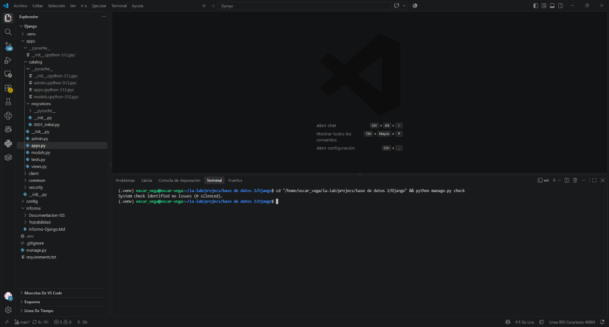

**Retroalimentación de la evidencia:** La terminal confirma que Django no identificó problemas después de registrar y migrar el catálogo.

**Conclusión y aprendizaje:** Aprendí a verificar la configuración al terminar la unidad de modelos del catálogo antes de pasar al siguiente ISS.

## ISS-06 - Operación de reservas y alquileres PedalLibre

### Paso 1 - Creación y registro de la aplicación `rental`

Creé la carpeta de destino `apps/rental`, generé la aplicación Django y la registré en `INSTALLED_APPS` como `apps.rental.apps.RentalConfig`.

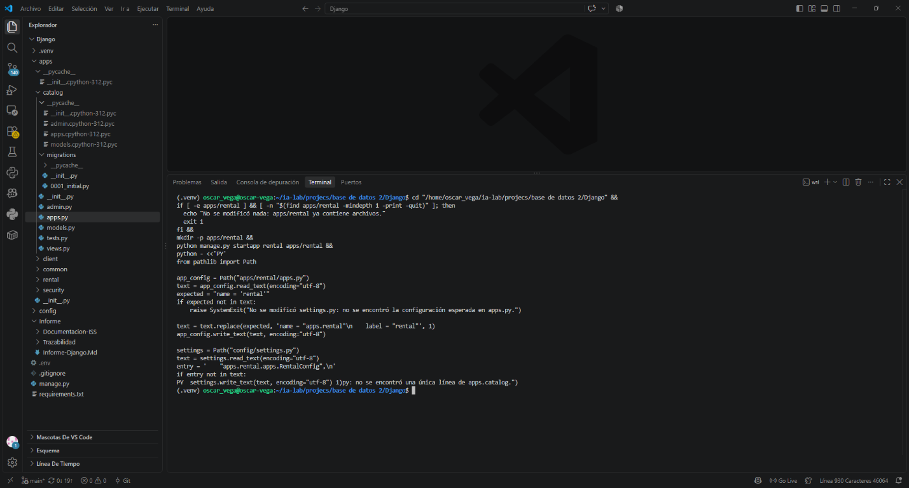

**Retroalimentación de la evidencia:** En el explorador observé `apps/rental` dentro del proyecto y la terminal regresó al prompt sin mostrar errores. La aplicación quedó registrada en la configuración de Django.

**Conclusión y aprendizaje:** Aprendí que `startapp` necesita que exista la carpeta de destino cuando se genera una aplicación dentro de `apps/`.

### Paso 2 - Modelos de reservas, alquileres y movimientos de bicicletas

Creé los modelos `Reservation`, `Rental`, `RentalEvent` y `BicycleDocking` en `apps/rental/models.py`, relacionándolos con los modelos de clientes y catálogo existentes. Cada modelo apunta a su tabla física de PedalLibre y declara `managed = False`, por lo que Django no administra la creación de esas tablas.

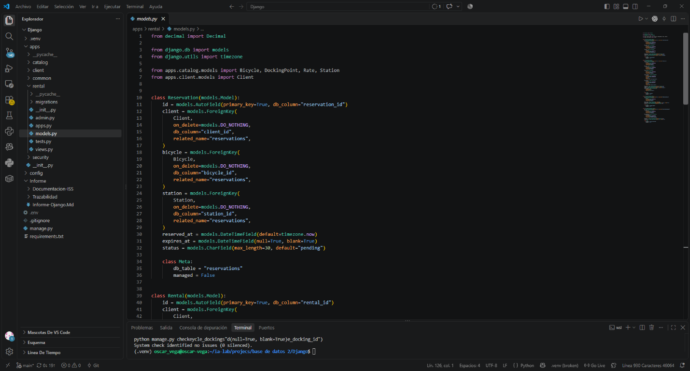

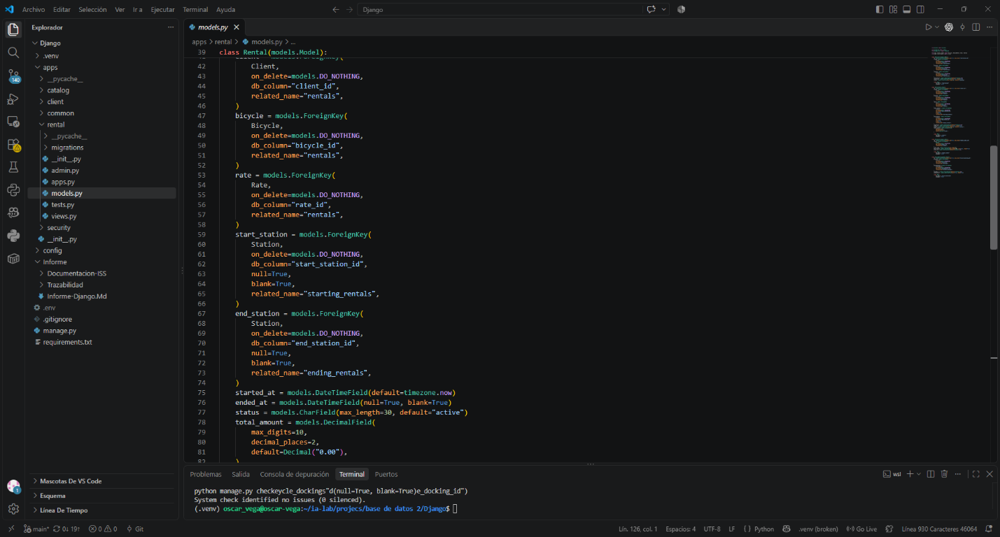

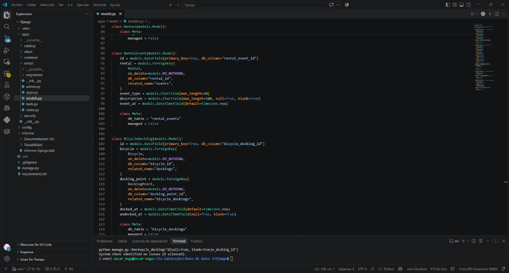

Ejecuté la comprobación:

```bash
python manage.py check
```

El resultado fue:

```text
System check identified no issues (0 silenced).
```

**Retroalimentación de las evidencias:** Observé en el código las relaciones con las entidades PedalLibre y los nombres de las tablas físicas. La salida de Django confirma que la configuración y los modelos no presentan problemas de sistema.

**Conclusión y aprendizaje:** Aprendí a representar la operación de reservas y alquileres existente en PedalLibre sin añadir las ventas de StoreLab ni entregar a Django la administración de las tablas del esquema.

### Paso 3 - Generación de la migración de estado

Generé la migración inicial de la app `rental`:

```bash
python manage.py makemigrations rental
```

Django creó `apps/rental/migrations/0001_initial.py` para `BicycleDocking`, `Rental`, `RentalEvent` y `Reservation`. Revisé la migración y confirmé que los cuatro modelos mantienen `managed = False`.

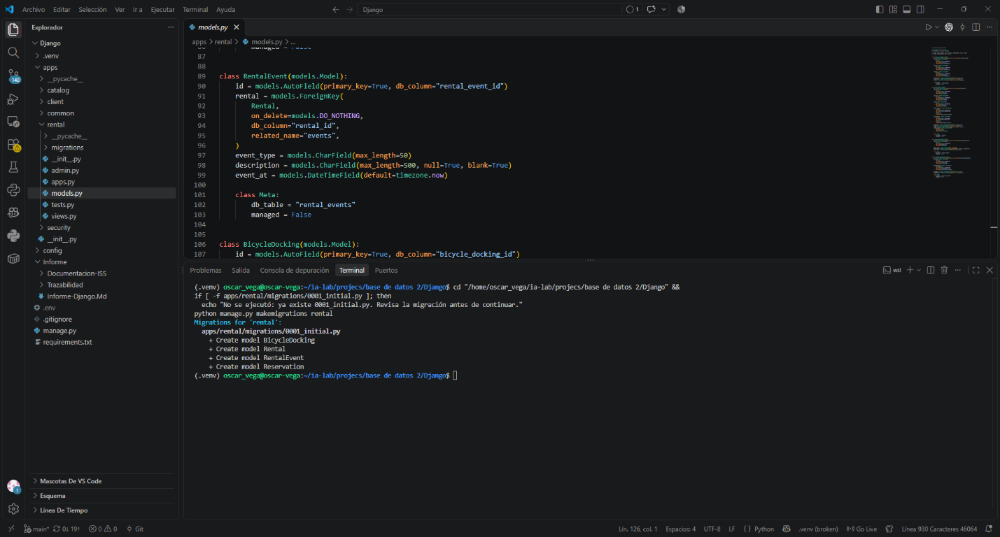

**Retroalimentación de la evidencia:** La terminal confirma la generación de `0001_initial.py` con los cuatro modelos. La migración registra su estado en Django, sin asumir la creación de las tablas físicas ya existentes en PedalLibre.

**Conclusión y aprendizaje:** Aprendí a generar la migración de estado de la app y a verificar que conserva `managed = False` para proteger las tablas administradas por el esquema SQL.

### Paso 4 - Aplicación de la migración de estado

Registré la migración inicial de la app `rental`:

```bash
python manage.py migrate rental
```

Django informó `Applying rental.0001_initial... OK`.

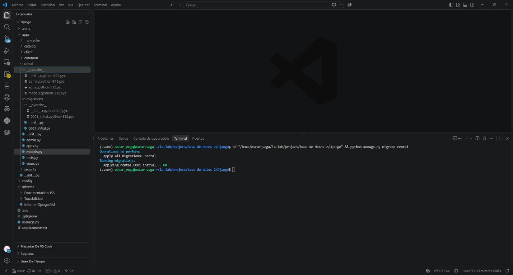

**Retroalimentación de la evidencia:** La salida confirma que Django registró la migración `rental.0001_initial` sin reportar errores. Los modelos se mantienen con `managed = False`, de modo que las tablas físicas siguen bajo el esquema SQL de PedalLibre.

**Conclusión y aprendizaje:** Aprendí a aplicar y verificar la migración de estado de la app sin transferir a Django la administración de las tablas existentes.

### Paso 5 - Verificación final de Django

Ejecuté la comprobación del sistema después de aplicar la migración:

```bash
python manage.py check
```

El resultado fue:

```text
System check identified no issues (0 silenced).
```

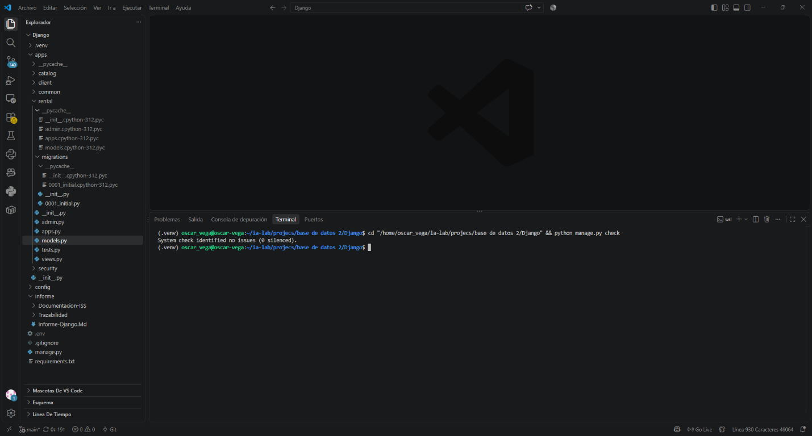

**Retroalimentación de la evidencia:** La terminal confirma que Django no encontró problemas después de registrar los modelos de reservas y alquileres.

**Conclusión y aprendizaje:** Aprendí a cerrar la verificación del ISS con el chequeo del proyecto, confirmando que la app `rental` y sus modelos están registrados sin errores.

## ISS-07 - Configuración de REST Framework, CORS y JSON camelCase

### Paso 1 - Instalación de dependencias de API

Instalé Django REST Framework, el renderer/parser camelCase y los encabezados CORS con las versiones indicadas en la guía. Actualicé `requirements.txt` después de la instalación.

```bash
source .venv/bin/activate
python -m pip install "djangorestframework==3.17.2" "djangorestframework-camel-case==1.4.2" "django-cors-headers==4.9.0"
python -m pip freeze > requirements.txt
```

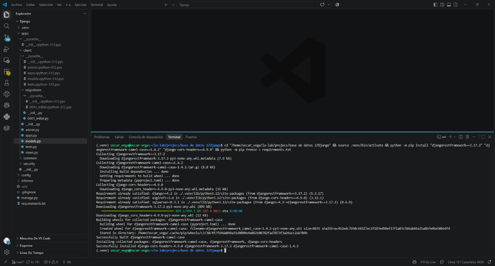

**Retroalimentación de la evidencia:** La terminal confirma la instalación de las tres dependencias y el archivo `requirements.txt` incluye sus versiones.

**Conclusión y aprendizaje:** Aprendí a instalar y registrar las dependencias de la API antes de configurar sus aplicaciones, middleware y renderers.

### Paso 2 - Registro de REST Framework y configuración de CORS

Registré `rest_framework` y `corsheaders` en `INSTALLED_APPS`, agregué `CorsMiddleware` antes del middleware de seguridad y configuré `CORS_ALLOW_ALL_ORIGINS` a partir de la variable de entorno `CORS_ALLOW_ALL_ORIGINS`.

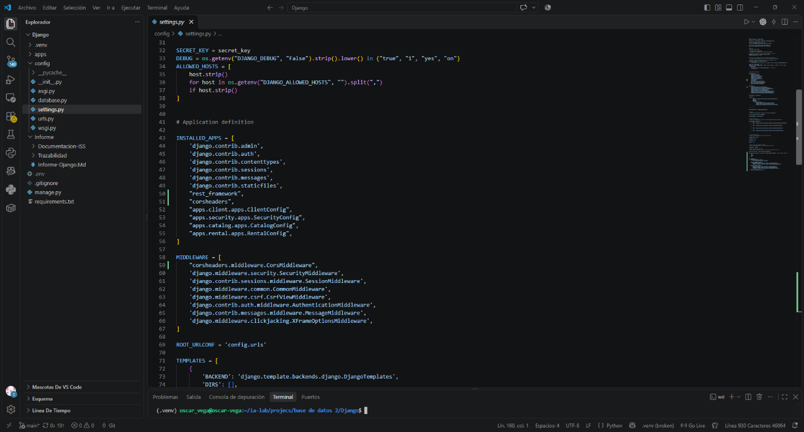

**Retroalimentación de la evidencia:** En `settings.py` observé las aplicaciones y el middleware de CORS en la configuración del proyecto.

**Conclusión y aprendizaje:** Aprendí a integrar los componentes de REST Framework y CORS en la configuración de Django. La lista de orígenes queda controlada por una variable de entorno.

### Paso 3 - Renderer y parser JSON camelCase

Configuré los permisos predeterminados `AllowAny`, los renderers y parsers camelCase y la paginación desactivada, de acuerdo con el ISS-07.

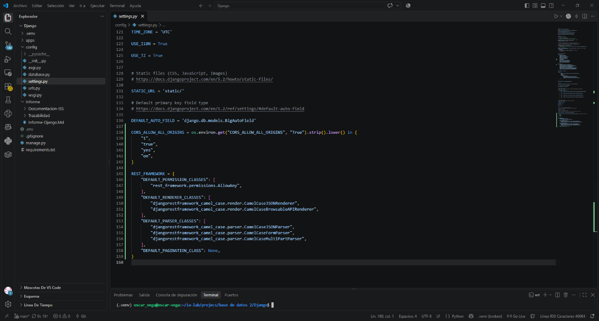

**Retroalimentación de la evidencia:** La captura muestra la configuración de los renderers y parsers para que el contrato HTTP use camelCase, sin cambiar los nombres de los campos de los modelos Python.

**Conclusión y aprendizaje:** Aprendí que la conversión camelCase se configura en la capa HTTP de la API, manteniendo snake_case en los modelos.

### Paso 4 - Verificación de la configuración

Ejecuté la comprobación del sistema después de configurar DRF y CORS:

```bash
python manage.py check
```

El resultado fue:

```text
System check identified no issues (0 silenced).
```

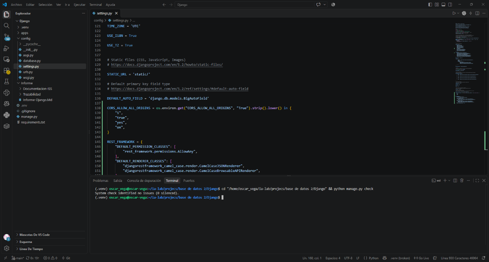

**Retroalimentación de la evidencia:** La terminal confirma que Django no encontró problemas con la configuración de REST Framework y CORS.

**Conclusión y aprendizaje:** Aprendí a comprobar los ajustes después de integrar las aplicaciones, el middleware y los renderers y parsers camelCase.

### Paso 5 - Serializers de cliente, catálogo y operación

Creé `ClientSerializer` para el perfil de cliente; `StationSerializer`, `BicycleSerializer`, `RateSerializer` y `DockingPointSerializer` para el catálogo; y `ReservationSerializer`, `RentalSerializer`, `RentalEventSerializer` y `BicycleDockingSerializer` para la operación de PedalLibre. Conservé los campos reales del esquema y marqué como de solo lectura los identificadores y fechas generadas.

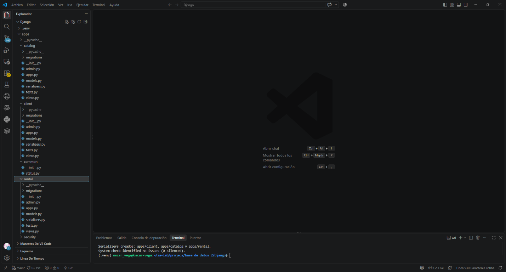

Ejecuté la comprobación:

```bash
python manage.py check
```

La salida fue `System check identified no issues (0 silenced)`.

**Retroalimentación de la evidencia:** En el explorador observé los archivos `serializers.py` en las apps de cliente, catálogo y alquileres. La terminal confirmó que Django no detectó problemas después de crearlos.

**Conclusión y aprendizaje:** Aprendí a traducir los modelos PedalLibre a serializers sin incorporar los campos StoreLab ni cambiar los nombres del esquema físico.

### Paso 6 - Verificación de los serializers y salida camelCase

Verifiqué que `ReservationSerializer` expone el campo Python `reserved_at` y que el renderer convierte los nombres a camelCase en el JSON.

La salida observada fue:

```json
{"reservedAt": "2026-10-12T12:00:00Z", "totalAmount": "0.00"}
Serializer rental y JSON camelCase: OK
```

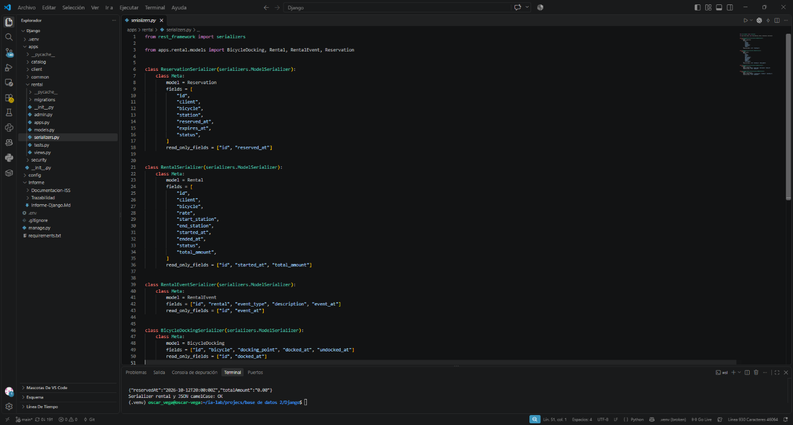

**Retroalimentación de la evidencia:** La terminal muestra `reservedAt` y `totalAmount` en la respuesta, mientras el serializer mantiene `reserved_at` en Python. La verificación terminó con `Serializer rental y JSON camelCase: OK`.

**Conclusión y aprendizaje:** Aprendí a verificar la conversión de nombres en la salida HTTP sin renombrar los campos del modelo ni del serializer.

## ISS-08 - Cliente con ModelViewSet

### Paso 1 - Creación del ClientViewSet

Creé `ClientViewSet` con `ModelViewSet`, `ClientSerializer` y permiso `AllowAny`. Como la tabla `clients` de PedalLibre no tiene columna `status`, no añadí baja lógica ni habilité `DELETE`.

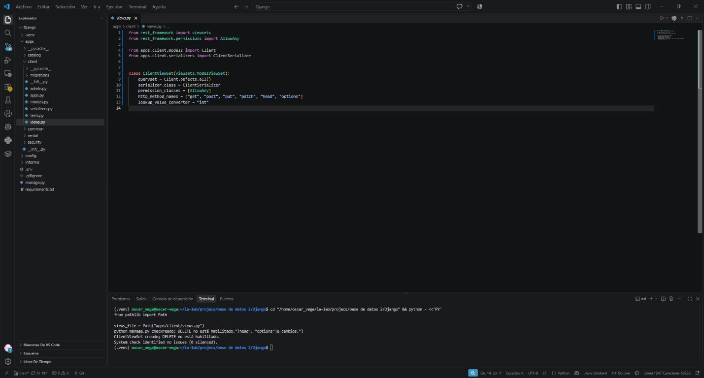

Ejecuté la comprobación del sistema y Django informó `System check identified no issues (0 silenced)`.

**Retroalimentación de la evidencia:** En el archivo observé el queryset de clientes, el serializer, el permiso y los métodos HTTP habilitados sin `DELETE`. La terminal confirma que Django no detectó problemas.

**Conclusión y aprendizaje:** Aprendí a adaptar el ViewSet al esquema real de `clients` y a no copiar la baja lógica del ejemplo StoreLab, cuyo campo `status` no existe en PedalLibre.

### Paso 2 - Registro de las rutas de clientes

Registré las rutas de `ClientViewSet` con `SimpleRouter` y conecté el router bajo el prefijo `/api/`, para exponer el recurso de clientes.

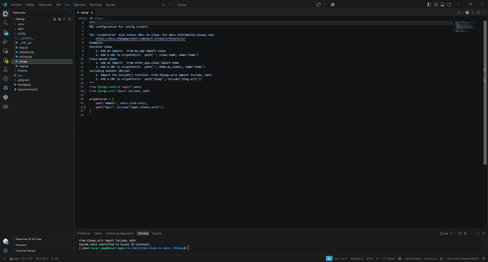

Verifiqué la configuración con `python manage.py check`; Django informó `System check identified no issues (0 silenced)`.

**Retroalimentación de la evidencia:** La captura muestra el router de la app `client`, su inclusión bajo `/api/` y el resultado correcto de la comprobación.

**Conclusión y aprendizaje:** Aprendí a separar el prefijo general de la API en la configuración del proyecto de las rutas específicas del recurso en su aplicación.

### Paso 3 - Pruebas de resolución de las rutas del CRUD

Agregué pruebas que verifican la resolución de las rutas de colección y detalle, así como las acciones HTTP disponibles. Las pruebas no consultan la base de datos.

```bash
python manage.py test apps.client
```

La ejecución encontró y aprobó dos pruebas.

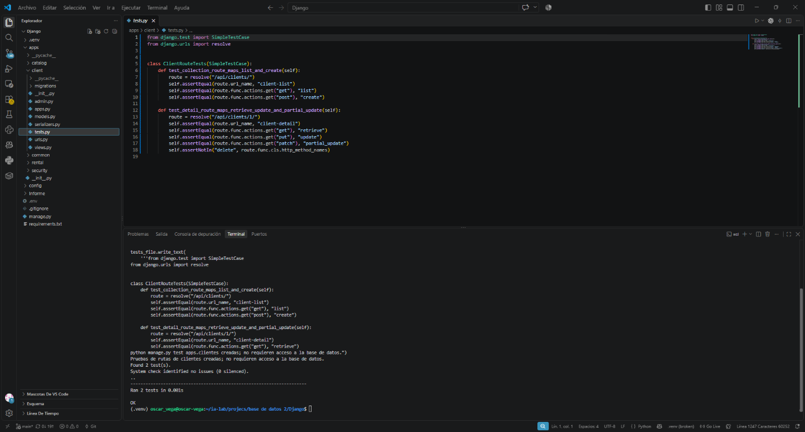

**Retroalimentación de la evidencia:** La terminal muestra `Found 2 test(s)` y `OK`; se validaron las acciones de listado, creación, detalle, actualización completa y parcial. También se confirmó que `DELETE` no está habilitado.

**Conclusión y aprendizaje:** Aprendí a probar las rutas y acciones HTTP sin acceder a la base de datos, verificando que el CRUD publicado corresponde a los métodos permitidos para `clients`.

### Paso 4 - Verificación del serializer de cliente y JSON camelCase

Verifiqué `ClientSerializer` con un objeto de cliente en memoria, sin consultar ni modificar la base de datos. Comprobé que expone los campos de la tabla y que el renderer convierte `created_at` a `createdAt`.

La salida obtenida fue:

```json
{"id": 1, "user": null, "firstName": "Ana", "lastName": "Ruiz", "documentNumber": "DOC-001", "phone": null, "createdAt": null}
ClientSerializer y JSON camelCase: OK
```

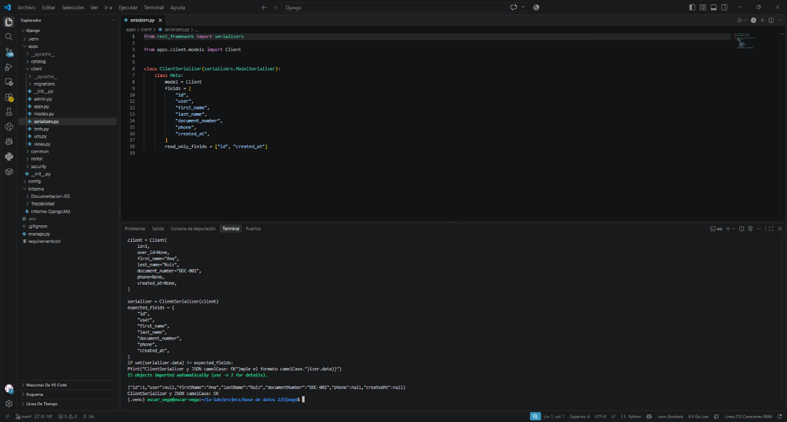

**Retroalimentación de la evidencia:** La terminal confirma los campos `firstName`, `lastName`, `documentNumber` y `createdAt` en el JSON, junto con el mensaje `ClientSerializer y JSON camelCase: OK`.

**Conclusión y aprendizaje:** Aprendí a comprobar que el serializer respeta el perfil real de PedalLibre y que camelCase se aplica solo al JSON serializado.

### Paso 5 - Verificación de los métodos HTTP del endpoint

Verifiqué las rutas del recurso con el cliente de API de Django. La colección expone GET y POST; el detalle expone GET, PUT y PATCH. Comprobé que DELETE devuelve `405 Method Not Allowed`.

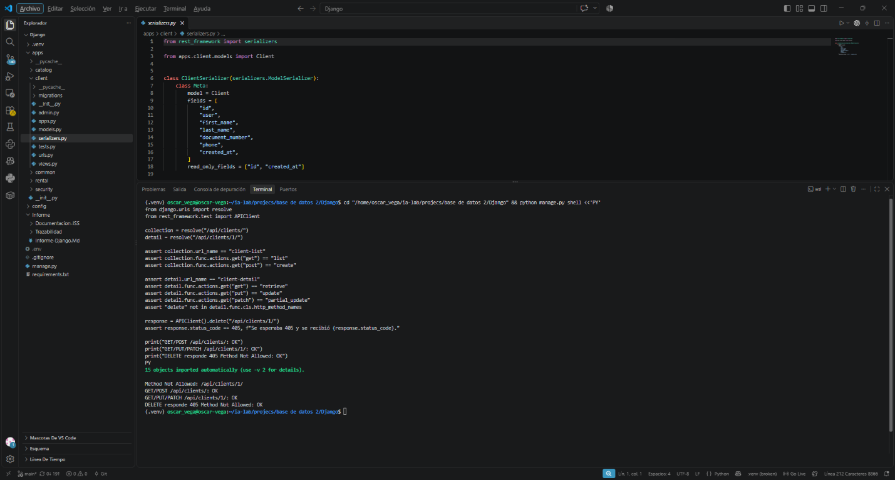

**Retroalimentación de la evidencia:** La terminal muestra las rutas de colección y detalle aprobadas y confirma `DELETE responde 405 Method Not Allowed: OK`.

**Conclusión y aprendizaje:** Aprendí a verificar el comportamiento HTTP del ViewSet y a confirmar que no se pueden borrar perfiles de clientes mediante el endpoint.

### Paso 6 - Lectura de la colección de clientes

Consulté `GET /api/clients/` en modo de solo lectura. La respuesta fue HTTP 200, incluyó 100 registros y los campos camelCase esperados. No mostré ni registré los valores personales de los clientes.

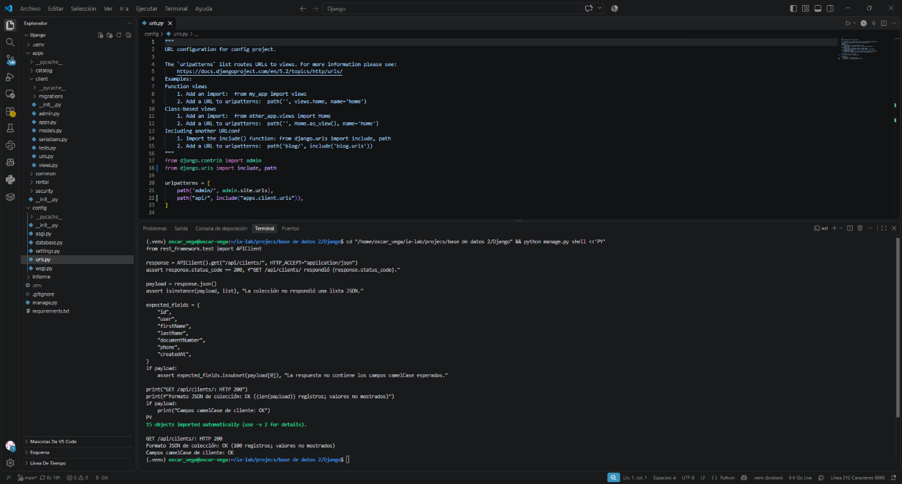

**Retroalimentación de la evidencia:** La terminal confirma `GET /api/clients/: HTTP 200`, una lista JSON válida de 100 registros y campos camelCase.

**Conclusión y aprendizaje:** Aprendí a comprobar la respuesta del endpoint con una consulta de solo lectura y a validar la estructura sin divulgar datos personales de la colección.

### Paso 7 - Lectura de un cliente por identificador

Tomé el identificador del primer resultado de la colección y consulté su detalle con GET. La respuesta fue HTTP 200 y contenía los campos camelCase esperados. El bloque de verificación no imprimió los valores personales.

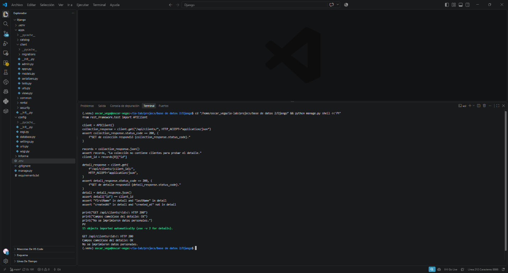

**Retroalimentación de la evidencia:** La terminal confirma `GET /api/clients/<id>/: HTTP 200`, los campos camelCase y que no se imprimieron datos personales.

**Conclusión y aprendizaje:** Aprendí a verificar la consulta de detalle usando el identificador de un registro existente y a mantener los datos personales fuera de la salida de la prueba.

### Paso 8 - Validación de una solicitud incompleta

Envié una solicitud POST con el cuerpo vacío para comprobar la validación sin crear un cliente:

```text
POST /api/clients/ con cuerpo vacío: HTTP 400
Validación del cuerpo sin crear registros: OK
```

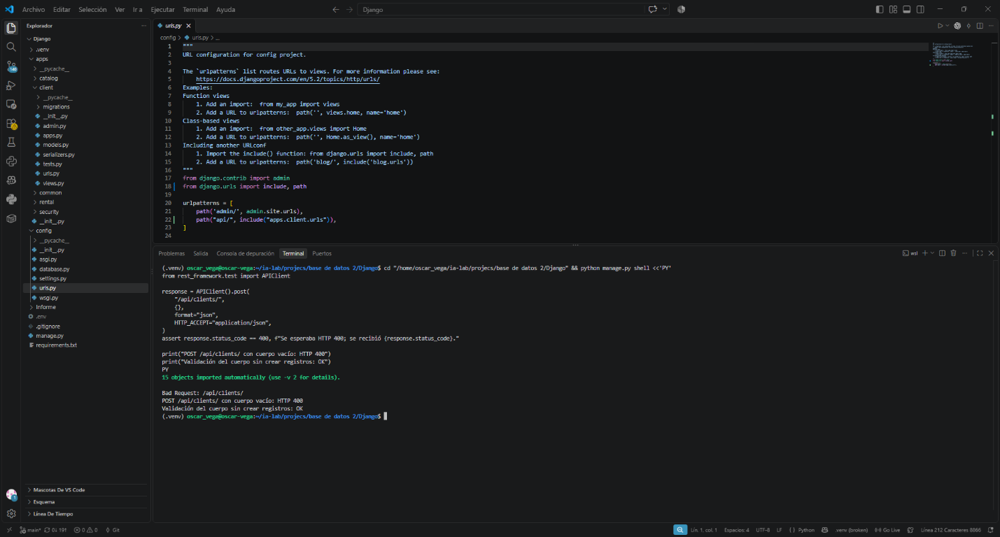

**Retroalimentación de la evidencia:** La respuesta `400 Bad Request` confirma que el serializer rechaza un cuerpo que no contiene los campos requeridos. La prueba no insertó datos.

**Conclusión y aprendizaje:** Aprendí a validar una solicitud incompleta de manera segura antes de probar una creación válida.

### Paso 9 - Verificación aislada del CRUD de clientes

Probé POST, GET de detalle y PATCH usando una base SQLite en memoria con tablas temporales para la prueba. La salida confirmó:

```text
POST en SQLite en memoria: HTTP 201
GET de detalle: HTTP 200
PATCH en SQLite en memoria: HTTP 200
DELETE: HTTP 405
MySQL no fue utilizado ni modificado.
```

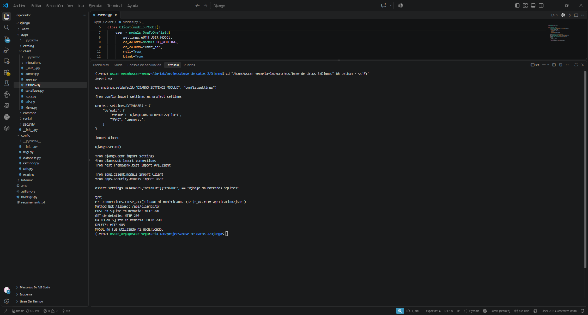

**Retroalimentación de la evidencia:** La terminal confirma la creación y actualización en la base temporal, la lectura del detalle y el rechazo de DELETE. La conexión MySQL no se utilizó.

**Conclusión y aprendizaje:** Aprendí a probar las operaciones de escritura en una base aislada y desechable para mantener intactos los datos reales de PedalLibre.

### Paso 10 - Verificación final del ISS-08

Ejecuté la comprobación general y las pruebas de rutas de clientes:

```bash
python manage.py check
python manage.py test apps.client
```

Django no encontró problemas y las dos pruebas terminaron en `OK`.

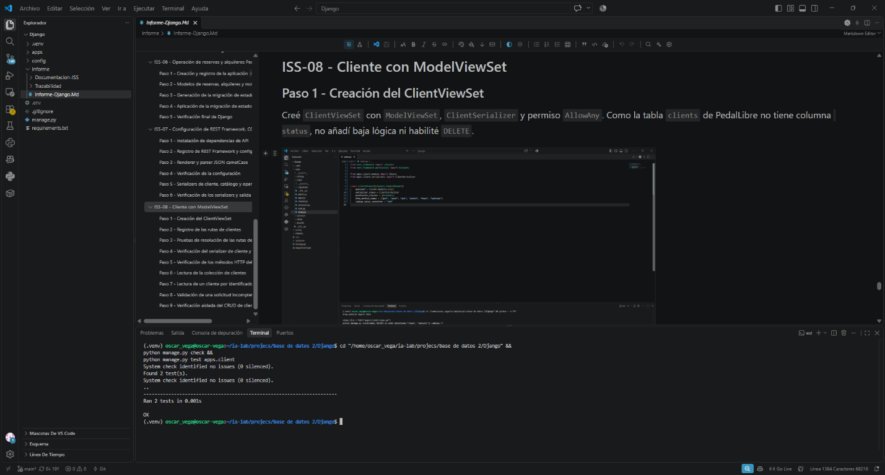

**Retroalimentación de la evidencia:** La salida confirma `System check identified no issues (0 silenced)` y `Ran 2 tests` con resultado `OK`.

**Conclusión y aprendizaje:** Aprendí a cerrar la unidad con la revisión general del proyecto y las pruebas automatizadas de rutas, manteniendo separadas las pruebas de escritura aisladas de la base MySQL.

## ISS-09 - Catálogo PedalLibre con ModelViewSet

### Paso 1 - Creación de los ViewSets del catálogo

Creé los ViewSets para estaciones, bicicletas, tarifas y puntos de anclaje con `ModelViewSet`, sus serializers de PedalLibre y permiso `AllowAny`. Deshabilité `DELETE` para proteger registros vinculados con operaciones del sistema.

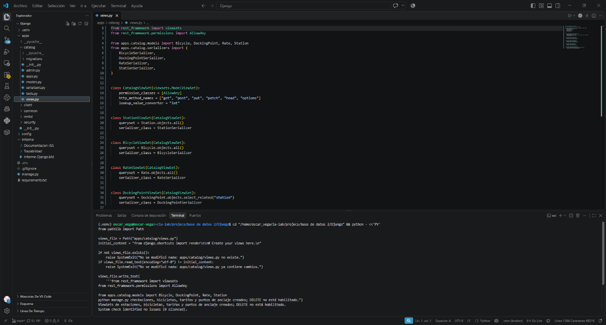

Ejecuté `python manage.py check`; Django informó `System check identified no issues (0 silenced)`.

**Retroalimentación de la evidencia:** La captura muestra los cuatro ViewSets basados en sus modelos reales y la comprobación de Django sin problemas.

**Conclusión y aprendizaje:** Aprendí a publicar los recursos reales del catálogo de PedalLibre sin crear modelos de productos ajenos al esquema y a proteger las relaciones deshabilitando el borrado desde la API.
