# Informe de desarrollo del proyecto Django

---

## Universidad de La Guajira

### Facultad de Ingeniería

| Dato | Información |
| :-- | :-- |
| Programa | Ingeniería de Sistemas |
| Estudiante | [Escribe aquí tu nombre completo] |
| Asignatura | Desarrollo Web — 2026-II semestre |
| Área del proyecto | Base de Datos II |
| Docente | ING. JAIDER J. QUINTERO MENDOZA, PhD G en Innovación |
| Proyecto | Desarrollo de PedalLibre con Django |

---

## Presentación

En este informe documento el desarrollo de PedalLibre con Django siguiendo, en orden, las instrucciones de cada ISS. Para cada paso registro el propósito, los bloques de código que ejecuto, la captura de evidencia, la retroalimentación sobre el resultado, la conclusión y lo que aprendí. Las capturas se presentan dentro del informe, debajo del paso al que corresponden, y también se conservan en la carpeta `Trazabilidad`.

## ISS-00 - Entorno y proyecto Django

### Paso 1 - Creación del entorno virtual e inicio del proyecto

Creé el entorno virtual `.venv`, lo activé, instalé Django 5.2.17, generé el proyecto `config` en la raíz y guardé las dependencias instaladas en `requirements.txt`.

```bash
python3 -m venv .venv
source .venv/bin/activate
python -m pip install "Django==5.2.17"
django-admin startproject config .
python -m pip freeze > requirements.txt
python -m django --version
```

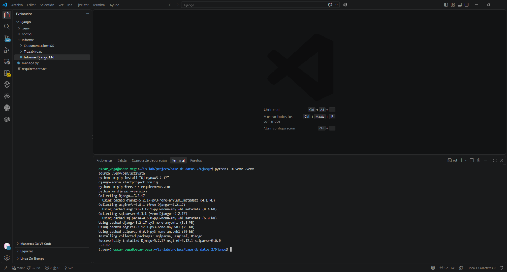

**Retroalimentación de la evidencia:** En la captura observé la ejecución de los comandos, la instalación exitosa de Django 5.2.17 y la versión `5.2.17` impresa al final. En el Explorador de VS Code aparecen `.venv/`, `config/`, `manage.py` y `requirements.txt`, correspondientes a la estructura inicial.

**Conclusión y aprendizaje:** Aprendí que `venv` permite aislar las dependencias del proyecto y que `django-admin startproject config .` genera la configuración en la raíz actual. `requirements.txt` conserva las dependencias para poder reproducir el entorno.

### Paso 2 - Creación del archivo `.gitignore`

Creé el archivo `.gitignore` en la raíz del proyecto `Django` para excluir del control de versiones el entorno virtual, los archivos temporales de Python, la configuración local y otros archivos generados.

```gitignore
.venv/
__pycache__/
*.py[cod]
.env
db.sqlite3
*.log
.idea/
.vscode/
staticfiles/
media/
.pytest_cache/
htmlcov/
.coverage
```


**Retroalimentación de la evidencia:** En la captura observé el comando que crea `.gitignore` desde la raíz `Django`, la ruta impresa por `pwd` y el contenido mostrado después con `cat`. Así comprobé que el archivo quedó en la ubicación indicada y que contiene las reglas de exclusión solicitadas.

**Conclusión y aprendizaje:** Aprendí que `.gitignore` debe estar en la raíz del proyecto para que Git aplique sus reglas a los archivos y carpetas generados dentro de él. Excluir `.venv/`, cachés y archivos locales evita incorporarlos accidentalmente a los commits.

### Paso 3 - Verificación de la instalación y del proyecto

Verifiqué la versión instalada de Django y comprobé la configuración inicial del proyecto.

```bash
python -m django --version
python manage.py check
```

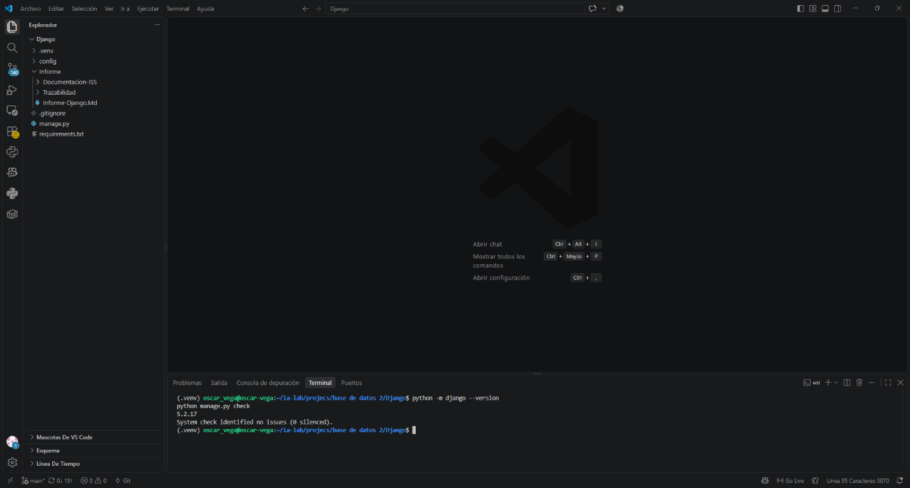

**Retroalimentación de la evidencia:** En la captura observé la versión `5.2.17` y el resultado `System check identified no issues (0 silenced)`. Esto confirma que Django reconoce el proyecto y que la comprobación del sistema no encontró problemas.

**Conclusión y aprendizaje:** Aprendí a verificar tanto la versión instalada como la configuración del proyecto con los comandos oficiales de Django. La comprobación sin errores deja validado el entorno inicial para continuar con el ISS-01.

## ISS-01 - Settings y selección del motor

### Paso 1 - Instalación de dependencias

Instalé las herramientas del sistema necesarias para compilar el controlador de MySQL y agregué al entorno virtual las dependencias de Django, dotenv y los cuatro motores de base de datos. Al final actualicé `requirements.txt` con `pip freeze`.

```bash
sudo apt update
sudo apt install build-essential pkg-config default-libmysqlclient-dev python3.12-dev

source .venv/bin/activate
python -m pip install "Django==5.2.17" "python-dotenv==1.2.3"
python -m pip install "mysqlclient==2.3.0"
python -m pip install "psycopg[binary]==3.3.6" "mssql-django==2.0.0" "oracledb==26.0.1"
python -m pip freeze > requirements.txt
```

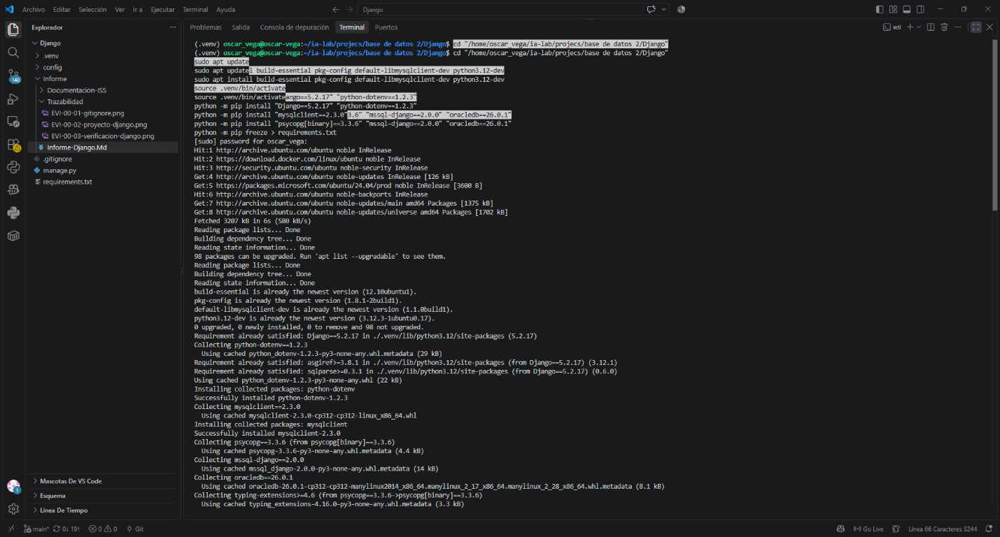

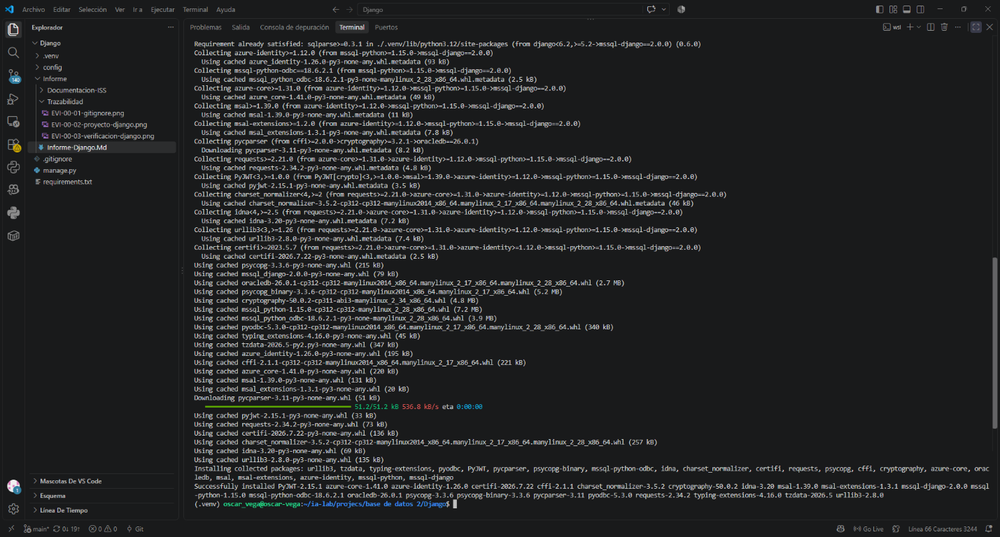

**Retroalimentación de las evidencias:** En la primera captura observé que `apt update` finalizó correctamente y que las herramientas de compilación y desarrollo requeridas ya estaban instaladas o actualizadas. En la segunda observé la instalación completada de las dependencias de Python y el regreso al prompt con el entorno `(.venv)` activo. El archivo `requirements.txt` registra Django 5.2.17, python-dotenv 1.2.3, mysqlclient 2.3.0, psycopg 3.3.6, mssql-django 2.0.0 y oracledb 26.0.1, además de sus dependencias.

**Conclusión y aprendizaje:** Aprendí que algunos controladores requieren herramientas del sistema además de paquetes de Python. También aprendí que actualizar `requirements.txt` después de instalar las dependencias deja constancia reproducible de las versiones incorporadas al entorno.

### Paso 2 - Creación del archivo `.env`

Creé `.env` en la raíz del proyecto con la configuración de Django y las variables de conexión para los motores indicados en el ISS-01. Seleccioné MySQL mediante `DB_DIALECT`. El archivo está excluido del control de versiones por `.gitignore`.

Por seguridad, en este informe no reproduzco las claves ni contraseñas. La siguiente estructura identifica las variables configuradas; los valores sensibles se reemplazan por marcadores:

```dotenv
DJANGO_SECRET_KEY=[REDACTADO]
DJANGO_DEBUG=True
DJANGO_ALLOWED_HOSTS=[VALORES_CONFIGURADOS]

DB_DIALECT=mysql
DB_MYSQL_HOST=[VALOR_CONFIGURADO]
DB_MYSQL_PORT=[VALOR_CONFIGURADO]
DB_MYSQL_USERNAME=[REDACTADO]
DB_MYSQL_PASSWORD=[REDACTADO]
DB_MYSQL_NAME=[VALOR_CONFIGURADO]

DB_POSTGRES_HOST=[VALOR_CONFIGURADO]
DB_POSTGRES_PORT=[VALOR_CONFIGURADO]
DB_POSTGRES_USERNAME=[REDACTADO]
DB_POSTGRES_PASSWORD=[REDACTADO]
DB_POSTGRES_NAME=[VALOR_CONFIGURADO]

DB_MSSQL_HOST=[VALOR_CONFIGURADO]
DB_MSSQL_PORT=[VALOR_CONFIGURADO]
DB_MSSQL_USERNAME=[REDACTADO]
DB_MSSQL_PASSWORD=[REDACTADO]
DB_MSSQL_NAME=[VALOR_CONFIGURADO]

DB_ORACLE_HOST=[VALOR_CONFIGURADO]
DB_ORACLE_PORT=[VALOR_CONFIGURADO]
DB_ORACLE_USERNAME=[REDACTADO]
DB_ORACLE_PASSWORD=[REDACTADO]
DB_ORACLE_CONNECT_STRING=[VALOR_CONFIGURADO]
```


**Retroalimentación de la evidencia:** En la captura observé el bloque de configuración en la terminal y el archivo `.env` en el Explorador de VS Code. La clave de Django y las contraseñas aparecen censuradas en esta copia de la imagen. Confirmé además que `.env` está incluido en las reglas de `.gitignore`, por lo que no se incorpora al commit.

**Conclusión y aprendizaje:** Aprendí que las variables de entorno permiten mantener la configuración fuera del código fuente y que los valores sensibles no deben publicarse en informes ni evidencias. Si alguna de las credenciales capturadas correspondiera a un servicio real, tendría que cambiarla, pues el original de la imagen la mostraba sin censura.

### Paso 3 - Configuración del motor de base de datos

Creé `config/database.py` para leer el selector `DB_DIALECT`, validar las variables requeridas para el motor seleccionado y producir únicamente la configuración `DATABASES["default"]`. La configuración admite MySQL, PostgreSQL, SQL Server y Oracle, según el contrato definido por el ISS-01.

```python
import os

from django.core.exceptions import ImproperlyConfigured


def _required(name: str) -> str:
    value = os.getenv(name)
    if value is None or not value.strip():
        raise ImproperlyConfigured(f"Falta la variable de entorno requerida: {name}")
    return value.strip()


dialect = _required("DB_DIALECT").lower()

if dialect == "mysql":
    database = {
        "ENGINE": "django.db.backends.mysql",
        "NAME": _required("DB_MYSQL_NAME"),
        "USER": _required("DB_MYSQL_USERNAME"),
        "PASSWORD": _required("DB_MYSQL_PASSWORD"),
        "HOST": _required("DB_MYSQL_HOST"),
        "PORT": _required("DB_MYSQL_PORT"),
    }
elif dialect == "postgres":
    database = {
        "ENGINE": "django.db.backends.postgresql",
        "NAME": _required("DB_POSTGRES_NAME"),
        "USER": _required("DB_POSTGRES_USERNAME"),
        "PASSWORD": _required("DB_POSTGRES_PASSWORD"),
        "HOST": _required("DB_POSTGRES_HOST"),
        "PORT": _required("DB_POSTGRES_PORT"),
    }
elif dialect == "mssql":
    database = {
        "ENGINE": "mssql",
        "NAME": _required("DB_MSSQL_NAME"),
        "USER": _required("DB_MSSQL_USERNAME"),
        "PASSWORD": _required("DB_MSSQL_PASSWORD"),
        "HOST": _required("DB_MSSQL_HOST"),
        "PORT": _required("DB_MSSQL_PORT"),
    }
elif dialect == "oracle":
    database = {
        "ENGINE": "django.db.backends.oracle",
        "NAME": _required("DB_ORACLE_CONNECT_STRING"),
        "USER": _required("DB_ORACLE_USERNAME"),
        "PASSWORD": _required("DB_ORACLE_PASSWORD"),
    }
else:
    raise ImproperlyConfigured(
        "DB_DIALECT debe ser mysql, postgres, mssql u oracle"
    )

DATABASES = {"default": database}
```


**Retroalimentación de la evidencia:** En la captura observé `database.py` dentro de `config/` y el comando utilizado para crearlo. Revisé el archivo guardado y confirmé que contiene la configuración de los cuatro dialectos, que falla explícitamente si falta una variable requerida y que solo expone el alias `default`. La captura no incluye valores del archivo `.env`.

**Conclusión y aprendizaje:** Aprendí a separar la selección del motor de la configuración general del proyecto. La validación de variables ayuda a identificar una configuración incompleta y evita crear conexiones para motores que no están seleccionados. La integración de este módulo con `settings.py` y la carga de `.env` se registra en el siguiente paso.

### Paso 4 - Integración de `.env` y configuración de Django

Actualicé `config/settings.py` para cargar las variables desde `.env` al iniciar Django. Configuré `SECRET_KEY`, `DEBUG` y `ALLOWED_HOSTS` mediante sus variables de entorno, y reemplacé la base SQLite generada inicialmente por `DATABASES` importado desde `config.database`.

```python
import os
from pathlib import Path

from dotenv import load_dotenv
from django.core.exceptions import ImproperlyConfigured

BASE_DIR = Path(__file__).resolve().parent.parent
load_dotenv(BASE_DIR / ".env")

secret_key = os.getenv("DJANGO_SECRET_KEY")
if not secret_key:
    raise ImproperlyConfigured("Falta la variable de entorno requerida: DJANGO_SECRET_KEY")

SECRET_KEY = secret_key
DEBUG = os.getenv("DJANGO_DEBUG", "False").strip().lower() in {"true", "1", "yes", "on"}
ALLOWED_HOSTS = [
    host.strip()
    for host in os.getenv("DJANGO_ALLOWED_HOSTS", "").split(",")
    if host.strip()
]

# En la sección Database de settings.py:
from config.database import DATABASES
```


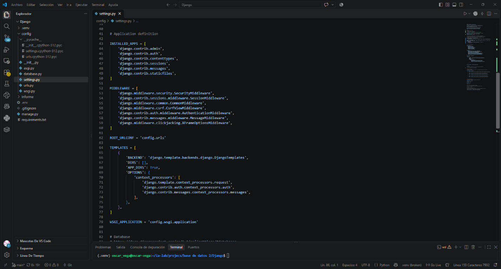

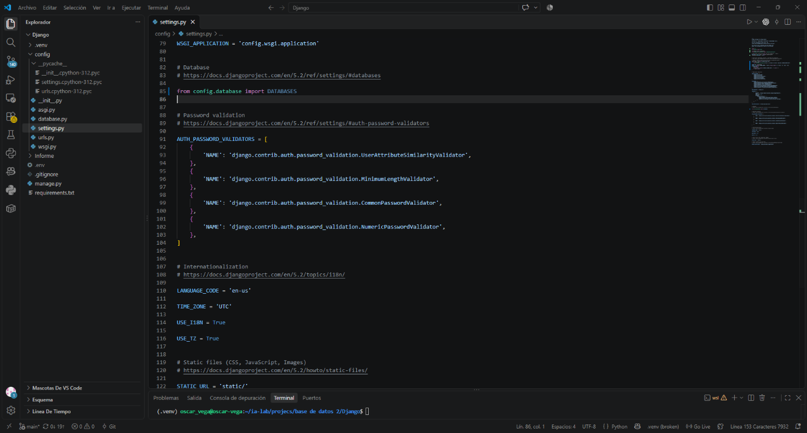

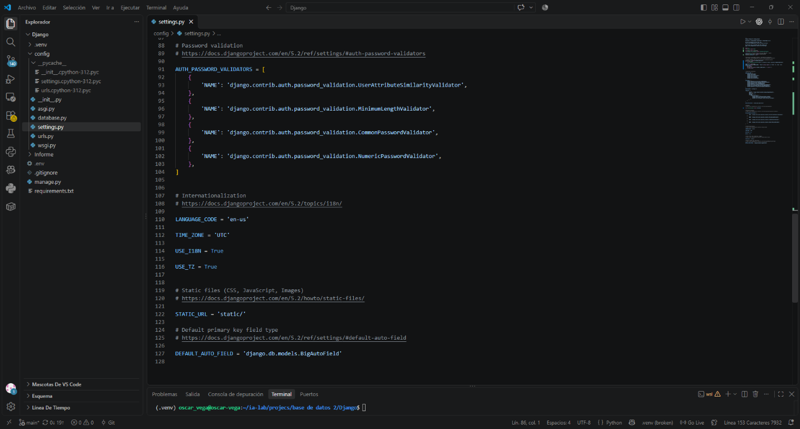

**Retroalimentación de las evidencias:** Revisé el archivo `settings.py` guardado y observé que `load_dotenv(BASE_DIR / ".env")` aparece antes de importar `DATABASES`; esto permite que `config.database` lea las variables al importarse. La clave se valida y genera un error explícito si falta, `DEBUG` se interpreta como booleano y `ALLOWED_HOSTS` se separa por comas. La importación de `DATABASES` reemplaza la configuración inicial SQLite. En las capturas no se muestra el contenido de `.env`.

**Conclusión y aprendizaje:** Aprendí que el orden de carga es importante: primero se leen las variables de entorno y después se importa el módulo que construye la conexión. También comprendí cómo evitar dejar la clave secreta directamente en `settings.py`. Esta revisión confirma el código guardado; la comprobación del sistema Django y el inicio del servidor se validarán en el siguiente paso.

### Paso 5 - Verificación de Django e inicio del servidor

Ejecuté la comprobación del sistema y luego inicié el servidor de desarrollo con los comandos indicados en el ISS-01.

```bash
python manage.py check
python manage.py runserver
```

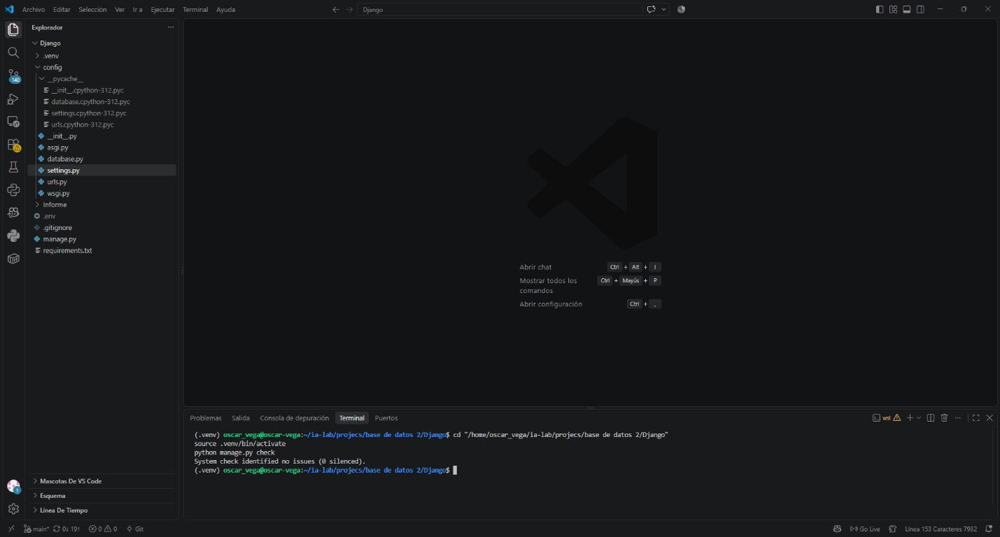

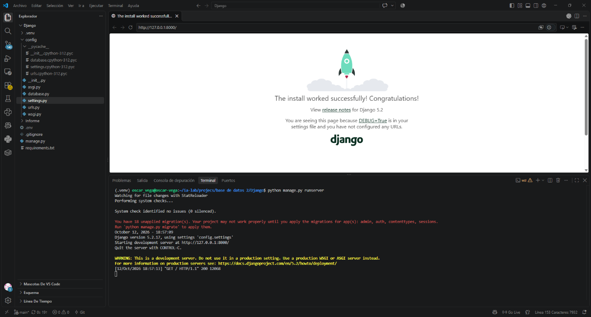

**Retroalimentación de las evidencias:** En la primera captura observé `System check identified no issues (0 silenced)`. En la segunda observé que Django inició en `http://127.0.0.1:8000/`, respondió con estado HTTP 200 y mostró la página de bienvenida. El servidor también informa que hay 18 migraciones pendientes de las aplicaciones integradas de Django.

**Conclusión y aprendizaje:** Aprendí que `check` valida los ajustes del proyecto y que `runserver` permite confirmar visualmente que la aplicación responde. El aviso de migraciones pendientes no impidió el inicio ni la respuesta de la página. No ejecutaré `python manage.py migrate` en este proyecto porque el esquema de PedalLibre se administra con scripts SQL y el ISS indica no alterar las tablas desde migraciones de Django. Antes de continuar, debo detener el servidor con Ctrl+C si sigue activo.

### Paso 6 - Verificación de las tablas existentes de PedalLibre

Verifiqué en DBeaver, mediante una consulta de solo lectura al catálogo `INFORMATION_SCHEMA.TABLES`, que las 21 tablas requeridas para PedalLibre existen en la base MySQL `Pedalibre-Terminal-Dbeaver`. La consulta comparó la lista de tablas de la referencia del proyecto con las tablas físicas y no modificó el esquema.

```sql
SELECT esperada.table_name AS tabla,
       CASE
           WHEN existente.TABLE_NAME IS NULL THEN 'FALTA'
           ELSE 'EXISTE'
       END AS estado
FROM (
    SELECT 'roles' AS table_name
    UNION ALL SELECT 'users'
    UNION ALL SELECT 'clients'
    UNION ALL SELECT 'stations'
    UNION ALL SELECT 'station_locations'
    UNION ALL SELECT 'station_schedules'
    UNION ALL SELECT 'docking_points'
    UNION ALL SELECT 'bicycles'
    UNION ALL SELECT 'bicycle_dockings'
    UNION ALL SELECT 'reservations'
    UNION ALL SELECT 'rates'
    UNION ALL SELECT 'rentals'
    UNION ALL SELECT 'rental_events'
    UNION ALL SELECT 'penalties'
    UNION ALL SELECT 'maintenance'
    UNION ALL SELECT 'payments'
    UNION ALL SELECT 'incidents'
    UNION ALL SELECT 'notifications'
    UNION ALL SELECT 'bicycle_history'
    UNION ALL SELECT 'reviews'
    UNION ALL SELECT 'invoices'
) AS esperada
LEFT JOIN INFORMATION_SCHEMA.TABLES AS existente
    ON existente.TABLE_SCHEMA = 'Pedalibre-Terminal-Dbeaver'
   AND existente.TABLE_NAME = esperada.table_name
   AND existente.TABLE_TYPE = 'BASE TABLE'
ORDER BY esperada.table_name;
```

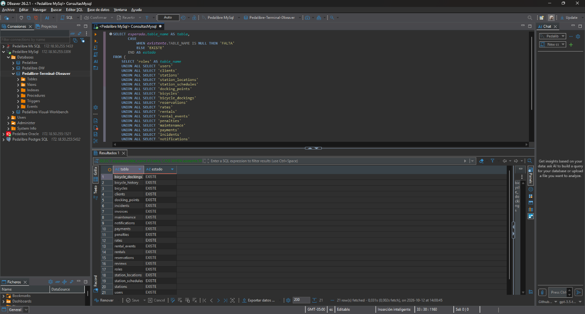

**Retroalimentación de la evidencia:** En el resultado de DBeaver observé 21 filas y cada una muestra `EXISTE`. Con ello confirmé el requisito de esquema previo al ISS-01 sin ejecutar scripts de borrado o creación.

**Conclusión y aprendizaje:** Aprendí a comprobar las tablas físicas desde `INFORMATION_SCHEMA` con una consulta que no altera la base. El requisito de las 21 tablas queda verificado para la conexión MySQL seleccionada.

**Estado del ISS-01:** Completé la instalación de dependencias, la configuración de `.env` y la selección del motor, la integración con los ajustes de Django, las verificaciones `check` y `runserver`, y confirmé que existen las 21 tablas requeridas.

## ISS-02 - Creación de la app de clientes

> La guía del ISS-02 menciona apps `product` y `sale`, pero la referencia de PedalLibre confirma que no existen productos ni ventas en este dominio. Por eso continúo solo con la app `client` y no creo apps ajenas al esquema PedalLibre.

### Paso 1 - Creación de `apps.client`

Creé el paquete `apps`, utilicé `startapp` para generar la app `client` dentro de `apps/client` y ajusté `ClientConfig` para usar el nombre de paquete y la etiqueta `client`.

```bash
mkdir -p apps/client
python manage.py startapp client apps/client
mkdir -p apps
touch apps/__init__.py
```

```python
class ClientConfig(AppConfig):
    default_auto_field = "django.db.models.BigAutoField"
    name = "apps.client"
    label = "client"
```


**Retroalimentación de las evidencias:** En la primera captura observé la ejecución de los comandos y los archivos que generó `startapp` dentro de `apps/client`. En la segunda observé que `ClientConfig` usa `name = "apps.client"` y `label = "client"`, como requiere la ubicación de la app.

**Conclusión y aprendizaje:** Aprendí que `startapp` genera la estructura inicial de la app y que su `AppConfig.name` debe reflejar el paquete Python completo. La app todavía debe agregarse a `INSTALLED_APPS` para que Django la registre; lo haré en el siguiente paso.

### Paso 2 - Registro de la app y comprobación del proyecto

Agregué la configuración de `client` al final de `INSTALLED_APPS` en `config/settings.py` y ejecuté la comprobación del sistema Django.

```python
INSTALLED_APPS = [
    # Aplicaciones Django integradas...
    "apps.client.apps.ClientConfig",
]
```

```bash
python manage.py check
```


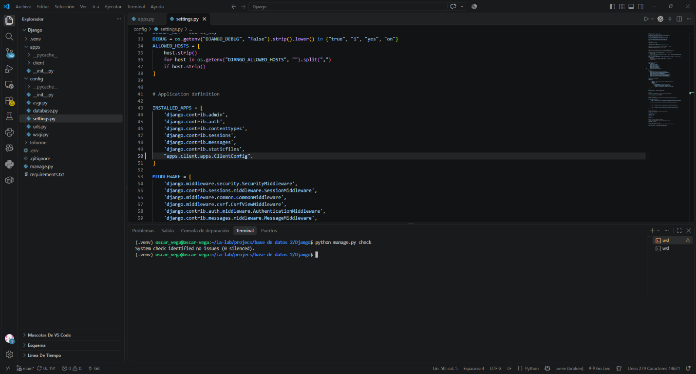

**Retroalimentación de las evidencias:** En la primera captura observé `apps.client.apps.ClientConfig` dentro de `INSTALLED_APPS`. En la segunda, el comando `python manage.py check` terminó con `System check identified no issues (0 silenced)`, sin errores de registro.

**Conclusión y aprendizaje:** Aprendí que crear una app no basta para que Django la cargue: también hay que registrarla en `INSTALLED_APPS`. La verificación confirma que Django reconoce `client`. Aún no he creado modelos de negocio.

**Estado del ISS-02:** La app de clientes fue creada con la CLI, está registrada y supera `check`. No creé `product` ni `sale` porque no pertenecen al esquema PedalLibre descrito en la referencia del proyecto.

## ISS-03 - Preparación de la app de seguridad

### Paso 1 - Creación de `apps.security`

Creé la app `security` con `startapp` dentro del paquete `apps` y configuré su `AppConfig` con el nombre completo `apps.security` y la etiqueta `security`.

```bash
mkdir -p apps/security
python manage.py startapp security apps/security
```

```python
class SecurityConfig(AppConfig):
    default_auto_field = "django.db.models.BigAutoField"
    name = "apps.security"
    label = "security"
```


**Retroalimentación de las evidencias:** En la primera captura observé los archivos generados dentro de `apps/security` y la ejecución de `startapp`. En la segunda confirmé el nombre completo del paquete y la etiqueta `security`. La app todavía no se ha registrado en `INSTALLED_APPS` y no se ha ejecutado ninguna migración.

**Conclusión y aprendizaje:** Aprendí que la app de seguridad debe tener un `AppConfig` acorde con su ubicación en el paquete `apps`. Antes de declarar el modelo de usuario debo compatibilizarlo con la tabla `users` existente, en lugar de copiar sin cambios el ejemplo genérico del ISS.

**Nota de revisión del ISS-03:** La tabla PedalLibre `users` tiene las columnas `user_id`, `role_id`, `username`, `password_hash`, `email`, `is_active` y `created_at`. El ejemplo `AbstractUser` del ISS incluye estructura y campos Django que no corresponden directamente a esa tabla. Por eso no lo registraré ni migraré de forma literal: primero adaptaré el mapeo y mantendré la tabla bajo administración del esquema SQL existente.
